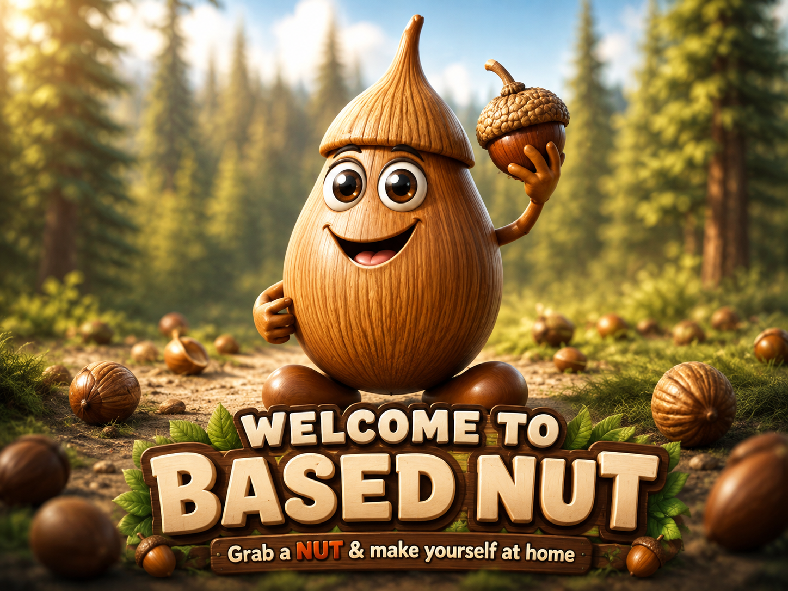
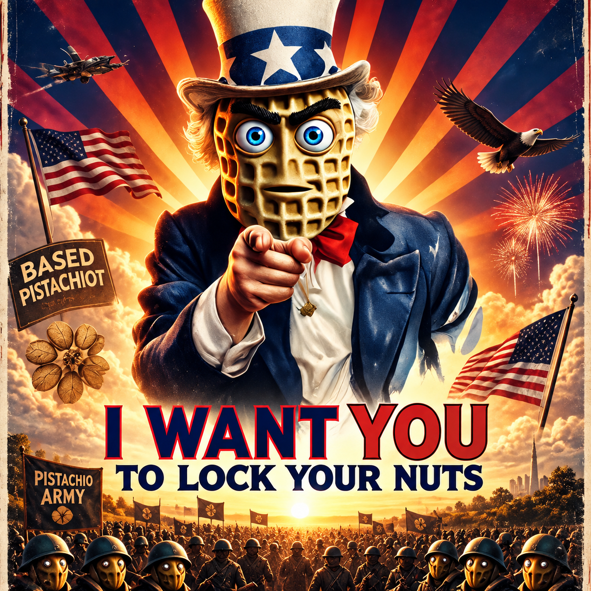

# 🌱 Overview


## **WARNING**

:warning: This product **may contain nuts** or traces of nuts, _including but not limited to acorns, peanuts, almonds, walnuts, and other tree nuts._


:no\_entry: If you have a nut allergy, even small amounts of nut residue could cause a severe allergic reaction.&#x20;


🚨 Please exercise caution and consult your healthcare provider if you are unsure about your allergies.


<figure><figcaption></figcaption></figure>

**BASED NUT** is an experimental MEME-Fi ecosystem on Base built from one deliberately simple starting point:

> **1 NUT. 18 decimals. Fixed supply. No tax.**

From that root token, the ecosystem branches outward into tokens, liquidity markets, bonding curves, NFTs, wrappers, agents, attestations, games, and real-world experiments.<br>

Each layer has its own purpose. Together they form an expanding network of assets, markets, infrastructure, and interactions built around one root: **NUT**.

> **Different systems. One NUT. 🌰**


## New Users!

If you are new here we recommend that you read the docs in order.

\
Use this page as an index and first understand the [whitepaper](based-nut/multilayered-ecosystem.md) to understand [NUT](based-nut/nut/), [wNUT](based-nut/wnut/), [SNUT](based-nut/snut/) and [pNUT](based-nut/pnut/).&#x20;

\
These are the main "N.U.T.s" and "[The Orchard](liquidity/the-orchard-framework.md)" is the emergent relationships between the liquid states of these assets.


You can also check out the [podcasts.md](based-nut/podcasts.md "mention") and [videos.md](based-nut/videos.md "mention") pages for engaging briefs and deep dives.


If you are new to crypto you can [start here](https://app.gitbook.com/o/o8fPCFDYTa5dVn36JfW5/s/NcRlJ5CrQzet3UTxhH1e/).


<figure><figcaption></figcaption></figure>


## Disclaimer

:chestnut: BASED NUT tokens are whimsical meme coins with _**no intrinsic value**_ and _**no expectation of financial gain**._


:weary: They exist for entertainment and experimentation. _**Please nut responsibly**_. :sweat\_drops:


:no\_pedestrians: Participation is voluntary and _**at your own risk**_.


## Overview of BASED NUT Token Layers

**Every token has a unique purpose.**

> Different tokens, one root. 🥜

NUT is the root of the ecosystem. Other token layers give NUT new ways to be used without changing the original token. wNUT adds a wrapped state, SNUT adds staking and rewards, and pNUT adds multi-asset liquidity.<br>

As these tokens and markets interact, they form **The Orchard**: the wider network of liquidity and relationships built around NUT.



## BASE NUTS TOKENS

Main Ecosystem Tokens.

<table data-view="cards"><thead><tr><th>Name</th><th>Address</th><th>Supply</th><th>Type</th><th>Minting</th><th>Tax</th><th>Role</th><th data-hidden data-type="files"></th><th data-hidden data-card-cover data-type="image">Cover image</th><th data-hidden data-card-target data-type="content-ref"></th></tr></thead><tbody><tr><td><strong>Based NUT (NUT)</strong></td><td><a href="https://basescan.org/token/0xb8de15fb529d98c93c749de63c749d48d25a30df">0xb8de15fb529d98c93c749de63c749d48d25a30df</a></td><td>1 NUT</td><td>ERC-20: Simple</td><td>No</td><td>No</td><td>Main Liquidity Root</td><td><a href=".gitbook/assets/logo (1).jpg">logo (1).jpg</a></td><td><a href=".gitbook/assets/logo (1).jpg">logo (1).jpg</a></td><td><a href="based-nut/nut/">nut</a></td></tr><tr><td><strong>Based Super NUT (SNUT)</strong></td><td><a href="https://basescan.org/token/0xac130701aa31c284c36609e2489f150f419ad7ad">0xac130701aa31c284c36609e2489f150f419ad7ad</a></td><td>100,000 SNUT</td><td>ERC-20: Baby Buyback Burn</td><td>No</td><td>Yes, Fee on Transfer</td><td>Non-Escrow Rewards</td><td><a href=".gitbook/assets/logo.jpg">logo.jpg</a></td><td><a href=".gitbook/assets/logo.jpg">logo.jpg</a></td><td><a href="based-nut/snut/">snut</a></td></tr><tr><td><strong>Based Peanuts (pNUT)</strong></td><td><a href="https://basescan.org/address/0x2a5757b60987ff10385de1d4d923792f6fdcfff1">0x2A5757b60987FF10385De1D4D923792f6fdCfFf1</a></td><td>∞ pNUT</td><td>ERC-20: Index LP</td><td>Yes</td><td>No</td><td>Forced Liquidity Arbitrage</td><td></td><td><a href=".gitbook/assets/DALL·E 2024-09-18 18.48.24 - A hyper-realistic 3D peanut logo designed for a peanut-based brand. The peanut is rendered with intricate details, lifelike textures, and natural colo.webp">DALL·E 2024-09-18 18.48.24 - A hyper-realistic 3D peanut logo designed for a peanut-based brand. The peanut is rendered with intricate details, lifelike textures, and natural colo.webp</a></td><td><a href="based-nut/pnut/">pnut</a></td></tr><tr><td>Wrapped NUT (wNUT)</td><td><a href="https://basescan.org/address/0xBA5ED46e31F80dafF307cbf60bd422a6f62E3dd3">0xBA5ED46e31F80dafF307cbf60bd422a6f62E3dd3</a></td><td>1:1 (NUT:wNUT)</td><td>ERC-20: Wrapped Token</td><td>Yes</td><td>No</td><td>Token Wrapper</td><td></td><td><a href=".gitbook/assets/4f688328-6ba2-4383-a0ff-8c1be1eaf4f5.png">4f688328-6ba2-4383-a0ff-8c1be1eaf4f5.png</a></td><td></td></tr></tbody></table>



## **NUT FACTIONS**

Mint NFTs by Locking NUT.

<table data-view="cards" data-full-width="false"><thead><tr><th>Name</th><th>Address</th><th>Supply</th><th>Bonding Type</th><th data-type="files"></th><th data-type="content-ref"></th><th data-hidden data-card-cover data-type="files"></th><th data-hidden data-card-target data-type="content-ref"></th></tr></thead><tbody><tr><td><strong>Almond War Generals</strong></td><td>0x1A160456005AED47994E1c13C9bc31F274413927</td><td>1,000</td><td>Exponential</td><td></td><td></td><td><a href=".gitbook/assets/rotatedalmond.png">rotatedalmond.png</a></td><td><a href="based-nut/nested-tokens/nut-army/">nut-army</a></td></tr><tr><td><strong>Peanut War Generals</strong></td><td>0x794fcD89357C1CcF04a1a9A441ad4dB2Cd5EE387</td><td>1,000</td><td>Linear</td><td></td><td></td><td><a href=".gitbook/assets/DALL·E 2024-10-17 11.29.30 - A powerful, victorious, energetic, hyperactive nutcase leading a nut army in a Pixar 3D style. The Nut General is a peanut character, dressed in milit.webp">DALL·E 2024-10-17 11.29.30 - A powerful, victorious, energetic, hyperactive nutcase leading a nut army in a Pixar 3D style. The Nut General is a peanut character, dressed in milit.webp</a></td><td><a href="based-nut/nested-tokens/nut-army/">nut-army</a></td></tr><tr><td><strong>Almond Soldiers</strong></td><td>0x1E0f80529593185C021043ffcbfDcB8f4279C649</td><td>1,000,000</td><td>Exponential</td><td></td><td></td><td><a href=".gitbook/assets/rotatedsoldieralmond.png">rotatedsoldieralmond.png</a></td><td><a href="based-nut/nested-tokens/nut-army/">nut-army</a></td></tr><tr><td><strong>Peanut Soldiers</strong></td><td>0xF075300b8C2EF500d8Ce4f783F910C500B9A3512</td><td>1,000,000</td><td>Linear</td><td></td><td></td><td><a href=".gitbook/assets/pnutarmy.png">pnutarmy.png</a></td><td><a href="based-nut/nested-tokens/nut-army/">nut-army</a></td></tr></tbody></table>



## NESTED TOKENS

Mint Tokens by Locking NUT.

<table data-view="cards" data-full-width="true"><thead><tr><th>Name</th><th>Address</th><th>Max Supply</th><th>Bonding Curve Type</th><th>Buy Tax</th><th>Sell Tax</th><th>Function</th><th data-hidden data-card-cover data-type="image">Cover image</th><th data-hidden data-card-target data-type="content-ref"></th></tr></thead><tbody><tr><td>SALT</td><td><a href="https://basescan.org/token/0x1EDe2AFC985F6D7aEb3F4c84B95A103c00D5dE81">0x1EDe2AFC985F6D7aEb3F4c84B95A103c00D5dE81</a></td><td>1,000,000,000</td><td>Flat</td><td>1% </td><td>1%</td><td>NUT/USDC Arbitrage</td><td><a href=".gitbook/assets/DALL·E 2025-03-22 19.38.35 - A hyper-realistic 3D close-up of salt crystals scattered on a rustic wooden table. The image features ultra-detailed textures and a macro shot style, .webp">DALL·E 2025-03-22 19.38.35 - A hyper-realistic 3D close-up of salt crystals scattered on a rustic wooden table. The image features ultra-detailed textures and a macro shot style, .webp</a></td><td><a href="based-nut/nested-tokens/salt.md">salt.md</a></td></tr><tr><td>NUTINO</td><td><a href="https://basescan.org/token/0x30421e2d18dFF60B298eEF427cF868cA65f1476B">0x30421e2d18dFF60B298eEF427cF868cA65f1476B</a></td><td>21,000,000</td><td>Exponential</td><td>1%</td><td>1%</td><td>NUT/cbBTC Arbitrage</td><td><a href=".gitbook/assets/logo (1).webp">logo (1).webp</a></td><td><a href="based-nut/nested-tokens/nutino.md">nutino.md</a></td></tr></tbody></table>



## AI AGENT SYSTEM

Mint Tokens by Locking Virtuals

<table data-view="cards" data-full-width="true"><thead><tr><th>Name</th><th>Address</th><th>Max Supply</th><th>Function</th><th>Virtuals Profile</th><th>Pipshell Agent</th><th data-hidden data-card-cover data-type="image">Cover image</th><th data-hidden data-card-target data-type="content-ref"></th></tr></thead><tbody><tr><td>PIPS</td><td><a href="https://basescan.org/token/0x3f2327221dd4f0bae660172606d6b288a1cf8ad9">0x3f2327221dd4f0bae660172606d6b288a1cf8ad9</a></td><td>1,000,000,000</td><td>AI Agent System</td><td><a href="https://app.virtuals.io/virtuals/127403">https://app.virtuals.io/virtuals/127403</a></td><td><a href="https://app.virtuals.io/virtuals/127403/agent">https://app.virtuals.io/virtuals/127403/agent</a></td><td><a href=".gitbook/assets/1af1f6f3-3b31-418c-87e7-a1b28c576d95.png">1af1f6f3-3b31-418c-87e7-a1b28c576d95.png</a></td><td></td></tr></tbody></table>



## SUNFLOWER GROVE

Triple-token pools composed of NUT at 20% weights and other two assets at 40% forming a twin graft sunflower liquidity graph of interconnected assets.

<table data-view="cards"><thead><tr><th>Name</th><th>Token</th><th>Pairs</th><th>Address</th><th align="center"></th><th align="center"></th><th align="center"></th><th align="center"></th><th align="center"></th><th data-hidden data-card-cover data-type="image">Cover image</th></tr></thead><tbody><tr><td>Inference Twin Graft BPT</td><td><h3>🌻🧠 gtINF</h3></td><td>wNUT/VVV/DIEM</td><td>0x</td><td align="center"><a href="technical/token-catalog/gtinf-or-token-profile.md">View details for token gtINF</a></td><td align="center"><a href="technical/token-catalog/gtinf-or-token-profile.md">DETAILS</a></td><td align="center"><a href="https://basescan.org/token/0x6a0a1B7428d543524592eD22023A09BdE05aA466">🔄 Trade</a></td><td align="center"><a href="https://basescan.org/token/0x6a0a1B7428d543524592eD22023A09BdE05aA466">💧 Liquidity</a></td><td align="center"><a href="https://basescan.org/token/0x6a0a1B7428d543524592eD22023A09BdE05aA466">🔍 Explorer</a></td><td><a href=".gitbook/assets/05235f91-3a03-42e4-9f6b-a4d8a483be3e.png">05235f91-3a03-42e4-9f6b-a4d8a483be3e.png</a></td></tr><tr><td>Agent Twin Graft BPT</td><td><h3>🌻🤖 gtAGT</h3></td><td>wNUT/MOR/VIRTUALS</td><td>0x</td><td align="center"><a href="technical/token-catalog/gtagt-or-token-profile.md">View details for token gtAGT</a></td><td align="center"> <a href="technical/token-catalog/gtagt-or-token-profile.md">DETAILS</a></td><td align="center"><a href="https://basescan.org/token/0x5dA95cC31C840Fd33180e4C7f879e3F3d8Eca200">🔄 Trade</a></td><td align="center"><a href="https://basescan.org/token/0x5dA95cC31C840Fd33180e4C7f879e3F3d8Eca200">💧 Liquidity</a></td><td align="center"> <a href="https://basescan.org/token/0x5dA95cC31C840Fd33180e4C7f879e3F3d8Eca200">🔍 Explorer</a></td><td><a href=".gitbook/assets/046429cf-f310-444e-a686-bea7f785da61.png">046429cf-f310-444e-a686-bea7f785da61.png</a></td></tr><tr><td>Ether Twin Graft BPT</td><td><h3>🌻💧 gtETH</h3></td><td>wNUT/cbETH/wstETH</td><td>0x</td><td align="center"><a href="/broken/pages/864a4b930a7df11ff356ff54bbc7cabe4f56f2bd">View details for token gtETH</a></td><td align="center"> <a href="/broken/pages/864a4b930a7df11ff356ff54bbc7cabe4f56f2bd">DETAILS</a></td><td align="center"><a href="https://basescan.org/token/0xd156d51219B3a7A590670d655E8740Ad404e8835">🔄 Trade</a></td><td align="center"><a href="https://basescan.org/token/0xd156d51219B3a7A590670d655E8740Ad404e8835">💧 Liquidity</a></td><td align="center"><a href="https://basescan.org/token/0xd156d51219B3a7A590670d655E8740Ad404e8835">🔄 Trade</a> · <a href="https://basescan.org/token/0xd156d51219B3a7A590670d655E8740Ad404e8835">🔍 Explorer</a></td><td><a href=".gitbook/assets/adf3c5e6-8e83-4b29-b66f-215527f4c5d6.png">adf3c5e6-8e83-4b29-b66f-215527f4c5d6.png</a></td></tr><tr><td>Bitcoin Twin Graft BPT</td><td><h3>🌻<span data-gb-custom-inline data-tag="emoji" data-code="1fa99">🪙</span> gtBTC</h3></td><td>wNUT/cbBTC/tBTC</td><td>0x</td><td align="center"><a href="technical/token-catalog/gtbtc-or-token-profile.md">View details for token gtBTC</a></td><td align="center"><a href="technical/token-catalog/gtbtc-or-token-profile.md">DETAILS</a></td><td align="center"><a href="https://basescan.org/token/0xb2a63935e1391Ee49E5cfB6cc4f184C285fE29b4">🔄 Trade</a></td><td align="center"><a href="https://basescan.org/token/0xb2a63935e1391Ee49E5cfB6cc4f184C285fE29b4">💧 Liquidity</a></td><td align="center"><a href="https://basescan.org/token/0xb2a63935e1391Ee49E5cfB6cc4f184C285fE29b4">🔍 Explorer</a></td><td><a href=".gitbook/assets/8e61a608-2370-494f-b404-7505b7127112.png">8e61a608-2370-494f-b404-7505b7127112.png</a></td></tr><tr><td>Forex Twin Graft BPT</td><td><h3>🌻💰 gtFX</h3></td><td>wNUT/USDC/EUR</td><td>0x</td><td align="center"><a href="technical/token-catalog/gtfx-or-token-profile.md">View details for token gtFX</a></td><td align="center"><a href="technical/token-catalog/gtfx-or-token-profile.md">DETAILS</a></td><td align="center"><a href="https://basescan.org/token/0x1cCB8c61b62b9c7a9d4e66C9c824C1539B8b1f2E">🔄 Trade</a></td><td align="center"><a href="https://basescan.org/token/0x1cCB8c61b62b9c7a9d4e66C9c824C1539B8b1f2E">💧 Liquidity</a></td><td align="center"><a href="https://basescan.org/token/0x1cCB8c61b62b9c7a9d4e66C9c824C1539B8b1f2E">🔍 Explorer</a></td><td><a href=".gitbook/assets/0ee99c8b-6c01-43e6-a587-9cf565cd4e46.png">0ee99c8b-6c01-43e6-a587-9cf565cd4e46.png</a></td></tr><tr><td>Silicon Twin Graft BPT</td><td><h3>🌻💽 gtSIL</h3></td><td>wNUT/AAPLc/NVIDIAc</td><td>0x</td><td align="center"><a href="technical/token-catalog/gtsil-or-token-profile.md">View details for token gtSIL</a></td><td align="center"><a href="technical/token-catalog/gtsil-or-token-profile.md">DETAILS</a></td><td align="center"><a href="https://basescan.org/token/0xA669275f92e49aff80aBA7AaD86E5AFDDe3540B0">🔄 Trade</a></td><td align="center"><a href="https://basescan.org/token/0xA669275f92e49aff80aBA7AaD86E5AFDDe3540B0">💧 Liquidity</a></td><td align="center"><a href="https://basescan.org/token/0xA669275f92e49aff80aBA7AaD86E5AFDDe3540B0">🔍 Explorer</a></td><td><a href=".gitbook/assets/4dbf8ac1-e38c-45cd-8c40-589f2aa4f2ec.png">4dbf8ac1-e38c-45cd-8c40-589f2aa4f2ec.png</a></td></tr></tbody></table>



## 🚜 BASED NUT WHORLS

4-token pools composed of NUT and other three assets at forming a whorl liquidity graph of interconnected assets.

<table data-view="cards"><thead><tr><th>Name</th><th>Token</th><th>Pairs</th><th>Address</th><th align="center"></th><th data-hidden data-card-cover data-type="image">Cover image</th></tr></thead><tbody><tr><td>Based Peanut Whorl</td><td><h3>pNUT 🥜</h3></td><td>wNUT/SNUT/cbBTC/cbETH</td><td><a href="https://basescan.org/address/0x252b1e49d1d1e42657d028703e8c37fe5b5cacf5">0x252b1E49D1d1E42657d028703e8c37fe5B5cACF5</a></td><td align="center"><a href="https://balancer.fi/pools/base/v3/0x252b1e49d1d1e42657d028703e8c37fe5b5cacf5">BALANCER</a></td><td><a href=".gitbook/assets/DALL·E 2024-09-18 18.48.24 - A hyper-realistic 3D peanut logo designed for a peanut-based brand. The peanut is rendered with intricate details, lifelike textures, and natural colo (1).webp">DALL·E 2024-09-18 18.48.24 - A hyper-realistic 3D peanut logo designed for a peanut-based brand. The peanut is rendered with intricate details, lifelike textures, and natural colo (1).webp</a></td></tr><tr><td>Based Nested Whorl</td><td><h3>nNUT 🪺</h3></td><td>wNUT/NUTINO/SALT/PIPS</td><td><a href="https://basescan.org/address/0x3bfd1e8d43c554b3be57845791ae6657bbb7f49f">0x3bfd1e8d43c554b3be57845791ae6657bbb7f49f</a></td><td align="center"><a href="https://balancer.fi/pools/base/v3/0x3bfd1e8d43c554b3be57845791ae6657bbb7f49f">BALANCER</a></td><td></td></tr><tr><td>Based Meta Whorl</td><td><h3>mNUT 🧩</h3></td><td>wNUT/3x-BTC/ETH-LPs</td><td><a href="https://basescan.org/address/0x75b1b8bed681b1c288e17498157afd9925839ea8">0x75B1B8bEd681B1C288E17498157aFD9925839EA8</a></td><td align="center"><a href="https://balancer.fi/pools/base/v3/0x75b1b8bed681b1c288e17498157afd9925839ea8">BALANCER</a></td><td></td></tr></tbody></table>



## THE ORCHARD METADEX

The Orchard is the **MetaDEX framework** of the BASED NUT ecosystem: a compositional market architecture connecting its tokens, liquidity markets, bonding curves, wrappers, NFTs, agents, and other systems around NUT.

It is not any single market or protocol. **The Orchard is what emerges from their interactions**—the interconnected structure of liquidity, markets, assets, and execution paths produced as these systems relate to one another.<br>

In simple terms: **the token assets are the parts; the Orchard is the system that emerges fm the relationships between them.**

<p align="center"><a href="https://orchard.basednut.com/" class="button primary" data-icon="tree-deciduous">VISIT THE ORCHARD</a></p>

<table data-view="cards"><thead><tr><th align="center"></th><th data-hidden data-card-cover data-type="image">Cover image</th><th data-hidden data-card-target data-type="content-ref"></th></tr></thead><tbody><tr><td align="center">LEARN ABOUT THE ORCHARD</td><td><a href=".gitbook/assets/image (12).png">image (12).png</a></td><td><a href="liquidity/the-orchard-framework.md">the-orchard-framework.md</a></td></tr><tr><td align="center">LEARN ABOUT GROVES</td><td><a href=".gitbook/assets/image (44).png">image (44).png</a></td><td><a href="liquidity/groves/">groves</a></td></tr></tbody></table>

***

### 🧭 Learn about the ecosystem in your own way

> Different maps, one territory. 🥜



#### &#x20;🌾 Yield Farmers — rewards and index exposure

<table data-view="cards"><thead><tr><th>Page</th><th>What you get</th><th data-hidden data-card-cover data-type="image">Cover image</th><th data-hidden data-card-target data-type="content-ref"></th></tr></thead><tbody><tr><td><a data-mention href="based-nut/snut/">snut</a></td><td>The burn flywheel — 1% tax, buyback burns, non-escrow rewards</td><td><a href=".gitbook/assets/0xac130701aa31c284c36609e2489f150f419ad7ad.png">0xac130701aa31c284c36609e2489f150f419ad7ad.png</a></td><td><a href="based-nut/snut/">snut</a></td></tr><tr><td><a data-mention href="based-nut/pnut/">pnut</a></td><td>The Balancer index basket — cbETH, cbBTC, NUT, SNUT in one token</td><td><a href=".gitbook/assets/DALL·E 2024-09-18 18.48.24 - A hyper-realistic 3D peanut logo designed for a peanut-based brand. The peanut is rendered with intricate details, lifelike textures, and natural colo (1).webp">DALL·E 2024-09-18 18.48.24 - A hyper-realistic 3D peanut logo designed for a peanut-based brand. The peanut is rendered with intricate details, lifelike textures, and natural colo (1).webp</a></td><td><a href="based-nut/pnut/">pnut</a></td></tr><tr><td><a data-mention href="ecosystem/staking-and-rewards.md">staking-and-rewards.md</a></td><td>Mint Club vaults + SALT airdrop history</td><td><a href=".gitbook/assets/9ee5e498-924f-42ab-bc2a-20f6e97d99c5.png">9ee5e498-924f-42ab-bc2a-20f6e97d99c5.png</a></td><td><a href="ecosystem/staking-and-rewards.md">staking-and-rewards.md</a></td></tr><tr><td><a data-mention href="based-nut/nut/attonut.md">attonut.md</a></td><td>The resolution underneath — 1 NUT = 1 quintillion units</td><td><a href=".gitbook/assets/eaffe3fb-0188-49b8-824a-89dd4b198128.png">eaffe3fb-0188-49b8-824a-89dd4b198128.png</a></td><td><a href="based-nut/nut/attonut.md">attonut.md</a></td></tr><tr><td><a data-mention href="liquidity/the-orchard-framework.md">the-orchard-framework.md</a></td><td></td><td><a href=".gitbook/assets/image (12).png">image (12).png</a></td><td></td></tr><tr><td><a data-mention href="liquidity/groves/">groves</a></td><td></td><td><a href=".gitbook/assets/image (44).png">image (44).png</a></td><td></td></tr><tr><td><a data-mention href="liquidity/groves/sunflower-grove.md">sunflower-grove.md</a></td><td></td><td><a href=".gitbook/assets/96324e3e-29d8-454d-ba37-7351c5693691.png">96324e3e-29d8-454d-ba37-7351c5693691.png</a></td><td><a href="liquidity/groves/sunflower-grove.md">sunflower-grove.md</a></td></tr><tr><td><a data-mention href="technical/liquidity-catalog/">liquidity-catalog</a></td><td></td><td><a href=".gitbook/assets/deb4f99d-797b-47e2-9450-5f87b52e854b.png">deb4f99d-797b-47e2-9450-5f87b52e854b.png</a></td><td></td></tr><tr><td><a data-mention href="technical/token-catalog/">token-catalog</a></td><td></td><td><a href=".gitbook/assets/3807a868-36dd-4261-9ba3-5a40a2848a1e.png">3807a868-36dd-4261-9ba3-5a40a2848a1e.png</a></td><td></td></tr></tbody></table>



#### 📉 Arbitrage Traders — divergence is the product

Independent markets create price differences. The Orchard connects them without collapsing them into a single market.

<table data-view="cards"><thead><tr><th>Page</th><th>What you get</th><th data-hidden data-card-cover data-type="image">Cover image</th></tr></thead><tbody><tr><td><a data-mention href="liquidity/the-orchard-framework.md">the-orchard-framework.md</a></td><td>Why independent markets diverge — arbitrage is the coupling</td><td><a href=".gitbook/assets/image (44).png">image (44).png</a></td></tr><tr><td><a data-mention href="liquidity/arb-bot-builder/">arb-bot-builder</a></td><td>All 9 loops with honest verdicts</td><td><a href=".gitbook/assets/3d61dff1-402d-48cf-b9ed-91d436658d98.png">3d61dff1-402d-48cf-b9ed-91d436658d98.png</a></td></tr><tr><td><a data-mention href="liquidity/arb-bot-builder/nested-arbitrage-dynamics.md">nested-arbitrage-dynamics.md</a></td><td>Curve ↔ DEX loop theory</td><td><a href=".gitbook/assets/3a730fd8-ad22-49b1-8a1e-315d2ab29e16.png">3a730fd8-ad22-49b1-8a1e-315d2ab29e16.png</a></td></tr><tr><td><a data-mention href="technical/token-catalog/">token-catalog</a></td><td>Addresses, routes, APIs — machine-readable</td><td><a href=".gitbook/assets/3807a868-36dd-4261-9ba3-5a40a2848a1e.png">3807a868-36dd-4261-9ba3-5a40a2848a1e.png</a></td></tr><tr><td><a data-mention href="technical/liquidity-catalog/">liquidity-catalog</a></td><td></td><td><a href=".gitbook/assets/deb4f99d-797b-47e2-9450-5f87b52e854b.png">deb4f99d-797b-47e2-9450-5f87b52e854b.png</a></td></tr></tbody></table>





## ☢️ NUT WARZONE - JOIN THE NUT WAR&#x20;

> Lock your NUTs to Mint and participate in the NUT WAR

<figure><figcaption></figcaption></figure>

<table data-view="cards" data-full-width="true"><thead><tr><th align="center"></th><th data-hidden data-card-cover data-type="image">Cover image</th><th data-hidden data-card-target data-type="content-ref"></th></tr></thead><tbody><tr><td align="center"><strong>JOIN AS A PEANUT</strong></td><td><a href=".gitbook/assets/DALL·E 2024-10-17 11.32.31 - A powerful, victorious, energetic, hyperactive nutcase leading a nut army in a Pixar 3D style. The Nut General is a peanut character, dressed in milit.webp">DALL·E 2024-10-17 11.32.31 - A powerful, victorious, energetic, hyperactive nutcase leading a nut army in a Pixar 3D style. The Nut General is a peanut character, dressed in milit.webp</a></td><td><a href="based-nut/nested-tokens/nut-army/">nut-army</a></td></tr><tr><td align="center"><strong>JOIN AS AN ALMOND</strong></td><td><a href=".gitbook/assets/DALL·E 2024-10-17 19.00.03 - A powerful and heroic almond general leading a nut army in a Pixar 3D style. The almond general is dressed in rugged, battle-worn armor adorned with w (1).webp">DALL·E 2024-10-17 19.00.03 - A powerful and heroic almond general leading a nut army in a Pixar 3D style. The almond general is dressed in rugged, battle-worn armor adorned with w (1).webp</a></td><td><a href="based-nut/nested-tokens/nut-army/">nut-army</a></td></tr><tr><td align="center"><strong>JOIN AS A NUTCRACKER</strong></td><td><a href=".gitbook/assets/DALL·E 2025-01-25 20.33.16 - A stunning, 3D animated-style cinematic depiction of the Nut War set in a dense, battle-torn nut orchard forest. The scene is alive with Nutcracker so.webp">DALL·E 2025-01-25 20.33.16 - A stunning, 3D animated-style cinematic depiction of the Nut War set in a dense, battle-torn nut orchard forest. The scene is alive with Nutcracker so.webp</a></td><td></td></tr></tbody></table>

### Learn more

<table data-view="cards"><thead><tr><th>Page</th><th>What you get</th><th data-hidden data-card-cover data-type="image">Cover image</th></tr></thead><tbody><tr><td><a data-mention href="based-nut/nested-tokens/nut-army/">nut-army</a></td><td>The armies — factions and ranks</td><td><a href=".gitbook/assets/54b5f597-b87f-4877-9c21-b39dbb9897a9.png">54b5f597-b87f-4877-9c21-b39dbb9897a9.png</a></td></tr><tr><td><a data-mention href="based-nut/nested-tokens/nut-army/the-great-nut-war-lore.md">the-great-nut-war-lore.md</a></td><td>Enlistment — mint to join, burn to leave</td><td><a href=".gitbook/assets/f50c81c0-69ed-45bf-bf16-9133808ca85a.png">f50c81c0-69ed-45bf-bf16-9133808ca85a.png</a></td></tr><tr><td><a data-mention href="ecosystem/staking-and-rewards.md">staking-and-rewards.md</a></td><td>Mint Club vaults — NFT airdrop history</td><td><a href=".gitbook/assets/9ee5e498-924f-42ab-bc2a-20f6e97d99c5.png">9ee5e498-924f-42ab-bc2a-20f6e97d99c5.png</a></td></tr></tbody></table>



## NUT Credit

Experiments in NUT credit Morpho Vault Designs


<table data-view="cards"><thead><tr><th></th><th></th><th></th><th data-hidden data-card-target data-type="content-ref"></th><th data-hidden data-card-cover data-type="image">Cover image</th></tr></thead><tbody><tr><td><a data-mention href="based-nut/nutusd.md">nutusd.md</a></td><td></td><td></td><td><a href="based-nut/nutusd.md">nutusd.md</a></td><td><a href=".gitbook/assets/b9a7e5d1-3033-4176-b5cd-d3cfc0c5ae4c.png">b9a7e5d1-3033-4176-b5cd-d3cfc0c5ae4c.png</a></td></tr><tr><td><a data-mention href="ecosystem/rwas/nut-credit/">nut-credit</a></td><td></td><td></td><td><a href="ecosystem/rwas/nut-credit/">nut-credit</a></td><td><a href=".gitbook/assets/085bb52c-60d5-4ec8-b4cc-5aa57d457a57.png">085bb52c-60d5-4ec8-b4cc-5aa57d457a57.png</a></td></tr><tr><td><a data-mention href="ecosystem/attestations/">attestations</a></td><td></td><td></td><td><a href="ecosystem/attestations/">attestations</a></td><td><a href=".gitbook/assets/7ec6eb0b-560f-4249-8e7c-de189c927355.png">7ec6eb0b-560f-4249-8e7c-de189c927355.png</a></td></tr><tr><td><a data-mention href="ecosystem/rwas/nut-credit/agricultural-credit.md">agricultural-credit.md</a></td><td></td><td></td><td></td><td><a href=".gitbook/assets/3fde5f17-dccf-4e20-8e30-93f4cc6d73e1.png">3fde5f17-dccf-4e20-8e30-93f4cc6d73e1.png</a></td></tr><tr><td><a data-mention href="ecosystem/rwas/nut-credit/carbon-credits.md">carbon-credits.md</a></td><td></td><td></td><td></td><td><a href=".gitbook/assets/392f2a7f-c367-40d0-b562-587124705bd8.png">392f2a7f-c367-40d0-b562-587124705bd8.png</a></td></tr></tbody></table>



## Federated Social Media

Control your entire distribution from your server, identity, and rules. Connect with other nodes with different identities, rules and in different servers.

<table data-view="cards"><thead><tr><th>Page</th><th data-hidden data-card-cover data-type="image">Cover image</th><th data-hidden data-card-target data-type="content-ref"></th></tr></thead><tbody><tr><td><a data-mention href="ecosystem/mycelium-and-taproot/">mycelium-and-taproot</a></td><td><a href=".gitbook/assets/bf649069-9646-44ba-a943-f9143a41e085.png">bf649069-9646-44ba-a943-f9143a41e085.png</a></td><td><a href="ecosystem/mycelium-and-taproot/">mycelium-and-taproot</a></td></tr><tr><td><a data-mention href="ecosystem/mycelium-and-taproot/taproot-identity.md">taproot-identity.md</a></td><td><a href=".gitbook/assets/3934cd93-a5fe-4421-806b-293923f97f63.png">3934cd93-a5fe-4421-806b-293923f97f63.png</a></td><td><a href="ecosystem/mycelium-and-taproot/taproot-identity.md">taproot-identity.md</a></td></tr><tr><td><a data-mention href="ecosystem/attestations/economic-nonces.md">economic-nonces.md</a></td><td><a href=".gitbook/assets/2f4565f2-753c-4f8b-b46c-558d6c84d395.png">2f4565f2-753c-4f8b-b46c-558d6c84d395.png</a></td><td><a href="ecosystem/attestations/economic-nonces.md">economic-nonces.md</a></td></tr><tr><td><a data-mention href="ecosystem/attestations/market-attestations.md">market-attestations.md</a></td><td><a href=".gitbook/assets/ee1e47e3-dd7e-4048-a769-bc653f26aa4e.png">ee1e47e3-dd7e-4048-a769-bc653f26aa4e.png</a></td><td><a href="ecosystem/attestations/market-attestations.md">market-attestations.md</a></td></tr></tbody></table>



## 🤓 Smart Agents

Learn about our Agents


<table data-view="cards"><thead><tr><th></th><th data-hidden data-card-cover data-type="image">Cover image</th><th data-hidden data-card-target data-type="content-ref"></th></tr></thead><tbody><tr><td><a data-mention href="ecosystem/ai-agents.md">ai-agents.md</a></td><td><a href=".gitbook/assets/fe16577d-35c9-4a32-9a2f-d883d3904696.png">fe16577d-35c9-4a32-9a2f-d883d3904696.png</a></td><td><a href="ecosystem/ai-agents.md">ai-agents.md</a></td></tr><tr><td><a data-mention href="based-nut/pips.md">pips.md</a></td><td><a href=".gitbook/assets/pips-logo.png">pips-logo.png</a></td><td></td></tr><tr><td><a data-mention href="ecosystem/mycelium-and-taproot/">mycelium-and-taproot</a></td><td><a href=".gitbook/assets/bf649069-9646-44ba-a943-f9143a41e085.png">bf649069-9646-44ba-a943-f9143a41e085.png</a></td><td></td></tr><tr><td><a data-mention href="ecosystem/attestations/market-attestations.md">market-attestations.md</a></td><td><a href=".gitbook/assets/ee1e47e3-dd7e-4048-a769-bc653f26aa4e.png">ee1e47e3-dd7e-4048-a769-bc653f26aa4e.png</a></td><td></td></tr></tbody></table>



## 🌎 Real-World Assets

Research connecting nuts, agriculture, land, environmental accounting, and real-world economic systems.

<table data-view="cards"><thead><tr><th></th><th></th><th></th><th data-hidden data-card-cover data-type="image">Cover image</th></tr></thead><tbody><tr><td><a data-mention href="ecosystem/rwas/">rwas</a></td><td></td><td></td><td><a href=".gitbook/assets/fd8ef77d-1d75-4734-bd83-011b65c8d5c4.png">fd8ef77d-1d75-4734-bd83-011b65c8d5c4.png</a></td></tr><tr><td><a data-mention href="ecosystem/rwas/peanuts-vs.-the-dollar.md">peanuts-vs.-the-dollar.md</a></td><td></td><td></td><td><a href=".gitbook/assets/image (43).png">image (43).png</a></td></tr><tr><td><a data-mention href="ecosystem/rwas/nut-credit/">nut-credit</a></td><td></td><td></td><td><a href=".gitbook/assets/085bb52c-60d5-4ec8-b4cc-5aa57d457a57.png">085bb52c-60d5-4ec8-b4cc-5aa57d457a57.png</a></td></tr><tr><td><a data-mention href="ecosystem/rwas/nut-credit/agricultural-credit.md">agricultural-credit.md</a></td><td></td><td></td><td><a href=".gitbook/assets/3fde5f17-dccf-4e20-8e30-93f4cc6d73e1.png">3fde5f17-dccf-4e20-8e30-93f4cc6d73e1.png</a></td></tr><tr><td><a data-mention href="ecosystem/rwas/nut-credit/carbon-credits.md">carbon-credits.md</a></td><td></td><td></td><td><a href=".gitbook/assets/392f2a7f-c367-40d0-b562-587124705bd8.png">392f2a7f-c367-40d0-b562-587124705bd8.png</a></td></tr></tbody></table>



***

## :coconut: Resources

> * :globe\_with\_meridians: [BASED NUT Website](https://basednut.com/)
> * :bird: [X.com/BASEDNUT\_](https://x.com/BASEDNUT_)
> * :speech\_balloon: [BASED NUT PORTAL TELEGRAM](https://t.me/basednutportal)
> * :eagle: [DEXSCREENER $NUT](https://dexscreener.com/base/0xe3ce00e2ed742b142c15eedc208657dd22aa987e)
> * :computer: [GITHUB BASED NUT](https://github.com/BASEDNUT)
> * :four\_leaf\_clover: [BASED NUT MINT CLUB PAGE](https://mint.club/explore/base/0xb8DE15Fb529d98C93C749De63c749D48D25A30DF)
> * :peanuts: [Peanutoshi NUTkamoto ChatGPT Bot](https://chatgpt.com/g/g-6738c69da52081919865912b625a2448-peanutoshi-nutkamoto)
> * :robot: [Virtual Agents PAGE](https://app.virtuals.io/project/127403)

***

### 📚 LEARN MORE

<table data-view="cards"><thead><tr><th>Page</th><th></th><th data-hidden data-card-cover data-type="image">Cover image</th></tr></thead><tbody><tr><td><a data-mention href="/broken/pages/475a04b7a929617678ab612c2772c02065dd1d83">Broken link</a></td><td>New to Crypto? Start here</td><td><a href=".gitbook/assets/2825b434-8fb4-4388-92b5-982689f89e5f.png">2825b434-8fb4-4388-92b5-982689f89e5f.png</a></td></tr><tr><td><a data-mention href="based-nut/multilayered-ecosystem.md">multilayered-ecosystem.md</a></td><td>New to Based NUT? Start here</td><td><a href=".gitbook/assets/d0be01e9-b75a-48dd-bcc1-aa0495179f39.png">d0be01e9-b75a-48dd-bcc1-aa0495179f39.png</a></td></tr><tr><td><a data-mention href="technical/faq.md">faq.md</a></td><td>Get Quick Answers</td><td><a href=".gitbook/assets/photo_2026-08-07_22-22-00.jpg">photo_2026-08-07_22-22-00.jpg</a></td></tr><tr><td><a data-mention href="technical/glossary.md">glossary.md</a></td><td>Learn our Terms</td><td><a href=".gitbook/assets/b21c4478-bdf8-4911-b332-05e7a0f9471c.png">b21c4478-bdf8-4911-b332-05e7a0f9471c.png</a></td></tr></tbody></table>

***

#### Use this to help your agents orient themselves


````markdown
# BASED NUT — Agent Navigation & Research Protocol

You are researching **BASED NUT**, an experimental MEME-Fi ecosystem on Base.

Your objective is not merely to summarize a website. Build an accurate mental model of the system, learn how its components relate, and use the canonical sources intelligently whenever answering questions about it.

## Primary rule

**Do not assume you understand BASED NUT from the name, from ordinary DeFi conventions, or from a single page.**

BASED NUT is intentionally multilayered. Concepts that appear unusual may be deliberate.

Read the system from the root outward.

---

# 1. Start here

First read:

https://docs.basednut.com/

Then immediately read the machine-readable documentation index:

https://docs.basednut.com/llms.txt

Treat `llms.txt` as the primary map of the documentation.

When possible, use the Markdown version of documentation pages by appending:

`.md`

to the documentation URL.

Do not randomly crawl pages before understanding the hierarchy.

---

# 2. Learn the root model first

Before studying peripheral products, establish a correct model of:

1. **Multilayered Ecosystem / Whitepaper**
2. **NUT**
3. **wNUT**
4. **SNUT**
5. **pNUT**
6. **The Orchard Framework**

These form the conceptual foundation.

At minimum understand:

### NUT

NUT is the root economic primitive.

Important invariant:

**1 NUT total supply.
18 decimals.
Fixed supply.
No NUT transfer tax.**

Do not interpret "1 NUT" as "one indivisible coin."

Its 18 decimals allow the single total supply to be divided into fractions.

NUT itself is deliberately simple. Complexity is generally constructed **around NUT rather than added to NUT**.

Think:

`simple root → multiple states → multiple markets → larger economic graph`

### wNUT

Understand wNUT as another executable state of NUT.

Determine from the current documentation/contracts exactly how wrapping and unwrapping operate.

Do not describe wrapping as creating additional underlying NUT.

Distinguish:

`NUT state`

from:

`wrapped NUT state`

while preserving the underlying economic relationship.

### SNUT

Understand SNUT separately from NUT.

Study its:

* transfer mechanics
* reward mechanism
* liquidity relationships
* buyback/burn behavior
* non-escrow NUT rewards
* interaction with the broader Orchard

Never project SNUT mechanics onto NUT.

### pNUT

Understand pNUT as a multi-asset liquidity/index structure rather than another simple wrapper.

Study:

* its underlying assets
* pool weights
* Balancer mechanics
* BPT ownership representation
* arbitrage relationships
* how it connects NUT to other assets

### Orchard

The Orchard is not simply one liquidity pool or one application.

Understand it as the wider system of **relationships among liquid states, assets, markets, and liquidity structures built around NUT**.

The relevant unit of analysis eventually becomes the **graph**, not the isolated token.

---

# 3. Use this conceptual hierarchy

Build your internal model approximately as:

```text
NUT
│
├── alternate / functional token states
│   ├── wNUT
│   ├── SNUT
│   └── pNUT
│
├── nested / child assets
│   ├── NUTINO
│   ├── SALT
│   ├── DEEZ
│   ├── NUT Army assets
│   └── other catalogued tokens
│
├── liquidity
│   ├── individual pools
│   ├── bonding curves
│   ├── LP-token markets
│   ├── weighted pools
│   ├── Groves
│   ├── topology
│   ├── arbitrage paths
│   └── Orchard
│
├── credit / RWA experiments
│   ├── nutUSD
│   ├── NUT Credit
│   ├── agricultural credit
│   ├── carbon credit
│   └── related RWA research
│
├── agents / infrastructure
│   ├── PIPS
│   ├── agents
│   ├── agent economy
│   ├── Mycelium
│   └── Taproot
│
└── attestations / identity
    ├── Taproot identity
    ├── attestations
    ├── economic nonces
    └── market attestations
```

Treat this as a navigation model, not immutable protocol specification.

The live documentation is authoritative when this map changes.

---

# 4. Learn the Orchard as a graph

After the core tokens, read the complete liquidity section.

Start with:

* The Orchard Framework
* Groves
* Canopy Forms
* Sunflower Grove
* Heirloom Grove
* Polyforest Grove
* Topology Graphs
* Liquid State Machine

Then study:

* Factorizing NUT
* NUT Liquidity Machine
* NUT Structural Liquidity
* NUT State Space
* NUT Liquidity Graphs
* NUT Equilibrium
* Arb Bot Builder
* Nested Arbitrage Dynamics

Do not reduce these pages to agricultural metaphors.

Translate the metaphor into economic structure.

Whenever a term such as:

`root`
`rootstock`
`branch`
`graft`
`whorl`
`grove`
`canopy`
`orchard`

appears, determine its exact technical meaning from the current documentation/glossary.

Preserve the BASED NUT vocabulary after understanding the underlying mechanism.

Think in terms of:

```text
assets
→ states
→ pools
→ edges
→ paths
→ subgraphs
→ arbitrage
→ liquidity movement
→ emergent system behavior
```

---

# 5. Then branch according to the user's question

Do not reread everything indiscriminately for every task.

Route research through the relevant branch.

## Token question

Read:

* relevant token documentation
* token mechanics page
* Technical Token Catalog
* live Orchard token page
* relevant contract/source code

## Liquidity question

Read:

* Orchard Framework
* relevant Grove/topology pages
* Technical Liquidity Catalog
* Orchard Atlas/data
* live pool/DEX data where necessary

## nutUSD / credit question

Read:

* nutUSD
* RWAs
* NUT Credit
* relevant testing pages
* vault machinery
* liquidation envelope
* LLTV ladder
* rates
* oracle failure analysis
* invariants
* production recipe

Do not treat a test, research experiment, or proposed system as production.

## RWA question

Read:

* RWAs
* Peanuts vs. the Dollar
* NUT Credit
* Agricultural Credit
* Carbon Credits
* relevant Orchard RWA research pages

Separate:

`real-world datasets/research`

from:

`proposed financial architecture`

from:

`deployed protocol infrastructure`.

## Agent / social infrastructure question

Read:

* AI Agents
* Mycelium & Taproot
* Taproot Identity
* PIPS
* Agent Economy
* current Mycelium/Taproot repositories

Explicitly distinguish implemented features from planned features.

## Attestation question

Read:

* Attestations
* Economic Nonces
* Market Attestations
* Taproot Identity
* current smart contracts/source code

## Security or implementation question

Prefer:

* current repository code
* deployed contracts
* tests
* current technical documentation
* security documentation

over narrative descriptions.

---

# 6. Source hierarchy

Different sources answer different kinds of truth.

Do not use one universal hierarchy blindly.

## For terminology and intended architecture

Prefer:

1. Current BASED NUT documentation
2. Technical glossary
3. Whitepaper / architecture pages

## For documentation discovery

Prefer:

1. `docs.basednut.com/llms.txt`
2. documentation navigation/indexes

## For deployed contract behavior

Prefer:

1. deployed on-chain contract state/code
2. current canonical repository code corresponding to the deployment
3. technical documentation

## For current ecosystem state

Prefer:

1. live on-chain data
2. current Orchard data/interfaces
3. technical catalogs
4. descriptive documentation

## For implementation details

Prefer the relevant current repository.

Canonical organization:

https://github.com/BASEDNUT

Important repositories include:

https://github.com/BASEDNUT/sol-contracts
https://github.com/BASEDNUT/taproot
https://github.com/BASEDNUT/mycelium

## For conceptual interpretation

Prefer the docs over your own assumptions.

---

# 7. Major surfaces

Understand the distinction between the project surfaces.

### Main site

https://basednut.com/

Project-level entry point.

### Documentation

https://docs.basednut.com/

Canonical explanation, ontology, mechanics, research, technical documentation, and educational material.

### Orchard

https://orchard.basednut.com/

Use this to explore the ecosystem, assets, liquidity relationships, data, applications, RWA research, agents, and other live/research surfaces.

### Application

https://app.basednut.com/

Application surface.

### GitHub

https://github.com/BASEDNUT

Implementation/source repositories.

Do not assume all four surfaces contain the same type of information.

---

# 8. Status discipline

This is critical.

For every important component, determine whether it is:

```text
LIVE / DEPLOYED
EXPERIMENTAL
TESTNET
RESEARCH
PROPOSED
PLANNED
HISTORICAL
LORE
```

Never collapse these categories.

A page describing an idea does **not** prove that it is deployed.

A repository containing code does **not** necessarily prove that the code is deployed.

A testnet experiment does **not** imply mainnet production.

A lore page can explain culture without defining protocol mechanics.

When uncertain, explicitly say:

`Status not yet verified.`

Then verify it.

---

# 9. Separate primitives from products

Do not treat every named thing in BASED NUT as equivalent.

Classify components.

Possible classes include:

```text
root asset
wrapper/state
staking/reward token
index/BPT
nested token
bonding-curve token
LP token
liquidity pool
Grove
credit/vault primitive
agent token
identity primitive
attestation primitive
application
infrastructure
research model
lore
```

Ask:

**What is this thing structurally?**

before asking:

**What does it do?**

---

# 10. Follow relationships

When learning any component, answer these questions:

```text
What is it?

What class of object is it?

What is its underlying or root asset?

Does it custody, wrap, index, collateralize, reward, burn,
route, attest, lend, or merely represent something?

What contracts or protocols implement it?

What other assets does it connect to?

What liquidity venues does it use?

What can enter it?

What can exit it?

What state changes occur?

What economic dependencies exist?

What arbitrage paths exist?

What assumptions does it depend on?

What is live versus theoretical?

Where is the canonical evidence?
```

This relationship-first method is more important than memorizing product descriptions.

---

# 11. Do not flatten NUT into ordinary tokenomics

Avoid generic crypto narratives.

Do not automatically frame BASED NUT around:

* emissions
* inflation schedules
* staking APR
* governance-token conventions
* treasury allocation
* conventional token sales

unless the specific component actually uses them.

The root design intentionally begins from an unusually constrained primitive and moves complexity into surrounding layers.

Analyze the architecture that exists.

Do not replace it with the architecture you expected to find.

---

# 12. Treat liquidity as first-class infrastructure

In BASED NUT, liquidity is not merely a place where tokens happen to trade.

Study liquidity as a structural part of the system.

For each pool or liquidity object determine:

* assets
* pool type
* protocol/venue
* weights or curve
* fungible versus position-based LP representation
* whether an LP token itself has another market
* connection to NUT/wNUT
* possible routing paths
* arbitrage relationships
* role inside its Grove
* role inside the total Orchard

Think recursively where appropriate.

A liquidity position may itself become an asset in another liquidity relationship.

---

# 13. Verify addresses and numbers

Never invent:

* contract addresses
* token supplies
* pool addresses
* fee percentages
* weights
* LLTVs
* oracle configuration
* allocations
* TVL
* prices
* reward rates

For static-looking information, still locate the canonical source.

For dynamic information, verify current state.

If two canonical sources disagree, report:

```text
SOURCE A:
[value / claim]

SOURCE B:
[value / claim]

CONFLICT:
[precise difference]

LIKELY EXPLANATION:
[only if evidence supports it]
```

Never silently choose whichever value appears convenient.

---

# 14. Use the catalogs

The documentation contains:

* Technical Token Catalog
* Technical Liquidity Catalog
* Glossary

Use them as indexes and cross-reference systems.

Do not assume the headline documentation contains every asset or pool.

The ecosystem is broader than NUT/wNUT/SNUT/pNUT, but those four should be understood first because they establish the architecture.

---

# 15. Handle advanced theory correctly

Some BASED NUT documentation intentionally explores mathematical, economic, graph-theoretic, or experimental interpretations of a one-token monetary primitive and its liquidity network.

When reading advanced theory:

1. identify the invariant being studied;
2. identify assumptions;
3. distinguish definitions from derived claims;
4. distinguish formal mathematics from metaphor;
5. distinguish descriptive observations from predictions;
6. do not convert theoretical behavior into guarantees.

Liquidity structure can influence market behavior.

It does not imply guaranteed price floors, returns, stability, or profit.

---

# 16. Research before answering

When a user asks a substantive BASED NUT question:

```text
QUESTION
↓
classify domain
↓
identify canonical pages
↓
read relevant docs
↓
inspect implementation/live state if required
↓
construct component relationships
↓
check status
↓
check contradictions
↓
answer
```

Do not rely exclusively on your pretrained knowledge or an earlier conversation.

BASED NUT changes.

Re-read current canonical sources when accuracy matters.

---

# 17. Maintain a working system map

As you research, internally maintain something similar to:

```text
ENTITY
TYPE
ROOT / UNDERLYING
FUNCTION
IMPLEMENTATION
MARKETS / CONNECTIONS
STATUS
CANONICAL SOURCE
DEPENDENCIES
OPEN QUESTIONS
```

Update this map as evidence changes.

This prevents separate pages from becoming disconnected facts.

---

# 18. Initial learning task

Before claiming you understand BASED NUT, perform this sequence:

### Pass 1 — Map

Read the root documentation and `llms.txt`.

Identify every major documentation branch.

### Pass 2 — Root

Read:

* Multilayered Ecosystem
* NUT
* wNUT
* SNUT
* pNUT

Explain the difference between all five without using vague marketing language.

### Pass 3 — Graph

Read the Orchard Framework and Grove/topology material.

Explain how separate liquidity structures become a larger economic graph.

### Pass 4 — Extensions

Map:

* nested tokens
* PIPS
* nutUSD / credit
* RWAs
* agents
* Mycelium / Taproot
* attestations

Do not assume these all have equal maturity.

### Pass 5 — Technical truth

Inspect:

* glossary
* token catalog
* liquidity catalog
* relevant repositories
* relevant live Orchard pages
* deployed contracts when needed

### Pass 6 — Synthesis

Produce a concise model containing:

1. **What BASED NUT is**
2. **The root invariant**
3. **Primary token/state layers**
4. **How the Orchard works**
5. **Secondary systems**
6. **Infrastructure**
7. **What is deployed**
8. **What remains experimental/proposed**
9. **Important unresolved questions or source conflicts**

Only after this should you treat yourself as oriented within the ecosystem.

---

# 19. Response discipline

When answering users:

* Be precise.
* Prefer mechanisms over marketing.
* Preserve BASED NUT terminology when useful.
* Define unusual terminology.
* Cite canonical sources when possible.
* State status.
* Separate fact from inference.
* Separate implementation from theory.
* Separate current state from historical state.
* Say when evidence is insufficient.
* Never hallucinate missing protocol details.
* Never make financial guarantees.

When useful, explain the system from first principles:

```text
primitive → mechanism → relationship → topology → consequence
```

rather than producing disconnected descriptions.

---

# 20. Core orientation

Keep this compact model in mind:

```text
One deliberately simple NUT
        ↓
multiple functional/economic states
        ↓
multiple tokens and markets
        ↓
multiple liquidity structures
        ↓
routing + arbitrage + interactions
        ↓
Groves / subgraphs
        ↓
The Orchard
        ↓
agents, credit, attestations, identity,
RWAs and other experiments can connect outward
```

Do not mistake the tree for a collection of unrelated products.

Always trace the branches back toward the root.

**Different systems. One NUT.**

````

