```mermaid
flowchart TB

  %% =====================================================
  %% ROOT + MAJOR HUBS
  %% =====================================================

  NUT(("🌰 NUT"))
  WETH(("Ξ WETH"))
  SNUT(("🦸 SNUT"))
  CBBTC(("₿ cbBTC"))

  ETH(("Ξ ETH"))
  AERO(("✈️ AERO"))
  CBETH(("Ξ cbETH"))
  USDC(("💵 USDC"))

  %% =====================================================
  %% NATIVE PRIMITIVES
  %% =====================================================

  WNUT(("🎁 wNUT"))
  PNUT(("🥜 pNUT"))
  SALT(("🧂 SALT"))
  NUTINO(("🌌 NUTINO"))
  NFT(("⚔️ NUT Army NFTs"))

  %% =====================================================
  %% REAL MARKETS
  %% =====================================================

  UV3NW["🦄 UniV3<br/>NUT / WETH"]
  UV2NW["🦄 UniV2<br/>NUT / WETH"]

  UV2SW["🦄 UniV2<br/>SNUT / WETH"]
  SWLP(("SNUT/WETH<br/>LP"))
  METALP["🦄 UniV2<br/>SNUT-LP / WETH"]

  AERON["✈️ Aerodrome<br/>AERO / NUT"]
  AEROSN["✈️ Aerodrome<br/>SNUT / NUT"]

  PNUTPOOL["⚖️ Balancer<br/>25/25/25/25"]

  SALTCURVE["📈 Mint Club<br/>NUT ↔ SALT"]
  SALTPOOL["✈️ Aerodrome<br/>SALT / USDC"]

  NUTINOCURVE["📈 Mint Club<br/>NUT ↔ NUTINO"]
  NUTINOPOOL["🦄 Uniswap<br/>NUTINO / cbBTC"]

  NFTCURVE["⚔️ Mint Club<br/>NUT ↔ NFTs"]

  %% =====================================================
  %% UNBOUNDED ETH / WETH ECOSYSTEM
  %% =====================================================

  XETH["⋯ other WETH markets<br/>external tokens"]

  %% =====================================================
  %% ETH / WETH HUB
  %% =====================================================

  ETH -. wrap .- WETH

  WETH --- UV3NW
  NUT --- UV3NW

  WETH --- UV2NW
  NUT --- UV2NW

  WETH --- UV2SW
  SNUT --- UV2SW

  UV2SW --> SWLP
  SWLP --- METALP
  WETH --- METALP

  WETH -.-> XETH

  %% =====================================================
  %% AERODROME MESH
  %% =====================================================

  AERO --- AERON
  NUT --- AERON

  SNUT --- AEROSN
  NUT --- AEROSN

  %% =====================================================
  %% BALANCER / pNUT MESH
  %% =====================================================

  NUT --- PNUTPOOL
  SNUT --- PNUTPOOL
  CBETH --- PNUTPOOL
  CBBTC --- PNUTPOOL
  PNUTPOOL --> PNUT

  %% =====================================================
  %% NESTED TOKEN MESH
  %% =====================================================

  NUT --- SALTCURVE
  SALTCURVE --- SALT

  SALT --- SALTPOOL
  USDC --- SALTPOOL

  NUT --- NUTINOCURVE
  NUTINOCURVE --- NUTINO

  NUTINO --- NUTINOPOOL
  CBBTC --- NUTINOPOOL

  %% =====================================================
  %% NFT COLLATERAL LAYER
  %% =====================================================

  NUT --- NFTCURVE
  NFTCURVE --- NFT

  %% =====================================================
  %% WRAPPER PRIMITIVE
  %% =====================================================

  NUT == "1:1 wrap" ==> WNUT

  %% =====================================================
  %% SECONDARY HUB EMPHASIS
  %% =====================================================

  SNUT -. hub .- PNUT
  CBBTC -. hub .- PNUT
  WETH -. hub .- NUT

  %% =====================================================
  %% STYLES
  %% =====================================================

  classDef root fill:#f6c453,stroke:#6b4b16,stroke-width:5px,color:#111;
  classDef hub fill:#dce7ff,stroke:#5369b5,stroke-width:3px,color:#111;
  classDef native fill:#e7f6e7,stroke:#4d7c4d,stroke-width:2px,color:#111;
  classDef external fill:#eef2f7,stroke:#6b7280,stroke-width:2px,color:#111;
  classDef pool fill:#ffe3f1,stroke:#c24d91,stroke-width:2px,color:#111;
  classDef curve fill:#e3f6f3,stroke:#39877e,stroke-width:2px,color:#111;
  classDef lp fill:#fff3d6,stroke:#a97922,stroke-width:2px,color:#111;
  classDef note fill:#f7f7f7,stroke:#999,stroke-width:1px,stroke-dasharray:5 5,color:#555;

  class NUT root;

  class WETH,SNUT,CBBTC hub;

  class WNUT,PNUT,SALT,NUTINO,NFT native;

  class ETH,AERO,CBETH,USDC external;

  class UV3NW,UV2NW,UV2SW,METALP,AERON,AEROSN,PNUTPOOL,SALTPOOL,NUTINOPOOL pool;

  class SALTCURVE,NUTINOCURVE,NFTCURVE curve;

  class SWLP lp;

  class XETH note;
```

# Multilayered Ecosystem

## NUT Multilayered Token Ecosystem Paper

<figure><figcaption></figcaption></figure>





## NUT Multilayered Token Ecosystem

### Multilayered Token Economies

Tokens are the lifeblood of cryptoeconomic projects. They can act as money, liquidity, rewards, collateral, indexes, governance instruments, or just funny internet objects. Their tokenomics and the relationships between them can make or break the systems they belong to.

Multilayered token economies take this further. Different tokens can perform different jobs while still interacting with each other, creating cascading effects, lagging effects, arbitrage, liquidity flows and other network dynamics. BASED NUT started as a funny meme experiment with one extreme rule: **there is only 1 NUT**. From that one NUT came many token layers, markets and increasingly strange fractal experiments around the same root.

***

### Separation of Monetary Labor

A single token does not need to do every job itself. Instead of putting staking, transfer taxes, rewards, indexing, bonding curves and every other function directly into NUT, BASED NUT separates these jobs into different token layers.

These layers are separate, but they are not isolated. They interact through markets, liquidity and contracts while referencing **NUT as the common root coordinate**. An action in one layer can therefore create effects somewhere else. NUT stays simple while the larger system around it does the work.

***

## BASED NUT

### NUT: The Root Parent Token of the Ecosystem

The BASED NUT ecosystem revolves around **NUT**, or Network Utility Token. NUT is a simple ERC-20 token with a total supply of exactly **1 NUT**, divided into 10¹⁸ atomic units called **attoNUTs**, or atomic NUTs.

Every forest starts with one nut! A tiny acorn can eventually become a huge oak, and NUT plays that role in the ecosystem. The root token itself remains deliberately simple: no minting, no transfer tax and no complicated internal tokenomics. Instead, other tokens, markets and systems grow around it.

#### Liquidity

NUT began with a Uniswap V3 NUT/ETH liquidity pool and has since spread into multiple markets using assets such as WETH, AERO and cbBTC. The same NUT can therefore exist across many different liquidity environments at once.

Because there is only one NUT, every pool, wallet, bonding curve and index contains some fraction of the same total supply. NUT itself does not inflate or deflate. What changes is where the NUT is, how liquid it is, what it is paired with, and what economic job it is performing.

***

## BASED SUPERNUTS

### SNUT: The Super Staking and Burn Token

**SNUT** is the reward, liquidity and burn layer of the BASED NUT ecosystem. It creates a liquid non-escrow position where holders can receive NUT rewards without locking their SNUT inside a traditional staking vault.

SNUT uses a transfer fee to route activity through several functions at once: liquidity, management, buyback/burn and NUT rewards. This gives SNUT its own tokenomics while also causing activity in SNUT to spill outward into NUT and other markets.

#### Cascading Effects

Every SNUT transfer can trigger several events: fees are collected, NUT can be bought and distributed, liquidity can be added and SNUT can be burned.

One transaction can therefore create several downstream effects at once. Some happen immediately, while others accumulate through changing balances, rewards, liquidity and future trading.

***

## BASED PEANUT

### pNUT: The Index Liquidity Token

**pNUT** is a Balancer index LP token representing a basket of four assets:

* **NUT**
* **SNUT**
* **cbBTC**
* **cbETH**

Each represents 25% of the pool. pNUT places NUT and SNUT inside the same liquidity structure as Bitcoin and staked Ether, creating another layer of relationships around the ecosystem.

#### Index Arbitrage

pNUT represents assets that also trade independently elsewhere. The value of the index can therefore move differently from the value of its underlying components, creating opportunities for joining, exiting, trading and rebalancing.

This connects several previously separate markets. Activity around NUT can affect pNUT, activity around SNUT can affect the basket, and movements in cbBTC or cbETH can change the conditions surrounding both of them.

***

## NUT PERIPHERALS

### Nested Tokens

Nested tokens and NFTs are created by locking NUT into bonding curves. Instead of changing the NUT contract, a bonding curve creates a new asset with its own supply and market while retaining an economic relationship back to NUT.

Examples include **SALT**, **NUTINO** and the **NUT Army NFTs**. These assets use different curves, supplies and outside markets, creating their own small economies around the same root asset.

#### Nested Arbitrage

A nested token can have one value inside its bonding curve and another value in an outside liquidity pool. Users can mint, burn or trade depending on which path offers the better exchange.

This creates another layer of interactions where NUT can become locked, released or moved through secondary markets as nested tokens are created and destroyed.

### Wrapped NUT

**wNUT** is a wrapped execution state of NUT that preserves a **1:1 claim** on the underlying asset. One NUT can be wrapped into one wNUT and later unwrapped back into one NUT. Wrapping does not create more NUT.

The important effect is an expanded **execution surface**. With NUT alone there is one state; with NUT and wNUT, the same underlying asset can exist in two interoperable states and move through more possible execution paths. The added complexity comes from interactions between those states, not from creating another monetary asset.

***

## THE ORCHARD

As BASED NUT expanded across Uniswap, Aerodrome, Balancer, Mint Club and other systems, the individual token layers began forming something larger. We call this **The Orchard**: the wider liquidity ecosystem formed by all of these markets interacting with each other.

At its most optimized, the Orchard is the **liquidity graph structure that emerges from the interactions of the entire ecosystem**. Tokens connect to pools, pools connect to other assets, bonding curves connect to outside markets, indexes connect several assets at once, and arbitrage connects markets that otherwise know nothing about each other. The Orchard is the market formed between markets.

***

## THE GIANT TREE OF NUT ETHER

The easiest way to understand the multilayered ecosystem is still as one giant tree:

* **NUT as the Seed, Trunk and Roots:** The simple monetary root anchoring the ecosystem.
* **SNUT and pNUT as Major Branches:** Different token layers performing different kinds of monetary labor.
* **Nested Tokens and NFTs as Epiphytes:** Smaller ecosystems growing around NUT while developing their own markets.
* **wNUT as an Alternate Execution State:** The same underlying NUT expressed in a second interoperable state, expanding its possible execution paths while preserving the 1:1 claim.
* **External Assets as Soil:** ETH, BTC, stablecoins and other assets providing the outside liquidity the ecosystem grows against.
* **The Orchard as the Canopy:** The larger network of markets and relationships produced by all of these pieces interacting.

What started with one tiny NUT grew into an ecosystem of ecosystems. The tree can keep producing new branches without changing the seed it originally grew from.

***

## A Novel Multilayered Token Economy

### Advanced Effects: Cascading, Lagging and Emergent Dynamics

Actions inside one layer can propagate into others. SNUT trading can generate NUT rewards and burns. Nested-token minting can lock NUT away from liquid markets. pNUT joins NUT and SNUT to cbBTC and cbETH. Wrapping does not add more NUT; it adds another execution state, allowing NUT and wNUT to interact through additional paths while preserving the same underlying asset. Each layer performs different monetary labor, but they continue to interact through the same root coordinate.

Some effects are immediate and others appear later as liquidity moves, rewards accumulate, tokens are burned or released, and market conditions change. New layers can also create relationships that were never explicitly programmed into any single token. Adding one new market can create several new paths through everything already surrounding it.

### Arbitrage Opportunities and Market Dynamics

The same assets can exist inside many independent markets at the same time. A bonding curve can value a token differently from an AMM. pNUT can trade differently from its underlying basket. NUT can have different prices across different liquidity pools. NUT and wNUT can also move between a fixed 1:1 wrapping relationship and market states created through liquidity. These differences create arbitrage opportunities between layers and states.

Arbitrage does more than create a trade. The trade itself changes the markets it touches, which changes the next opportunity. As more markets and execution paths become connected, markets begin forming between other markets and new loops can emerge across the entire liquidity graph. What began as several token pairs starts behaving like one larger economic system, even though no single contract controls the whole thing.

***

## Conclusion

BASED NUT began with one simple experiment: **only 1 NUT**.

Instead of making that token increasingly complicated, the ecosystem grew around it. SNUT handles rewards and burns. pNUT creates index liquidity. Nested tokens create their own small economies. wNUT expands the execution surface of the same NUT across interoperable states. The Orchard emerges from the interactions between all of them.

One small nut became a very large tree.

**One NUT. Many layers. Many effects.**
