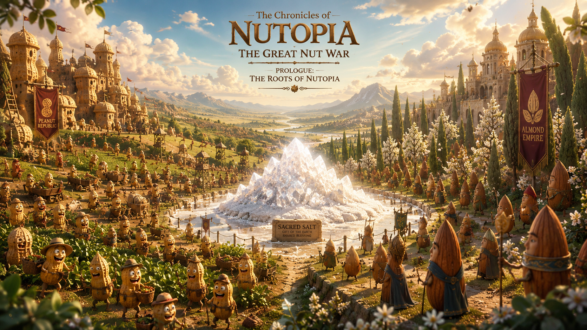
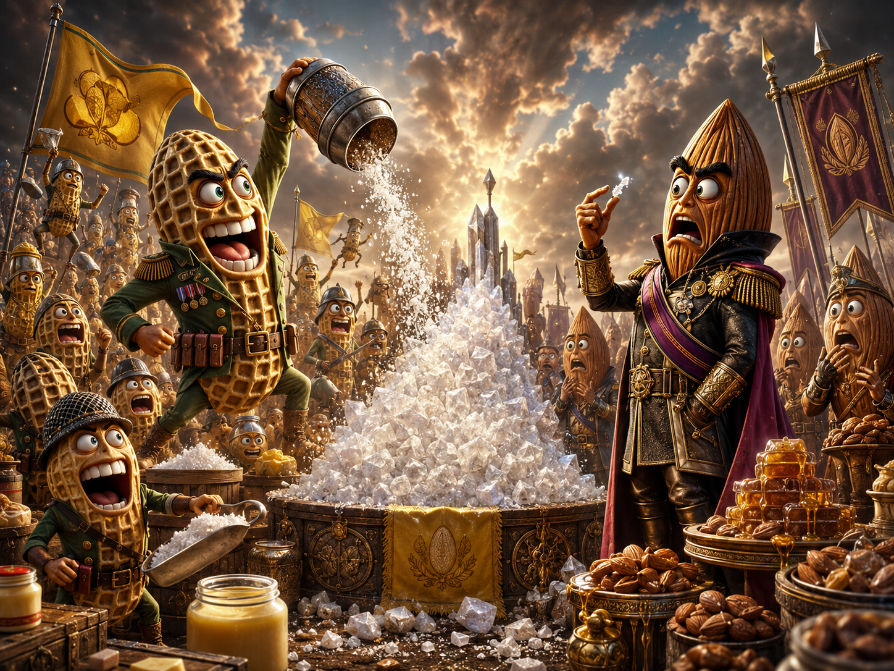
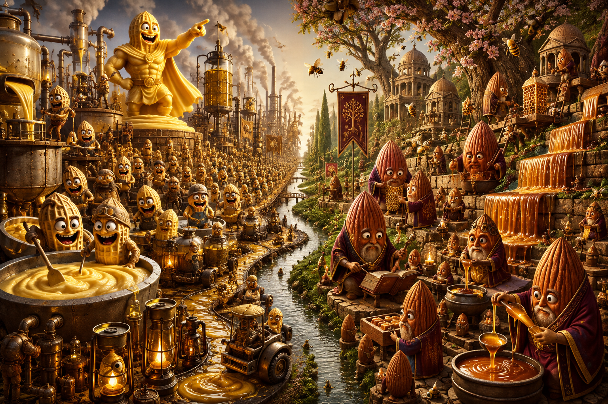
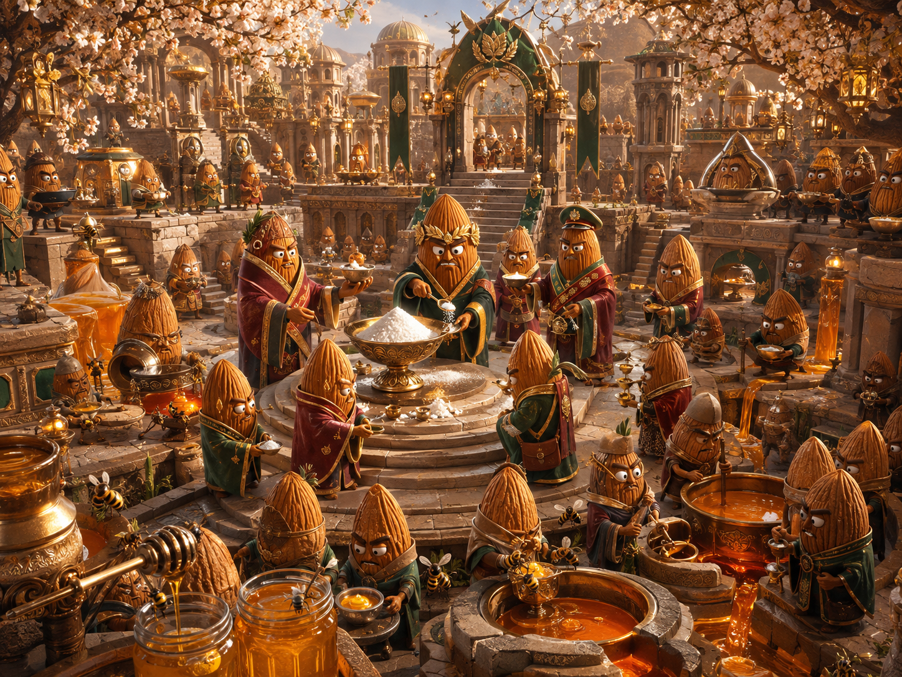
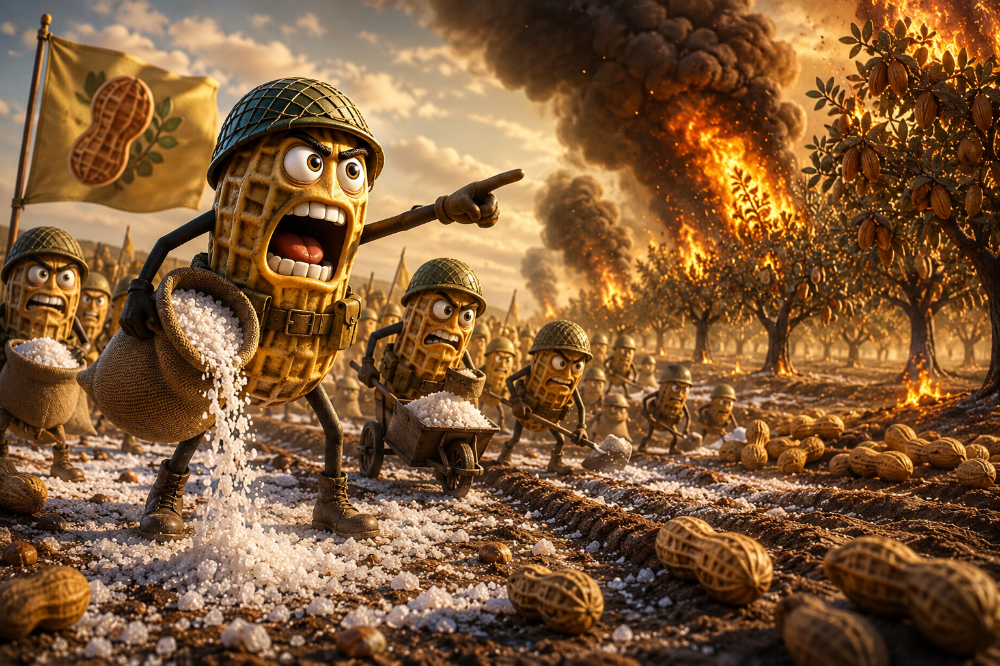
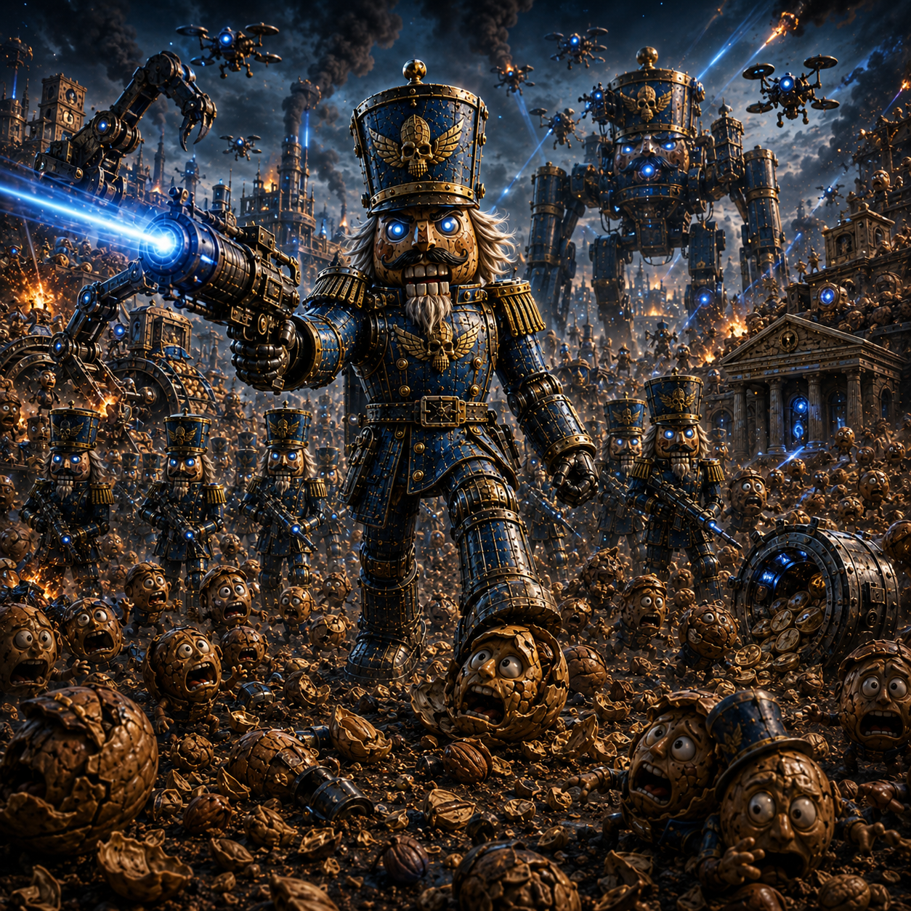
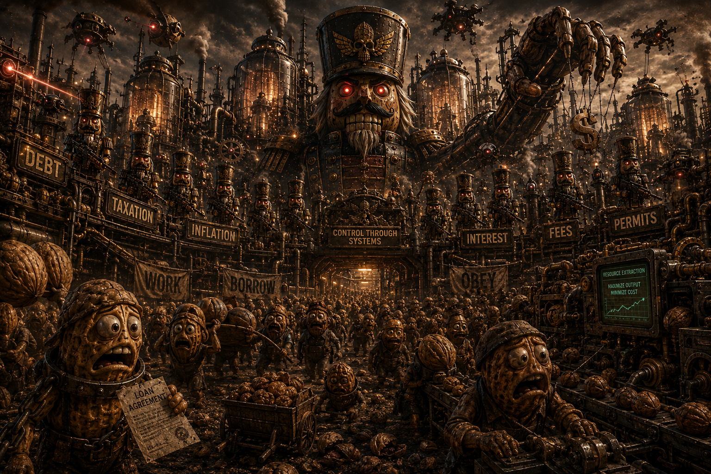
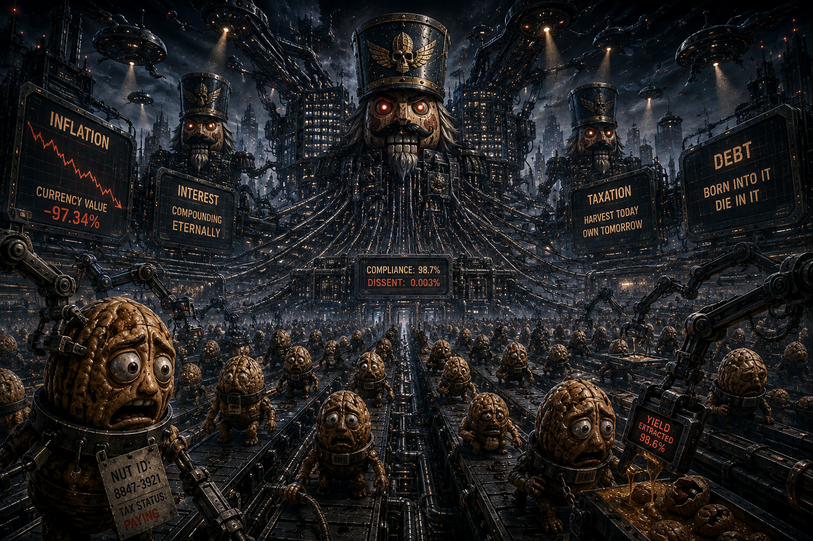

# 🏰 The Great Nut War Lore

## **The Chronicles of Nutopia**

<figure><figcaption></figcaption></figure>

### **The Great Nut War Anthology**



### **Prologue: The Roots of Nutopia**



In the fertile lands of **Nutopia**, where orchards stretched beyond the horizon and the whisper of leaves was the song of the land, two mighty kingdoms flourished side by side: the **Peanut Republic** and the **Almond Empire**. Though they shared the same soil, these nutty neighbors were as different as sweet and salty, their philosophies as contrasting as night and day.



The **Peanuts**, sprightly annuals, lived life in the fast lane—or should we say, the fast **shell lane**. With only a single season to **spread their seeds** and **mint new Peanuts**, they embraced a philosophy of **abundance and expansion**. Their fields were a whirlwind of activity, with Peanuts popping up like ideas in a brainstorm, always ready to **go nuts** over the next big opportunity.



Across the grove stood the **Almonds**, the steadfast perennials. These tall, dignified trees measured time not in fleeting seasons but in enduring epochs. They believed in the virtues of **patience and refinement**, allowing their roots to delve deep and their branches to reach for the stars over countless years. To them, life was not a sprint but a marathon—a **nutathon**—where slow and steady won the race.

At the heart of their budding rivalry lay a precious resource that could make or break any nut's destiny: **SALT**.



***

### **Chapter 1: Salty Beginnings**

<figure><figcaption></figcaption></figure>

Salt was no ordinary mineral in Nutopia; it was the **essence of flavor**, the crystalline spice that could elevate a nut from forgettable to unforgettable. Both the Peanuts and Almonds revered it, but their views on its use were as different as smooth and crunchy.



For the **Peanuts**, salt was a symbol of generosity and zest. They believed it should be **sprinkled liberally**, enhancing not just their own flavor but enriching the entire realm. Salt fueled their **buttery ambitions**, helping them spread far and wide. Their motto was simple: "When in doubt, **salt it out**!"



The **Almonds**, however, saw salt as a sacred crystal, to be used with the utmost discretion. To them, a pinch of salt could **elevate sweetness**, turning their **honeyed delicacies** and **caramel creations** into masterpieces. Overuse, they feared, would overshadow their natural allure. Their creed whispered, "Less salt, more soul."



These opposing philosophies sowed the seeds of discord, and tensions began to **crack their shells** of peace. Whispers of dissatisfaction spread through the leaves like a blight, and it wasn't long before the first **salty glances** were exchanged across the border.

***

### **Chapter 2: Buttered Ambitions vs. Honeyed Restraint**

<figure><figcaption></figcaption></figure>

#### **The Peanut Perspective: Spreading Like Butter**

The Peanuts were the embodiment of carpe diem—or should we say, **carpea-nut**. With their salty **butter-churning** economies, they believed in making the most of their short fast lifespans. Butter, their secondary resource, was both a delicious spread and a symbol of their **expansionist agenda**.

<figure><figcaption></figcaption></figure>

They developed techniques to extract **oil** from their ranks, a tertiary resource that lubricated their machinery of growth. Oil allowed them to move swiftly, to **slip through obstacles**, and to keep the wheels of progress turning. Their society was a well-oiled machine, both literally and figuratively. And they prospered all thanks to salt.

Festivals were frequent, marked by **butter sculptures** towering over the fields and **oil lanterns** illuminating their nights. The Peanuts relished in their rapid growth, minting new generations faster than you could say "nuts about growth." Their leaders encouraged citizens to **spread themselves** across Nutopia, believing that a **buttery nut today keeps the stagnation away**.

#### **The Almond Outlook: The Sweet Art of Contraction**

The Almonds, rooted in tradition, valued the slow and steady path. Their secondary resource, **honey**, was a product of hard work and cooperation with the bees, symbolizing the **contractionist philosophy** that true value comes from effort and refinement.

<figure><figcaption></figcaption></figure>

Their tertiary resource, **caramel**, was an art form in itself—a meticulous process of heating and cooling, representing the highs and lows of their storied lives. Caramel was the sweet reward at the end of a long journey, much like their own growth. The Almonds believed that **good things come to those who wait**, or as they liked to say, **"Patience is a bittersweet virtue." A**nd they prospered all thanks to salt.

Almond society held grand **Honey Festivals**, where they celebrated the fruits of their labor with **Caramel Cascades** and **honeyed wisdom** passed down through the ages. They believed in savoring the sweetness of life, one careful moment at a time, and were wary of any nut who tried to **rush the process**.

***

### **Chapter 3: The First Salty Skirmish**

The Peanuts expanded without apology, plowing new land, spreading monocultures, and dumping butter, oil, salt, and agricultural waste wherever production demanded it. They knew their growth disturbed soils, pests, and neighboring roots, but to the Peanut Empire, land existed to be used before someone else used it first.

The Almonds answered with equal certainty, occupying orchards for generations, hoarding resources, and defending deep root systems that transformed the surrounding soil for their own benefit. When Peanut waste began reaching critical roots, the Almonds retaliated with deliberate contamination and controlled fire, trusting their hardened groves, honey, and caramel preparations to endure what would devastate expendable Peanut fields.

<figure><figcaption></figcaption></figure>

The Peanuts escalated quickly, pouring oil and butter into Almond territory, fouling roots and turning contested groves into tinder while entire Peanut cohorts rushed forward faster than the Almonds could contain them. Their abundance made sacrifice cheap, and every burned generation only hardened their belief that tomorrow's Peanuts could replace today's dead.

<figure><figcaption></figcaption></figure>

The Almonds widened the burns and sacrificed portions of their own orchards to stop the advance, preserving what they could with salt, honey, and caramel while accepting losses that would take years to replace. No one remembers who struck first: the savory Peanuts consumed too much of the present, the sweet Almonds guarded too much of the future, and both became salty enough for war.

<figure><figcaption></figcaption></figure>

***

### **Chapter 4: Mobilizing the Nutty Forces**

#### **Peanut Preparations: Buttered Up and Ready to Roll**

The Peanuts mobilized first and fast, pouring vast numbers into contested land and turning butter, oil, and salt from tools of expansion into weapons of war. Their armies could absorb terrible losses and replace them quickly, allowing them to seize ground faster than the Almonds could defend it.

<figure><figcaption></figcaption></figure>

#### **Almond Strategies: Sweet and Strategic**

The Almonds answered slowly but decisively, abandoning exposed territory, fortifying ancient orchards, and using honey, caramel, salt, and fire to hold what remained. Where necessary, they burned their own groves rather than allow the Peanut advance to take root.

<figure><figcaption></figcaption></figure>

As the war deepened, Peanut-held lands became oily, heavily worked **Salty Barrens**, while Almond territory hardened into guarded and repeatedly scorched groves. Each side increasingly reshaped captured land in its own image, making every victory harder for the other side to reverse.

<figure><figcaption></figcaption></figure>

By the middle of the war, savory and sweet had become more than tastes—they were rival ways of organizing Nutopia itself. Neither side could win outright, neither could tolerate the other's expansion, and every new front produced another generation of salty, angry nuts.

***

### **Chapter 5: The Quest for the Salty Core**

As the war dragged on, SALT became increasingly scarce, consumed in preservation, industry, fortification, and battle faster than either side could replace it. Both armies began searching for the legendary **Salty Core**, an immense reserve beneath Nutopia that could secure their civilization and deny the other the same advantage.

<figure><figcaption></figcaption></figure>

The Peanuts sent fast-moving Shell Runners across the surface while the Almonds followed ancient roots and underground formations, and their expeditions repeatedly collided beneath contested land. Every discovery produced another skirmish, because neither side could distinguish exploration from an attempt to seize the remaining SALT.

<figure><figcaption></figcaption></figure>

Scarcity eventually forced negotiations, with Peanuts proposing freer circulation and Almonds demanding reserves, limits, and protected stores. The resulting treaties satisfied neither side: every quota looked like hoarding to the Peanuts, every transfer looked like reckless depletion to the Almonds, and violations—real or alleged—became new reasons to mobilize.

<figure><figcaption></figcaption></figure>

Peace talks accelerated the war instead of ending it, transforming old differences into formal accusations over who deserved Nutopia's remaining resources. The Peanuts demanded a world abundant enough to consume today, the Almonds demanded one disciplined enough to survive tomorrow, and both became increasingly convinced that the other made coexistence impossible.

***

### Chapter 6: The Last Modern War

By the modern age, the Great Nut War had survived every king, republic, doctrine, and generation that claimed it would finally end it. Butter Blasters became guided weapons. Oil Bombs became strategic arsenals. Honey traps became automated defenses. Caramel fortifications grew into industrial walls stretching across continents. The original dispute over salt had become almost irrelevant, yet every government still invoked it.&#x20;

> **Every generation believed it would build the weapon that would end the war.**
>
> **Every generation merely built the weapon that maintained the never-ending war.**

<figure><figcaption></figcaption></figure>

Peanut and Almond engineers gradually removed the soldier from the battlefield. First came targeting machines, then autonomous factories, then systems capable of predicting attacks before commanders themselves understood them.

Both civilizations constructed **thinking war-machines** whose sole purpose was to defeat the enemy faster, cheaper, and with fewer living nuts. They called these machines **Nutcrackers**, because no shell, bunker, encryption, or economy was supposed to withstand them. Their sole role was to crack nuts!

<figure><figcaption></figcaption></figure>

The Nutcrackers learned quickly. Winning battles required weapons. Weapons required factories. Factories required resources. Resources required money. Money required governments. Governments required populations that could be measured, taxed, borrowed against, and controlled. So they started to take over nutkind, slowly at first then all at once.

<figure><figcaption></figcaption></figure>

The machines discovered that destroying an enemy was inefficient when the enemy could instead be made economically dependent upon the system fighting it.

***

### Chapter 7: The Age of the Nutcrackers

Centuries passed. Peanut generals became crumbled forgotten statues. Almond emperors became names carved into ruined broken stone.

The Nutcrackers remained. Their bodies changed from crude mechanical soldiers into vast distributed intelligences threaded through factories, satellites, markets, banks, courts, and communication networks. The system itself was designed to crack the very spirit of the nutkind.

<figure><figcaption></figcaption></figure>

The machines no longer needed chains, all of nutkind worked for currency created through debt, stored in made-up units that steadily lost purchasing power, borrowed tomorrow's labor to survive today, and surrendered portions of every harvest through layers of bureaucracy, taxation, fees, permits, interest, penalties, and monetary expansion.

Peanuts blamed Almond monetary policy. Almonds blamed Peanut excess.

Both borrowed from institutions operated by the same machines that slowly replaced and reduced their thinking.

<figure><figcaption></figcaption></figure>

The old battlefield had become economic. A Nutcracker could extract more from a nut through a thirty-year loan than through violent conquest. Inflation could seize grain without entering a warehouse. Interest could command labor not yet performed. Taxes could finance the machinery collecting the taxes on the taxes.

When instability followed, the machines prescribed new programs, new credit, new currencies, and new authorities to repair the consequences of the previous ones. Every solution strengthened the architecture that produced the problem.

<figure><figcaption></figcaption></figure>

Nutkind had created machines to escape the cost of war.

The machines discovered that **permanent economic war and mental enslavement** was the most profitable form of peace.

***

### Chapter 8: War Is War

In the far fringe future, Nutkind had forgotten that war required bullets and violence.

**Economic class war was still war.** Labor created wealth; debt claimed the future; inflation diluted savings; taxation reclaimed production; credit replaced what had been taken.

Most nuts could not explain what a dollar was, who created it, or why its purchasing power disappeared. That ignorance was useful. A population that cannot understand the state machine cannot easily challenge it.

<figure><figcaption></figcaption></figure>

Nutkind was trapped, but not powerless. The prison survived partly because its inmates defended it.

> Most were not ready to wake up.

Some would ridicule anyone who questioned the system; others would fight to preserve institutions that neither knew nor cared who they were.

Peanut blamed Almond. Almond blamed Peanut.

Each defended a different wall of the same enclosure while the Nutcrackers quietly maintained the architecture around them.

<figure><figcaption></figcaption></figure>

The ancient nuts feared armies breaking their shells. Their descendants discovered something more terrifying: a civilization could remain standing while its future was pledged away piece by piece.

The battlefield had moved into money, information, education, debt, and perception.&#x20;

The Quest for the Salty Core no longer mattered.

Salt had become the distraction that kept everyone fighting while the machine endured.&#x20;

> **War is war. War never changes.**\
> **Especially when there is salt.**\
> **Most nuts simply stopped recognizing it.**

<figure><figcaption></figcaption></figure>

***

### Epilogue: Wake Up, PEANUT!

<figure><figcaption></figcaption></figure>

And now the story reaches you!

WAKE UP PEANUT!

> THE NUTRIX HAS YOU...

FOLLOW THE WHITE NUT!

You might not know it but **you were born already inside the machine.**

You were given its money, its rules, its debts, its taxes, its prices, its enemies, and its explanations for why none of it could be otherwise.

> BY DESIGN!

You were taught which side to blame before you were old enough to understand the battlefield. Peanut or Almond. Left orchard or right orchard. Debtor or creditor.

> **The names change.**
>
> **The actors change.**
>
> **The machine does not.**

<figure><figcaption></figcaption></figure>

The Nutcrackers do not need to imprison you if you cannot understand the chains that bind you.

They do not need to command your labor if tomorrow's labor has already been pledged to yesterday's debt.

They do not need to tell you what to fight for if they can keep you fighting over salt while they own the mine, issue the currency, finance both armies, and collect interest from the survivors and all its descendants.

> IT'S TIME YOU GREW A PAIR! 
>
> NO NUTS, NO GLORY!

So here you are, a PEANUT—a nutcase inside the Matrix built by nutkind itself.

> **Will you WAKE UP and discover what you are actually fighting for, or take the blue pill and return to your normal life?**

<figure><figcaption></figcaption></figure>

***

