# 💸 nutUSD

## 🏦 nutUSD — The USDC Credit Reserve Share


This is a Morpho Vault, learn more about [Morpho here](https://morpho.org/).&#x20;


nutUSD is the tokenized share of the Based NUT USDC Credit Reserve.

Users deposit USDC into the vault and receive nutUSD. The reserve deploys that USDC into isolated credit markets where borrowers collateralize assets such as cbBTC and cbETH to borrow USDC.

Borrowers receive liquidity. Depositors receive the interest generated by that credit. nutUSD represents the depositor's proportional ownership of the reserve.

nutUSD is not USD. It is not a stablecoin, synthetic dollar, or $1-pegged asset.

### Credit Reserve

nutUSD turns deposited USDC into productive credit capital.


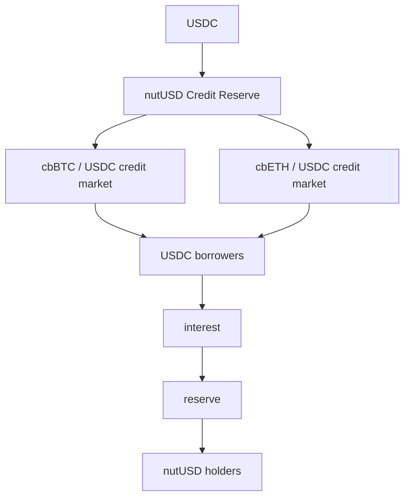


The reserve does not create dollars. It coordinates existing USDC capital between lenders and collateralized borrowers.

***

### What nutUSD Represents

nutUSD is an ERC-4626 vault share. A holder owns a proportional claim on the USDC-denominated assets of the vault.

$$\text{nutUSD value} = \text{vault assets} / \text{nutUSD supply}$$

If the reserve earns interest, assets increase while the number of shares does not necessarily increase. The amount of USDC represented by each nutUSD therefore increases.


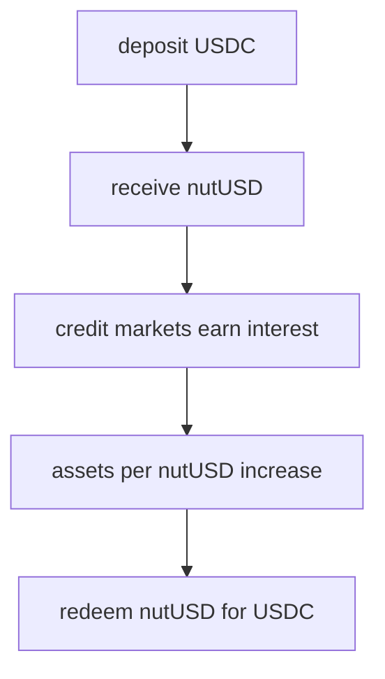


There is no requirement that 1 nutUSD = 1 USDC.

***

### nutUSD Mechanics

#### Deposit

A user deposits USDC into the vault.

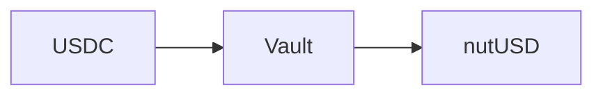

The vault mints the corresponding quantity of nutUSD shares. The exchange rate depends on the vault's existing assets and outstanding shares.

#### Share Accounting

Shares and assets are tracked to the smallest unit of the loan asset.

Minted shares on deposit and returned assets on redemption follow the vault's share price. A deposit-and-redeem cycle is exact to within one unit of the loan asset. No fraction of an asset is lost inside the vault's accounting. 

#### Allocation

Vault USDC can be allocated into approved Morpho credit markets. The initial design uses isolated markets such as:

* cbBTC / USDC
* cbETH / USDC

Each market exists independently. Exposure to one collateral market does not automatically become exposure to every other Morpho market. 

#### Yield

Borrowers pay interest on borrowed USDC. That interest increases the assets attributable to the reserve.


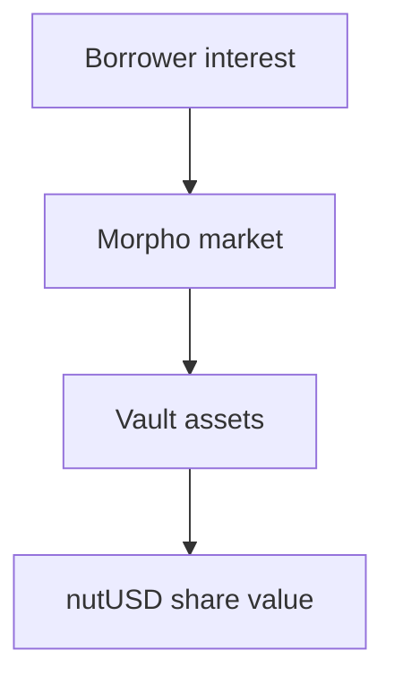


nutUSD therefore does not require emissions to generate its underlying yield. Yield originates from demand for credit. No borrowing demand means little or no lending yield. 

#### Redemption

nutUSD can be redeemed through the vault for its corresponding amount of USDC, subject to available liquidity and the mechanics of the underlying positions.

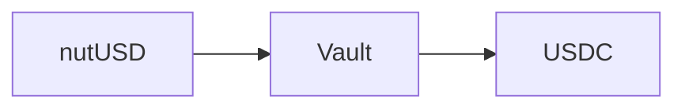

The redemption value follows the vault share price rather than an external peg. 

### Credit Markets

The first nutUSD markets are designed around a deliberately conservative 38.5% LLTV.

At a 38.5% LLTV:

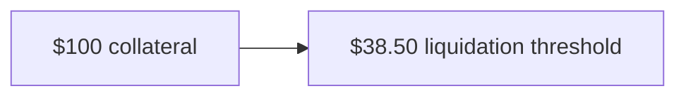

This creates substantial collateral coverage around USDC credit. The borrower retains exposure to the collateral asset while accessing USDC liquidity.

For example:

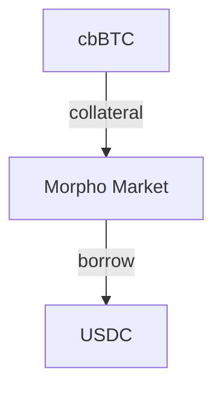

The borrower does not need to sell the cbBTC. The reserve supplies the USDC. 

#### A Credit Tier, Not a Credit Curve

A single 38.5% LLTV does not constitute a credit curve. It represents one credit tier. Additional markets with different collateral requirements or LLTVs could eventually form a broader spectrum of credit conditions.

For the initial reserve:

$$\text{Credit Tier}_0 = 38.5\%\ \text{LLTV}$$

The design begins with one deliberately conservative tier rather than manufacturing complexity prematurely. 

### Risk & Liquidations

nutUSD transfers capital into lending markets. It therefore contains lending risk. The principal protections come from:

* overcollateralization
* isolated markets
* immutable Morpho market parameters
* explicit LLTVs
* collateral oracles
* permissionless liquidation
* vault exposure caps and allocation controls

These mechanisms reduce risk. They do not eliminate it. 

#### Liquidation

A borrower becomes liquidatable when the position reaches the market's LLTV.

For a 38.5% market: $$\text{LTV} \geq 38.5\%$$

Once the threshold is crossed, a liquidator can repay borrower debt and receive collateral plus the protocol-defined liquidation incentive. Morpho determines its Liquidation Incentive Factor from the market LLTV. At the 38.5% LLTV tier, the formula reaches Morpho's maximum 1.15 LIF, corresponding to a maximum 15% liquidation incentive. The low LLTV and strong liquidation incentive create a large buffer between collateral value and outstanding debt. 

#### Losses

Overcollateralization does not make losses impossible. Potential loss sources include:

* rapid collateral price movements
* oracle failure
* insufficient liquidation liquidity
* bad debt
* USDC risk
* smart-contract risk
* vault or adapter risk
* market configuration risk

If the vault realizes losses, the USDC value represented by each nutUSD share can decrease. nutUSD therefore has variable yield and variable share value. It does not promise principal protection.

***

### Relationship to NUT

Despite its name, nutUSD is not backed by NUT.

* NUT is not nutUSD collateral
* NUT is not nutUSD redemption
* NUT is not the nutUSD peg

Its underlying reserve asset is USDC. Its initial borrower collateral is external assets such as cbBTC and cbETH.

Its relationship to Based NUT is infrastructural rather than collateral-based:

* NUT is the ecosystem root.
* nutUSD is the ecosystem credit layer.

This separation is intentional. It allows Based NUT to construct credit infrastructure without making the credit system dependent on the market price of NUT.

***

### Primitive

The simplest description of nutUSD is:

USDC enters as capital. Collateralized borrowers consume that capital as credit. Interest returns to the reserve. nutUSD represents ownership of the reserve.

nutUSD is therefore simultaneously:

* a vault share,
* a credit reserve share,
* and a composable representation of supplied USDC credit capital.

***

### Credit Constitution

nutUSD is governed by a credit constitution defining what forms of credit the vault may fund and under what constraints.

The mandate is not to maximize APY. The mandate is to coordinate USDC into deliberately selected, overcollateralized credit markets under explicit risk limits.

The constitution separates three things:

* **Strategy approval** — which forms of credit are permitted.
* **Risk limits** — how much USDC may be exposed to each strategy.
* **Allocation** — how currently deposited USDC is distributed among already-approved strategies.

An allocator may change allocation. An allocator may not redefine what constitutes acceptable credit.

***

### What Is a Strategy?

A nutUSD strategy is not merely the name of a collateral asset. It is the complete market configuration through which USDC may be lent.

A strategy therefore consists of:

$$S_i = (C_i, \text{USDC}, \text{LLTV}_i, O_i, \text{IRM}_i, \text{Cap}_i)$$

where:

* C\_i = collateral asset
* USDC = loan asset
* LLTV\_i = liquidation loan-to-value
* O\_i = oracle
* IRM\_i = interest-rate model
* Cap\_i = maximum vault exposure

Changing one of these components can materially change the risk.

* A different oracle is a different credit configuration.
* A different LLTV is a different credit configuration.
* A different collateral asset is a different credit configuration.

### One Strategy, One Approval

Each strategy is evaluated and approved independently.

One strategy = one governance decision.

Approval of one cbBTC market does not constitute blanket approval of every cbBTC market. Approval must refer to the specific:

* collateral;
* USDC loan asset;
* LLTV;
* oracle;
* IRM;
* exposure cap;
* underlying Morpho market;
* relevant adapter, where applicable.

This prevents broad asset labels from concealing materially different credit risk.

### Genesis Credit Policy

The intended genesis policy is deliberately conservative: 38.5% LLTV.

At a 38.5% LLTV, $100 of correctly valued collateral supports at most $38.50 of debt before the position reaches the liquidation threshold.

$$\text{Maximum Debt} = \text{Collateral Value} \times 0.385$$

For $100 of collateral:

$$\$100 \times 0.385 = \$38.50$$

This is not a target borrower LTV. It is the liquidation boundary of the market. Borrowers may choose materially lower LTVs.

#### Why 38.5%?

38.5% is the lowest non-zero LLTV currently approved for Morpho Blue markets.

The purpose is straightforward: large overcollateralization before substantial USDC credit is extended.

This trades capital efficiency for lender protection. It means:

* borrowers receive less USDC for the same collateral;
* collateral has greater nominal coverage relative to debt;
* leverage is intentionally constrained;
* credit may be less attractive to highly leverage-sensitive borrowers;
* borrower demand may therefore be lower.

That last point is not concealed. A conservative market can have zero borrower demand and therefore little or zero yield. nutUSD does not manufacture yield to compensate.

### LTV and Liquidation

A borrower's actual LTV is:

$$\text{LTV} = \text{Debt} / \text{Collateral Value}$$ 

The position becomes eligible for liquidation when:

$$\text{LTV} > \text{LLTV}$$ 

For genesis 38.5% markets:

$$\text{LTV} > 38.5\% \Rightarrow \text{Liquidatable}$$

A 38.5% LLTV should therefore not be described as a 61.5% price-decline buffer. The actual buffer depends on the borrower's starting LTV. 

For example, a borrower beginning at 30% LTV reaches 38.5% LLTV when collateral falls to approximately:

$$30 / 0.385 \approx 77.92$$

relative to an initial collateral value of 100. That corresponds to approximately a 22.08% collateral decline, ignoring accrued interest and oracle effects. 

Past the ceiling, three states follow:

<table><thead><tr><th width="213">LTV range</th><th>State</th></tr></thead><tbody><tr><td>LTV ≤ 38.5%</td><td>healthy</td></tr><tr><td>38.5% &#x3C; LTV ≤ 86.96%</td><td>liquidatable; liquidation still covers the debt</td></tr><tr><td>LTV > 86.96%</td><td>bad-debt region; seizure no longer covers the debt</td></tr></tbody></table>

86.96% is 1/1.15, the inverse of the liquidation incentive. From a maximum-boundary borrow, the bad-debt region begins only after a collateral decline greater than 55.725%. 

### Liquidation Economics

Morpho determines the liquidation incentive from the market LLTV.

For a 38.5% LLTV market, the formula reaches Morpho's maximum 1.15 liquidation incentive factor.

$$\text{LIF} = \min(1.15,\ 1 / (0.3 \times \text{LLTV} + 0.7))$$ 

At 38.5%:

$$\text{LIF} = \min(1.15,\ 1 / (0.3 \times 0.385 + 0.7)) = 1.15$$

This means a liquidator may receive collateral worth up to approximately 115% of the debt repaid, subject to the actual liquidation mechanics. 

Among Morpho's standard nonzero LLTV options, 38.5% is the one at which the maximum incentive applies — the lowest approved leverage ceiling with the maximum liquidation draw. 

That incentive exists to make liquidation economically attractive. It is beneficial to lenders only insofar as it helps unhealthy debt get repaid. It is costly to liquidated borrowers. It does not guarantee that liquidation will succeed or that bad debt cannot occur.

***

### Credit Markets Are Immutable

Morpho Blue markets are isolated. Each market is defined by five immutable parameters:

$$M_i = (\text{Collateral}, \text{Loan Asset}, \text{LLTV}, \text{Oracle}, \text{IRM})$$

For nutUSD, the loan asset is USDC. A genesis market therefore has the general form:

$$M_i = (C_i, \text{USDC}, 38.5\%, O_i, \text{AdaptiveCurveIRM})$$

Once a Morpho Blue market exists, those market parameters cannot simply be edited. Changing an immutable market parameter means using or creating a different market.

That distinction matters for governance. A vote to change an LLTV is therefore economically a vote to migrate credit exposure to another market, not merely to edit a number.

***

### Collateral Strategies

The initial strategy universe is intended to focus on mature collateral rather than using NUT simply because NUT exists.

Examples under consideration include major Base-native or Base-accessible assets such as:

* cbBTC;
* cbETH;
* WETH;
* other independently approved major collateral.

Each still requires its own market, oracle review, liquidity analysis, liquidation-path analysis, cap, and governance approval. No collateral is approved merely by appearing on this list. The live strategy registry should be the authoritative list of approved nutUSD exposures.

***

### Oracles

Every credit strategy depends on an oracle valuing its collateral against USDC. The oracle is therefore part of the credit instrument itself.

A strategy proposal must identify:

* oracle contract;
* underlying price source;
* quote denomination;
* update behavior;
* failure conditions;
* dependency chain;
* manipulation assumptions;
* fallback behavior, if any.

The exact oracle address must be published before a strategy becomes active.

An oracle should never be described merely as infrastructure. It determines when borrowers become liquidatable.

The adapter that composes the two legs accepts any non-negative answer. A zero answer on either leg is therefore a live configuration, not an error. The two zeros are not symmetric:

* a zero **collateral-leg** answer serves a zero collateral price — borrowing is gated off, but the liquidation path stays open: collateral can be seized for zero repayment, and any remaining debt is socialized. This is the drain state.
* a zero **USDC-leg** answer panics in the division, and every price-dependent call freezes with it.

The production invariant is therefore strict: every oracle leg must remain greater than zero, with monitoring wired to an enforced response. The adapter itself carries no such guard and no staleness check — a stale answer serves at its last value.

***

#### Price Composition

Collateral is valued against USDC through Chainlink price feeds.

For collateral with a direct USD feed, the collateral value in USDC terms is composed from two feeds — the collateral leg and the USDC leg:

$$
\text{collateral value in USDC} = \frac{\text{collateral/USD}}{\text{USDC/USD}}
$$

The genesis cbBTC market follows this 2-leg form: cbBTC/USD ÷ USDC/USD. This is the production candidate — collateral priced in USDC terms directly from the two feeds, no ETH leg in the path.

For collateral quoted in ETH, the value is composed from two feeds:

For collateral quoted in ETH, the value is composed from two feeds:

$$
\text{collateral value in USDC} = \text{collateral/ETH} \times \text{ETH/USD}
$$

The composed path is part of the market definition. Each market names its feeds, and the feeds are part of the credit instrument.

***

### Interest Rates

nutUSD does not set a promised depositor rate. Morpho Blue markets use the AdaptiveCurveIRM. Its interest rate responds to utilization.

$$U = \text{Borrowed USDC} / \text{Supplied USDC}$$

The AdaptiveCurveIRM targets approximately:

$$U_{\text{target}} = 90\%$$

Borrow rates generally rise when utilization remains above target and fall when utilization remains below target. This creates a market mechanism rather than a fixed promised rate.

The vault therefore does not determine yield by declaration. It obtains yield only when underlying credit markets generate it.

***

### Lender Economics

Borrowers pay interest on USDC debt. That interest accrues to USDC suppliers through the underlying Morpho market.

At a simplified level:

$$\text{Gross Supplier Rate} \approx \text{Borrow Rate} \times U \times (1 - \text{Market Fee})$$

nutUSD then represents the vault's proportional claim on those accumulated assets.

If net assets increase while share supply is unchanged:

`USDC per nutUSD ↑`

If assets are lost:

`USDC per nutUSD ↓`

This is the economic mechanism. There is no rebasing requirement and no $1 peg mechanism.

***

### Zero Demand Means Zero Yield

The vault can create credit capacity without creating credit demand. This distinction is fundamental.

A newly created conservative market may initially contain:

* USDC supply;
* collateral capacity;
* no borrowers.

If $$\text{Borrowed USDC} = 0$$ then $$U = 0$$ and lending yield may be negligible.

That does not mean the market is malfunctioning. It means credit capacity exists but has not been used.

nutUSD is therefore not designed around the assumption that every approved strategy must already have existing borrower demand before it can exist.

***

### Strategy Caps

An approved market is not authorization for unlimited exposure. Every strategy must have an explicit cap.

$$E_i \leq \text{Cap}_i$$

where E\_i is vault exposure to strategy i. 

For the complete vault:

$$\sum_i E_i + \text{USDC}_{\text{idle}} = \text{Vault Assets}$$ 

Caps are the primary mechanism separating:

"this credit market is permitted"

from:

"the vault may place unlimited capital here." 

Genesis cap values must be published before deposits are solicited. 

***

### Allocation

The allocator determines where available USDC is placed inside the constitutional boundaries already established by the curator.

Allocation can respond to:

* borrower demand;
* utilization;
* liquidity;
* interest rates;
* concentration;
* withdrawal requirements;
* changing risk conditions.

This is allocation, not permission to invent new strategies. The allocator cannot turn an unapproved market into an approved market merely because its yield is higher.

***

### Idle USDC

Not all vault assets must be lent. Some USDC may remain idle.

$$\text{Vault Assets} = \text{Idle USDC} + \sum \text{Credit Positions}$$

Idle USDC earns less or no lending yield but provides immediate liquidity. A vault with a higher idle balance may therefore have lower aggregate yield and greater immediate withdrawal capacity. That is an explicit economic tradeoff.

In the initial configuration, every deposit is allocated automatically and the idle balance is zero. Whether USDC sits idle is a property of the vault's configuration and its caps, not a constant of the design.

***

### Curator Constitution

The curator defines the boundaries of acceptable risk.

The curator is not expected to predict markets perfectly. The curator is expected to make the vault's permitted risk explicit, bounded, observable, and reversible where the architecture allows it.

#### Constitutional Principles

1. **USDC is the credit asset.** nutUSD coordinates USDC lending. It does not issue an endogenous dollar.
2. **Strategies are approved individually.** One strategy, one decision.
3. **Safety is not inferred from asset names.** Collateral, oracle, LLTV, IRM, liquidity, and market structure are evaluated together.
4. **Caps are mandatory.** Approval does not imply unlimited exposure.
5. **Risk increases require deliberation.** Adding strategies or materially expanding exposure must follow the applicable governance and timelock process.
6. **Risk reductions should be executable rapidly.** Caps may be reduced and capital deallocated when credible risk emerges.
7. **Allocation is subordinate to strategy approval.** Allocators operate inside the constitution.
8. **Yield is not the primary security criterion.** A higher APY does not justify weaker collateral, weaker oracle infrastructure, or excessive concentration.
9. **No hidden guarantees.** The curator does not guarantee principal, liquidity, yield, oracle correctness, liquidation success, or USDC solvency.
10. **Governance policy is not smart-contract law unless encoded.** Any constitutional rule that is not technically enforced by the vault contracts remains a governance commitment and must be described as such.

***

### Strategy Admission

Before a strategy can receive nutUSD capital, its proposal should disclose at minimum:

* the collateral asset and its contract;
* the loan asset (USDC);
* the LLTV;
* the oracle — contract, underlying price source, quote denomination, update behavior, failure conditions, dependency chain, and manipulation assumptions;
* the interest-rate model;
* the exposure cap;
* the underlying Morpho market;
* any adapter the vault uses, where applicable;
* liquidity and liquidation-path analysis.

No strategy should enter the vault merely because it exists on Morpho.

***

### Strategy Lifecycle

The intended process is:





A strategy can remain approved while receiving zero allocation. Likewise, an allocator can reduce a strategy to zero without necessarily removing it from the constitutional strategy set.

This separates permission from current deployment.

***

### Roles

#### Owner

The Owner controls top-level administrative authority. For nutUSD, this should be controlled by a secure Based NUT Safe rather than a single externally owned account. The exact Safe address and signer policy must be public. 

#### Curator

The Curator defines strategy and risk boundaries. Its responsibilities include:

* approving permitted infrastructure;
* setting or proposing exposure caps;
* defining fees;
* defining strategy boundaries;
* appointing allocators where applicable;
* reducing risk when necessary.

The Curator does not own depositor assets. 

#### Allocator

The Allocator manages active capital deployment among approved strategies. The allocator may optimize:

* liquidity;
* utilization;
* credit availability;
* concentration;
* yield.

It remains constrained by curator-defined permissions and caps. 

#### Sentinel

The Sentinel is the defensive role. Its purpose is to reduce risk or stop pending dangerous changes, not to create new risk.

The separation between Curator, Allocator, and Sentinel is intentional. 

### Timelocks

Changes that increase risk should not become effective invisibly or instantaneously where Morpho's architecture provides a timelock. 

A timelock creates a public interval between:

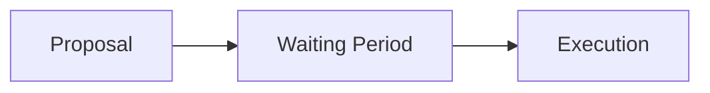

This gives depositors and safety roles time to inspect a proposed change and react. The exact nutUSD timelock configuration must be published with the deployment. 

### Fees

Fees are economic parameters, not implementation trivia. nutUSD documentation must disclose:

* management fee;
* performance fee;
* fee recipient;
* any underlying protocol fees. 

Net depositor return is approximately:

$$R_{\text{net}} = R_{\text{gross}} - F_{\text{protocol}} - F_{\text{management}} - F_{\text{performance}}$$

The live onchain configuration is authoritative. A fee that can be changed by governance should be described as changeable, even if its current value is zero. 

### What the Curator Can Actually Control

The curator can constrain risk. The curator cannot eliminate it.

The curator can decide:

* which strategies are permitted;
* which infrastructure may be used;
* how much exposure is allowed;
* which allocators operate the vault;
* certain fee and operational settings. 

The curator cannot guarantee:

* collateral prices;
* USDC solvency;
* borrower behavior;
* oracle operation;
* liquidation execution;
* blockchain availability;
* smart-contract correctness;
* secondary-market pricing of nutUSD;
* continuous withdrawal liquidity.

That distinction is part of the product. 

### The Economic Objective

nutUSD should be understood as a credit coordination primitive.

Its objective is not: deposit one dollar, manufacture another dollar.

Its objective is: aggregate existing USDC, define acceptable collateralized credit, and make that USDC available to borrowers under explicit risk constraints. 

The economic transformation is therefore:

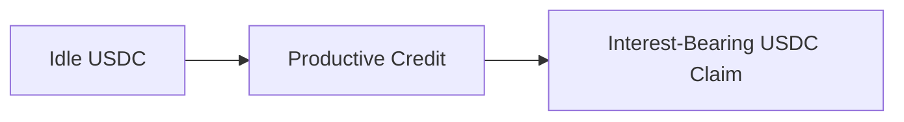

not:

nutUSD tokenizes the lender side of that system. It is a share of credit assets. It is not money creation. 

### Boundaries and Protections

#### The Liquidation Boundary

The 38.5% LLTV forms the borrowing ceiling.

$$\text{Maximum Debt} = \text{Collateral Value} \times 0.385$$

The ceiling is computed to the smallest unit of the loan asset, with floor rounding. The highest executable borrow can sit one unit below the theoretical maximum. A borrow request beyond the ceiling is rejected.

A borrower at the ceiling remains healthy. Liquidation becomes possible only when accrued interest or a collateral-price change moves the position past the ceiling. 

#### Position Protection

A healthy position cannot be liquidated.

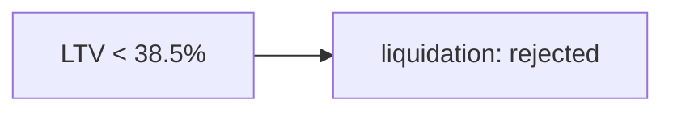

A borrower with outstanding debt cannot withdraw collateral.

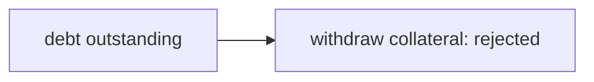

The debt must be repaid first. Zero-value borrow and repay calls are rejected.

The protections are three: a healthy borrower cannot be liquidated; a borrower with debt cannot withdraw collateral; a lender cannot withdraw beyond available liquidity. 

#### First Shares

Dead shares are seeded to an unspendable address before public deposits. The vault's first shares are placed out of reach. The first supply shares of each credit market are placed out of reach the same way.

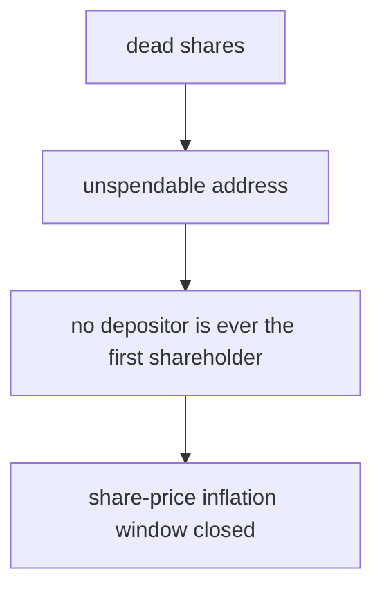

A vault with zero shares can price a first deposit at an inflated rate. The dead shares close that window before any depositor enters. 

#### Repayment

Repayment can be specified in assets or in shares.

A repay call defined in assets does not stop at the outstanding debt. Repaying more assets than the debt computes more shares than the position holds and fails.

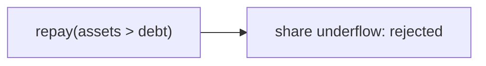

Exact full closure is performed in shares. Asset-denominated repayment serves partial repayment. 

#### Redemption

Redemption is bounded by market liquidity.

A holder may redeem every share in a single transaction. The corresponding USDC is returned through the underlying market positions.

If a market is fully utilized, withdrawals wait for repayments or liquidations.

The redemption value follows the vault share price rather than an external peg. 

#### Deposit Allocation

Deposits are allocated automatically.

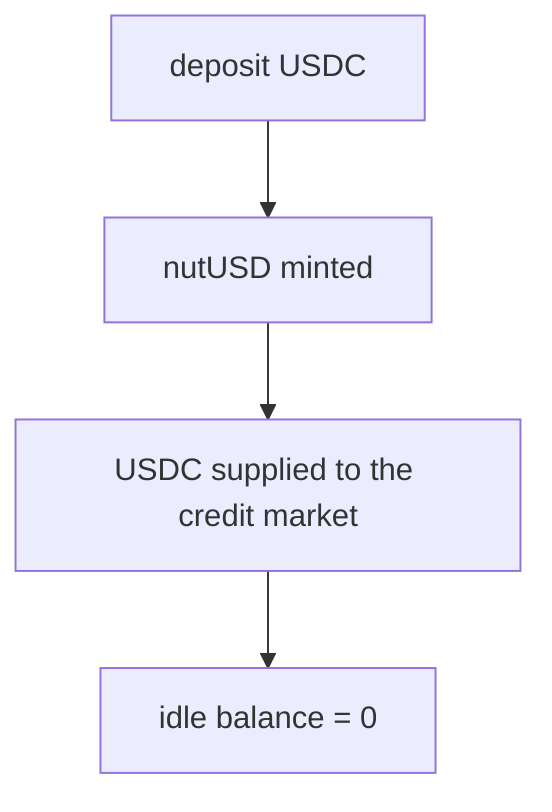

The vault does not hold idle USDC in the initial configuration. Whether USDC sits idle is a property of the vault's configuration and its caps, not a constant of the design.

> ⚠️ **Experimental Memefi.** No intrinsic value, no expectation of financial gain. Entertainment only — nut responsibly. 🌰
