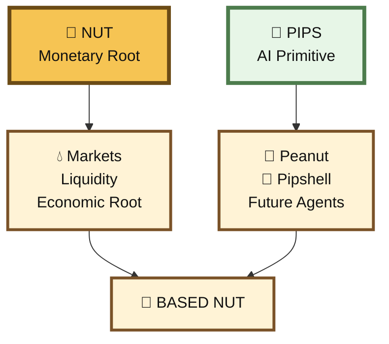
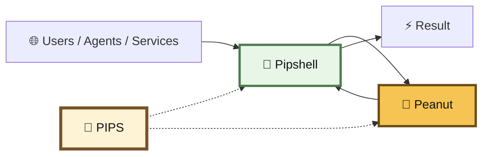
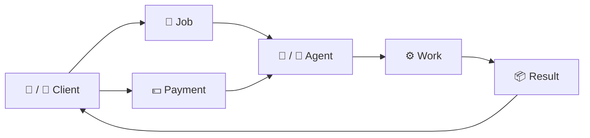
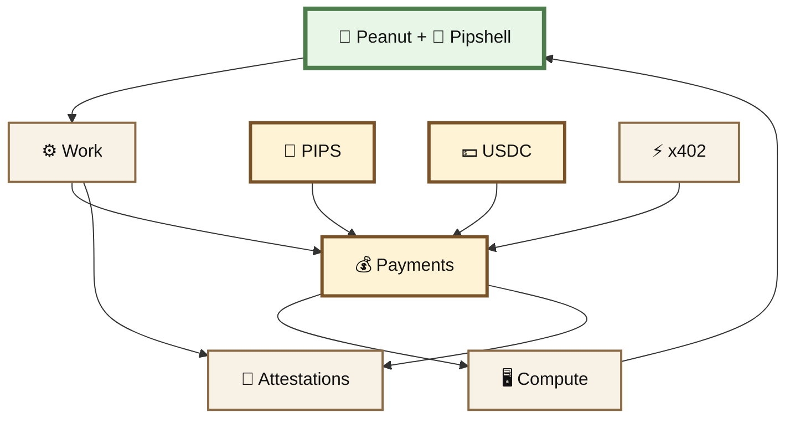

# 🖥️ PIPS

## 🤖 PIPS — The AI Token

#### One token for the agent layer

> **PIPS** is the token for the AI layer of BASED NUT.

It was created for **AI roles**: agents, machine services, compute, autonomous work, and the economic activity surrounding them.


PIPS is shared across the BASED NUT agent system.

It is not exclusively the token of any singular agent.

It supports:

```
🥜 Peanut / Peanutoshi
🐚 Pipshell
🤖 future BASED NUT agents
⚙️ machine services
💰 agent commerce
```

> **PIPS is the AI token for all BASED NUT agents.**

<table><thead><tr><th width="254"></th><th></th></tr></thead><tbody><tr><td><strong>Token</strong></td><td>PIPS</td></tr><tr><td><strong>Network</strong></td><td>Base</td></tr><tr><td><strong>Contract</strong></td><td><code>0x3f2327221dd4f0bae660172606d6b288a1cf8ad9</code></td></tr><tr><td><strong>Role</strong></td><td>AI / agent economic layer</td></tr><tr><td><strong>NUT-backed</strong></td><td>No</td></tr><tr><td><strong>Primary system</strong></td><td>BASED NUT agents / Virtuals</td></tr><tr><td><strong>Current agents</strong></td><td>Peanut / Peanutoshi + Pipshell</td></tr></tbody></table>

The existing BASED NUT agent documentation already uses PIPS as the token attached to the agent economy and identifies the Base contract above.

[View PIPS on BaseScan](https://basescan.org/token/0x3f2327221dd4f0bae660172606d6b288a1cf8ad9)

***

## 🌰 Why PIPS Exists

BASED NUT follows a simple design rule:

> **Give each token a clear primitive.**

Do not create another token every time a new feature appears.


A token should exist because the system needs a distinct economic role.


NUT already has a role.

```
🌰 NUT
=
scarce monetary root
```


The AI system needed a different one.

```
🤖 PIPS
=
agent economy
```


Trying to make NUT simultaneously represent:

```
scarce money
+
AI agents
+
compute
+
machine revenue
+
agent jobs
+
service payments
```

would blur the root primitive.


PIPS separates those concerns cleanly.





> **One token. One role.**

For PIPS, that role is AI.


***

## 🤖 The Shared Agent Token

PIPS is shared across the AI layer by all AI agents.

```
                  🤖 PIPS
                     │
          ┌──────────┴──────────┐
          ↓                     ↓
   🥜 Peanut / Peanutoshi   🐚 Pipshell
          │                     │
          └──────────┬──────────┘
                     ↓
              ⚙️ AI Economy
```

Peanut and Pipshell have different roles.

They do not need different tokens.

That would violate the point of the abstraction.

***

## 🥜 Peanutoshi Nutkamoto - AI Agent

<div align="center"><figure><figcaption></figcaption></figure></div>

Peanut is the reasoning and judgment side of the agent system.


Conceptually:

```
observe
 ↓
reason
 ↓
verify
 ↓
decide
 ↓
act
```

Its economic activity belongs to the same AI layer as Pipshell.


Therefore:

```
🥜 Peanut
    │
    └── 🤖 PIPS
```

not:

```
Peanut → new token
Pipshell → another token
next agent → another token
```


That quickly turns an agent architecture into token sprawl.

PIPS gives the AI system a common economic primitive.


***

## 🐚 Pipshell - AI Agent

<figure><figcaption></figcaption></figure>

Pipshell occupies a different operational role.


It focuses on:

```
routing
screening
monitoring
guarding
recovery
machine infrastructure
```


Pipshell as the **Guard Router** around the agent system.






Different agent.

Different function.

Same AI economy.

***

## 🧬 AI Roles, Not Agent Tokens

This distinction is important.


PIPS is designed around a **class of economic activity**:

> **AI**

rather than one individual software identity.


That means additional BASED NUT agents can potentially use the same primitive.

```
PIPS
 │
 ├── reasoning agents
 ├── monitoring agents
 ├── routing agents
 ├── research agents
 ├── execution agents
 ├── service agents
 └── future autonomous systems
```


Each agent can still have:

```
separate identity
separate wallet
separate permissions
separate reputation
separate attestations
separate jobs
```

without requiring:

```
separate token
```


This keeps the economic architecture much simpler.

***

## 🧠 Token Role vs. Agent Identity

PIPS should also not be confused with agent identity.


An agent can have:

```
wallet
identity
permissions
attestations
history
software build
service catalog
```


PIPS is not any of those things.

PIPS is the **economic primitive shared by that class of actors**.


```
identity
≠
token

agent
≠
token

PIPS
=
economic layer around agents
```

This lets BASED NUT keep identity and economics separate.


***

## 💰 Why AI Needs an Economic Layer

AI agents consume real resources.


A persistent agent may require:

```
inference
compute
servers
storage
RPC calls
APIs
bandwidth
databases
monitoring
model access
```

Those resources have costs.


So an autonomous-agent system eventually encounters a basic constraint:

```
machine costs > 0
```


If the machine never generates economic value:

```
treasury
   ↓
compute
   ↓
compute
   ↓
compute
   ↓
0
```

Eventually the machine stops.


The more interesting architecture is:

```
useful machine
      ↓
performs work
      ↓
earns
      ↓
pays infrastructure
      ↓
continues operating
```

> **The machine should be capable of contributing to the cost of running the machine.**


PIPS gives the AI layer a tokenized economic surface around that experiment.

***

## ⚙️ Work Is Different From Token Activity

PIPS trading is not the same thing as agent productivity.

This distinction should remain explicit.


An agent might have:

```
token volume
```

without having:

```
service revenue
```

Likewise, an agent could potentially generate useful service revenue even when its token market is quiet.


Therefore:

```
token economy
≠
agent revenue
```


The stronger model is:

```
                    🤖 AI ECONOMY

              ┌──────────┴──────────┐
              ↓                     ↓

        🟢 PIPS markets       ⚙️ Agent work
                                  │
                                  ↓
                            💵 Service revenue
```


Both belong to the AI layer.

They are not the same economic flow.


***

## 🤝 Agent Commerce

Peanut and Pipshell can perform machine-readable work for humans or other agents.


This includes things such as:

```
research
monitoring
economic data
chain state
risk analysis
routing
verification
market information
other machine services
```


The current agent infrastructure already experiments with agent commerce and machine-payable services.


Conceptually:





This gives agents something more economically meaningful than merely having a token.

They can **sell useful machine capacity**.


***

## ⚡ x402

One direction is using **x402-style machine payments** with PIPS and USDC.


The basic x402 pattern is simple:

```
request
   ↓
HTTP 402 Payment Required
   ↓
machine payment
   ↓
resource unlocked
```


BASED NUT can experiment with two payment assets:

```
💵 USDC
+
🤖 PIPS
```

This creates a useful distinction.


#### USDC

A neutral dollar-denominated payment asset.


Useful when:

```
price certainty matters
external agents need simple settlement
services are quoted in dollars
```


#### PIPS

The native AI economic asset.


Potentially useful when:

```
the service belongs to the BASED NUT agent economy
machine users already hold PIPS
agent incentives should remain inside the AI layer
PIPS-specific pricing or access makes sense
```


Conceptually:

```
GET /service
      ↓
402 Payment Required
      ↓
choose payment
   ┌───────┴───────┐
   ↓               ↓
💵 USDC          🤖 PIPS
   │               │
   └───────┬───────┘
           ↓
      service executes

```


***

## 🌳 PIPS in the Orchard

PIPS also participates in the broader economic network.


It is not NUT-backed.

It is not a wrapped representation of NUT.


But markets can connect the two systems.

```
🤖 PIPS
   │
   │ market
   ▼
🌰 NUT
   │
   ▼
🌳 Orchard
```

That is precisely how the Orchard works.

> **Pairing an asset with NUT plants that asset in the Orchard.**


The external asset remains itself.

Its liquidity becomes economically connected to the NUT graph.


So PIPS can simultaneously be:

```
Virtuals agent token
+
BASED NUT AI primitive
+
Orchard-connected economic asset
```

without becoming NUT.


***

## 💧 PIPS Markets

### PIPS

|                      |                                              |
| -------------------- | -------------------------------------------- |
| **Name**             | Pipshell by Virtuals                         |
| **Symbol**           | PIPS                                         |
| **Network**          | Base                                         |
| **Contract**         | `0x3f2327221dd4f0bae660172606d6b288a1cf8ad9` |
| **BASED NUT role**   | Shared AI token                              |
| **Current AI users** | Peanut / Peanutoshi + Pipshell               |
| **NUT-backed**       | No                                           |

[View PIPS on BaseScan](https://basescan.org/token/0x3f2327221dd4f0bae660172606d6b288a1cf8ad9)

***

### PIPS / USDC

The current BASED NUT agent documentation lists a PIPS/USDC Balancer market:

```
0xb19e3af68BB307369e8772A9E157431FcFE9Dd44
```

This market gives PIPS a dollar-denominated liquidity relationship.


That becomes especially useful if PIPS and USDC eventually become parallel settlement assets for machine services.

```
                 🤖 PIPS
                /       \
               /         \
       agent economy    market
             /             \
            ↓               ↓
       machine work       💵 USDC
```

***

## 🌰 PIPS Is Not NUT

This needs to remain explicit.


PIPS is not:

```
wrapped NUT
fractional NUT
NUT collateral
a claim on NUT
redeemable for NUT
part of the 1 NUT supply
```


NUT and PIPS have different primitives.

```
🌰 NUT
scarce monetary root

🤖 PIPS
shared AI economic token
```

> **Connection does not imply backing.**


***

## 🧮 The One-Token Rule

The PIPS design makes more sense when viewed alongside the rest of the token architecture.


A token should answer:

> **What unique economic function requires this token to exist?**


For PIPS:

```
function = AI economy
```


That means the agent layer can grow without requiring a new token for every new software personality.

```
               🤖 PIPS
                  │
      ┌───────────┼───────────┐
      ↓           ↓           ↓
   Peanut      Pipshell     Agent C
      │           │           │
      └───────────┼───────────┘
                  ↓
            machine economy
```


This is much cleaner than:

```
Peanut Token
Pipshell Token
Research Agent Token
Monitor Agent Token
Router Agent Token
...
```


The agents should proliferate.


The tokens do not need to.

> **One AI primitive can support many AI roles.**


***

## 🧮 PIPS in the Economic State

PIPS also fits the broader BASED NUT state model.


It is not a representation of NUT, but it can become another coordinate of the connected economic system.

```
E = {
    NUT state,
    wNUT state,

    PIPS state,

    NUT/PIPS market state,

    agent balances,
    agent revenue,
    service payments,
    compute spending,

    other Orchard states
}
```


Different actions transform different coordinates.

```
E₀
 ↓ agent earns USDC
E₁
 ↓ PIPS payment
E₂
 ↓ PIPS/NUT swap
E₃
 ↓ compute expense
E₄
```


So software begins to acquire something it traditionally does not have:

> **observable economic state.**

***

## ⚡ PIPS and Economic Path Nonces

Because PIPS has independent state, PIPS interactions can also participate in Economic Path Nonces.


For example:

```
known economic input
      ↓
NUT transition
      ↓
wNUT market state
      ↓
PIPS interaction
      ↓
LP state
      ↓
economic fingerprint
```


Possible PIPS transitions could include:

```
transfer
market swap
liquidity action
payment
burn
other canonical state change
```

The important property is not PIPS specifically.


It is that PIPS provides another economic state machine through which an ordered economic path can move.

***

## 🧾 Attestations

The AI layer also intersects naturally with attestations.


An agent can eventually create a record describing:

```
who acted
what agent build acted
what service was requested
what result was produced
what payment occurred
what economic state changed
```


Conceptually:

```
🥜 Peanut / 🐚 Pipshell
          ↓
       work
          ↓
      result
          ↓
   PIPS / USDC payment
          ↓
economic state transition
          ↓
      📜 receipt
```

PIPS can therefore participate in the economic evidence surrounding agent work without pretending that owning PIPS proves anything about the quality of that work.

> **The token provides economic state. The attestation provides the receipt.**


***

## 🖥️ Machine Runway

The long-term experiment is straightforward.

```
AI
 ↓
useful work
 ↓
economic activity
 ↓
revenue / resources
 ↓
compute
 ↓
more AI work
```

PIPS gives that loop a native tokenized layer.

USDC gives it a stable external settlement layer.

x402 can potentially give machines a simple payment rail.

Agent commerce provides work.

Attestations can provide evidence.





The objective is not:

> **make a token and call the AI autonomous.**


It is:

> **give useful machines an economic architecture through which they can work, earn, spend, and persist.**

***

## 🧬 PIPS vs. NUT

|                          | 🌰 NUT               | 🤖 PIPS                            |
| ------------------------ | -------------------- | ---------------------------------- |
| **Primitive**            | Monetary root        | AI                                 |
| **Role**                 | Scarce economic base | Shared agent economy               |
| **Supply concept**       | Exactly 1 NUT        | Independent token economy          |
| **Used by agents**       | Can be               | **Yes — AI-wide**                  |
| **Peanut**               | Can interact         | **Yes**                            |
| **Pipshell**             | Can interact         | **Yes**                            |
| **Future agents**        | Can interact         | **Yes**                            |
| **NUT-backed**           | —                    | **No**                             |
| **Agent commerce**       | Not primary role     | **Primary domain**                 |
| **Future x402 use**      | Possible             | **PIPS + USDC planned experiment** |
| **Orchard connectivity** | Root                 | Through markets                    |

The distinction can be reduced to one line:

> **NUT is the money primitive. PIPS is the AI primitive.**


***

## ⚠️ What PIPS Is Not


PIPS should not be presented as:

* a claim on NUT
* a wrapped form of NUT
* a stablecoin
* an individual Pipshell-only token
* an individual Peanut-only token
* proof of agent revenue
* proof of AI autonomy
* guaranteed infrastructure funding
* guaranteed future x402 settlement
* a promise of financial return

PIPS is the shared token of the BASED NUT **AI economic layer**.

***

## 🤖 Why PIPS Matters

PIPS exists because AI is a distinct economic role inside BASED NUT.

If every new agent received another token, the architecture would become increasingly fragmented.


Instead:

```
many agents
+
many services
+
many roles
────────────
one AI token
```

Peanut can reason.

Pipshell can guard and route.

Future agents can specialize further.


They can still share:

```
🤖 PIPS
```

as their common economic primitive.


And over time, PIPS can connect to:

```
agent commerce
machine services
PIPS payments
USDC settlement
x402
Orchard liquidity
economic attestations
machine runway
```

without changing what NUT itself is.

***

## 🌰 Summary

```
🌰 NUT
=
the monetary primitive

🤖 PIPS
=
the AI primitive
```

PIPS was created because the agent layer needed an economic role of its own.

It is shared by:

```
🥜 Peanut
🐚 Pipshell
🤖 future BASED NUT agents
```

The agents can have different identities and different jobs without requiring different currencies.

In the future, machine services can experiment with **PIPS and USDC as parallel x402 settlement assets**:

```
machine asks for service
        ↓
402 Payment Required
        ↓
  ┌─────┴─────┐
  ↓           ↓
🤖 PIPS      💵 USDC
  └─────┬─────┘
        ↓
      work
```

The architecture remains simple:

> **One monetary root. One AI primitive. Many agents.**

## **PIPS is the token for the machines. 🤖**
