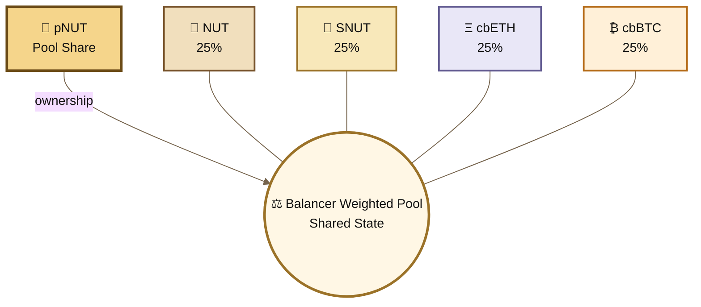
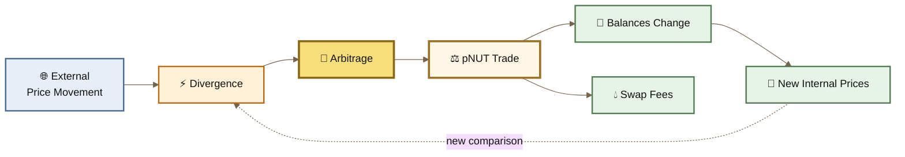
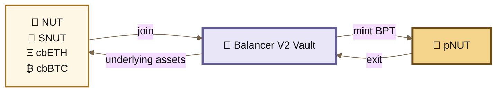

# ⚙️ pNUT Mechanics

Weighted liquidity, market rebalancing, and the economics behind the basket


pNUT is not a wrapper around four tokens.

It is the **Balancer Pool Token (BPT)** representing ownership of a live Balancer V2 Weighted Pool containing **NUT, SNUT, cbETH, and cbBTC**.


The pool is the economic machine.

**pNUT is the share of that machine.**

***

### ⚖️ One Shared Market

The four assets do not sit in four independent vault compartments.

They participate in **one shared weighted invariant**.






The deployed pool was created with:

| Parameter            | Verified deployment                                               |
| -------------------- | ----------------------------------------------------------------- |
| **Assets**           | cbETH · SNUT · NUT · cbBTC                                        |
| **Weights**          | 25% · 25% · 25% · 25%                                             |
| **Initial swap fee** | 1%                                                                |
| **Rate providers**   | None                                                              |
| **Pool / BPT**       | `0x2A5757b60987FF10385De1D4D923792f6fdCfFf1`                      |
| **Pool ID**          | `0x2a5757b60987ff10385de1d4d923792f6fdcfff100010000000000000019e` |

These parameters are visible directly in the creation transaction. ([Basescan](https://basescan.org/tx/0xe707f8dfb0d12258d1f6721c30a6b51cf90296ae07ab0622d648a21f8419a2ec))

The **25% weights are fixed mathematical parameters**. They do not mean that the raw token quantities are equal, nor that external market values can never temporarily drift away from those target relationships.

***

### 🧮 The Weighted Invariant

Balancer Weighted Pools generalize the constant-product AMM into a constant-mean invariant. ([GitHub](https://github.com/balancer/docs-developers/blob/main/resources/pool-math/weighted-math.md?utm_source=chatgpt.com))

```
V = ∏ Bᵢ ^ Wᵢ
```

Where:

```
Bᵢ = balance of asset i
Wᵢ = normalized weight of asset i

Σ Wᵢ = 1
```

For pNUT:

```
W_NUT   = 0.25
W_SNUT  = 0.25
W_cbETH = 0.25
W_cbBTC = 0.25
```

Therefore:

```
V =
B_NUT^0.25
× B_SNUT^0.25
× B_cbETH^0.25
× B_cbBTC^0.25
```

Or:

```
V =
(
    B_NUT
  × B_SNUT
  × B_cbETH
  × B_cbBTC
) ^ 0.25
```

A swap changes balances while remaining on this invariant surface.

That means a NUT/cbBTC trade does not create a separate NUT/cbBTC pool.

It changes two balances inside the **same four-asset state**.

***

### 📐 Internal Prices

Balancer derives the spot relationship between any two assets from their balances and weights:

```
SP(i → o) =

(Bᵢ / Wᵢ)
──────────
(Bₒ / Wₒ)
```

([Balancer](https://docs.balancer.fi/whitepaper.pdf?utm_source=chatgpt.com))


Because every pNUT asset has the same weight:

```
Wᵢ = Wₒ = 0.25
```

the weight terms cancel:

```
SP(i → o) = Bᵢ / Bₒ
```

This produces an interesting property.

For a trade between any two pNUT assets, the exact-input equation is:

```
Aᵢ,eff = Aᵢ × (1 - f)
```

and:

```
Aₒ =
Bₒ ×
[
    1 -
    (
        Bᵢ
        ───────────
        Bᵢ + Aᵢ,eff
    ) ^ (Wᵢ / Wₒ)
]
```


Because pNUT uses equal weights:

```
Wᵢ / Wₒ = 1
```

so the pairwise swap simplifies to:

```
Aₒ =

Bₒ × Aᵢ,eff
─────────────
Bᵢ + Aᵢ,eff
```


This is the familiar equal-weight constant-product relationship for that pair. ([GitHub](https://github.com/balancer/balancer-v2-monorepo/blob/master/pkg/pool-weighted/contracts/WeightedMath.sol?utm_source=chatgpt.com))


But all of those pairwise relationships **share the same balances**.

Change the NUT balance and NUT's relationship with **SNUT, cbETH, and cbBTC** changes simultaneously.


That is what makes the four-asset pool more than a collection of separate pairs.

***

### 🐝 The Arbitrage Machine

The pool does not know the external price of NUT, SNUT, ETH, or Bitcoin.

External markets move independently.


When they move, pNUT can become misaligned.





This is the core Balancer mechanism: traders following arbitrage opportunities perform the rebalancing that a conventional portfolio manager would otherwise have to perform.

In BASED NUT terms:

```
price movement
      ↓
divergence
      ↓
arbitrage pressure
      ↓
trading
      ↓
new pool state
      +
swap fees
```

This is what we mean by **volatility farming**.

But arbitrage is only rational when:

```
Expected Arbitrage Profit =

Gross Price Difference
- Swap Fees
- Slippage
- Gas
- MEV / Execution Costs
- Execution Risk

> 0
```

The invariant creates the pressure.

It cannot force a third party to make an unprofitable trade.

> **pNUT is built to expose volatility to arbitrage.**


***

### 🌪️ Why the Pool Is So Volatile

pNUT combines four assets with very different economic behavior:

```
🌰 NUT
scarce ecosystem root

🦸 SNUT
fee + reward + burn mechanics

Ξ cbETH
liquid staked ETH exposure

₿ cbBTC
wrapped Bitcoin exposure
```


They are not expected to move together.

That is intentional.


The more their relative prices diverge, the more aggressively the pool can be pushed away from surrounding markets before arbitrage brings it back toward alignment.

And because the pool is shallow, relatively small trades can produce large changes in balance and price.


Balancer V2 Weighted Math also limits a single swap to at most **30% of the relevant input balance**, and similarly limits exact-output swaps to 30% of the output balance. These protections constrain extreme individual swaps but do not remove price impact or volatility. ([GitHub](https://github.com/balancer/balancer-v2-monorepo/blob/master/pkg/pool-weighted/contracts/WeightedMath.sol?utm_source=chatgpt.com))

***

### 🔄 Joining and Exiting

pNUT is **joined and exited**, not wrapped and unwrapped.

Balancer V2 routes joins and exits through the Vault. A join transfers assets into the pool and can mint BPT; an exit returns assets and burns BPT. ([GitHub](https://github.com/balancer/docs-developers/blob/main/deep-dive/guided-tour-of-balancer-vault/episode-2-joins/README.md?utm_source=chatgpt.com))







The simple model is:

```
assets
  ↓
join
  ↓
pNUT
```

and:

```
pNUT
  ↓
exit
  ↓
assets
```

Proportional liquidity changes preserve the existing pool composition.

Imbalanced and single-asset joins or exits effectively contain internal swap behavior, so Balancer charges swap fees on the portion that unbalances the pool. ([GitHub](https://github.com/balancer/docs-developers/blob/main/deep-dive/guided-tour-of-balancer-vault/episode-2-joins/README.md?utm_source=chatgpt.com))

The pNUT supply is therefore **dynamic**, not infinite.

***

### 💧 Where the Economics Come From

pNUT does not need pNUT emissions to produce economic accrual.

There are two identifiable sources.


#### 1. Trading Fees

Every swap can add fee value to the pool.

The pool was deployed with a:

```
1% swap fee
```

and current market indexing continues to identify it as a 1% pool. ([Basescan](https://basescan.org/tx/0xe707f8dfb0d12258d1f6721c30a6b51cf90296ae07ab0622d648a21f8419a2ec))


The gross swap fee should not be confused with net LP income. Balancer protocol fees can claim part of pool fee growth, and the WeightedPool contract accounts for pending protocol-fee obligations. ([GitHub](https://github.com/balancer/docs-developers/blob/main/deep-dive/guided-tour-of-balancer-vault/episode-2-joins/README.md?utm_source=chatgpt.com))


So:

```
more trading ≠ guaranteed profit
```

but:

```
more trading → more potential swap-fee accrual
```


#### 2. cbETH Staking Exposure

Twenty-five percent of the pool's normalized weight is cbETH.

Coinbase states that cbETH represents staked ETH and that its conversion rate changes over time as rewards accrue to the underlying staked ETH. Its market price can still trade above or below that underlying conversion value. ([Coinbase Help](https://help.coinbase.com/en/coinbase/coinbase-staking/staking/cbeth-intro?utm_source=chatgpt.com))

The sstakin accrual exists inside the cbETH position itself and is transmitted to the basket through cbETH's value and market price.

Underlying token appreciation or depreciation is separate from yield.

***

### 🕸️ One Hyperedge

In liquidity-graph terms, pNUT is one of the clearest examples of a **hyperedge** in the Orchard.

```
H_pNUT = {
    NUT,
    SNUT,
    cbETH,
    cbBTC
}
```

It is not:

```
NUT / SNUT
NUT / cbETH
NUT / cbBTC
SNUT / cbETH
...
```

as six independent markets.


It is **one market with one shared reserve state**.

```
BASED NUT assets
 NUT + SNUT
 
      ↕
   ⚖️ pNUT
      ↕
      
reserve assets
cbETH + cbBTC
```

A change originating in one part of that structure can therefore alter the relative state of every asset connected through the pool.


That is the deeper function of pNUT:

> **Four independently priced assets placed inside one shared economic state machine.**

***

## ⚠️ Risk Disclosure

pNUT should be treated as a **hyper-volatile experimental liquidity machine**, not as a passive index fund.

The pool deliberately combines independently priced assets and relies on market arbitrage to move its internal prices toward surrounding markets.


#### Arbitrage can work against LPs

When one asset rises relative to the others, arbitrage tends to remove the outperforming asset and add relatively underperforming assets.

In simple terms:

```
outperformer
    ↓
sold from pool

underperformer
    ↓
accumulated by pool
```

That rebalancing can create fees.

It can also cause pNUT holders to underperform simply holding the four underlying assets.

Balancer identifies **impermanent loss in volatile, non-correlated Weighted Pools** as a core risk. ([Balancer](https://balancer.fi/risks?utm_source=chatgpt.com))


#### Shallow liquidity amplifies movement

pNUT is currently a very small liquidity pool.


That means:

```
less liquidity
      ↓
greater price impact
      ↓
larger state changes
      ↓
higher manipulation and execution risk
```

Live liquidity should always be checked before interacting; static documentation should not be treated as current market data.


#### Constituent risk compounds

pNUT inherits the risks of all four assets.

NUT and SNUT introduce their own liquidity and experimental-token risks.

cbETH introduces Ethereum staking, Coinbase, liquidity, and conversion-rate risk. Coinbase notes that cbETH's market price can differ from the value of its underlying staked ETH. ([Coinbase Help](https://help.coinbase.com/en/coinbase/coinbase-staking/staking/cbeth-intro?utm_source=chatgpt.com))

cbBTC introduces Coinbase custody and issuer dependency. Coinbase currently states that cbBTC is backed **1:1 by BTC held by Coinbase** and publishes reserve and supply data. ([Coinbase Help](https://help.coinbase.com/en/coinbase/trading-and-funding/sending-or-receiving-cryptocurrency/coinbase-wrapped-btc?utm_source=chatgpt.com))


#### Balancer V2 is legacy infrastructure

pNUT remains a **Balancer V2 Weighted Pool**.

The November 3, 2025 Balancer exploit affected V2 **Composable Stable Pools**. Balancer's post-mortem specifically states that Weighted Pools were unaffected by that exploit and remained operational. ([Medium](https://medium.com/balancer-protocol/nov-3-exploit-post-mortem-51dcbeb6b020?utm_source=chatgpt.com))

However, Balancer subsequently disabled V2 pool factories as part of its transition to V3, and its 2026 operating plan describes V2 as **maintenance-only on a sunset path**. ([Balancer](https://forum.balancer.fi/t/bip-887-transitioning-to-balancer-v3-disabling-v2-pool-factories/6874?utm_source=chatgpt.com))

pNUT therefore carries both ordinary smart-contract risk and the lifecycle risk of operating on legacy V2 infrastructure.


#### **pNUT is a market position, not a source of external truth.**

It is not a secure standalone oracle. pNUT's own balances can move, external prices can move, the pool is shallow, and actual exit execution depends on pool state.


#### Nothing is guaranteed

pNUT does not guarantee:

```
25% external market value at every moment

positive yield

profitable arbitrage

principal preservation

protection from impermanent loss

sufficient exit liquidity

continued Balancer V2 support
```

The machine can generate fees precisely because its assets disagree.

That disagreement is also the risk.


> **pNUT does not remove volatility. It puts volatility to work.**


Four assets.

One invariant.

One continuously changing state.

**pNUT is the receipt for whatever state the machine reaches next. 🥜**
