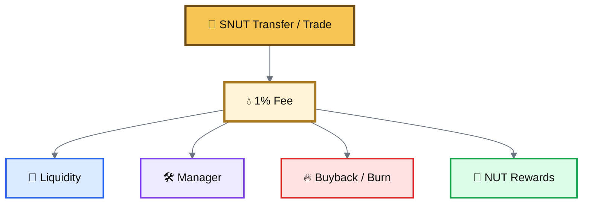
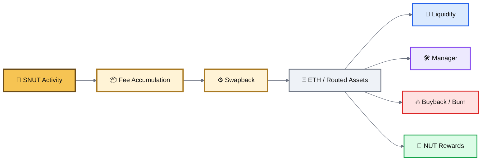
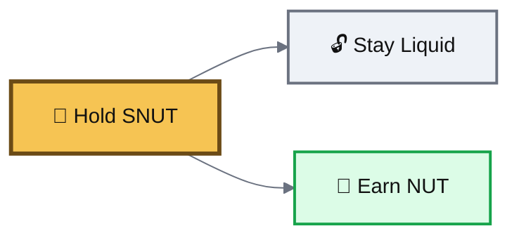
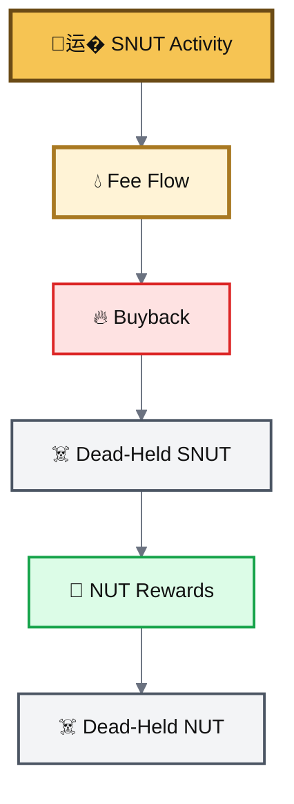
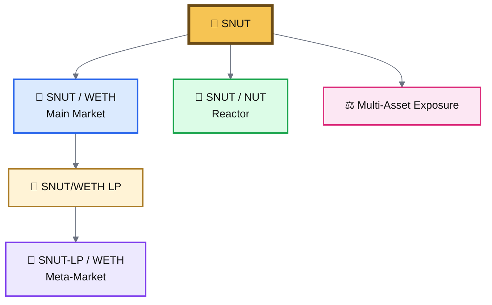
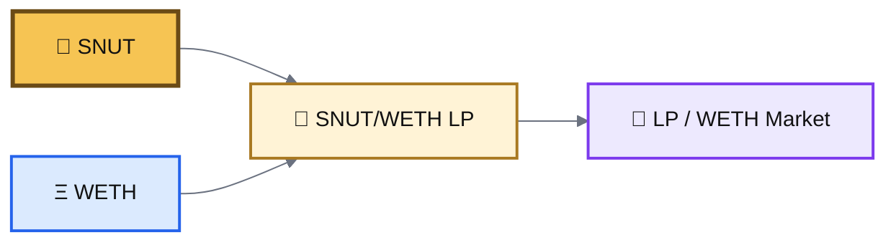
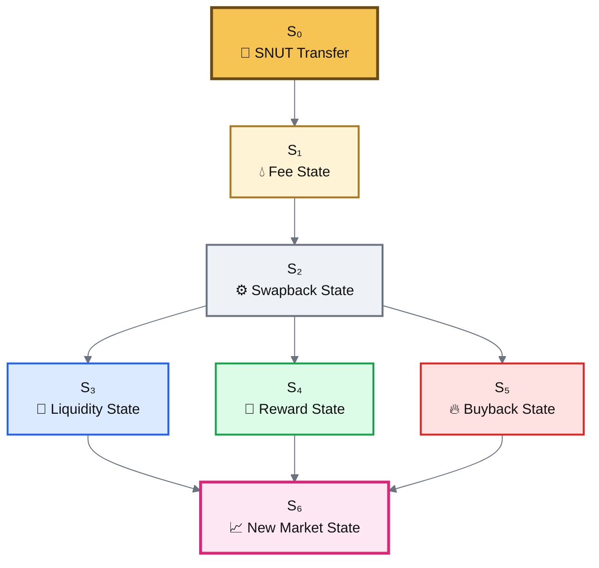

# 🔥 SNUT Mechanics

SNUT is the mechanical layer of the BASED NUT ecosystem.


The surface behavior is simple:

> **Hold SNUT → earn NUT.**&#x20;
>
> **Trade SNUT → feed the system.**

Underneath that is a chain of linked market actions.


***

### 🔄 Fee Routing

Every SNUT transfer currently applies a **1% fee**.

That fee is routed across four functions.





The exact live split should always be verified from the contract.


***

### ⚙️ Swapback Engine

Collected fee-bearing SNUT does not stop at collection.

It is processed through a swapback path that turns the fee flow into usable outputs.





This is why SNUT transfers can create downstream market effects rather than just moving balances.


***

### 🌰 Non-Escrow Reward Position

SNUT holders do not need to lock tokens in a traditional escrow staking contract.





> **SNUT is a liquid reward position for NUT.**

***

### 🔥 Recursive Compounding Burn Flywheel

One of the most unusual SNUT mechanics is the recursive burn path.

Buybacks can send SNUT to the dead address.

If dead-held SNUT remains inside reward accounting, it can continue receiving NUT rewards. Those NUT can also accumulate at dead.





> **Burn feeds burn.**

Important distinction: sending tokens to dead removes them from effective circulation, but it does not rewrite the token’s original total-supply constant.


***

### 🌊 SNUT Liquidity Layers

SNUT lives across multiple market layers.

Each pool has a different job.





#### Pool Roles

| Pool                     | Role                                         |
| ------------------------ | -------------------------------------------- |
| **SNUT / WETH**          | Primary spot liquidity and price discovery   |
| **SNUT-LP / WETH**       | Secondary market for the LP token itself     |
| **SNUT / NUT**           | Direct reactor connection into the NUT graph |
| **Multi-asset exposure** | Additional shared liquidity relationships    |

***

### 🌴 The Palm Tree Market

The `SNUT-LP / WETH` pool is a meta-market.

It gives the **SNUT/WETH LP token** its own market price.





This creates another pricing layer:

```
SNUT spot
+ WETH spot
+ SNUT/WETH LP value
+ SNUT-LP/WETH market price
```

That separation can produce additional arbitrage and repricing behavior.

> **Liquidity itself becomes liquid.**


***

### 🧮 Cascading State

SNUT is one of the clearest examples of layered economic state inside BASED NUT.

A single transfer can propagate through multiple compartments.





> **One token action can propagate through rewards, liquidity, burns, and multiple market states.**


***

### Contracts & Markets

<table><thead><tr><th width="261">Component</th><th>Address</th></tr></thead><tbody><tr><td><strong>SNUT</strong></td><td><code>0xAC130701aa31c284c36609E2489f150F419AD7AD</code></td></tr><tr><td><strong>SNUT/WETH LP</strong></td><td><code>0xb22895d2ee6e29395f30ec47c8d9fe0d55355ae1</code></td></tr><tr><td><strong>SNUT-LP/WETH Meta-Pool</strong></td><td><code>0x82bbadb9d6b2c0a59ed01809e30323f89f6faa1c</code></td></tr><tr><td><strong>SNUT/NUT</strong></td><td><code>0x893faaa7baf7a8247fc7142afb28e13d51a5aae8</code></td></tr></tbody></table>

> ⚠️ **Experimental Memefi.** Contract behavior, fee configuration, liquidity, and market state should always be independently verified before interaction.
