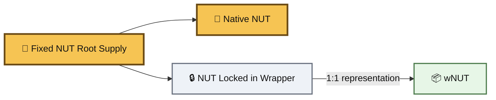
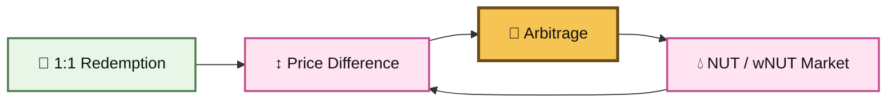

# 🎁 wNUT

<figure><figcaption></figcaption></figure>

Wrapped NUT ($wNUT) is the **1:1 wrapped execution state of BASED NUT ($NUT)**.


Wrapping moves NUT from its native state into a wrapped state. The underlying NUT is held by the wrapper and an equal amount of wNUT becomes outstanding.


Unwrapping reverses the transition.

```
1 NUT ⇄ 1 wNUT
```


No additional NUT is created. The NUT contract does not change. The fixed NUT root supply remains the same.

> **Same NUT. Different state. 🌰**



**wNUT is not a second NUT economy.**

Every outstanding wNUT corresponds to NUT held by the wrapper. wNUT changes the state and execution surface of existing NUT without increasing the underlying NUT supply.



***

### 🌰 One NUT, Multiple States

NUT is the conserved root.


At any moment, NUT can remain in its native state or be deposited into the wrapper and represented as wNUT.





The important distinction is between **token supply** and **token state**.

Wrapping does not mint more NUT.

It changes where existing NUT resides and creates a 1:1 wrapped representation of that locked NUT.



NUT exists directly in its original ERC-20 state.

It can be held, transferred, pooled, or used wherever the NUT contract is supported.



NUT is held by the wrapper while an equal amount of wNUT circulates.

wNUT has its own contract address and can participate independently in compatible markets and contracts.



The two states are directly reversible:

```
NUT → wrap → wNUT
wNUT → unwrap → NUT
```

The underlying economic root remains NUT throughout the transition.



***

### 🧩 Expanding the Execution Surface

The purpose of wNUT is larger than creating another representation.


It gives the same conserved NUT economy **another addressable execution state**.


An **execution surface** is the set of contracts, markets, relationships, and operations available to a token state.


With only NUT:

```
NUT
 ├── Market A
 ├── Contract B
 └── Liquidity C
```


With NUT and wNUT:

```
NUT
 ├── Native NUT relationships
 ├── NUT ⇄ wNUT transition
 └── wNUT
      ├── wNUT relationships
      ├── wNUT markets
      └── wNUT integrations
```


The root supply has not expanded but the **number of reachable execution paths has**.



#### 🌱 Depth without dilution

Multi-state NUT expands what the existing asset can interact with without requiring additional NUT to exist.


The gain is **execution depth**, not additional supply.



This does **not** mean the same NUT can be independently spent twice.


NUT represented by wNUT is locked inside the wrapper. The architecture expands the ways the conserved asset can be expressed and connected; it does not duplicate capital.


***

### 💧 NUT / wNUT Liquidity

A NUT/wNUT pool is structurally different from an ordinary market such as NUT/WETH.


#### Ordinary liquidity

```
NUT ⇄ WETH
```


Two different economic assets are exchanged.


#### State liquidity

```
NUT ⇄ wNUT
```

Two token states reference the **same underlying NUT economy**.


That distinction gives the NUT/wNUT relationship a different role.




The wrapper creates the deterministic state transition.

```
1 NUT → 1 wNUT
1 wNUT → 1 NUT
```

Wrapping and unwrapping do **not** require an AMM.



The pool creates a **market and liquidity position between the states**.

It allows:

* NUT/wNUT swaps
* liquidity participation
* LP fee generation when trading occurs
* reserve-based market pricing
* additional programmable behavior where the AMM supports it



The wrapper anchors the states through 1:1 redemption.

The pool makes the relationship tradable and LP-addressable.

If the pool price moves away from redemption parity, arbitrage can move it back toward the wrapper relationship.





**The pool does not create the NUT ⇄ wNUT transition. The wrapper does.**

The pool adds a **liquidity layer around that transition**: trading, LP participation, market state, fees, and potentially programmable liquidity.



This is the more precise meaning of **liquid state relationships**.


***

### ⚖️ One Redemption Relationship, Two Market States

The wrapper defines:

```
1 NUT ⇄ 1 wNUT
```

An AMM independently maintains reserves and therefore has its own instantaneous market price.


The AMM price can temporarily differ from the wrapper's redemption relationship.





Arbitrage is therefore an important **market mechanism**, but it is not the primary purpose of wNUT.

The deeper primitive is the reversible state relationship itself.


***

### 🧬 Keep the Root Simple

NUT is intentionally minimal.


wNUT demonstrates another way of extending the ecosystem:

> **Do not force every capability into the root asset. Build additional execution states and relationships around it.**

```
                    🌰 NUT
                 Conserved Root
                       │
              ┌────────┴────────┐
              │                 │
        Native State      Wrapped State
             NUT              wNUT
              │                 │
        native paths      additional paths
              └────────┬────────┘
                       │
                same root economy
```

The point is not merely that functionality can be added somewhere outside the NUT contract.

The stronger architectural property is that **new execution surfaces can remain connected to one conserved root through reversible state transitions**.


***

### 🔬 Current Primitive vs Future Architecture

wNUT itself should be distinguished from systems that may eventually be built around it.



The deployed wNUT primitive provides:

* 1:1 NUT backing
* reversible wrapping and unwrapping
* a separate wrapped token state
* no wNUT transfer tax
* independent contract composability
* the ability to form NUT/wNUT liquidity relationships
* redemption-driven arbitrage where markets exist

wNUT is **not yield-bearing**.



Additional systems can potentially use the state relationship as infrastructure.

Examples include:

* programmable NUT/wNUT liquidity
* Uniswap v4 hooks
* dynamic liquidity behavior
* automated state routing
* conditional state transitions
* time-dependent transitions
* Superfluid-style functional states
* temporary or transaction-local execution states

These are architectural possibilities, **not properties of the current wNUT contract**.



***

### 🚫 What wNUT Does Not Do

wNUT does not:

* create additional NUT
* increase the fixed root supply
* allow the same underlying NUT to be independently spent twice
* generate yield by itself
* increase its NUT backing over time
* guarantee that every external market will always quote exactly 1:1
* automatically make every protocol understand NUT and wNUT as equivalent
* automatically create capital efficiency simply by existing


Its current primitive is simpler:

> **A reversible, 1:1 wrapped execution state that expands the relationships available around the same conserved NUT root.**


***

### 🌳 The Model

```
One conserved NUT root
        +
Reversible wrapped state
        +
Independent execution surface
        +
Optional liquidity between states
```


**Keep the root simple. Build around it.**

**Same NUT. Different state. More execution paths. 🌰📦**

