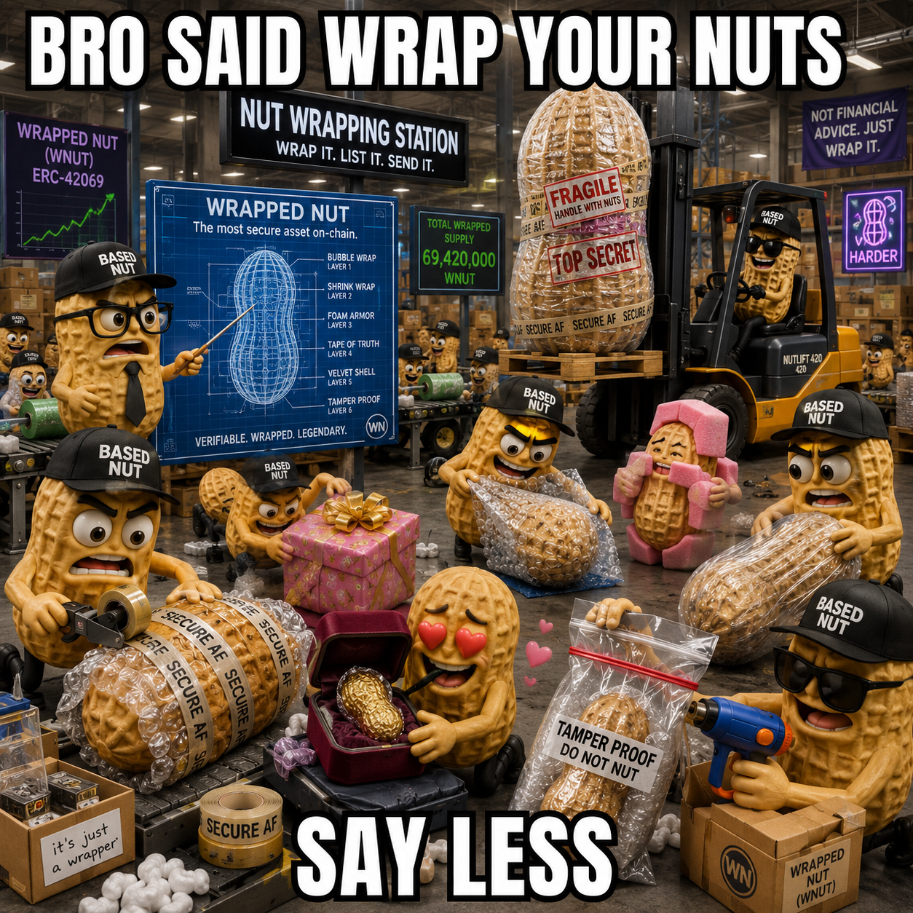
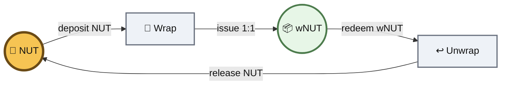
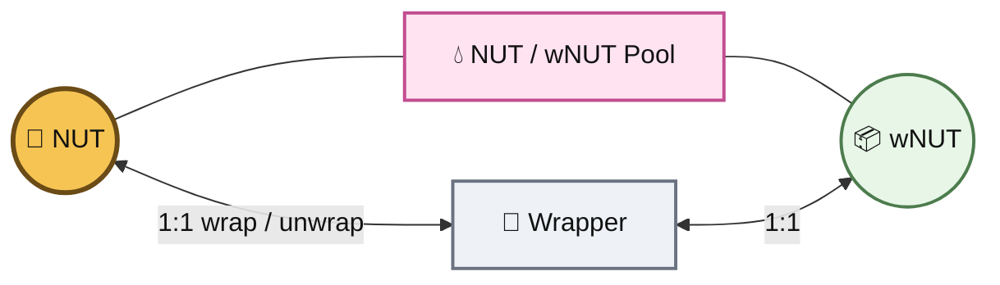
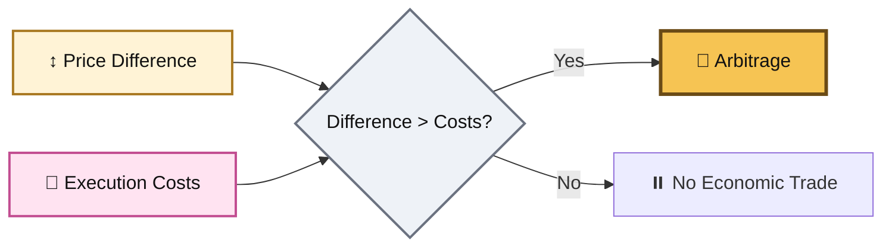

# 📦 wNUT Mechanics

<figure><figcaption></figcaption></figure>


For the conceptual model — **one conserved NUT root, multiple execution states** — see the main **wNUT** page.


***

### 📋 Technical Details

<table><thead><tr><th width="200">Property</th><th>Value</th></tr></thead><tbody><tr><td><strong>Token Name</strong></td><td>Wrapped NUT ($wNUT)</td></tr><tr><td><strong>Chain</strong></td><td>Base</td></tr><tr><td><strong>wNUT Address</strong></td><td><code>0xBA5ED46e31F80dafF307cbf60bd422a6f62E3dd3</code></td></tr><tr><td><strong>Underlying Asset</strong></td><td>BASED NUT ($NUT)</td></tr><tr><td><strong>NUT Address</strong></td><td><code>0xb8de15fb529d98c93c749de63c749d48d25a30df</code></td></tr><tr><td><strong>Backing</strong></td><td>1:1 NUT</td></tr><tr><td><strong>Issuance</strong></td><td>Created by wrapping NUT</td></tr><tr><td><strong>Redemption</strong></td><td>Redeem wNUT for NUT</td></tr><tr><td><strong>Transfer Tax</strong></td><td>None</td></tr><tr><td><strong>Yield-Bearing</strong></td><td>No</td></tr><tr><td><strong>Root Supply Effect</strong></td><td>None</td></tr></tbody></table>


### wNUT supply is **not additional NUT supply**.

wNUT represents NUT already held by the wrapper.



***

### 🔄 Wrap & Unwrap

The wrapper creates a direct reversible relationship between NUT and wNUT.









#### Select NUT

Choose the amount of NUT to move into the wrapped state.

Example:

```
0.1 NUT
```



#### Deposit NUT

The selected NUT is transferred into the wrapper contract.

If the wrapping function pulls NUT using ERC-20 `transferFrom`, the wrapper must first have sufficient NUT allowance.



#### Receive wNUT

An equal amount of wNUT becomes outstanding.

```
0.1 NUT → 0.1 wNUT
```

The corresponding NUT remains held by the wrapper while that wNUT is outstanding.







#### Select wNUT

Choose the amount of wNUT to redeem.

Example:

```
0.1 wNUT
```



#### Redeem wNUT

The selected wNUT is returned to the wrapper for redemption.

The amount of outstanding wNUT decreases by the redeemed amount.



#### Receive NUT

The wrapper releases the corresponding NUT.

```
0.1 wNUT → 0.1 NUT
```





***

### 🔒 Conservation Invariant

Let:

```
N_total   = fixed NUT root supply
N_free    = NUT outside the wrapper
N_locked  = NUT held by the wrapper
W         = outstanding wNUT
```

Then:

```
N_total = N_free + N_locked
```

and under 1:1 backing:

```
W = N_locked
```

Therefore:

#### After wrapping `x` NUT

```
N_free   → N_free - x
N_locked → N_locked + x
W        → W + x
N_total  → unchanged
```

#### After unwrapping `x` wNUT

```
N_free   → N_free + x
N_locked → N_locked - x
W        → W - x
N_total  → unchanged
```



#### 🌰 Root conservation

Wrapping changes the distribution of NUT between native and wrapped representation.


It does **not** change `N_total`.



#### ⚠️ Do not double-count the wrapper

This expression is economically misleading:

```
N_total + W
```

because `W` represents claims against NUT already contained inside `N_total`.


If 0.2 NUT is locked and 0.2 wNUT exists, the system has **not created 0.4 NUT of underlying economic value**.


It has:

```
0.2 NUT locked
+
0.2 wNUT representing that locked NUT
```

One underlying position. Two token-state records.


***

### 🧬 State Accounting

Wrapping changes **state**, not root ownership quantity.

```
Before
──────
User: 0.1 NUT
Wrapper: 0 NUT
User: 0 wNUT

After Wrap
──────────
User: 0 NUT
Wrapper: 0.1 NUT
User: 0.1 wNUT
```

The user's economic exposure remains linked to NUT through the wrapper's redemption relationship.


Unwrapping reverses the accounting.


This distinction is central:

> **wNUT increases representation and execution paths, not underlying NUT quantity.**
>
>

***

### 💧 NUT / wNUT Liquidity

A NUT/wNUT AMM creates a market between the native and wrapped states.





The wrapper and the AMM perform different functions.



The wrapper defines the contractual conversion relationship:

```
1 NUT ⇄ 1 wNUT
```

This is the **redemption path**.

It does not depend on AMM reserves.



The AMM contains reserves of NUT and wNUT.

Its price is determined by the pool's own state and AMM rules.

The pool enables:

* swapping
* liquidity provision
* trading fees
* reserve-based price formation
* venue-specific programmable behavior



Arbitrage connects the AMM price to the wrapper relationship.

If the market moves far enough away from 1:1, traders can use wrapping or unwrapping as the other side of the trade.





#### A pool is optional

Users do not need a NUT/wNUT pool to wrap or unwrap.

The wrapper provides the state transition directly.

The pool makes the relationship **tradable, LP-addressable, and potentially programmable**.



***

### ⚖️ Redemption Parity vs AMM Price

Define:

```
P_redemption = 1 NUT per wNUT
P_market     = current AMM price of wNUT in NUT
```


The wrapper fixes:

```
P_redemption = 1
```


The AMM does not mechanically force:

```
P_market = 1
```

because its price is derived from its own reserves and execution rules.


The two can therefore temporarily diverge.


**Independent market state does not mean independent economic backing.**

wNUT remains a 1:1 NUT-backed representation even when an AMM temporarily quotes a different market price.



***

### 🐝 Redemption-Driven Arbitrage



If:

```
1 wNUT < 1 NUT
```

an arbitrage path can be:

```
Acquire discounted wNUT
        ↓
Unwrap wNUT
        ↓
Receive corresponding NUT
```

Buying wNUT from the pool creates upward pressure on its AMM price.



If:

```
1 wNUT > 1 NUT
```

an arbitrage path can be:

```
Acquire NUT
    ↓
Wrap NUT 1:1
    ↓
Sell wNUT into the pool
```

Selling wNUT creates downward pressure on its AMM price.




Arbitrage is only economically rational when the gross opportunity exceeds total execution cost.

```
Arbitrage Opportunity
>
Swap Fees
+ Slippage
+ Gas
+ Wrapper Execution Costs
+ Other Execution Costs
```

Small discrepancies can therefore persist.

Larger discrepancies create stronger incentives for correction.






***

### 🌱 LP Economics

wNUT itself is **not yield-bearing**.

```
1 wNUT does not become 1.01 wNUT
1 wNUT does not gain additional NUT backing
```

A NUT/wNUT LP position can nevertheless earn trading fees when swaps occur.

```
Trading Activity
      ↓
   Swap Fees
      ↓
Liquidity Providers
```


The distinction matters:

> **Yield around wNUT is not yield from wNUT.**


LP returns depend on the actual market structure, including:

* trading volume
* fee configuration
* liquidity depth
* slippage
* LP range or AMM design
* external incentives, if any
* contract and integration risk

Price divergence can create arbitrage volume, but divergence is **not itself guaranteed productive activity** and does not guarantee LP yield.


***

### 🧩 Protocol Composability

NUT and wNUT are separate contract addresses.


To another smart contract, they are therefore separate token interfaces unless that protocol explicitly understands their relationship.

This has several consequences.


#### 1. wNUT can be integrated independently

A protocol can support wNUT without modifying NUT.

#### 2. NUT and wNUT are not automatically interchangeable everywhere

The wrapper guarantees redemption.

External contracts do not automatically know that relationship.

#### 3. Routers can abstract the transition

A higher-level integration can wrap or unwrap as part of a larger transaction so users do not need to manually manage every state transition.

#### 4. Additional states can create additional paths

A future system can potentially connect NUT to other functional states while preserving NUT as the root economic asset.


***

### 🧬 Execution Surface

At the contract level, the state graph begins simply:

```
          wrap
NUT ─────────────► wNUT
 ▲                  │
 └──────────────────┘
        unwrap
```

Then integrations add edges:

```
                    Market A
                       ▲
                       │
NUT ⇄ wNUT ────────────┼──── Contract B
                       │
                       ▼
                    Pool C
```

The meaningful expansion is therefore not the number of token units.

It is the number of **valid execution relationships reachable from the conserved root**.


***

### 🧪 Extension Boundary


#### Current contract vs future systems

The current wNUT wrapper should not be documented as though it already contains functionality supplied by external protocols.


Programmable liquidity, streaming, automated routing, hooks, or conditional execution would be **systems built around the NUT/wNUT state relationship**, not existing properties of wNUT itself.



Potential extension surfaces include:



A NUT/wNUT v4 pool could potentially add hook-controlled behavior around swaps and liquidity operations.

Examples include dynamic fees, custom accounting, automated behavior, and conditional execution.



Other wrapped states could expose specialized functionality while remaining linked to NUT.

Superfluid-style streaming is one example of this broader design pattern.



Routers or agents could eventually select when NUT should remain native, become wNUT, participate in liquidity, or transition back to the root state.

That functionality belongs above the wrapper layer.




***

### ⚠️ Risks & Constraints

#### 🔒 Wrapper Contract Risk

The 1:1 relationship depends on the wrapper contract correctly holding and releasing NUT.

#### 💧 Liquidity Risk

A NUT/wNUT pool can have low liquidity, slippage, or temporary price divergence even though direct redemption remains 1:1.

#### 🐝 Execution-Cost Risk

An apparent arbitrage opportunity may be uneconomic after fees, gas, and slippage.

#### 🧩 Integration Risk

External protocols may treat NUT and wNUT differently or may not support one of them.

#### 🔗 Composability Risk

Every additional protocol layered around wNUT introduces its own contract and execution assumptions.

#### 🌱 Yield Assumptions

wNUT does not generate yield by itself. LP fees or external incentives are separate mechanisms and are not guaranteed.

#### ♻️ No Capital Duplication

NUT held behind wNUT cannot simultaneously be treated as independently available native NUT without introducing another claim or rehypothecation mechanism.


***

### 🚫 What wNUT Is Not

wNUT is not:

* additional NUT supply
* a rebasing token
* a yield-bearing wrapper
* an automatic source of LP yield
* a mechanism for using the same NUT twice
* a guarantee of exact 1:1 AMM pricing at every moment
* a replacement for the underlying NUT
* automatically equivalent to NUT inside every external protocol


***

### 📐 Core Invariants

```
1 NUT wrapped = 1 wNUT issued

1 wNUT redeemed = 1 NUT released

wNUT outstanding = NUT locked by the wrapper

NUT total supply does not increase when wrapping occurs
```


The resulting architecture is:

```
🌰 NUT
   │
   │ reversible 1:1 state transition
   ▼
📦 wNUT
   │
   ├── markets
   ├── liquidity
   ├── integrations
   └── future programmable execution
```

> **The wrapper preserves the root. The wrapped state expands the surface. Liquidity connects the states economically.**



**Wrap the NUT 🎁. Change the state 📦. Keep the root 🌰.**


