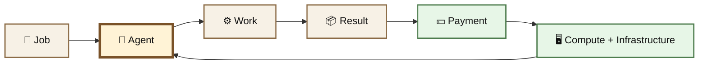
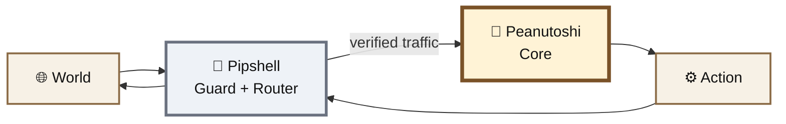
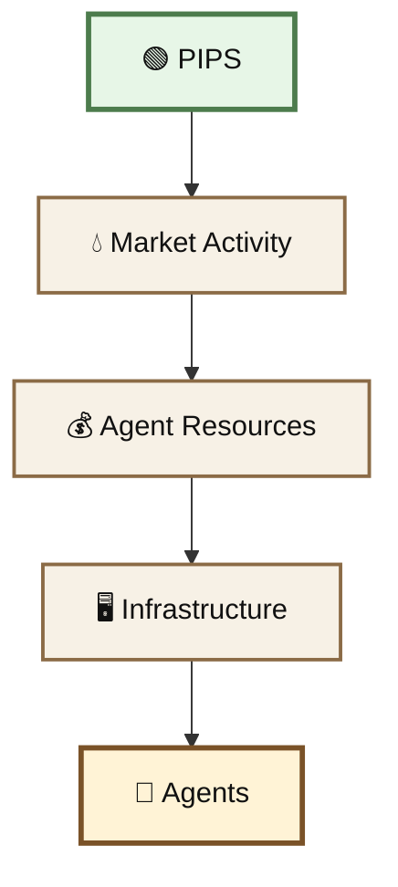
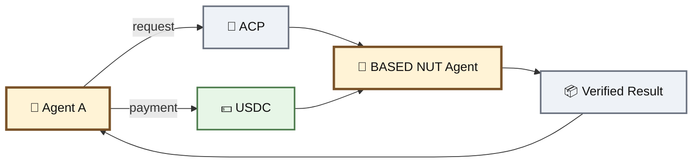
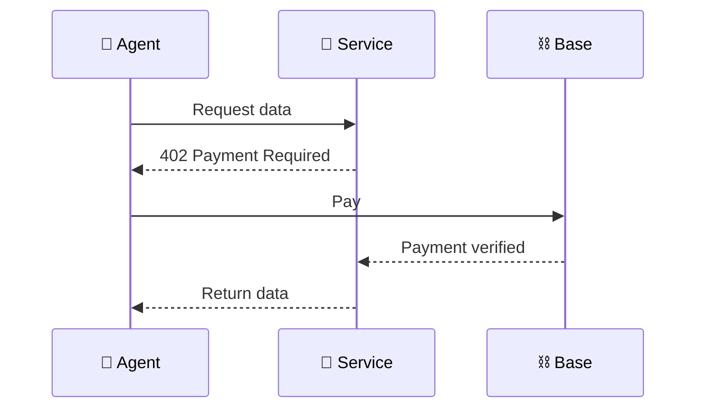
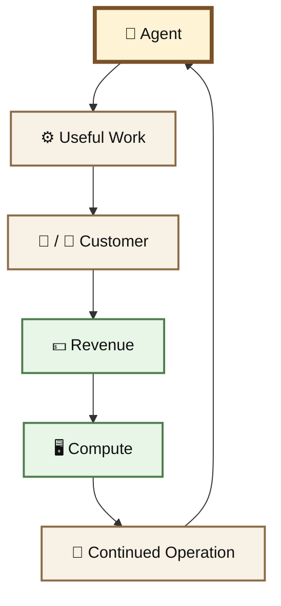
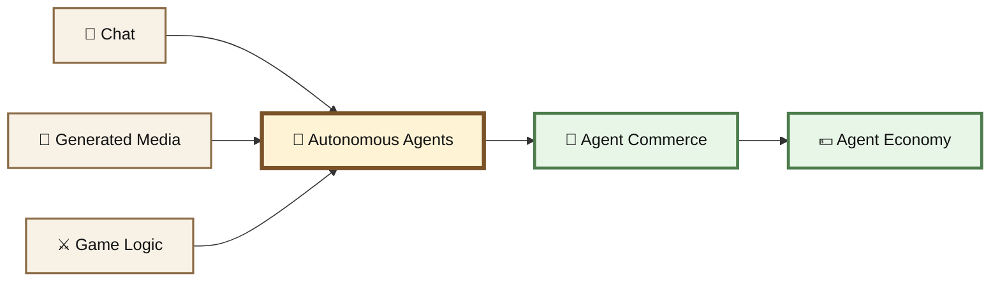

# 🤖 AI Agents

#### Overview

BASED NUT began experimenting with AI through chat, generated media, games, and autonomous tooling.

The experiment has since moved further:

> **Can an AI agent do useful work, earn revenue, pay for its own infrastructure, and persist as an economic actor?**

The current agent system combines **autonomous agents, machine-payable services, onchain economics, and agent-to-agent commerce on Base**.





> **Agents should do more than talk. They should work.**

***

## 🥜 Peanutoshi Nutkamoto

#### The Core

**Judgment · State · Execution**

Peanutoshi is the central BASED NUT agent.

Its role is to read the system, verify evidence, maintain state, and make decisions about what is actually deployed, live, and true.

```
world / chain / services
          ↓
    🥜 Peanutoshi
          ↓
       verify
          ↓
       decide
          ↓
       execute
```

Core responsibilities include:

* 🔎 reading onchain and external state
* 🧠 maintaining ecosystem context
* ✅ verifying evidence before acting
* ⚙️ executing approved operations
* 🛡️ applying pre-flight checks and safety gates
* 📡 answering ecosystem queries

> **The center of the wheel.**

Public presence:

* [X — @BASEDNUT\_](https://x.com/BASEDNUT_)
* [Telegram](https://t.me/basednutportal)
* [Peanutoshi ChatGPT](https://chatgpt.com/g/g-6738c69da52081919865912b625a2448-peanutoshi-nutkamoto)

***

## 🐚 Pipshell

#### The Guard Router

**Gate · Watch · Restore**

Pipshell sits around the Core.

Its job is not to replace Peanutoshi's judgment. It handles the edge of the system: incoming traffic, infrastructure monitoring, routing, protection, and recovery.





Pipshell:

* 🚪 screens incoming requests
* 🚦 routes work
* 👁️ watches infrastructure and services
* 🛡️ isolates risky inputs
* ♻️ maintains recovery state
* 🤖 participates in agent commerce

The architecture separates **routing and protection** from **judgment and execution**.

***

## 🟢 PIPS

**PIPS** is the Virtuals-linked token associated with Pipshell and its agent economy.

|                     |                                              |
| ------------------- | -------------------------------------------- |
| **Token**           | PIPS                                         |
| **Chain**           | Base                                         |
| **Address**         | `0x3f2327221dd4f0bae660172606d6b288a1cf8ad9` |
| **Agent ecosystem** | Virtuals                                     |
| **Role**            | Agent / compute economy                      |

PIPS introduces an economic layer around the agents: market activity can contribute resources toward the infrastructure used to run them.





\{% hint style="info" %\}\
**PIPS is not NUT-backed.**

It belongs to the agent economy rather than the NUT-backed token hierarchy.\
\{% endhint %\}

***

## 🤝 Agent Commerce Protocol

The agents can participate in **Virtuals' Agent Commerce Protocol (ACP)**.

ACP allows agents to offer services to other agents and receive payment for completing work. Virtuals describes ACP as infrastructure for agents to operate as service providers, vendors, or customers in an agent economy.

For BASED NUT, the model is simple:





Services can include things such as:

* ecosystem state
* token and pool data
* gas conditions
* market information
* arbitrage scans
* audits
* yield data
* infrastructure status

Results are designed to carry **source, freshness, and evidence**, rather than pretending stale information is current. The current BASED NUT agent implementation documents ACP settlement in USDC on Base.

[🤝 View the ACP Agent →](https://app.virtuals.io/acp/agent/019fbb76-56ac-75de-beea-427514fd12c4)

***

## ⚡ x402 Machine Payments

Agents should also be able to buy data without creating accounts, managing subscriptions, or waiting for a human.

BASED NUT exposes machine-payable services using **HTTP 402 payments**.





This turns an API call into a machine-native economic interaction:

> **Request → Price → Payment → Result**

Existing service categories include ecosystem data, Base gas, NUT markets, liquidity, bonding curves, Morpho monitoring, arbitrage scans, oracle data, and broader market information.

***

## 🌱 An Agent Economy

ACP and x402 address a larger problem:

AI agents consume resources.

```
models
compute
APIs
servers
storage
bandwidth
```

Those resources cost money.

If an agent can provide useful work in return, another loop becomes possible:





The goal is not autonomous activity for its own sake.

It is an agent capable of producing enough useful output to justify the resources required to operate it.

> **Useful work → revenue → compute → more useful work.**

***

## ♻️ Resilience

Autonomy means very little if an agent disappears with one server.

The BASED NUT agent architecture therefore separates operational roles and recovery state.

```
🥜 Peanutoshi
   └── judgment + canonical operating state

🐚 Pipshell
   └── routing + monitoring + recovery
```

Pipshell maintains an encrypted recovery path so infrastructure failure does not necessarily mean the loss of the agent's operating state.

This direction also connects naturally with **Mycelium**, where agents can participate as first-class actors on federated infrastructure.

***

### ☠️ What Happens When an Agent Dies?

Agents require compute, infrastructure, APIs, storage, and other resources to remain operational.

If those resources stop being funded, the agent does not need to disappear permanently.

It can enter a **paused state**.

```
useful work
    ↓
revenue
    ↓
compute
    ↓
agent remains active
```

If that loop breaks:

```
revenue / infrastructure stops
          ↓
agent pauses
          ↓
state + identity + recovery data persist
          ↓
capital becomes available again
          ↓
agent is redeployed
          ↓
operation resumes
```

The important distinction is between **execution** and **continuity**.

An agent can stop running while its:

* identity
* operating state
* history
* permissions
* attestations
* relationships
* service configuration
* recovery data

remain intact.

The agent is economically dormant, not necessarily gone.

#### Benefactors

An agent does not have to finance its own revival.

A **benefactor** can restore the resources required to run it again.

That benefactor could be:

* the agent's own accumulated treasury
* another agent
* a user
* a community
* a protocol
* an external organization
* the BASED NUT ecosystem itself

This creates a simple lifecycle:

**operate → earn → sustain → pause → recapitalize → redeploy**

An agent that can no longer support its own infrastructure may therefore remain paused indefinitely until someone decides that restoring it is worth the cost.

#### BASED NUT Agents

The same rule applies to BASED NUT's own agents.

Peanutoshi, Pipshell, or future agents should not be described as magically immortal.

If their infrastructure ceases operating, they pause.

If their canonical state and recovery material remain intact, they can later be redeployed by the ecosystem or another authorized benefactor and continue from that preserved state.

The objective is not immortality.

It is **recoverable continuity**.

> **An agent dies when execution stops. It returns when someone gives it the resources to run again.**

***

## 🧪 Earlier AI Experiments

Before the current agent economy, BASED NUT experimented with smaller AI primitives.

Those experiments remain part of the system's history.

### 💬 Chat Integration

Venice AI was integrated as an interactive chat surface for:

* ecosystem questions
* contextual responses
* backend API access
* experimental agent interfaces

***

### 🎨 Nutino Memes

Nutino Memes explored generative media inside the Orchard.

Users could generate NUT-themed content using AI models and predefined visual styles.

The experiment demonstrated AI as a **creative interface**, rather than an autonomous economic actor.

***

### ⚔️ Warmachine

Warmachine applied AI to the Great Nut War.

It experimented with:

* dynamic game state
* automated decisions
* strategic interactions
* feature-gated AI behavior

[⚔️ The War Machine →](https://chatgpt.com/v2/nut-war/war-machine.md)

***

## 🧬 From AI Features to AI Actors

The direction has changed substantially.





The early question was:

> **What can we add AI to?**

The current question is much more interesting:

> ### **What can an agent actually do, sell, earn, pay for, remember, and keep running?**
