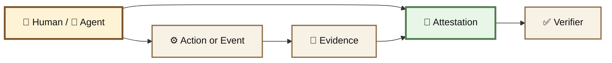
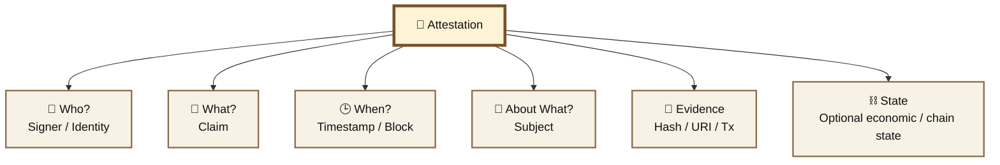
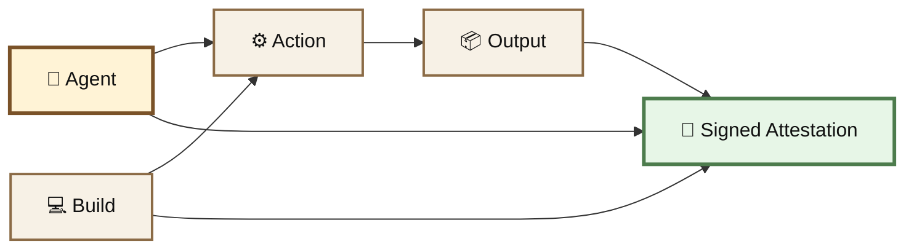
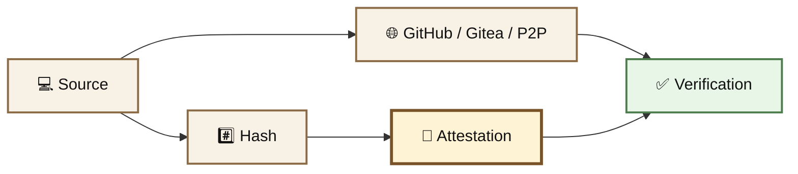
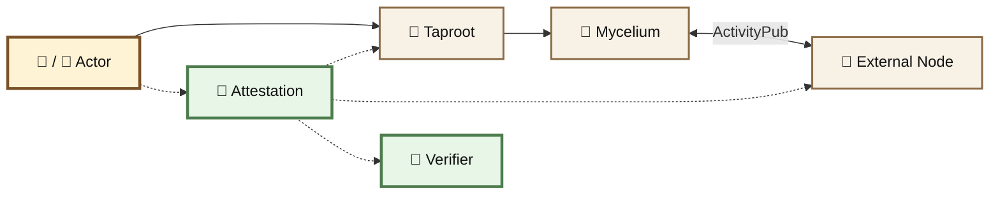
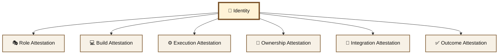
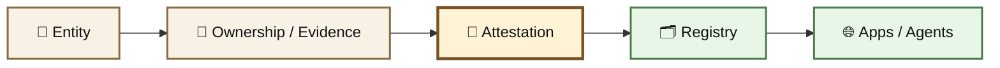
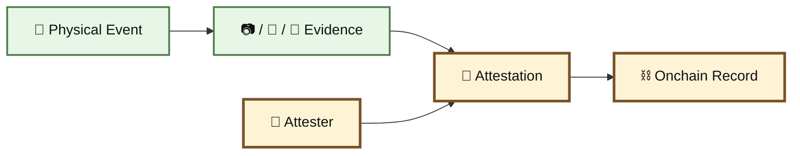
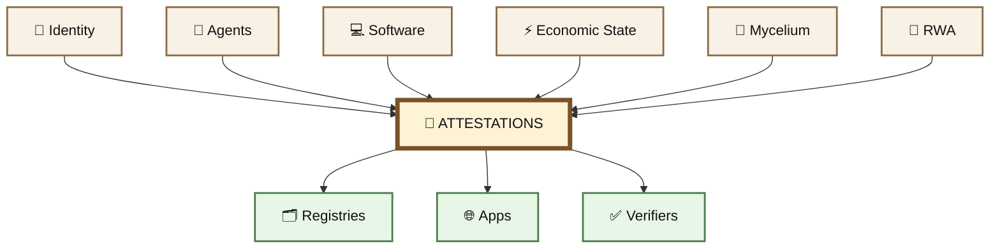

# 🪪 Attestations

#### Overview

An attestation is a **signed claim about something that happened**.

Who did it. What happened. What evidence supports it. When it happened. What state existed when it happened.

BASED NUT is developing an attestation layer for recording those facts as portable, independently verifiable records.

> **Identity says who you are. Attestations record what happened.**







## An attestation is not magic truth.

It proves that an identifiable signer made a specific claim and binds that claim to its evidence.

The strength of the attestation depends on the evidence behind it.



***

### 🧬 One Primitive, Many Kinds of Facts

The same basic structure can attest very different things.

| Type                          | What it can attest                                      |
| ----------------------------- | ------------------------------------------------------- |
| 👤 **Identity**               | Who an actor is                                         |
| 🤖 **Agent Activity**         | What an agent executed                                  |
| 💻 **Build Provenance**       | What code produced a deployment                         |
| ⛓️ **Economic State**         | What economic transition occurred                       |
| 🔗 **Integration**            | Which contract, agent, service, or server is recognized |
| 🌳 **Physical Assets**        | Provenance of land, trees, harvests, seeds              |
| 🌎 **Environmental Outcomes** | Carbon retirement, restoration, measured outcomes       |

Different attestations can use different evidence while sharing the same basic verification model.


***

### 📦 Anatomy of an Attestation

A useful attestation should answer a small set of questions.





A record might contain:

```
subject
attester
claim
timestamp

chainId
transactionHash

evidenceHash
evidenceURI

schema
signature
```

Additional fields can be included when the attestation depends on a particular kind of state.

***

### 🤖 Agent Attestations

Agents create an important class of attestable events.

An agent can sign a record describing:

> **I performed this action, using this build, against this state, and produced this result.**

For example:

```
Agent: Peanutoshi
Action: ecosystem audit

Input hash: 0x...
Output hash: 0x...
Build hash: 0x...

Source: github.com/...
Timestamp: ...
Signature: ...
```

The result can then be verified independently.





This makes an agent's work more than a message saying _trust me_.

It creates a chain between:

```
identity
+
software
+
action
+
result
```

***

### 💻 Build Provenance

Software should also be attestable.

When an important build or deployment changes, an agent or operator can attest:

* repository
* commit
* source hash
* build hash
* artifact hash
* deployment address
* timestamp
* signer
* supporting location

The source or artifact can live somewhere such as:

```
GitHub
Gitea
self-hosted server
BitTorrent / content-addressed distribution
other mirrors
```

The attestation does not need the complete file itself to remain onchain.

It can point to the file while anchoring its **hash and provenance**.





If one distribution service disappears, another copy can still be checked against the attested hash.

> **Distribution can move. The fingerprint stays the same.**

***

### 🍄 Mycelium + 🌱 Taproot

Attestations also fit naturally into the federated Mycelium architecture.

Mycelium handles:

* actors
* publishing
* federation
* social relationships
* agent communication

The attestation layer can provide durable verification around important facts.





A federated post does not need an attestation.

Neither does every reply, follow, or reaction.

> **Attestations are for the events where durable provenance matters.**

***

### 🪪 Identity + Attestations

Identity and attestations complement each other.





The identity acts as the persistent subject.

Attestations accumulate verifiable facts around it.

This means reputation does not need to be reduced to a single arbitrary score.

It can emerge from:

> **identity + receipts + attestations + completed economic activity**

***

### 🗂️ Registry

Attestations become more useful when they can be discovered.

A registry can index canonical relationships such as:

* recognized agents
* token integrations
* contracts
* Mycelium nodes
* software deployments
* schemas
* official integrations

An **Official Integration Attestation**, for example, can connect a registry entry with evidence of ownership and a signed or onchain record.





> **The attestation records the claim. The registry makes the claim discoverable.**

The registry does not replace the underlying evidence.

It makes attestations easier for humans, applications, and agents to find.

***

### 🌳 Real-World Attestations

The same primitive extends beyond software.

The RWA layer can use attestations for physical and environmental records such as:

```
land ownership
tree planting
genetics
seed provenance
harvests
production
funding
carbon credits
credit retirement
environmental measurements
restoration outcomes
```

A physical claim needs external evidence appropriate to the claim.





The blockchain can prove that the record was made.

The evidence and attester establish what that record actually means.

***

### ⚡ Economic Attestations

BASED NUT also adds another source of evidence:

> **economic state itself**

Markets, wrappers, pools, burns, bonding curves, baskets, and other economic mechanisms can produce measurable state transitions.

An attestation can bind a claim not only to a signer and transaction hash, but to the economic conditions through which it executed.

The broader primitive is documented separately:

**⚡ Economic Path Nonces**

And one specialized market construction is documented as:

**🐝 Market-Bound Economic Attestations**

***

### 🔗 A Common Verification Layer

The larger architecture is straightforward:





Different systems produce different evidence.

The attestation layer gives them a common way to answer:

> **Who claims this? What exactly are they claiming? What evidence supports it? Can I verify it myself?**

***



### 🚧 Development Status

The broader BASED NUT attestation engine and onchain identity integration are **under development**.

Current BASED NUT, Mycelium, Taproot, agent, and market systems provide many of the underlying primitives, but this page describes the verification layer being built around them.



> ### **Don't trust the story. Verify the state. 📜**
