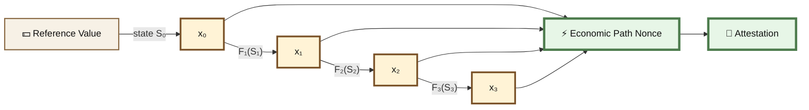
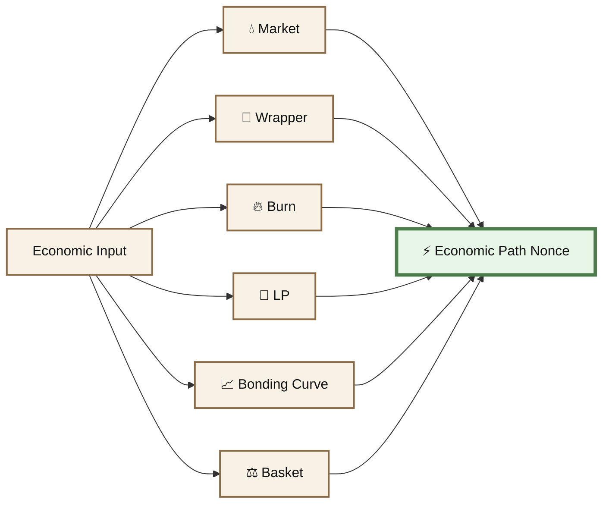

# ⚖️ Economic Nonces

#### Economic State-Transition Attestations

An Economic Path Nonce is produced by passing a known economic quantity through one or more live economic mechanisms and recording the resulting sequence of state-dependent transformations.

> **The nonce is the path through economic state.**

A path might involve:

```
starting economic value
        ↓
market
        ↓
wrapper
        ↓
burn
        ↓
liquidity position
        ↓
bonding curve
        ↓
basket
        ↓
economic fingerprint
```

The particular mechanisms are optional.

What matters is that each transition executes against **real economic state**.

***

### 🧬 Core Primitive

Let:

```
x₀ = starting economic quantity
```

Each primitive transforms that quantity against live state:

```
x₀ ──F₁(S₀)──► x₁
x₁ ──F₂(S₁)──► x₂
x₂ ──F₃(S₂)──► x₃
...
```

Where:

```
F = economic operation
S = state against which it executes
x = resulting quantity
```

Possible operations include:

```
market swap
wrapper interaction

LP mint
LP burn

token burn

bonding curve mint
bonding curve redemption

basket join
basket exit

reward distribution

other state-changing economic operations
```

> **Each operation transforms an input according to live economic state.**

***

### 💵 Starting From Economic Value

A path can begin from a defined economic reference.

For example:

```
reference value = $10
```

Suppose an asset has price `P` at reference state `S₀`.

Then:

```
x₀ = $10 / P
```

The starting quantity can therefore depend on:

```
reference value
+
reference asset
+
price source
+
time / block
+
observed price
──────────────
x₀
```

A different reference state can produce a different starting quantity.

This means the path can begin with a quantity already derived from economic state.

***

### 🌳 Composable Economic Paths





Each output becomes another measurable component of the path.

The nonce is therefore not one transaction.

It is the **ordered interaction history**.

***

### #️⃣ The Interactions Are the Nonce

The nonce is not merely:

```
hash(transaction)
```

It is closer to:

```
EconomicPathNonce = H(
    schemaVersion,

    payloadHash,

    startingValue,
    startingAsset,
    startingState,

    operation₁,
    state₀,
    result₁,

    operation₂,
    state₁,
    result₂,

    operation₃,
    state₂,
    result₃,

    ...,

    executionOrdering,
    blockContext
)
```

Conceptually:

```
payload commitment
+
starting economic state
+
transformation
+
result
+
transformation
+
result
+
transformation
+
result
──────────────────────────
economic path fingerprint
```

> **The interactions are the nonce.**

***

### 🔒 Binding Data to the Path

If an arbitrary payload is supposed to be part of the economic receipt, it must be committed **before or during** execution.

The ordering is:

```
payload
 ↓
payloadHash
 ↓
commitment
 ↓
economic path
 ↓
attestation
```

Possible constructions include:

* placing `payloadHash` in transaction calldata
* emitting it from a commitment contract
* publishing a prior onchain commitment
* anchoring a signed commitment onchain
* using a contract that records the commitment and executes the first economic action



Post-hoc hashing is not prior commitment

```
H(payloadHash, oldTransactionHash)
```

does not prove that the payload existed when the old transaction occurred.

The commitment must precede or participate in the economic path.



***


### 🧮 Canonical Encoding

The path also needs a canonical representation.

Two independent verifiers should derive the same fingerprint from the same economic event.

```
same event
+
same encoding rules
────────────────
same nonce
```

This applies to:

```
assets
amounts
states
contract addresses
transaction references
operation ordering
block context
payload commitments
```

***

### 🕸️ Multiple Independent State Machines

A path can cross separate protocols and separate forms of economic state.





Markets are one kind of state machine.

Burns are another.

Liquidity positions are another.

Bonding curves are another.

Baskets are another.

> **The power comes from composing them.**

***

### 🔥 Burn Transformations

A burn can contribute state such as:

```
pre-burn supply
amount burned
burn transaction
post-burn supply
related balances
related outputs
```

Conceptually:

```
state₀
 ↓
burn
 ↓
state₁
```

A burn does not need to produce a second asset.

Changing measurable economic state is enough for it to participate in the path.

***

### 💧 Liquidity Transformations

Liquidity creation or removal can also produce state-dependent outputs.

For an LP mint:

```
asset A
+
asset B
+
pool state
+
LP supply
+
deposit quantities
──────────────
LP output
```

```
flowchart LR
    A["🪙 Asset A"]
    B["🪙 Asset B"]
    STATE["💧 Pool State"]
    ACTION["⚙️ Liquidity Action"]
    OUTPUT["🎟️ LP Output"]

    A --> ACTION
    B --> ACTION
    STATE --> ACTION
    ACTION --> OUTPUT
```

The same nominal deposit performed against a different pool state may produce a different result.


An LP interaction is **not itself the attestation**. It is one state transition that may participate in an Economic Path Nonce.


***

### 🔐 Why Economic Paths Are Harder to Fabricate

There are two distinct constraints.

#### 💰 Economic Resistance

A valid economic path requires real execution against real systems.

Producing it can require:

```
capital availability
+
gas
+
fees
+
slippage
+
protocol costs
+
taxes / royalties where applicable
+
execution risk
```

Capital used in an action is not necessarily consumed, but actual execution still requires real economic resources.

A random identifier can be generated almost freely.

An economic receipt requires interaction with the economic system.

> **Economic execution gives the nonce a cost-bearing component.**

***

#### ⛓️ State Resistance

The path also depends on state.

Relevant conditions may include:

```
prices
reserves
liquidity

token supply
LP supply
balances

fees

block context
transaction ordering
surrounding transactions

inputs
outputs
pre-states
post-states
```

Execution changes that state.

```
S₀ → F₁ → S₁ → F₂ → S₂ → F₃ → S₃
```

A later attempt occurs against a different canonical history.

Another actor can create a new economic path.

They cannot make the new path become the old historical path.

***

### 🧬 Same Inputs ≠ Same Nonce

Using the same nominal starting value again does not necessarily reproduce the same path.

For example:

```
$10
 ↓
different reference state
 ↓
different x₀
```

Even if `x₀` happens to match:

```
same x₀
 ↓
different state S₁
 ↓
different x₁
```

Even if `x₁` matches, a later mechanism can differ.

> **The fingerprint comes from the complete ordered path, not an individual decimal.**

***

### ⚖️ State-Transition Scarcity

The scarce object is not a decimal value.

It is the **complete historical path**:

```
payload commitment
+
starting state
+
ordered operations
+
pre-states
+
transactions
+
execution outputs
+
surrounding conditions
+
block context
+
post-states
```

Once the canonical chain has advanced, another actor can create another path.

They cannot recreate the same historical position.

***

### 📜 Attestation Structure

The final attestation can reference the path instead of storing every raw state value.

```
Attestation {
    schemaVersion

    subject
    attester

    payloadHash
    commitmentTx

    referenceValue
    referenceAsset

    startState
    startAmount

    transitions: [
        {
            primitive,
            tx,
            input,
            output,
            stateHash
        },
        ...
    ]

    economicPathNonce
}
```

The final fingerprint can then be:

```
economicPathNonce = H(
    schemaVersion,
    payloadHash,
    startingEconomicState,
    orderedTransitions
)
```

Ordering matters.

```
A → B → C
```

is not the same economic path as:

```
A → C → B
```

even when the same mechanisms are touched.

***

### ✅ What This Proves

Depending on the construction, an Economic Path Attestation can prove that:

* a particular payload was committed
* a particular ordered economic path executed
* specified contracts or mechanisms participated
* specified inputs and outputs occurred
* specified state references were used
* transactions occurred in a defined ordering
* the resulting receipt corresponds to a particular historical execution

A normal signature proves:

> **Key X authorized message Y.**

An economic path can additionally prove:

> **Message Y was bound to an ordered set of real economic state transitions.**

***

### 🚫 What This Does Not Prove

It does not automatically prove:

* that the underlying claim is factually true
* that the signer is trustworthy
* that an action was profitable
* that an action was expensive
* that a larger transaction is more truthful
* that numerically similar outputs can never occur again

> **The attestation is a receipt, not an oracle.**

***

### 🧩 Potential Uses

#### 📜 Economic Attestations

Bind claims to verifiable economic execution.

#### 🕒 Economic Timestamps

Associate a prior commitment with a particular economic and chain state.

#### ⚙️ Proof of Economic Execution

Demonstrate that an actor performed a specified economic path rather than merely signing a description.

#### 🤖 Agent Actions

Agents can attach economic receipts to jobs, outputs, claims, or actions.

#### 💻 Build Provenance

A build hash can be committed before the path and included in the resulting receipt.

#### 🔗 Provenance Chains

Later records can reference earlier economic paths.

#### 🎯 Challenge-Response Protocols

A protocol can require predefined economic transformations and verify that they occurred.

#### #️⃣ Economic State Fingerprints

Canonical states, executions, and outputs can identify particular historical economic paths.

***

### 📖 Terminology

The broad primitive is:

> **Economic Path Nonce**

Another descriptive term is:

> **Economic State-Transition Fingerprint**

A **Market-Bound Economic Nonce** is one subtype where a market transition forms part of the path.

🐝 Market-Bound Economic Attestations →

***

### 🌰 Summary

> **BASED NUT economic attestations can bind data to an ordered sequence of real economic state transitions.**

```
Economic Path Nonce =
H(
    payload commitment,
    initial economic state,
    x₀,
    F₁(S₀) → x₁,
    F₂(S₁) → x₂,
    F₃(S₂) → x₃,
    ...,
    execution ordering
)
```

The path can involve markets, wrappers, burns, liquidity positions, bonding curves, baskets, rewards, or other economic mechanisms.

> ### **The nonce is the path through economic state. ⚡**
