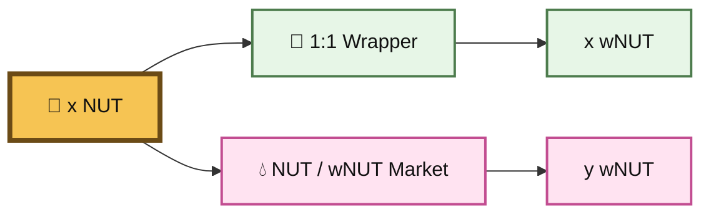
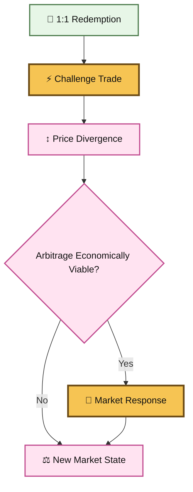
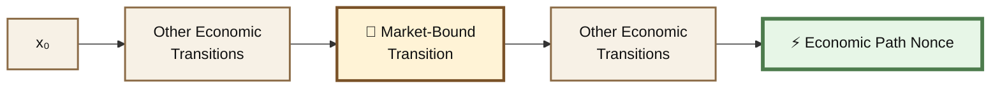

# 🌻 Market Attestations

## :sunflower: Market Challenge-Response

A **Market-Bound Economic Nonce** is a specialized Economic Path Nonce in which a live market provides one or more of the state transitions.

NUT and wNUT provide a useful construction because they combine:

```
fixed wrapper parity
+
independently priced market
+
possible arbitrage response
```

The broader Economic Path Nonce primitive is documented separately.

This page focuses only on the **market behavior**.

***

### 🎁 Fixed Parity, Floating Market

The wrapper defines:

```
1 NUT ⇄ 1 wNUT
```

Wrapping `x` NUT directly gives:

```
x NUT → x wNUT
```

A NUT/wNUT market instead executes against live reserves:

```
x NUT → y wNUT
```

`y` can depend on:

```
reserves
liquidity
fee configuration
trade size
previous trades
transaction ordering
block state
```





> **The wrapper provides the reference. The market provides the state-dependent output.**

***

### 🎯 Market Challenge-Response

A trade can move the market away from redemption parity:

```
AMM price ≠ 1:1 redemption relationship
```

This creates an economic challenge.





“Forced arbitrage” is useful shorthand, but arbitrage is not literally forced.

The better description is:

> **Market challenge-response**

***

### 🐝 When Does the Market Respond?

Arbitrage only becomes rational when the expected discrepancy exceeds the costs and risks of execution.

```
Gross Arbitrage Value
>
Trading Fees
+ Slippage / Price Impact
+ Gas
+ Other Execution Costs
+ Risk
```

A price difference can therefore persist inside a **no-arbitrage band**.

The 1:1 wrapper relationship does not mean the AMM must display exact 1:1 pricing at every moment.

***

### ⚡ Challenge State

The challenge itself is already a valid market transition:

```
S₀
 ↓
challenge trade
 ↓
S₁
```

For a market-bound nonce, `S₁` can be sufficient.

The attestation does not require an arbitrageur to appear.

***

### 🐝 Optional Response State

A richer construction can observe a later response:

```
S₀
 ↓
challenge
 ↓
S₁
 ↓
market response
 ↓
S₂
```

This can capture not just the state disturbance, but how the market subsequently reacted.

The response is **optional**.

***

### ⏱️ Defining Resolution

If `S₂` participates in the nonce, the protocol needs a deterministic rule for deciding what counts as the response.

Examples:

```
resolutionWindow = 20 blocks
```

or:

```
first qualifying arbitrage transaction after challenge
```

or:

```
first state where deviation < threshold
```

The exact policy can vary.

The important property is:

> **Independent verifiers must derive the same resolution state.**

***

### #️⃣ Market-Specific State

A market-bound transition can contribute fields such as:

```
chainId
pool

preState

challengeTx
amountIn
amountOut

challengeState

challengeBlock
transactionIndex

optional responseTx
optional resolvedState
optional resolutionBlock
```

The broader Economic Path Nonce can then incorporate this market transition as one ordered component of the complete path.

For example:

```
MarketTransition {
    pool,
    preState,
    challengeTx,
    input,
    output,
    postState
}
```

or, with a defined response:

```
MarketTransition {
    pool,

    state₀,

    challengeTx,
    state₁,

    responseTx,
    state₂
}
```

***

### 🌰 Why NUT/wNUT Is Interesting

The wrapper provides a canonical 1:1 reference.

The market provides an independent state-dependent exchange result.

NUT adds another unusual property:

> **The total NUT supply is 1 NUT.**

Therefore any NUT quantity is directly expressible as a fraction of the entire asset.

```
0.0001 NUT = 0.01% of supply
0.0010 NUT = 0.10% of supply
0.0100 NUT = 1.00% of supply
```

This does **not** make a decimal amount unique.

It makes the economic magnitude of the NUT component unusually legible.

For example:

```
$10 at reference state S₀
 ↓
x NUT
 ↓
NUT / wNUT market
 ↓
y wNUT
```

The useful object is not merely `x` or `y`.

It is the market transition connecting them.

***

### 💧 Liquidity as Market Capacity

Liquidity controls how the market reacts to a transaction.

```
deeper liquidity
→ less price impact for the same trade

shallower liquidity
→ more price impact for the same trade
```

So for this particular state machine:

```
LP depth   → market capacity
swap       → challenge
arbitrage  → possible response
transition → market fingerprint
```

Adding liquidity does **not** itself create an attestation.

It changes the state in which future market transitions occur.

Likewise, adding liquidity does not automatically create arbitrage.

***

### 🧬 Market Transition Inside the Larger Path

The market-bound nonce is not a separate competing theory.

It is one component that can be inserted into a broader path.





For example:

```
reference value
 ↓
x NUT
 ↓
🐝 NUT/wNUT market transition
 ↓
y wNUT
 ↓
🔥 burn-related transition
 ↓
💧 LP transition
 ↓
Economic Path Nonce
```

This is the relationship between the two pages.

***

### 🧬 Design Principle

wNUT itself should remain simple.

```
🌰 NUT
   │
   │ 1:1
   ▼
🎁 wNUT
   │
   └── 💧 NUT/wNUT market
           │
           ├── challenge state
           ├── optional response state
           └── market transition
                    │
                    ▼
              Economic Path Nonce
```

The wrapper does not need attestation logic embedded inside it.

> **The wrapper provides the invariant. The market provides the transition. The Economic Path Nonce composes the result.**

***

### 📖 Terminology

For this page:

**Market-Bound Economic Nonce**\
A nonce containing a market state transition.

**Market Challenge-Response**\
A market disturbance followed by an optional economically motivated response.

**Market-Execution Attestation**\
An attestation whose evidence includes real market execution.

The parent primitive is:

> **Economic Path Nonce**

Avoid using:

```
decimal scarcity
forced arbitrage
LP creation as the attestation
```

as definitions of the market-bound primitive.

***

### 🌰 Summary

The specialized construction is:

```
fixed NUT/wNUT reference
+
independent NUT/wNUT market
+
challenge trade
+
state S₀ → S₁
+
optional market response S₂
────────────────────────────
Market-Bound Economic Transition
```

That transition can then become one component of:

```
Economic Path Nonce
```


> ### **The market is one state machine. The nonce can cross many. 🐝⚡**



### ⚠️ Experimental Memefi

This is experimental infrastructure and research.

Market execution carries transaction costs, liquidity risk, smart-contract risk, and execution risk. Nothing here implies financial value, expected profit, or guaranteed arbitrage.


<br>
