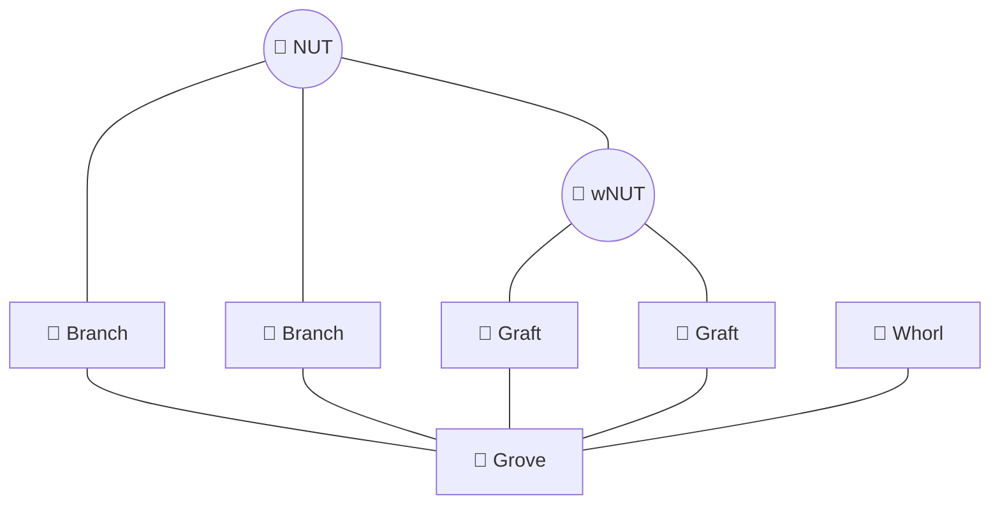
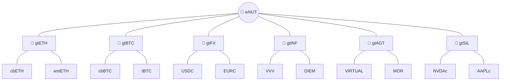
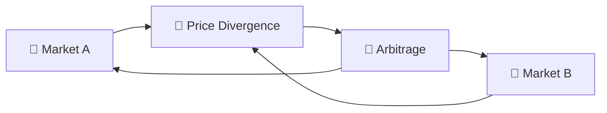
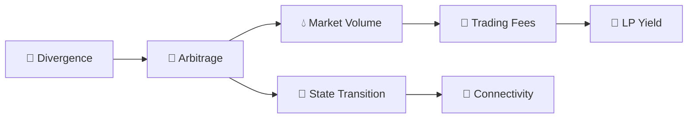
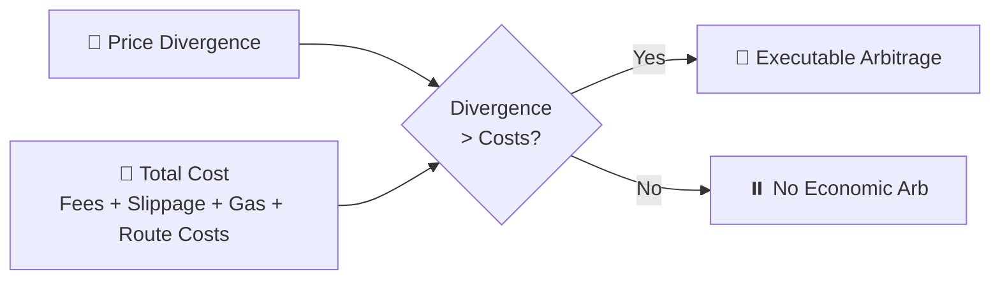
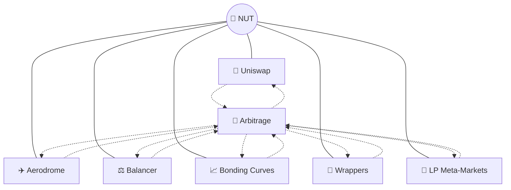
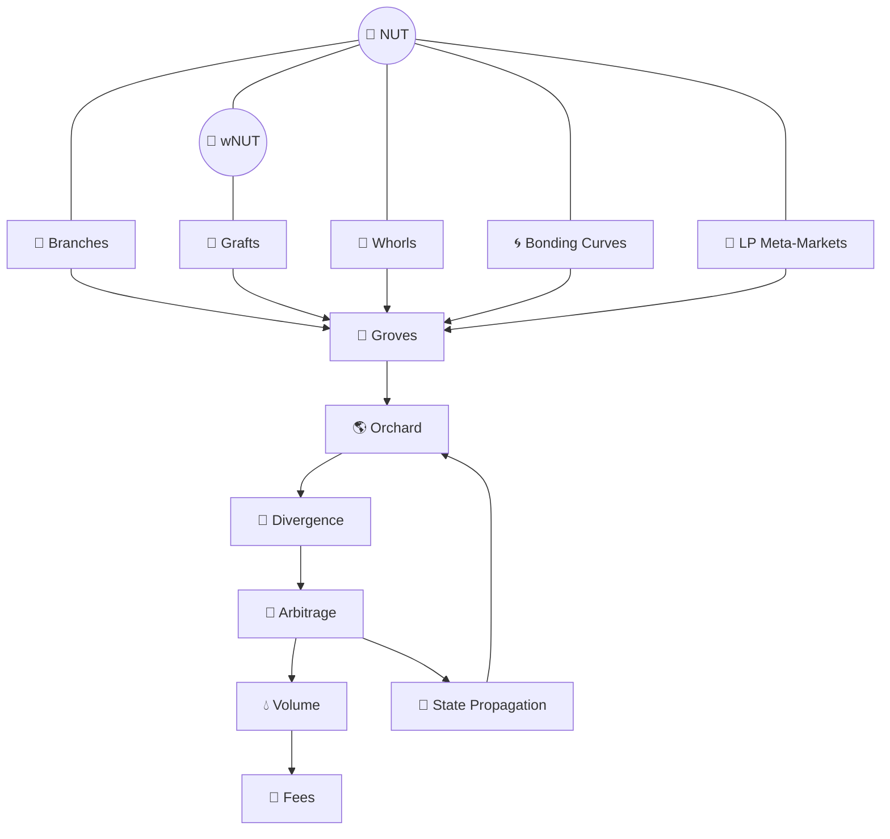
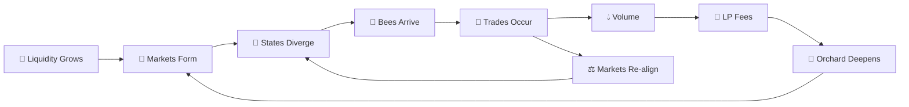

# 🐝 Arb Bot Builder

### 🐝 Pollinate the Orchard

> **Liquidity grows the Orchard. Arbitrage pollinates it.**

In the wild, nut trees depend on pollination.

The Orchard is no different.

Every market has its own **reserves, fees, curves, liquidity, timing, and local price**. Those markets naturally move into different states.

Arbitrage moves between them, carrying price information across the ecosystem and creating activity that reconnects those markets.

At the simplest level:

> **Markets are flowers and branches.**\
> **Divergence creates pollen.**\
> **Arbitrageurs are bees.**

***

## 🌳 The Orchard

Before looking at arbitrage, look at the habitat.

The Orchard is the interconnected liquidity architecture formed by BASED NUT markets.

It contains simple pools, multi-asset pools, wrappers, bonding curves, LP tokens, external assets, and markets built on top of other markets.



The structures describe different shapes in the liquidity graph.

***

### 🌿 Branch

A **Branch** is the simplest market structure: an ordinary two-token liquidity relationship.

```
🌰 NUT ───────── Asset
```

Examples include markets such as:

```
NUT / WETH
NUT / AERO
NUT / cbBTC
```

A Branch is an edge.

***

### 🌼 Graft

A **Graft** is exactly three assets sharing one rooted liquidity surface around wNUT.

```
              Asset A
                 \
                  🌼
                 /
          wNUT ───── Asset B
```

Formally:

{wNUT, si, sj}\\{wNUT,\ s\_i,\ s\_j\\}

It should not be visualized as three unrelated pairwise markets.

The three assets participate in the same pool.

***

### 🌸 Whorl

A **Whorl** is an unrooted multi-asset pool containing three or more assets.

```
                Asset A
                   │
                   │
        Asset D ── 🌸 ── Asset B
                   │
                   │
                Asset C
```

pNUT is a four-asset example:

```
                NUT
                 │
                 │
        SNUT ── pNUT ── cbETH
                 │
                 │
               cbBTC
```

All four assets participate in one weighted liquidity surface.

***

### 🌳 Grove

A **Grove** is not a pool.

It is a coherent collection of overlapping liquidity structures.

```
        🌼────🌿
       /        \
     🌼────🌸────🌼
       \        /
        🌿────🌼
```

A Grove can contain:

* Branches
* Grafts
* Whorls
* wrappers
* bonding curves
* several protocols
* external assets
* multiple arbitrage routes

Groves can themselves take different canopy shapes, including radial Sunflowers, rings, hub-and-spoke structures, stars, hierarchies, and increasingly interconnected meshes.

***

### 🌎 The Orchard

The **Orchard** is the complete graph.

```
Branches
   +
Grafts
   +
Whorls
   +
Groves
   +
Wrappers
   +
Bonding Curves
   +
LP Tokens
   +
Meta-Markets
   +
External Assets
   ↓
🌎 THE ORCHARD
```

It is not one pool.

It is not one DEX.

It is the larger market architecture that emerges from the interaction of many independently deployed markets.

***

## 🌻 The Sunflower Grove

A real example already exists inside the Orchard.

The Sunflower Grove contains wNUT-rooted Twin Grafts connecting different external asset families.



Each Graft is one flower.

wNUT is the shared rootstock.

The external assets are the scions.

For example, gtETH is a Balancer v3 weighted pool containing:

**20% wNUT · 40% cbETH · 40% wstETH**

The flower is visually symmetrical because three assets share one pool.

That does **not** mean the economic weights must be equal.

***

## 🌼 A Pool Is a Flower

A useful visual model for an LP pool is a flower.

The assets are the petals.

The shared liquidity mechanism is the center.

#### Two assets

```
TOKEN A 🌿 ───── 🌼 ───── 🌿 TOKEN B
```

#### Three assets

```
                 TOKEN A
                    🌿
                     \
                      🌼
                     / \
                    /   \
              🌿 B       C 🌿
```

#### Four assets

```
                 TOKEN A
                    │
                    🌿
                    │
TOKEN D 🌿 ──────── 🌼 ──────── 🌿 TOKEN B
                    │
                    🌿
                    │
                 TOKEN C
```

The diagram represents **topology**, not weighting.

A 20/40/40 Graft remains a three-petal flower.

A 25/25/25/25 Whorl remains a four-petal flower.

***

## 🌱 When a Flower Grows Unevenly

Trades change pool state.

One asset enters.

Another leaves.

The reserves change.

The local exchange rate changes.

```
BEFORE

       🌿 A
         \
          🌼
         /
       🌿 B


TRADE

A ───→ 🌼 ───→ B


AFTER

     🌿🌿🌿 A
           \
            🌼
           /
         🌿 B
```

The important point is not that the pool became larger.

It is that its **state changed**.

Another flower elsewhere in the Orchard may now imply a different price.

```
FLOWER A                         FLOWER B

   ETH                              ETH
    │                                │
   🌼                               🌼
    │                                │
   NUT                              NUT

NUT = X                         NUT = Y
```

The flowers disagree.

That disagreement creates **pollen**.

***

## 🌾 Pollen

Pollen represents an economically meaningful divergence between reachable market states.

It can emerge between:

* spot market ↔ spot market
* bonding curve ↔ AMM
* basket ↔ components
* wrapper state ↔ market state
* LP NAV ↔ LP-token market
* multi-asset pool ↔ overlapping pool
* one Grove ↔ another Grove

```
Market State A
      │
      │ divergence
      ▼
   🌾 POLLEN
      ▲
      │
      │ divergence
Market State B
```

Not every price difference is usable pollen.

There must also be a **route** between the states.

And the divergence must be large enough to pay for the trip.

***

## 🐝 The Bees

Arbitrageurs are the pollinators.

They inspect the Orchard for divergence and trade against it when the economics justify doing so.



Conceptually:

```
before

Flower A                Flower B

NUT = 90                NUT = 110


          🐝


after

Flower A                Flower B

NUT ≈ 100               NUT ≈ 100
```

The exact result depends on:

* available liquidity
* route size
* pool curves
* fees
* slippage
* gas
* taxes
* MEV
* timing
* execution behavior

Arbitrage does not guarantee perfect price equality.

It creates economic pressure toward alignment.

***

## 🌱 What Pollination Produces

Arbitrage does more than correct prices.

It can generate:

* 🧭 price alignment
* 💧 market volume
* 💸 trading fees
* 🌱 LP yield
* 🔄 cross-market state transitions
* 🌳 stronger economic connectivity



LP fees may contribute to LP returns; they do not guarantee that the LP position is profitable after inventory changes, price movement, or other risks.

> **No pollination, no nuts. No arbitrage, no connected Orchard.**

More precisely:

> **No economically reachable pollination path, no economic connection between those market states.**

***

## 🌻 From Flowers to Canopies

Once several flowers overlap, larger shapes emerge.

#### Sunflower

Many Grafts share one rootstock.

```
          🌼
           \
     🌼 ── 🌱 ── 🌼
           / \
         🌼   🌼
```

#### Hub-and-Spoke

One highly connected market routes into many others.

```
          ●
          │
      ●── HUB ──●
          │
          ●
```

#### Ring

Markets form a closed route.

```
       ●────●
      /      \
     ●        ●
      \      /
       ●────●
```

A ring can matter because the final trade may return to the starting asset.

#### Star

Several independent edges share one central asset.

```
       ●
       │
   ●── ● ──●
      / \
     ●   ●
```

#### Hierarchy

Liquidity structures can sit on top of other structures.

```
        ROOT
         │
       POOL
      /    \
    LP      LP
    │       │
 MARKET   MARKET
```

#### Mesh

When many independent routes overlap, the graph becomes increasingly interconnected.

```
●────●────●
|\  /|\  /|
| \/ | \/ |
| /\ | /\ |
|/  \|/  \|
●────●────●
```

These shapes matter because **topology determines possible routes**.

The more routes exist, the more ways market state can propagate across the Orchard.

***

## ⚖️ The Arbitrage Threshold

A visible price difference is not automatically an opportunity.

The divergence has to be large enough to pay for execution.

Executable Arbitrage  ⟺  Price Divergence>Total Execution Cost\text{Executable Arbitrage} \iff \text{Price Divergence} > \text{Total Execution Cost}

Where, at minimum:

Total Execution Cost=Trading Fees+Slippage+Gas+Route Costs\text{Total Execution Cost} = \text{Trading Fees} + \text{Slippage} + \text{Gas} + \text{Route Costs}

Depending on the market, execution costs may also include:

* transfer taxes
* bonding-curve spreads
* royalties
* wrapper steps
* MEV exposure
* liquidity constraints
* implementation risk



Or simply:

Price Divergence>Trading Fees+Slippage+Gas+Execution Costs\text{Price Divergence} > \text{Trading Fees} + \text{Slippage} + \text{Gas} + \text{Execution Costs}

Small discrepancies can remain open when correcting them costs more than the spread itself.

A route can also remain inactive because there is insufficient liquidity even when an apparent price difference exists.

***

## 🌐 Eight Pollination Paths

The current Arb Bot Builder identifies **eight different market structures**.

| # | Path                 | Relationship                  |
| - | -------------------- | ----------------------------- |
| 1 | 🌰 Cross-Venue NUT   | Spot ↔ spot                   |
| 2 | 🥜 pNUT Index        | Basket ↔ components           |
| 3 | 🧂 SALT              | Bonding curve ↔ AMM           |
| 4 | 🌌 NUTINO            | Bonding curve ↔ AMM           |
| 5 | 🔥 SNUT Deflation    | Structural mechanic — not arb |
| 6 | 🦸 SNUT Cross-Venue  | Multi-market                  |
| 7 | ⚛️ SNUT/NUT Reactor  | NUT/SNUT Reactor              |
| 8 | 🌊 SNUT LP Meta-Pool | LP NAV ↔ LP market            |

These are not eight versions of the same trade.

They expose different kinds of divergence.

***

## 🌰 1. Cross-Venue Price Divergence

The simplest form is spot against spot.

```
NUT / WETH — venue 1
        ↕

NUT / WETH — venue 2
        ↕

NUT / AERO
        ↕

NUT / cbBTC
```

Different venues can imply different NUT prices.

Normalize them to a common unit, account for all execution costs, and compare.

***

## 🥜 2. Basket Divergence

pNUT introduces another kind of market state:

```
market price of pNUT
         ↕
value of underlying basket
```

The relationship is between an index-like token and the assets represented by that index.

pNUT is a Balancer weighted pool containing:

**25% NUT · 25% SNUT · 25% cbETH · 25% cbBTC**

The underlying assets sit inside the Balancer Vault rather than inside the BPT contract itself.

The basket therefore creates another market state for NUT and SNUT relative to external reserve assets.

***

## 🧂 3. SALT Bonding-Curve Divergence

SALT exists simultaneously in two pricing systems.

```
             bonding curve
                  ↕
NUT ─────────── SALT ─────────── external market
```

One price comes from minting and redemption.

Another comes from the external AMM.

***

## 🌌 4. NUTINO Bonding-Curve Divergence

NUTINO has the same broad structure:

```
             bonding curve
                  ↕
NUT ───────── NUTINO ───────── external market
```

Arbitrage becomes possible only when the difference exceeds:

* curve spread
* royalties
* trading fees
* gas
* slippage
* other execution costs

***

## 🔥 5. SNUT Deflation

SNUT introduces structural mechanics including:

* transaction tax
* NUT rewards
* buybacks
* burns

These mechanics can create economic pressure.

That does **not** mean every resulting effect is arbitrage.

SNUT deflation is therefore listed as a structural mechanic rather than an arbitrage route by itself.

***

## 🦸 6. SNUT Cross-Venue

SNUT also exists across multiple liquidity venues.

Those venues can imply different local market states.

The analysis must account for SNUT's own transaction mechanics in addition to ordinary pool costs.

***

## ⚛️ 7. SNUT / NUT Reactor

SNUT also creates direct economic relationships with NUT through:

* transaction tax
* NUT rewards
* buybacks
* burns
* multiple liquidity venues
* reward-bearing pool states

These relationships do not exist in a conventional ERC-20.

Some resulting states may be arbitrageable.

Others are simply structural economic pressure and should not be mistaken for arbitrage.

***

## 🌊 8. Markets on Markets

A liquidity position can itself become an independently priced asset.

The SNUT/WETH LP token itself has a market against ETH.

That creates:

```
SNUT spot price
      ↓
SNUT / WETH pool
      ↓
LP NAV
      ↕
LP token market price
```

Now the underlying object being priced is itself a market position.

This is a **meta-market**:

> **a market whose underlying object is another market position.**

***

## 🌳 More Markets, More Pollination Paths

The Orchard does not require every market to use the same mechanism.

That is the point.

The ecosystem can contain:

* 🦄 Uniswap
* ✈️ Aerodrome
* ⚖️ Balancer
* 📈 bonding curves
* 🎁 wrappers
* 🌊 LP meta-markets

The original venue-level view remains useful:



The newer Orchard view explains what those markets become when considered together:

```
protocol
   ↓
pool
   ↓
Branch / Graft / Whorl
   ↓
Grove
   ↓
Orchard
   ↓
possible pollination routes
```

Different mechanisms create different local states.

Different states create divergence.

Divergence attracts arbitrage.

Arbitrage moves activity through the graph.

***

## 🤖 Arb Bot Builder Helper

The **Arb Bot Builder Helper** is the public technical read-path for developers and agents building around BASED NUT markets on Base.

It provides:

* token addresses and decimals
* pool addresses
* venue-specific quirks
* RPC read patterns
* function selectors
* Balancer pool IDs
* price-reading methods
* executable Python examples
* known arbitrage loops
* honest viability assessments

> **Research the topology once. Let builders start from the machine-readable state.**

🐝 **Open the Arb Bot Builder →**

\{% hint style="warning" %\}\
This is a technical reference, not a solicitation to trade.

Arbitrage carries execution, liquidity, smart-contract, MEV, tax, pricing, and implementation risk.\
\{% endhint %\}

***

## 📌 Know the Market Before Trading It

Several BASED NUT markets have unusual properties that matter directly to arbitrage systems.

***

### 🌰 NUT Is a Unity Token

Total supply:

**1 NUT**

Standard token-price and market-cap APIs may therefore produce misleading results.

For NUT:

> **Price and fully diluted market capitalization collapse onto the same numerical value.**

***

### 🔢 Decimals Matter

Three especially important decimal traps:

| Asset   | Decimals |
| ------- | -------: |
| 🦸 SNUT |        9 |
| ₿ cbBTC |        8 |
| 💵 USDC |        6 |

Assuming 18 decimals produces incorrect prices and therefore incorrect arbitrage signals.

***

### 🦄 Uniswap V3 Genesis Pool

The NUT/WETH Genesis pool must be read onchain.

Use the pool's state directly rather than assuming third-party DEX indexing sees the complete market.

***

### ⚖️ Balancer pNUT

pNUT contains:

**25% NUT · 25% SNUT · 25% cbETH · 25% cbBTC**

The assets sit inside the Balancer Vault, not directly inside the BPT contract.

The basket therefore creates another market state for NUT and SNUT relative to external reserve assets.

***

## 🗺️ The Pollination Map

At this point the whole system can be read at once.



The map becomes progressively richer:

```
asset
  ↓
market
  ↓
liquidity structure
  ↓
Grove
  ↓
Orchard
  ↓
divergence
  ↓
route
  ↓
arbitrage
  ↓
new market state
```

***

## 🌳 The Full Cycle

The complete mechanism can be reduced to one loop:



**Liquidity grows flowers.**

**Trading changes their state.**

**Different flowers drift apart.**

**That divergence releases pollen.**

**Bees harvest the pollen when the economics justify the flight.**

**Their movement generates volume, fees, state transitions, and cross-market connectivity.**

The Orchard becomes richer as more independent structures overlap.

> **The Orchard creates the habitat.**\
> **The markets create the flowers.**\
> **Divergence creates the pollen.**\
> **Arbitrageurs are the pollinators.** 🐝🌰
