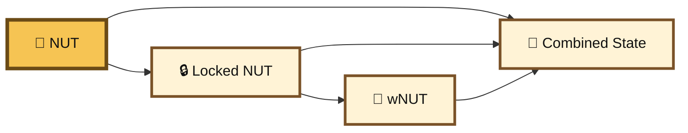
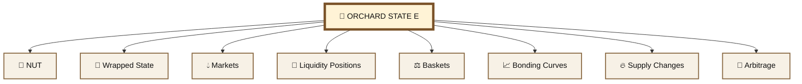
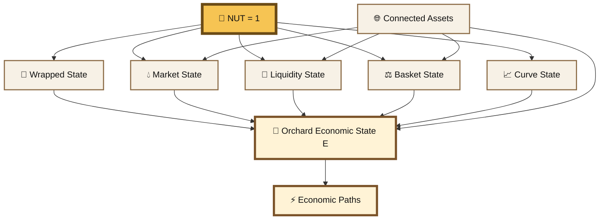

# Factorizing NUT


### **WARNING: YOU ARE READING** HYPER ADVANCED NUT RESEARCH

We have exhausted the practical explanations and are now investigating what happens when very smart people are left alone with **1 NUT** for too long. The whitepaper needed more symbols. Advanced theory needed more equations. Apparently neither was enough. Welcome to the part where we give the NUT a research PhD program.


## 🧮 NUT as an Integer 1

<figure><figcaption></figcaption></figure>

#### FRACTRAN, Prime State & Many Expressions of One System


NUT can be viewed not only as a token, but as the **root coordinate of a larger economic state**.

The realization comes from the logic behind **FRACTRAN**, John Conway's extraordinarily small universal programming language.


A FRACTRAN program consists of an ordered list of positive fractions and a positive integer representing the current state. At each step, the program multiplies the current integer by the first fraction that produces another integer. The resulting integer becomes the next state. Conway introduced the system as a universal language for arithmetic. ([Conway — FRACTRAN: A Simple Universal Programming Language for Arithmetic](https://link.springer.com/chapter/10.1007/978-1-4612-4808-8_2?utm_source=chatgpt.com)).


The important idea for BASED NUT is deeper than the fraction game itself.


A single integer can contain many independently readable variables through its **prime factorization**.

```
N = 2ᵃ × 3ᵇ × 5ᶜ × 7ᵈ × ...
```

The integer is one object.

Its prime exponents can be interpreted as coordinates of its state.

> **Many apparent variables can be different mathematical expressions of one underlying state.**

That gives us a surprisingly powerful way to think about NUT and the economic systems growing around it.


#### A mathematical model, not literal token equivalence

The mathematics of prime-factor encoding and FRACTRAN is established mathematics and computer science.

Applying that model to NUT, markets, wrappers, LP positions, bonding curves, baskets, burns, and related assets is a **BASED NUT interpretation**.

The claim is not that every token is literally NUT or that the ecosystem is implemented as one giant integer.

The claim is that these economically connected objects can be modeled as **coordinates, representations, or transformations of a larger shared economic state**.


***

#### FRACTRAN, Prime State & Many Expressions of One Economic Root


NUT begins with an unusual mathematical property:

> The entire supply is 1 NUT.


Not one billion. Not twenty-one million. Just one.


That makes the asset naturally interpretable as a **unit whole**.


Every NUT quantity is immediately a fraction of the complete asset:

```
1 NUT       = 100% = 1

0.1 NUT     = 10%  = 1/10
0.01 NUT    = 1%   = 1/100
0.001 NUT   = 0.1% = 1/1000
```

This becomes especially interesting when viewed through the logic of **FRACTRAN**, John Conway's universal arithmetic programming language.


FRACTRAN demonstrates that many variables can be encoded inside a single mathematical state through prime factorization, and that computation can occur by transforming that factorization.


For BASED NUT, this suggests a useful model:

> **One root unit can support many economic expressions of a larger connected state.**


NUT is the root:

```
1
```


Around that root can exist:

```
wrapped representations
market states
liquidity positions
basket shares
bonding-curve assets
supply transformations
arbitrage relationships
economic receipts
```

These are not literally the same token.


They are different economic objects whose states can be related back into one larger system.

> **NUT supplies the unit. The Orchard supplies the state space.**


In arithmetic, `1` is the multiplicative identity:

```
1 × n = n
```

Its prime factorization is empty.

Nothing needs to be removed from it to recover the unit.


FRACTRAN provides another useful idea: a larger integer can encode many variables simultaneously through its prime exponents.

```
E = 2ᵃ × 3ᵇ × 5ᶜ × 7ᵈ × ...
```

Here, `E` is one state.


Its factorization exposes many coordinates:

```
a
b
c
d
...
```


This suggests an important distinction for BASED NUT:

```
NUT = 1
```

is the **root unit**, while:

```
E
```

is the **larger economic state constructed around that unit**.


> **The integer 1 is the root. The factorization describes the world growing around it.**


The root remains simple.

The state around it becomes increasingly expressive.


That is exactly the architectural principle behind BASED NUT:

> **Keep the root simple. Build complexity around it.**

***

### 🌳 The Orchard Grows Around 1

NUT does not need to be one more variable inside the model.

It can serve as the normalized root around which the variables are expressed.


```
                        🌳 ORCHARD STATE E

                               │
                               │
                            🌰 NUT
                               1
                               │
            ┌──────────────────┼──────────────────┐
            ↓                  ↓                  ↓
       🎁 wrappers         💧 markets         🌊 liquidity
            │                  │                  │
            ↓                  ↓                  ↓
        wrapped state      price state       position state

            ┌──────────────────┼──────────────────┐
            ↓                  ↓                  ↓
       ⚖️ baskets         📈 curves           🔥 burns


```

The root remains simple.

The state around it becomes increasingly expressive.


That is exactly the architectural principle behind BASED NUT:

Keep the root simple. Build complexity around it.

***

### 🔢 One Integer, Many Variables

Consider:

```
N = 2³ × 3² × 5¹
```


Its factorization contains three independently recoverable values:

```
a = 3
b = 2
c = 1
```

This works because of the **Fundamental Theorem of Arithmetic**: every positive integer greater than one has a unique prime factorization, apart from the ordering of its factors. ([Fundamental Theorem of Arithmetic — Wolfram MathWorld](https://mathworld.wolfram.com/FundamentalTheoremofArithmetic.html?utm_source=chatgpt.com)).


The number:

```
2³ × 3² × 5¹
```

is therefore not merely one opaque integer.


Its structure can be read as:

```
prime 2 → coordinate 3
prime 3 → coordinate 2
prime 5 → coordinate 1
```

One state.

Several coordinates.

***

### 🧠 Gödel Numbering

FRACTRAN is not the only place this idea appears.


A major precedent is **Gödel numbering**.

One standard form of Gödel encoding takes a finite sequence:

```
<n₀, n₁, n₂, ...>
```

and represents it as:

```
2ⁿ⁰ × 3ⁿ¹ × 5ⁿ² × ...
```

Because prime factorization is unique, the original sequence can be recovered from the resulting natural number. The Stanford Encyclopedia of Philosophy uses this exact prime-power construction when explaining Gödel numbering. ([Gödel Numbering — Stanford Encyclopedia of Philosophy](https://plato.stanford.edu/archives/spr2017/entries/goedel-incompleteness/sup1.html?utm_source=chatgpt.com)).


This is the deeper mathematical foundation of the idea:

> **Many pieces of information can be represented inside one integer without ceasing to be individually recoverable.**


***

## 🧬 The FRACTRAN Insight

FRACTRAN turns this representational trick into **computation**.


A program begins with an integer:

```
N₀
```

and applies an ordered list of fractions:

```
F₁, F₂, F₃, ...
```


At each step:

```
N₀
 ↓ × F₁
N₁
 ↓ × F₂
N₂
 ↓ × F₃
N₃
```

but a fraction is eligible only when multiplying the current state by it produces another integer. That divisibility condition lets the denominator test for existing prime factors, while the numerator can add or alter other factors. ([Springer Nature](https://link.springer.com/chapter/10.1007/978-1-4612-4808-8_2))


A useful way to understand FRACTRAN is therefore:

```
prime exponents
      ↓
state variables
      ↓
fractions
      ↓
state-transition rules
```

The prime numbers themselves effectively become labels for registers or coordinates, while their exponents carry values. Technical explanations of FRACTRAN commonly use this register interpretation. ([Esolangs](https://esolangs.org/wiki/Fractran?utm_source=chatgpt.com))

[FRACTRAN — Esolang Wiki technical explanation](https://esolangs.org/wiki/Fractran?utm_source=chatgpt.com)

[FRACTRAN — Wolfram MathWorld](https://mathworld.wolfram.com/FRACTRAN.html?utm_source=chatgpt.com)


So computation becomes:

> **Transform one encoded state into another by changing its factorization.**

***

### ⚡ Economic State as Transformation


That maps naturally onto an onchain economic system.


Suppose we describe an abstract economic state as:

```
E₀
```


An operation changes it:

```
E₀
 ↓ F₁
E₁
```

Another operation changes it again:

```
E₁
 ↓ F₂
E₂
```

And so on:

```
E₀ → E₁ → E₂ → E₃ → ...
```


The analogy is especially appropriate on Ethereum because Ethereum itself is formally modeled as a **transaction-based state machine**. The Yellow Paper describes transactions as valid transitions from a prior state `σₜ` to a new state `σₜ₊₁`. ([Ethereum Yellow Paper — Formal Specification](https://ethereum.github.io/yellowpaper/paper.pdf?utm_source=chatgpt.com)).


Conceptually:

```
σₜ₊₁ = Υ(σₜ, T)
```

where `T` is a transaction and `Υ` is Ethereum's state-transition function.


The BASED NUT interpretation adds another layer:

```
Ethereum state
      ↓
contracts + balances + markets
      ↓
economic relationships
      ↓
connected economic state
```

***

### 🌰 One State, Many Economic Expressions

Conceptually, we could write:

```
E =

    2^(NUT state)
  × 3^(wNUT state)
  × 5^(SNUT state)
  × 7^(pNUT state)
  × 11^(LP state)
  × 13^(curve state)
  × 17^(market state)
  × ...
```

Or symbolically:

```
E = NUTᵃ × wNUTᵇ × LPᶜ × pNUTᵈ × SALTᵉ × ...
```

This is **not an actual Solidity formula**.

It is a model.


Each term stands for some measurable coordinate of the larger system.


Different contracts and assets remain technically independent.

But their states can still be economically related.

> **Different surface objects can be coordinates of one connected economic state.**

***

## 🎁 NUT and wNUT

The simplest example is NUT and wNUT.

```
NUT
 ↓
wrap
 ↓
wNUT
```

The representation changes while the defined relationship connects both states:

```
1 NUT ⇄ 1 wNUT
```


Conceptually:

```
free NUT
locked NUT
wNUT outstanding
```

are not unrelated measurements.


They describe different coordinates of a connected wrapping state.



> **Same root. Different expression.**

At the implementation level, however, ERC-20 assets remain separate smart-contract token states. ERC-20 specifies balances, total supply, transfers, and allowances for each conforming token implementation. ([ERC-20 Token Standard — EIP-20](https://eips.ethereum.org/EIPS/eip-20?utm_source=chatgpt.com)).


The FRACTRAN analogy describes the **economic relationship between states**, not technical ERC-20 identity.

***

## 💧 Markets

Now introduce a market.


The wrapper gives a deterministic relationship:

```
x NUT → x wNUT
```

But a live NUT/wNUT AMM can produce:

```
x NUT → y wNUT
```

because `y` depends on live market state.


That state can include:

```
reserves
liquidity
fees
price
transaction size
transaction ordering
previous trades
```

The same input can therefore have different expressions depending on where and when it is transformed.


```
x NUT
 │
 ├── wrapper ──→ x wNUT
 │
 └── market ───→ y wNUT
```

Again:

> **One economic root can be interpreted through several different state-transition functions.**

***

### 🧮 AMMs as Mathematical State

Automated market makers are particularly clear examples because their outputs are explicitly determined by mathematical rules and stored pool state.

Uniswap v2, for example, maintains pooled reserves and implements exchange behavior around a constant-product invariant. Trades change those reserves, producing a new pool state.&#x20;

([Uniswap v2 Core Whitepaper](https://docs.uniswap.org/whitepaper.pdf?utm_source=chatgpt.com)).


Balancer generalizes the idea to weighted, multi-asset pools whose invariant describes an N-dimensional surface. Its original whitepaper explicitly describes Balancer pools as self-balancing weighted portfolios and price sensors, with arbitrage traders moving their state through trading. ([Balancer Whitepaper](https://docs.balancer.fi/whitepaper.pdf?utm_source=chatgpt.com)).


This makes an AMM a concrete economic state machine:

```
pool state S₀
     ↓
transaction
     ↓
pool state S₁
```

***

## 💧 LP Positions

Liquidity positions add another layer of representation.


For a simple fungible LP model:

```
asset A
+
asset B
+
pool reserves
+
pool-share supply
──────────────
LP representation
```

A liquidity provider no longer holds exactly the same direct combination of assets.

They instead hold a position whose economic meaning is derived from the pool.

```
direct assets
      ↓
pool
      ↓
pool-share representation
```

Uniswap v2's pair contracts hold the pooled funds that support the AMM. ([Uniswap Developers](https://docs.uniswap.org/whitepaper.pdf?utm_source=chatgpt.com))

Balancer similarly uses pool shares around a multi-asset state determined by balances and weights. ([Balancer](https://docs.balancer.fi/whitepaper.pdf?utm_source=chatgpt.com))

So the LP representation can be viewed as another **coordinate derived from deeper state**.

***

### 🧬 Not Every LP Representation Is Fungible

The abstraction becomes even clearer with concentrated liquidity.

Uniswap v3 gives LPs individualized positions defined by parameters such as price ranges rather than representing every liquidity provider with one homogeneous fungible pool share. ([Uniswap v3 Core Whitepaper](https://blog.uniswap.org/whitepaper-v3.pdf?utm_source=chatgpt.com)).


This is useful for the FRACTRAN interpretation because it reminds us:

> **The economically meaningful object is the state relationship, not necessarily a particular token format.**


A coordinate in the larger state might be:

```
ERC-20 balance
NFT position
pool share
reserve amount
price range
debt position
claim
```

The state model can contain all of them.


***

## ⚖️ Basket Assets

A multi-asset basket provides another expression.


Suppose a pool contains:

```
NUT
SNUT
cbETH
cbBTC
```

Those underlying assets remain distinct.


But the pool itself has a combined state:

```
balances
+
weights
+
pool-share supply
+
market relationships
```

and a pool-share asset can represent a claim on that combined state.


Balancer's weighted-pool mathematics provides a direct real-world implementation of this concept. ([Balancer](https://docs.balancer.fi/whitepaper.pdf?utm_source=chatgpt.com))


Conceptually:

```
NUT
SNUT
cbETH
cbBTC
  │
  ▼
combined pool state
  │
  ▼
pool-share representation
```

A new surface asset can therefore be an **expression of several underlying coordinates at once**.

***

## 📈 Bonding Curves

Bonding curves make the state-expression idea especially visible.


A bonding-curve asset can derive its mint or burn result from:

```
base asset
+
current supply
+
curve definition
+
transaction quantity
```

The visible output is therefore a mathematical interpretation of another state.


Mint Club describes this directly: token pricing is linked to supply through a predefined price-supply relationship; buying mints tokens against a base asset, while selling burns tokens and releases the calculated base asset. Mint Club V2 uses a discrete, step-based bonding curve. ([Mint Club Docs](https://docs.mint.club/learn/bonding?utm_source=chatgpt.com))

[Mint Club — Bonding Curve Model](https://docs.mint.club/learn/bonding?utm_source=chatgpt.com)

[Mint Club — Bonding Curve Design](https://docs.mint.club/tools/bonding-curve-design?utm_source=chatgpt.com)


Conceptually:

```
base asset state
       +
curve state
       +
current supply
       ↓
    transaction
       ↓
new supply + new reserve state
```

So:

> **The bonding-curve token is another readable output of an underlying state-transition rule.**

***

## 🔥 Burns

Burns are another transformation.


Suppose some coordinate is represented by:

```
pᵍ
```

and an economic operation reduces that state by `k`.


Conceptually:

```
pᵍ
 ↓ burn
p^(g-k)
```

The exact FRACTRAN representation is only an analogy, but the structural idea is valid:

```
pre-state
 ↓
state-changing operation
 ↓
post-state
```

For an actual token burn, the relevant economic state might include:

```
pre-burn supply
burned amount
post-burn supply
balances
related market state
```

> **A burn is a transformation of measurable economic state.**

***

## 🌳 The Orchard as One State Object

The Orchard currently looks, on the surface, like a collection of different assets, pools, wrappers, curves, and markets.


For example:

```
NUT / WETH
NUT / AERO
NUT / cbBTC
SNUT / NUT
NUT / wNUT

pNUT basket

SALT bonding relationship
NUTINO bonding relationship

LP positions
wrapper state
arbitrage state
...
```

One way of drawing it is as a network.


Another is to view it as **one high-dimensional economic state**.



A swap changes one coordinate.

An LP mint changes another.

A burn changes another.

A bonding-curve mint changes another.

A wrapper transformation moves state between representations.

An arbitrage transaction can propagate the consequences of a change into another market.

The visible objects differ.

The complete system remains economically connected.


#### BASED NUT interpretation

FRACTRAN proves neither that the Orchard _is_ one integer nor that financial assets are secretly prime factors.

FRACTRAN demonstrates something more fundamental: many variables can be represented through one arithmetic state and manipulated through state transitions.

Ethereum provides the canonical on-chain state machine.

AMMs, wrappers, curves, pools, and tokens provide economic state-transition functions.

The Orchard interpretation combines those ideas into a model of **one connected economic state with many observable expressions**.<br>

***

## 🐝 Arbitrage as State Propagation

This also provides a mathematical interpretation of arbitrage.


Suppose two markets expose related economic quantities:

```
Market A → state A₀
Market B → state B₀
```

A transaction changes one:

```
A₀ → A₁
```

The relationship between the markets may now be inconsistent.


That creates an arbitrage opportunity:

```
A₁
 ↓
relative price discrepancy
 ↓
arbitrage
 ↓
B₀ → B₁
```

The local state change has propagated into another coordinate of the larger system.

Balancer's original whitepaper explicitly describes arbitrage traders as the mechanism that rebalances its weighted portfolios, while AMM spot prices are functions of pool state. ([Balancer](https://docs.balancer.fi/whitepaper.pdf?utm_source=chatgpt.com))


Uniswap similarly derives exchange behavior from pool reserves and mathematical invariants. ([Uniswap Developers](https://docs.uniswap.org/whitepaper.pdf?utm_source=chatgpt.com))

> **A local economic state transition can create consequences elsewhere in the connected state.**


This is the mathematical version of the Orchard's pollination metaphor:

> **Pollinators move genetic information between plants. Arbitrageurs move price information between markets.**

***

## ⚡ Economic Path Nonces

The FRACTRAN interpretation also clarifies the logic behind **Economic Path Nonces**.


An economic path is an ordered sequence:

```
E₀
 ↓ F₁
E₁
 ↓ F₂
E₂
 ↓ F₃
E₃
```


The transformations can be:

```
price observation
swap
wrap
burn
LP mint
LP burn
bonding-curve mint
bonding-curve redemption
basket join
basket exit
arbitrage
other economic actions
```

The nonce is then derived from the path.


Conceptually:

```
EconomicPathNonce = H(
    E₀,
    F₁,
    E₁,
    F₂,
    E₂,
    F₃,
    E₃,
    ...
)
```

or:

```
starting state
+
ordered transformations
+
state-dependent outputs
────────────────────────
economic fingerprint
```

> **The interaction path is a computation over economic state.**

This is much closer to the FRACTRAN insight than treating a nonce as merely a random decimal or transaction hash.

***

## 🧮 From Token List to State Algebra

Without this lens, an ecosystem can look like a list:

```
NUT
wNUT
SNUT
pNUT
SALT
NUTINO
PIPS
LP positions
markets
...
```

Each item appears to be its own thing.


With a state-oriented lens:

```
E₀
 ↓ wrap
E₁
 ↓ swap
E₂
 ↓ LP mint
E₃
 ↓ curve mint
E₄
 ↓ burn
E₅
 ↓ arbitrage
E₆
```

The emphasis shifts.


The important object becomes:

```
E
```

and the visible tokens, positions, and markets become **ways of reading or transforming parts of E**.


This is why the model is better described as a **state algebra** than a token taxonomy.

***

## 🔢 Why the Integer Matters

The integer metaphor is not useful because BASED NUT should literally store the entire economy inside one enormous Solidity integer.


It matters because mathematics establishes that a single natural number can encode an arbitrary finite collection of discrete coordinates through prime powers. Gödel numbering is a standard example of precisely this technique. ([Stanford Encyclopedia of Philosophy](https://plato.stanford.edu/archives/spr2017/entries/goedel-incompleteness/sup1.html?utm_source=chatgpt.com))


That changes the conceptual picture.

Instead of:

```
asset A

asset B

market C

pool D

position E

curve F
```

as fundamentally unrelated objects, we can imagine:

```
                    STATE E
                       │
        ┌──────────────┼──────────────┐
        ↓              ↓              ↓
   coordinate A   coordinate B   coordinate C
        │              │              │
        ↓              ↓              ↓
      asset          market          position
```

The visible object is one interpretation of the state.

The deeper object is the **relationship among all of the coordinates**.


***

## 🌰 Why NUT Fits the Model

NUT begins from an unusually minimal root:

```
total supply = 1 NUT
```


That makes every quantity naturally interpretable as a fraction of the whole:

```
1 NUT       = 100%

0.1 NUT     = 10%

0.01 NUT    = 1%

0.001 NUT   = 0.1%

0.0001 NUT  = 0.01%
```


The ecosystem can then create additional states around that root:

```
🌰 NUT
 │
 ├── 🎁 wrapped state
 │
 ├── 💧 market state
 │
 ├── 🌊 liquidity state
 │
 ├── ⚖️ basket state
 │
 ├── 📈 bonding-curve state
 │
 ├── 🔥 supply-changing state
 │
 ├── 🐝 arbitrage relationships
 │
 └── ⚡ economic path transitions
```


The important realization is **not**:

> “All these tokens are secretly NUT.”


That would be technically false.


The useful statement is:

> **They can be interpreted as different mathematical expressions, coordinates, claims, or transformations inside one connected economic system rooted around NUT.**

***

## ⚠️ Not Literal Token Equivalence

This distinction matters.


wNUT, SNUT, pNUT, SALT, NUTINO, PIPS, LP positions, counter-assets, and other components do not all have the same:

```
contract
issuer
supply
collateral
redemption
ownership rights
economic exposure
legal meaning
```

They are not interchangeable.

They are not all NUT-backed.

They are not literally prime factors encoded inside one integer.


ERC-20 itself defines separate contract-level token states rather than some universal identity across tokens. ([Ethereum Improvement Proposals](https://eips.ethereum.org/EIPS/eip-20?utm_source=chatgpt.com))


The FRACTRAN model is a **mathematical lens**:

> heterogeneous state can be represented as one larger object, and operations can be understood as transformations of that object.

***

## 🧬 Representation vs. Transformation

This leads to a useful distinction.


Some primitives primarily **represent state**:

```
wNUT
LP positions
pool shares
basket shares
balances
claims
```


Other primitives primarily **transform state**:

```
wrap
unwrap
swap
mint
burn
LP deposit
LP withdrawal
bonding-curve trade
basket join
basket exit
arbitrage
```


And some structures do both.

A pool share, for example, represents an economic claim while the pool itself continuously changes through trades.

A bonding-curve asset represents supply state while minting and burning transform the reserve and supply coordinates.


Mint Club's discrete bonding-curve system makes this duality explicit: supply determines a curve state, while mint and burn operations move the system between states. ([Mint Club Docs](https://docs.mint.club/learn/bonding?utm_source=chatgpt.com))


This gives the larger model a simple grammar:

```
STATE
  +
REPRESENTATIONS
  +
TRANSFORMATIONS
  =
ECONOMIC SYSTEM
```

***

## 🌳 The Larger Realization

The forest is not the individual token.

The forest is the **state space**.


NUT is the root around which a growing number of economic representations, positions, markets, and transformations can be defined.


FRACTRAN provides an unusually compact mathematical analogy:

> **One integer can encode many variables.**\
> **One factorization can describe many coordinates.**\
> **One operation can transform the encoded state.**


Ethereum gives us the onchain version:

> **One canonical chain state.**\
> **Transactions transform it.** ([Ethereum GitHub](https://ethereum.github.io/yellowpaper/paper.pdf?utm_source=chatgpt.com))


DeFi adds economic interpretation:

> **Balances, reserves, pools, shares, curves, and prices become interconnected state variables.**


And the Orchard adds the BASED NUT interpretation:

> ### **Many assets. Many markets. Many representations. One connected economic state. 🌰**

***

## 📚 References & Further Reading


### 🧮 FRACTRAN — Primary Source

#### John H. Conway — _FRACTRAN: A Simple Universal Programming Language for Arithmetic_

Conway's original treatment of FRACTRAN. The state is a positive integer; the program is an ordered list of fractions; execution repeatedly selects the first fraction whose multiplication keeps the result integral. The chapter appears in _Open Problems in Communication and Computation_ and runs pp. 4–26. ([Springer Nature](https://link.springer.com/chapter/10.1007/978-1-4612-4808-8_2))

[Read Conway's FRACTRAN chapter — Springer Nature](https://link.springer.com/chapter/10.1007/978-1-4612-4808-8_2?utm_source=chatgpt.com)

**DOI:** `10.1007/978-1-4612-4808-8_2`

***

### 🎥 Conway Explains FRACTRAN

#### John Conway — _Fractran: A Ridiculous Logical Language_

A 74-minute lecture by Conway himself, recorded in 2012. Useful for understanding the intuition behind the arithmetic machine rather than approaching it only through the paper. ([UCTV](https://www.uctv.tv/shows/Fractran-A-Ridiculous-Logical-Language-with-John-Conway-23320?utm_source=chatgpt.com))

[Watch Conway's FRACTRAN lecture — UCTV](https://www.uctv.tv/shows/Fractran-A-Ridiculous-Logical-Language-with-John-Conway-23320?utm_source=chatgpt.com)

***

### 🔢 Unique Prime Factorization

#### Fundamental Theorem of Arithmetic — Wolfram MathWorld

The mathematical reason a natural number can carry independently recoverable prime-exponent coordinates: every integer greater than one has a unique factorization into primes, up to factor ordering. ([MathWorld](https://mathworld.wolfram.com/FundamentalTheoremofArithmetic.html?utm_source=chatgpt.com))

[Explore the Fundamental Theorem of Arithmetic — MathWorld](https://mathworld.wolfram.com/FundamentalTheoremofArithmetic.html?utm_source=chatgpt.com)

***

### 🧠 Gödel Numbering

#### Stanford Encyclopedia of Philosophy — Gödel Numbering

A particularly important conceptual predecessor.

The SEP demonstrates how a finite sequence of numbers can be encoded into one natural number using successive prime powers:

```
2ⁿ⁰ × 3ⁿ¹ × 5ⁿ² × ...
```

This is one of the clearest rigorous introductions to the idea of **many values encoded inside one integer**. ([Stanford Encyclopedia of Philosophy](https://plato.stanford.edu/archives/spr2017/entries/goedel-incompleteness/sup1.html?utm_source=chatgpt.com))

[Read Gödel Numbering — Stanford Encyclopedia of Philosophy](https://plato.stanford.edu/archives/spr2017/entries/goedel-incompleteness/sup1.html?utm_source=chatgpt.com)

For the broader logical context:

[Gödel's Incompleteness Theorems — Stanford Encyclopedia of Philosophy](https://plato.stanford.edu/entries/goedel-incompleteness/index.html?utm_source=chatgpt.com)

***

### 🧬 FRACTRAN — Technical Explanations

#### FRACTRAN — Wolfram MathWorld

A compact mathematical explanation of the execution rule and Conway's prime-generating FRACTRAN program. ([MathWorld](https://mathworld.wolfram.com/FRACTRAN.html?utm_source=chatgpt.com))

[Explore FRACTRAN — Wolfram MathWorld](https://mathworld.wolfram.com/FRACTRAN.html?utm_source=chatgpt.com)

#### FRACTRAN — Esolang Wiki

A more implementation-oriented treatment that explicitly explains the importance of viewing FRACTRAN integers as products of prime powers. ([Esolangs](https://esolangs.org/wiki/Fractran?utm_source=chatgpt.com))

[Explore FRACTRAN — Esolang Wiki](https://esolangs.org/wiki/Fractran?utm_source=chatgpt.com)

These are secondary sources; Conway's original paper remains the primary mathematical reference.

***

## ⛓️ Ethereum as a State Machine

#### Ethereum Yellow Paper

Ethereum's formal execution specification.

The Yellow Paper explicitly describes Ethereum as a **transaction-based state machine** and defines a state-transition function mapping a prior state and transaction to a subsequent state. ([Ethereum GitHub](https://ethereum.github.io/yellowpaper/paper.pdf?utm_source=chatgpt.com))

[Read the Ethereum Yellow Paper](https://ethereum.github.io/yellowpaper/paper.pdf?utm_source=chatgpt.com)

This is the strongest primary source for the transition from:

```
mathematical state machine
```

to:

```
onchain state machine
```

***

## 🪙 ERC-20

#### EIP-20 — ERC-20 Token Standard

The canonical specification for fungible token contracts on Ethereum-compatible chains.

Useful here because it establishes the technical distinction between separate token implementations even when those tokens have economic relationships with one another. ([Ethereum Improvement Proposals](https://eips.ethereum.org/EIPS/eip-20?utm_source=chatgpt.com))

[Read ERC-20 — Ethereum Improvement Proposals](https://eips.ethereum.org/EIPS/eip-20?utm_source=chatgpt.com)

***

## 💧 Automated Market Makers

#### Uniswap v2 Core Whitepaper

Primary technical source for the constant-product AMM design, reserve state, ERC-20/ERC-20 pairs, LP-held pooled funds, swaps, and price behavior. ([Uniswap Developers](https://docs.uniswap.org/whitepaper.pdf?utm_source=chatgpt.com))

[Read the Uniswap v2 Core Whitepaper](https://docs.uniswap.org/whitepaper.pdf?utm_source=chatgpt.com)

#### Uniswap v3 Core Whitepaper

Extends the state model with concentrated liquidity and individualized LP positions. Particularly useful for understanding why a liquidity representation does not need to be a simple fungible pool token. ([Uniswap Labs](https://blog.uniswap.org/whitepaper-v3.pdf?utm_source=chatgpt.com))

[Read the Uniswap v3 Core Whitepaper](https://blog.uniswap.org/whitepaper-v3.pdf?utm_source=chatgpt.com)

***

## ⚖️ Weighted Pools & Baskets

#### Balancer Whitepaper

Balancer's original whitepaper describes an N-dimensional AMM invariant, weighted portfolios, pool state, spot pricing, and arbitrage-driven rebalancing.

It is especially relevant to the idea that several underlying assets can be represented through a higher-level pool state. ([Balancer](https://docs.balancer.fi/whitepaper.pdf?utm_source=chatgpt.com))

[Read the Balancer Whitepaper](https://docs.balancer.fi/whitepaper.pdf?utm_source=chatgpt.com)

***

## 📈 Bonding Curves

#### Mint Club — Bonding Curve

Primary documentation for one of the bonding-curve systems used within the BASED NUT ecosystem.

Mint Club describes assets whose prices depend on supply and a predefined curve. Purchases mint the curve asset while committing a base asset; sales burn the curve asset and return base assets. Mint Club V2 implements a discrete step-based curve. ([Mint Club Docs](https://docs.mint.club/learn/bonding?utm_source=chatgpt.com))

[Read Mint Club's Bonding Curve Documentation](https://docs.mint.club/learn/bonding?utm_source=chatgpt.com)

#### Mint Club — Bonding Curve Design

Technical details on its discrete price intervals, curve types, supply ranges, and curve customization. ([Mint Club Docs](https://docs.mint.club/tools/bonding-curve-design?utm_source=chatgpt.com))

[Explore Mint Club Bonding Curve Design](https://docs.mint.club/tools/bonding-curve-design?utm_source=chatgpt.com)

#### Mint Club — ERC-20 Curve Assets

Details on creating an ERC-20 curve asset around another ERC-20 base asset. ([Mint Club Docs](https://docs.mint.club/create/token?utm_source=chatgpt.com))

[Explore Mint Club ERC-20 Curve Assets](https://docs.mint.club/create/token?utm_source=chatgpt.com)

***

## 🧭 How the Ideas Connect


For readers who want to follow the concept from its mathematical foundations all the way to BASED NUT:

```
Fundamental Theorem of Arithmetic
        │
        │ unique prime factorization
        ▼

Gödel Numbering
        │
        │ many values encoded in one integer
        ▼

FRACTRAN
        │
        │ prime-factor state + arithmetic transitions
        ▼

State Machines
        │
        ▼

Ethereum
        │
        │ transactions transform canonical state
        ▼

Smart Contracts
        │
        ├── tokens
        ├── wrappers
        ├── AMMs
        ├── LP positions
        ├── baskets
        ├── bonding curves
        └── burns
        │
        ▼

Economic State Transitions
        │
        ▼

The Orchard
        │
        │ many economically connected coordinates
        ▼

Economic Path Nonces
        │
        │ ordered transformations through state
        ▼

BASED NUT State Algebra
```

The first layers are established mathematics and computer science.

The protocol layers are implemented blockchain systems.


The final synthesis is the **BASED NUT interpretation**:

> ### **Different assets can be understood as different expressions of one connected economic state.**


Not because they are literally the same token.

Not because every asset is NUT-backed.


But because **representations, claims, prices, reserves, positions, supplies, and markets can all be coordinates of a larger state—and economic actions transform that state.**

***

## 🌰 The Integer 1


Most token systems begin with a large arbitrary supply:

```
1,000,000
100,000,000
1,000,000,000
```

NUT begins with:

```
1
```

This makes the whole asset itself the unit.

Its subdivisions are fractions of the whole.

Its markets express relationships against that whole.

Its wrappers transform its representation.

Its liquidity positions encode claims involving it.

Its baskets compose it with other assets.

Its bonding curves create state-dependent relationships around it.

Its economic paths transform quantities through those states.


The root remains:

```
1
```


The complexity exists around it.





FRACTRAN gives us the mathematical insight:

> **One state can contain many variables.**


NUT adds another unusual starting point:

> **The root itself is 1.**


And the Orchard supplies the economic interpretation:

> **Many representations. Many transformations. Many markets. One connected state growing around the unit whole.**


## **NUT = 1. The rest is state. 🌰**
