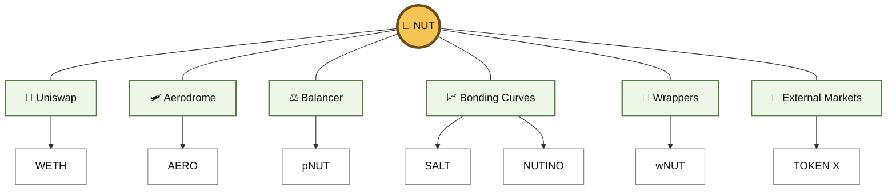
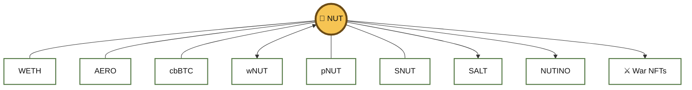
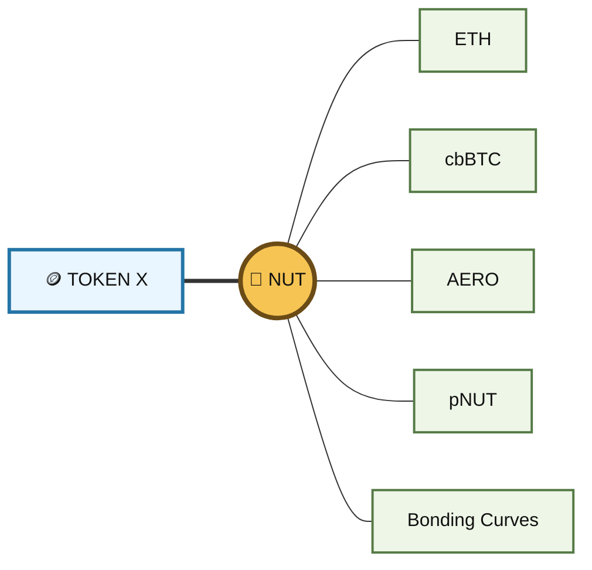
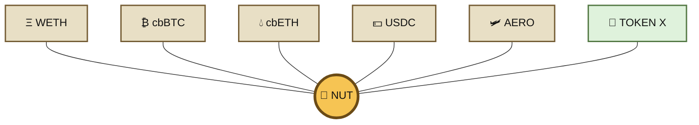
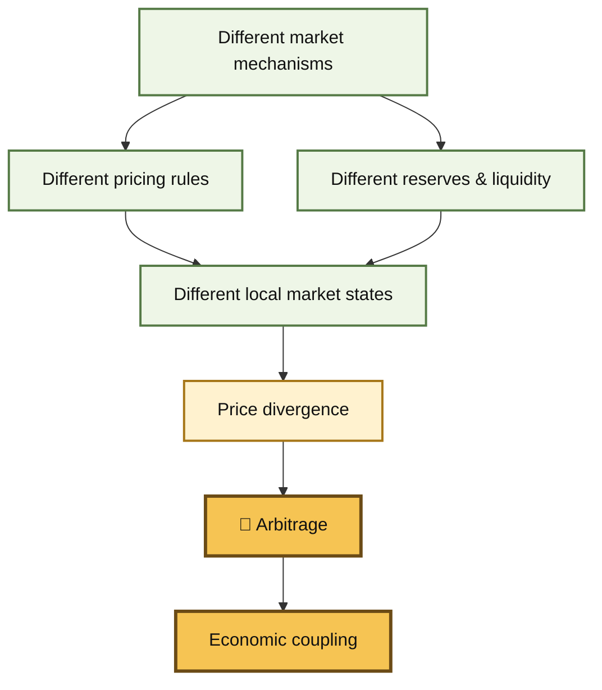
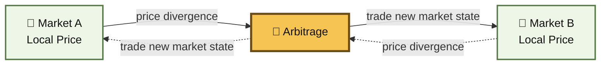
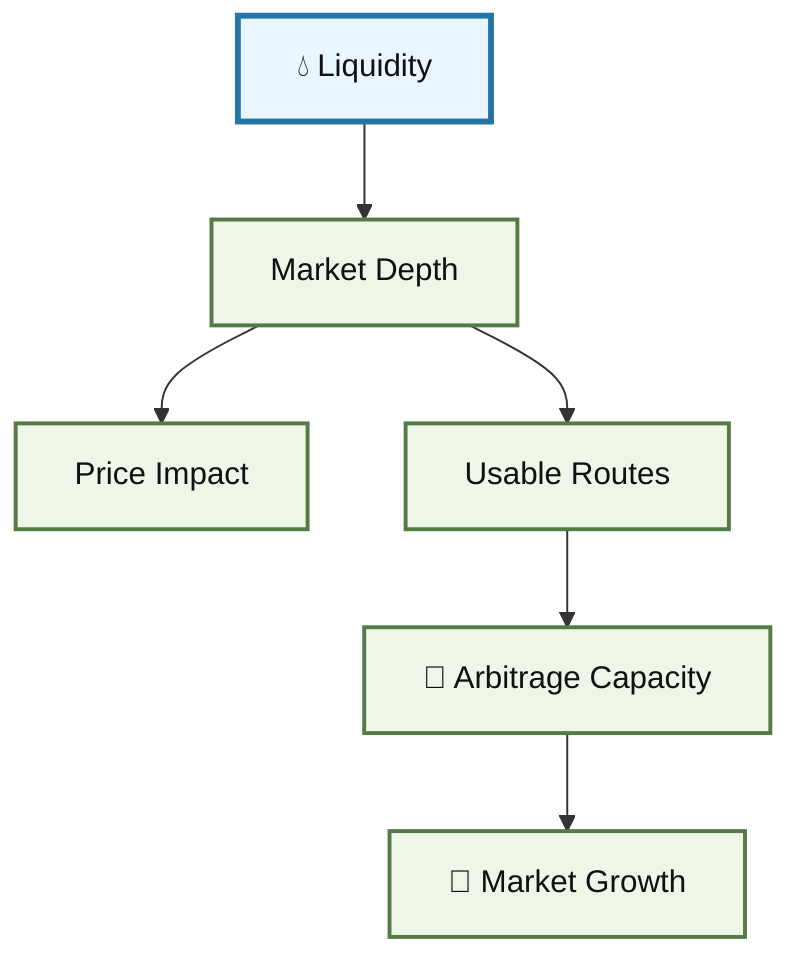
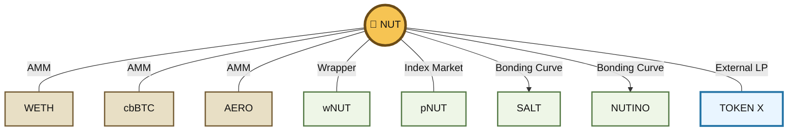
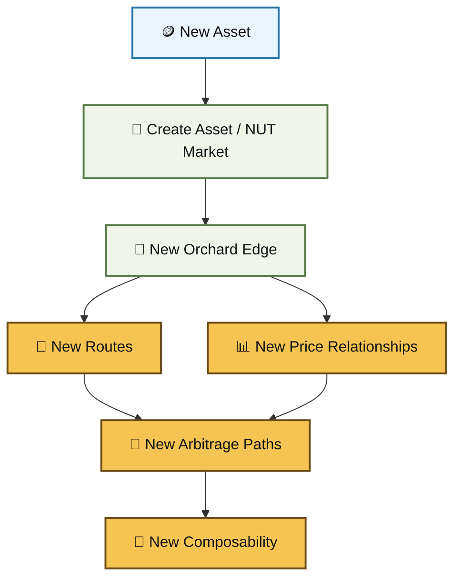
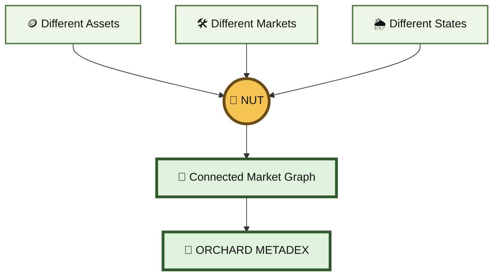

# 🌳 The Orchard Framework

### The BASED NUT MetaDEX Framework

<figure><figcaption></figcaption></figure>


#### 🌰 Different markets. Different mechanisms. One connected Orchard.

**The Orchard** is the economic architecture of BASED NUT: a **MetaDEX** formed from interconnected AMMs, liquidity pools, bonding curves, index pools, wrappers, tokens, NFTs and other market mechanisms built around **NUT**.


The Orchard site is still in early development , [find it here ](https://orchard.basednut.com/).


### 🔧 Overview

The Orchard is **not a normal decentralized exchange**.

There is no master exchange contract containing the entire system.

Markets can exist independently across **Uniswap, Aerodrome, Balancer, Mint Club and other protocols**, each maintaining its own contracts, liquidity, pricing rules and market state.


What connects them is **NUT!**


> **The relationships between the markets ARE the system.**


The Orchard exists **above and across** those individual markets as a higher-order liquidity network.






Each component remains independent.

Together they form a **market graph that we call The Orchard**.


***

### 🌿 The Orchard Lexicon

The permaculture language is a metaphor, but each term maps to an actual DeFi concept.

<figure><figcaption></figcaption></figure>

<table><thead><tr><th width="190">🌳 Orchard</th><th>⚙️ DeFi</th></tr></thead><tbody><tr><td>🌳 <strong>The Orchard</strong></td><td>Entire NUT-connected MetaDEX graph</td></tr><tr><td>🌰 <strong>NUT / Seed</strong></td><td>Common root asset and economic primitive</td></tr><tr><td>🌱 <strong>Planting</strong></td><td>Creating a market between an asset and NUT</td></tr><tr><td>🪴 <strong>Soil</strong></td><td>External assets and market conditions supporting NUT liquidity</td></tr><tr><td>🧪 <strong>Soil Mix</strong></td><td>Composition and properties of those supporting markets</td></tr><tr><td>🌱 <strong>Sapling</strong></td><td>New, shallow or lightly connected NUT market</td></tr><tr><td>🌳 <strong>Nut Tree</strong></td><td>Established, deeper or highly connected NUT market</td></tr><tr><td>🌲 <strong>Grove</strong></td><td>Related collection of markets or assets</td></tr><tr><td>🐝 <strong>Pollination</strong></td><td>Arbitrage transmitting price information between markets</td></tr><tr><td>💧 <strong>Water</strong></td><td>Available liquidity and market depth</td></tr><tr><td>🌦️ <strong>Microclimate</strong></td><td>Local curves, fees, volatility and market conditions</td></tr><tr><td>✂️ <strong>Pruning</strong></td><td>Rebalancing, restructuring or retiring liquidity positions</td></tr><tr><td>🪱 <strong>Nutrient Cycling</strong></td><td>Fees, rewards, redemptions, buybacks and other value flows</td></tr><tr><td>🌿 <strong>Polyculture</strong></td><td>Multiple market mechanisms coexisting around shared assets</td></tr></tbody></table>



The metaphor is a vocabulary for understanding the **underlying market architecture**.



***

## 🐚 The Orchard Is NOT a DEX

A conventional DEX contains markets.

A Meta-Dex contains relationships between markets.


The Orchard connects **markets to other markets via a single point invariant NUT.**

> **The Orchard is a cross-protocol liquidity architecture in which independent markets become interoperable components of a larger programmable economic graph anchored on the same invariant root.**


### What is a MetaDEX?

A **MetaDEX** is a liquidity system built **above and across multiple independent markets**, rather than being a single decentralized exchange itself.

A DEX operates a market and contains its own pools and pricing mechanism.

A MetaDEX operates across a network of markets and has many components and relationships.


```
Uniswap pools
Aerodrome pools
Balancer indexes
Bonding curves
Wrapped assets
Derivative markets
       │
       ▼
    MetaDEX
       │
       ▼
higher-order liquidity network
```

They become part of the metadex because **their assets and markets intersect through NUT**.

The individual protocols remain independent. They continue to maintain their own contracts, reserves, pricing functions and market states.

The MetaDEX emerges from **connecting those markets through shared assets and economic relationships**.

> **A MetaDEX is a compositional liquidity framework that treats multiple independent market mechanisms, assets, pools, curves, wrappers and liquidity systems as components of a higher-order programmable market graph.**


The Orchard is the BASED NUT implementation of this idea.



#### ⚠️ MetaDEX does not mean one pool controls everything.

Every venue retains its own liquidity, execution rules and risks. The MetaDEX is the **economic graph created between them**.


### DEX vs MetaDEX

A conventional DEX might contain:

```
Token A ↔ Token B
Token A ↔ Token C
Token B ↔ Token C
```

All three markets belong to one protocol and generally use a common family of contracts.

A MetaDEX can instead contain:

```
                  NUT
                   │
        ┌──────────┼───────────┐
        │          │           │
    Uniswap    Aerodrome    Balancer
        │          │           │
       WETH       AERO        pNUT
                               │
                         NUT + SNUT
                         cbBTC + cbETH

                  NUT
                   │
               Mint Club
              ╱         ╲
           SALT         NUTINO
            │              │
           USDC          cbBTC
```

There is no single exchange contract controlling this graph.

The **relationships between the markets ARE the system**.

The **liquidity graph topology** IS the system.

***

### The Orchard

The **Orchard MetaDEX** is a cross-protocol liquidity system that connects independent AMMs, bonding curves, index pools, wrappers and derivative markets around a common asset graph.

Each venue maintains its own market state.

For example:

* Uniswap determines price from its liquidity positions.
* Aerodrome determines price from its own reserves and curve.
* Balancer determines state using a multi-asset weighted pool.
* Mint Club determines mint and redemption prices through bonding curves.
* wNUT maintains a contractual 1:1 relationship with NUT.

None of these protocols needs to understand the complete Orchard.

They become components of it because their assets and markets intersect.


### Markets can use different mathematics

This is important.

The Orchard does not require every component to behave like the same AMM.

One part might use:

```
x · y = k
```

Another may use concentrated liquidity.


Another:

```
weighted multi-asset invariant
```

Another:

```
bonding curve
```

Another:

```
1 NUT = 1 wNUT
```

These are fundamentally different economic machines.


A MetaDEX can compose them because they share assets and therefore produce **comparable state transitions**.

For example:

```
NUT
 │
 ├── AMM price
 │
 ├── bonding-curve collateral value
 │
 ├── index weight
 │
 ├── wrapper redemption value
 │
 └── reward distribution
```

The same primitive enters several different forms of market mathematics.

That heterogeneity is not incidental.

**It is what creates the higher-order system.**

***

## 🌰 NUT — The Seed and Root


At the center of the Orchard is **NUT**.


> **1 NUT. 18 decimals. Fixed supply. No tax.**


NUT is deliberately simple.


Instead of placing every behavior inside the root token, additional behavior can exist **around it** through markets, wrappers, bonding curves, index pools, NFTs and other contracts.


This makes NUT a **common economic primitive** through which otherwise independent systems can interact.

NUT is better understood as a **minimal common primitive** than as the token of a traditional exchange.


It provides a common economic object that different mechanisms can interact with in different ways.





The result is not one giant pool. It is a **network of markets sharing a common root**.

Each relationship gives the same asset a different economic context.


NUT can simultaneously function as:

* a traded asset,
* collateral,
* a reserve,
* an index constituent,
* a reward asset,
* a wrapped underlying,
* a bonding-curve base,
* and a common routing coordinate.


The MetaDEX therefore does not depend on making NUT itself complex.

**NUT stays simple while the graph around NUT becomes complex.**

***

### 🥜 Network Utility Token

<figure><figcaption></figcaption></figure>

> **NUT** stands for **Network Utility Token**.

Within BASED NUT, that name describes the actual NUT token and its role as the root asset connecting the network.


NUT is the **seed of the Orchard**.


Its usefulness does not come from packing every possible function into the ERC-20 contract. Its functionality emerges from the systems that can be composed around it.

> 🌰 **Simple seed. Complex ecosystem.**


***

### Independent markets, shared state


Each market has its own local state.

Suppose NUT trades simultaneously in four places:

```
NUT/WETH       $20,000
NUT/AERO       $20,300
NUT/cbBTC      $19,900
pNUT implied   $20,150
```


There is no contract declaring:

```
NUT price = $20,087.50
```

Instead there are several **local price surfaces**.

Each is valid for the market producing it.


The markets become economically connected because they share NUT.


That means a trader can observe:

```
NUT cheap here
      ↓
buy
      ↓
NUT expensive there
      ↓
sell
```

The resulting transactions alter both markets.

This is how otherwise independent protocols become parts of one larger economic machine.

***

## 🌱 Planting an Asset in the Orchard


The simplest Orchard integration is also one of its most important primitives:

> ### **Pair any asset with NUT.**


Suppose another ecosystem has a token called `TOKEN X`. Create:

```
TOKEN X ↔ NUT
```


Now a new economic relationship exists.






`TOKEN X` itself has **not changed**.

Its token contract remains independent.

Its existing ecosystem remains independent.

Its other liquidity remains independent.


What _changed_ is its **economic connectivity**.

The new market adds another edge to the Orchard graph.


A project does not need to migrate to a new DEX, replace its token or adopt every BASED NUT mechanism.


It can connect at the market layer:

```
YOUR TOKEN ↔ NUT
```

That market can create routes and arbitrage relationships with other NUT-connected markets.


#### 🔗 Liquidity connection, not liquidity fusion


Pairing with NUT does **not** magically merge two pools or move all external liquidity into the Orchard.

Instead, it creates a **market connection** through which traders, routers and arbitrageurs can economically couple the two systems.

The Orchard can therefore expand **permissionlessly, one market edge at a time**.

***

## 🪴 Soil Mix

> **“No forest thrives without its soil. No liquidity flourishes without its collateral.”**\
> — _**Peanutoshi Nutkamoto**_

### 🌾 The Foundation of Growth

<figure><figcaption></figcaption></figure>

NUT may be the seed, but a seed does not grow by itself.

It grows inside an environment.

In the Orchard, that environment is the **Soil Mix**.


**Soil** represents the paired external assets and market conditions supporting NUT liquidity.


Current examples include:

* Ξ **WETH**
* ₿ **cbBTC**
* 💧 **cbETH**
* 💵 **USDC**
* 🛩️ **AERO**


External assets planted through NUT markets can become additional components of the Soil Mix.





***

### 🧪 What Makes a Soil Mix?


A Soil Mix is not merely a list of tokens.

It is the combined economic character of the assets and markets surrounding NUT.


The Soil Mix influences:

* 💧 **liquidity depth**
* 🌀 **slippage**
* 🌋 **volatility**
* 🔗 **correlation**
* 🐝 **arbitrage capacity**
* 🌊 **external market depth**
* 💸 **fees and transfer friction**
* 🔄 **redemption mechanics**
* 🧭 **routing possibilities**
* 🧩 **composability**
* ⚠️ **contract, asset and counterparty risk**



### 🥀 Bad soil means bad growth.

A poorly constructed market environment can produce shallow liquidity, excessive slippage, fragile routes or poor arbitrage connectivity.


This does **not** mean an asset itself is inherently “bad.” Soil quality describes how the **mixture, liquidity and market structure work together**.



A deep `NUT/WETH` market produces different conditions from a shallow `NUT/memecoin` market.

A `NUT/USDC` market creates a different **microclimate** from `NUT/cbBTC`.


Different soil creates different growth.

***

### 🌿 Principles of Effective Soil Design

<table><thead><tr><th width="247">Principle</th><th>DeFi Meaning</th></tr></thead><tbody><tr><td>⚖️ <strong>Stability + Dynamism</strong></td><td>Combine assets with different volatility and liquidity properties.</td></tr><tr><td>💧 <strong>Adequate Water</strong></td><td>A market needs enough usable liquidity for its intended trade size.</td></tr><tr><td>🐝 <strong>Arbitrage Connectivity</strong></td><td>Useful external markets create more paths for price discovery.</td></tr><tr><td>🧩 <strong>Composability</strong></td><td>Assets with broad DeFi integrations can connect the Orchard to additional systems.</td></tr><tr><td>⚠️ <strong>Risk Diversity</strong></td><td>Every asset introduces its own contract, market, liquidity and counterparty risks.</td></tr><tr><td>🌱 <strong>Strategic Simplicity</strong></td><td>A useful market is better than unnecessary complexity.</td></tr><tr><td>🌳 <strong>Organic Expansion</strong></td><td>Add new markets as meaningful relationships emerge.</td></tr></tbody></table>

***

### 🌰 Soil Mix Asset Categories

<table><thead><tr><th width="265">Category</th><th width="152">Examples</th><th>Role</th></tr></thead><tbody><tr><td>💵 <strong>Stable Assets</strong></td><td>USDC</td><td>Stable quote asset and lower-volatility market anchor</td></tr><tr><td>Ξ <strong>Major Assets</strong></td><td>WETH, cbBTC</td><td>Deep external markets and broad routing</td></tr><tr><td>💧 <strong>Yield-Bearing Assets</strong></td><td>cbETH</td><td>External yield exposure combined with market liquidity</td></tr><tr><td>🛩️ <strong>Ecosystem Assets</strong></td><td>AERO</td><td>Connects NUT to another protocol economy</td></tr><tr><td>🌱 <strong>External Project Tokens</strong></td><td><code>TOKEN X</code></td><td>Extends the Orchard into another token ecosystem</td></tr><tr><td>🌍 <strong>Future Tokenized Assets</strong></td><td>RWAs </td><td>Potential new economic branches and market relationships</td></tr></tbody></table>

> **The Soil Mix is the economic environment in which the NUT market graph grows.**

***

## 🌿 Polyculture Liquidity

<figure><figcaption></figcaption></figure>


Many DeFi systems are analyzed as isolated mechanisms:

* 🦄 one AMM
* ⚖️ one index pool
* 📈 one bonding curve
* 🎁 one wrapper
* 🪙 one token economy


The Orchard treats these mechanisms as a **polyculture**.


They do not need to work identically.

Their differences are useful.

Different systems produce different results using different mechanics.







Uniswap does not need to become Balancer.

Balancer does not need to behave like a bonding curve.

A bonding curve does not need to behave like a wrapper.


Each can retain its own market logic while participating in a larger connected system.

> 🌿 **The Orchard preserves heterogeneous markets instead of collapsing them into one mechanism.**


***

## 🌦️ Market Microclimates


Every market has local conditions.

A concentrated Uniswap V3 position behaves differently from:

* ♻️ a constant-product AMM
* ⚖️ a weighted Balancer pool
* 📈 a bonding curve
* 🎁 a wrapper
* 💸 a fee-on-transfer token
* 💵 a stablecoin market
* 🪙 a shallow external token pair


These are the Orchard's **microclimates**.


A microclimate can differ in:

<table><thead><tr><th width="156">Condition</th><th>Market Effect</th></tr></thead><tbody><tr><td>💧 Liquidity</td><td>Determines trade capacity and price impact</td></tr><tr><td>📐 Curve</td><td>Determines how price responds to inventory changes</td></tr><tr><td>💸 Fees</td><td>Changes the threshold at which arbitrage becomes economical</td></tr><tr><td>🌋 Volatility</td><td>Changes the speed and magnitude of divergence</td></tr><tr><td>📦 Inventory</td><td>Determines the local balance of assets</td></tr><tr><td>🧭 Routing</td><td>Determines which other markets are economically reachable</td></tr><tr><td>⏱️ Timing</td><td>Markets update at different times and through different transactions</td></tr></tbody></table>


**The differences are part of the architecture.**


***

### :chart\_with\_upwards\_trend: A market graph

The Orchard can therefore be represented as a graph.


#### Nodes

Nodes can represent:

* tokens,
* pools,
* contracts,
* indexes,
* bonding curves,
* wrappers,
* agents.


#### Edges

Edges represent transformations:

```
swap
wrap
unwrap
mint
burn
redeem
deposit
withdraw
reward
arbitrage
```


For example:

```
WETH ──swap── NUT ──mint── SALT ──swap── USDC
              │
              ├──wrap── wNUT
              │
              ├──deposit── pNUT
              │
              └──mint── NUTINO ──swap── cbBTC
```

This makes the system programmable as a **market graph** rather than merely a collection of token pairs.


A path through the graph is an economic operation.

A cycle through the graph may become an arbitrage loop.


### Higher-order markets

Once markets are connected, new markets effectively emerge from **relationships between existing markets**.


Consider SALT:

```
NUT
 ↓
Mint Club
 ↓
SALT
 ↓
Aerodrome
 ↓
USDC
```

Mint Club creates one valuation for SALT through its relationship to NUT.

Aerodrome creates another valuation through SALT/USDC.


The difference between those two mechanisms produces a **higher-order market**:

```
Mint Club SALT valuation
          ↕
       arbitrage
          ↕
Aerodrome SALT valuation
```

No contract explicitly creates that market.

It exists because the two existing markets are economically connected.


The same phenomenon appears with:

```
NUT ↔ multiple AMMs

pNUT ↔ underlying NAV

NUT ⇄ wNUT ↔ market price

NFT ↔ bonding-curve redemption value

SNUT ↔ NUT rewards ↔ external SNUT markets
```


This is one of the defining ideas behind the MetaDEX.

> **Markets themselves become composable primitives.**

***

## 🐝 Arbitrage as Pollination

<figure><figcaption></figcaption></figure>

Independent markets naturally diverge.


Different liquidity, curves, fees, inventory and trading activity can cause the same economic asset to be priced differently across venues.


Arbitrage responds to that divergence.


> ### **🐝 Arbitrage is pollination!**


The MetaDEX does not require every venue to share an oracle or synchronized state.

**Arbitrage couples them economically.**


Consider:

```
Uniswap
NUT = $20,000

Aerodrome
NUT = $21,000
```

An arbitrageur can buy NUT on Uniswap and sell it on Aerodrome.


That action tends to:

```
Uniswap NUT price ↑

Aerodrome NUT price ↓
```

The two markets move toward one another.


Therefore:

```
independent market states
          ↓
       price gap
          ↓
       incentive
          ↓
      arbitrage
          ↓
transactions on both venues
          ↓
    new market states
```


This produces the fundamental MetaDEX loop:

> **state → discrepancy → incentive → transaction → new state**


The protocols do not need to communicate directly.

**Economic actors perform the communication.**


### 🌰 No pollination, no nuts.

In nature, nut-bearing plants depend on **pollination** to reproduce and produce their seeds and fruit. Pollination may come from insects, wind, or other biological vectors, but the principle is the same: **the ecosystem needs movement between organisms for new nuts to emerge.**


The Orchard uses the same metaphor economically.


Markets can exist independently, but without activity moving between them they remain isolated local systems. **Arbitrage is the pollination mechanism of the MetaDEX**: it carries price information and economic activity between markets, connecting otherwise separate liquidity environments.







Arbitrage carries **price information** between otherwise independent markets.

The markets remain separate.

But repeated trading economically couples their states.


#### 🌾 Structured differences

The Orchard does not require every market to have identical:

* curves
* fee structures
* liquidity depth
* collateral
* inventory
* mechanics


Those structural differences create distinct local prices and arbitrage thresholds.

This is where much of the MetaDEX behavior emerges.



## Arbitrage opportunities are **state-dependent**, not guaranteed profits.

Fees, slippage, gas, taxes, available liquidity and competing traders determine whether a particular route is executable.



### What the MetaDEX allows

Once liquidity is treated as a programmable graph, a number of things become possible.


### Cross-protocol arbitrage

Observe and execute cycles spanning several protocols.

```
WETH
 ↓
NUT on Uniswap
 ↓
NUT on Aerodrome
 ↓
WETH
```

***

### Bonding-curve arbitrage

Connect issuance directly to secondary markets.

```
NUT
 ↓
mint SALT
 ↓
sell SALT
 ↓
USDC
```

or the reverse.

***

### Index arbitrage

Compare a derived basket with its underlying components.

```
pNUT market value
       ↕
NUT + SNUT + cbETH + cbBTC
```

***

### Wrapper markets

A contractual invariant can interact with a market price.

```
1 NUT = 1 wNUT
       │
       ▼
 NUT/wNUT market
```

This allows challenge-response markets and other state-transition systems.


***

### Autonomous market agents

An agent can reason over the graph rather than one DEX:

```
read markets
     ↓
construct graph
     ↓
find paths
     ↓
evaluate state transitions
     ↓
execute / report / attest
```

Peanutoshi, arbitrage agents and future autonomous infrastructure can therefore treat the Orchard as a **machine-readable economic environment**.


***

### New assets without rebuilding the exchange

A new NUT-connected token can introduce another market subsystem:

```
            NUT
             │
        new contract
             │
         NEW TOKEN
          ╱      ╲
      market A   market B
```

That automatically creates:

* new paths,
* new price surfaces,
* new state variables,
* possible arbitrage cycles,
* and new relationships with existing assets.

The MetaDEX expands **compositionally**.


***

## 🌱 Saplings and 🌳 Nut Trees

<figure><figcaption></figcaption></figure>

**Saplings** and **Nut Trees** describe the maturity of markets inside the Orchard.

They are **descriptive states**, not separate token standards.


### 🌱 Sapling

A **Sapling** is a newly planted, shallow or lightly connected NUT market.

```
TOKEN X ↔ NUT
```

The relationship exists, but its liquidity, activity or connectivity may still be limited.


A Sapling can grow through:

* 💧 deeper liquidity
* 👥 increased market participation
* 🧭 additional routing
* 🐝 active arbitrage
* 🔗 integrations
* 🌱 additional connected markets


### 🌳 Nut Tree

A **Nut Tree** is a more mature NUT-connected market with meaningful liquidity, activity or integration into the wider Orchard.


There is no universal onchain threshold at which a Sapling mechanically becomes a Nut Tree.

The metaphor describes **market maturity and alignment**.


***

## 🌲 Groves

Related markets can be understood as **Groves** inside the larger Orchard.


### Ξ Base-Asset Grove

```
NUT ↔ WETH
NUT ↔ cbBTC
NUT ↔ cbETH
```

### 🌰 Internal NUT Grove

```
NUT ↔ SNUT
NUT ↔ pNUT
NUT ⇄ wNUT
```

### 📈 Bonding-Curve Grove

```
NUT → SALT
NUT → NUTINO
```

### 🌱 External Ecosystem Grove

```
TOKEN X ↔ NUT
TOKEN Y ↔ NUT
TOKEN Z ↔ NUT
```

A Grove is an organizational abstraction.

The underlying markets can remain distributed across completely different protocols.


***

## 💧 Liquidity Is Water


A market can exist with very little liquidity.

That does not mean it can support meaningful trade sizes.


In the Orchard:

> **Liquidity is water.**

The distribution of liquidity determines how easily economic activity can move through the graph.





Deep liquidity generally supports larger trades with less price impact.

Shallow liquidity generally produces larger local price movement.


Neither condition exists in isolation: the rest of the Soil Mix determines what those movements mean for the broader network.


***

## 🪱 Nutrient Cycling

A healthy ecosystem continuously moves resources through different layers.

The same is true of a market network.


Depending on the specific component, value can circulate through:

* 💸 trading fees
* 🌰 NUT rewards
* 🔥 buybacks and burns
* 🔄 minting and redemption
* ⚖️ index rebalancing
* 📈 bonding-curve activity
* 🐝 arbitrage
* 💧 liquidity provisioning


In Orchard language, these recurring economic flows are **nutrient cycles**.


Not every Orchard market contains every cycle.

Different components contribute different flows.


***

## ✂️ Pruning and Maintenance

Permaculture is not passive.

Neither is liquidity architecture.


Markets sometimes require:

* ✂️ liquidity repositioning
* ⚖️ rebalancing
* 💧 deeper or reduced liquidity
* 🧹 removal of obsolete routes
* 🔄 migration between market mechanisms
* 🛡️ risk reduction
* 🌱 introduction of new complementary assets


This is **pruning**.


Pruning does not mean controlling every participant in the MetaDEX. It describes maintaining the parts of the system that participants or protocols actually control.


***

## 🔄 The Orchard as a Market Graph

The permaculture metaphor maps directly onto a formal economic model.

<table><thead><tr><th width="188">Orchard Model</th><th>Market-Graph Model</th></tr></thead><tbody><tr><td>🌰 <strong>Seed / NUT</strong></td><td>Common root node</td></tr><tr><td>🪙 <strong>Assets</strong></td><td>Nodes</td></tr><tr><td>🌱 <strong>Planting</strong></td><td>Adding a new market edge</td></tr><tr><td>🔗 <strong>Markets</strong></td><td>Edges between nodes</td></tr><tr><td>💧 <strong>Water</strong></td><td>Edge liquidity / capacity</td></tr><tr><td>🌦️ <strong>Microclimate</strong></td><td>Local market state</td></tr><tr><td>🐝 <strong>Pollination</strong></td><td>Cross-market arbitrage</td></tr><tr><td>🌲 <strong>Grove</strong></td><td>Related subgraph</td></tr><tr><td>🌳 <strong>Orchard</strong></td><td>Complete connected market graph</td></tr></tbody></table>





In graph terms:

```
Assets       = nodes
Markets      = edges
NUT          = common root node
Liquidity    = edge capacity
Prices       = local market state
Arbitrage    = cross-edge state transmission
Protocols    = independent market mechanisms
MetaDEX      = resulting higher-order graph
```


That is the technical core of the Orchard.

> **A conventional DEX provides markets. The Orchard composes relationships between markets.**


***

## 🌳 Growing the Orchard

The Orchard can expand without replacing existing protocols.

Every meaningful NUT market adds another relationship to the graph.








### 🌱 Bring your token. Bring your market. Connect it to NUT.

The project keeps its token, contracts, community and existing liquidity infrastructure.

The NUT market creates the new economic connection.



The Orchard grows **one relationship at a time**.


***

## 🧬 Liquidity Permaculture

Permaculture does not try to make every organism identical.

It designs relationships between different organisms, resources and environments so that the overall system can become more interconnected.


The Orchard applies the same conceptual model to DeFi.


#### 🌿 Different assets

Stable assets, majors, ecosystem tokens, wrappers, indexes and external project tokens.


#### 🛠️ Different mechanisms

AMMs, bonding curves, index pools, wrappers and other market structures.


#### 🌦️ Different conditions

Liquidity, fees, volatility, inventory, curves and execution environments.


#### 🐝 Shared economic relationships

Arbitrage, routing, liquidity and common assets connect those independent systems.







The Orchard is therefore not defined by one contract, one exchange or one liquidity mechanism.


It is defined by **economic connectivity**.


> ## 🌳 Different markets. Different mechanisms. One connected Orchard. 🌰
