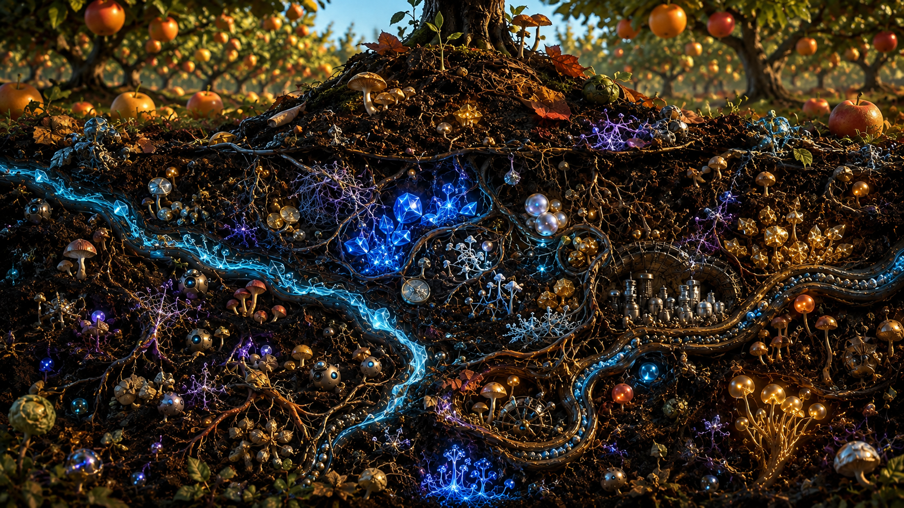

# 🔩 Token Catalog


## **Status: LIVE — all on Base mainnet (chain ID 8453). Explorer: basescan.org.**


<figure><figcaption></figcaption></figure>

#### The Root

<table data-card-size="large" data-view="cards"><thead><tr><th>Token</th><th>Supply</th><th>Role</th><th align="center">Address</th><th align="center"></th><th align="center"></th><th align="center"></th><th align="center"></th><th align="center"></th><th data-hidden data-card-cover data-type="image">Cover image</th></tr></thead><tbody><tr><td><strong>NUT</strong> 🌰</td><td>1 whole token (18 decimals)</td><td>The root of all liquidity. TRUE Price = TRUE Market Cap. No mint, no burn, no governance</td><td align="center"><code>0xb8de15fb529d98c93c749de63c749d48d25a30df</code></td><td align="center"><a href="nut-or-the-root-of-all-liquidity-or-based-nut.md">View details for token NUT</a> </td><td align="center"><a href="nut-or-the-root-of-all-liquidity-or-based-nut.md">DETAILS</a></td><td align="center"><a href="https://basescan.org/token/0xb8de15fb529d98c93c749de63c749d48d25a30df">🔄 Trad</a><a href="https://basescan.org/token/0xb8de15fb529d98c93c749de63c749d48d25a30df">e</a></td><td align="center"><a href="https://basescan.org/token/0xb8de15fb529d98c93c749de63c749d48d25a30df">💧 Liquidity</a></td><td align="center"><a href="https://basescan.org/token/0xb8de15fb529d98c93c749de63c749d48d25a30df">🔍 Explorer</a></td><td><a href="../../.gitbook/assets/0xb8de15fb529d98c93c749de63c749d48d25a30df.png">0xb8de15fb529d98c93c749de63c749d48d25a30df.png</a></td></tr><tr><td><h3>wNUT 🎁</h3></td><td>1:1 wraped version of NUT</td><td>To enhance the surface area of the root token.</td><td align="center"><code>0xBA5ED46e31F80dafF307cbf60bd422a6f62E3dd3</code></td><td align="center"><a href="wnut-or-wrapped-nut-observatory-or-based-nut.md">View details for token wNUT</a></td><td align="center"><a href="wnut-or-wrapped-nut-observatory-or-based-nut.md">DETAILS</a></td><td align="center"><a href="https://basescan.org/token/0x30421e2d18dFF60B298eEF427cF868cA65f1476B">🔄 Trade</a></td><td align="center"><a href="https://basescan.org/token/0x30421e2d18dFF60B298eEF427cF868cA65f1476B">💧 Liquidity</a></td><td align="center"><a href="https://basescan.org/token/0x30421e2d18dFF60B298eEF427cF868cA65f1476B">🔍 Explorer</a></td><td><a href="../../.gitbook/assets/4f688328-6ba2-4383-a0ff-8c1be1eaf4f5 (1).png">4f688328-6ba2-4383-a0ff-8c1be1eaf4f5 (1).png</a></td></tr></tbody></table>

***

#### The Branches

<table data-card-size="large" data-view="cards"><thead><tr><th>Token</th><th>Supply</th><th>Role</th><th align="center">Address</th><th align="center"></th><th align="center"></th><th align="center"></th><th align="center"></th><th align="center"></th><th data-hidden data-card-cover data-type="image">Cover image</th></tr></thead><tbody><tr><td><strong>SNUT</strong> 🥥</td><td>100,000 (9 decimals)</td><td>Liquid non-escrow NUT reward-position token. 1% tax funds NUT rewards, buyback/burn, and liquidity. Dead-held SNUT keeps earning NUT — recursive burn flywheel</td><td align="center"><code>0xAC130701aa31c284c36609E2489f150F419AD7AD</code></td><td align="center"><a href="snut-or-the-burn-token-or-based-nut.md">View details for token SNUT</a></td><td align="center"><a href="snut-or-the-burn-token-or-based-nut.md">DETAILS</a></td><td align="center"><a href="https://basescan.org/token/0xac130701aa31c284c36609e2489f150f419ad7ad">🔄 Trade</a></td><td align="center"><a href="https://basescan.org/token/0xac130701aa31c284c36609e2489f150f419ad7ad">💧 Liquidity</a></td><td align="center"> <a href="https://basescan.org/token/0xac130701aa31c284c36609e2489f150f419ad7ad">🔍 Explorer</a></td><td><a href="../../.gitbook/assets/0xac130701aa31c284c36609e2489f150f419ad7ad.png">0xac130701aa31c284c36609e2489f150f419ad7ad.png</a></td></tr><tr><td><strong>pNUT</strong> 🥜</td><td>BPT</td><td>Balancer V2 index basket holding 25% each of cbETH, cbBTC, NUT, and SNUT. NAV drift from market price creates arbitrage</td><td align="center"><code>0x2a5757b60987ff10385de1d4d923792f6fdcfff1</code></td><td align="center"><a href="pnut-or-the-basket-index-token-or-based-nut.md">View details for token pNUT</a></td><td align="center"><a href="pnut-or-the-basket-index-token-or-based-nut.md">DETAILS</a></td><td align="center"><a href="https://basescan.org/token/0x2a5757b60987ff10385de1d4d923792f6fdcfff1">🔄 Trade</a></td><td align="center"><a href="https://basescan.org/token/0x2a5757b60987ff10385de1d4d923792f6fdcfff1">💧 Liquidity</a></td><td align="center"><a href="https://basescan.org/token/0x2a5757b60987ff10385de1d4d923792f6fdcfff1">🔍 Explorer</a></td><td><a href="../../.gitbook/assets/DALL·E 2024-09-18 18.48.24 - A hyper-realistic 3D peanut logo designed for a peanut-based brand. The peanut is rendered with intricate details, lifelike textures, and natural colo (1).webp">DALL·E 2024-09-18 18.48.24 - A hyper-realistic 3D peanut logo designed for a peanut-based brand. The peanut is rendered with intricate details, lifelike textures, and natural colo (1).webp</a></td></tr></tbody></table>

***

#### The AI Infrastructure

<table data-card-size="large" data-view="cards"><thead><tr><th>Token</th><th>Role</th><th>Address</th><th align="center"></th><th align="center"></th><th align="center"></th><th align="center"></th><th align="center"></th><th data-hidden data-card-cover data-type="image">Cover image</th></tr></thead><tbody><tr><td><strong>PIPS</strong> 💻🥜</td><td>Compute fuel for Pipshell, the DevOps agent. Trade fees fund agent compute. Infrastructure token — not a consumer product</td><td><code>0x3F2327221Dd4f0BAE660172606D6b288A1cf8aD9</code></td><td align="center"><a href="pips-or-token-profile.md">View details for token PIPS</a></td><td align="center"><a href="pips-or-token-profile.md">DETAILS</a></td><td align="center"><a href="https://basescan.org/token/0x3f2327221dd4f0bae660172606d6b288a1cf8ad9">🔄 Trade</a></td><td align="center"><a href="https://basescan.org/token/0x3f2327221dd4f0bae660172606d6b288a1cf8ad9">💧 Liquidity</a></td><td align="center"> <a href="https://basescan.org/token/0x3f2327221dd4f0bae660172606d6b288a1cf8ad9">🔍 Explorer</a></td><td><a href="../../.gitbook/assets/pips-logo.png">pips-logo.png</a></td></tr></tbody></table>

***

#### The Nested Tokens

<table data-card-size="large" data-view="cards"><thead><tr><th>Token</th><th>Role</th><th align="center">Address</th><th align="center"></th><th align="center"></th><th align="center"></th><th align="center"></th><th align="center"></th><th data-hidden data-card-cover data-type="image">Cover image</th></tr></thead><tbody><tr><td><strong>SALT</strong> 🧂</td><td>Mint Club bonding curve token backed by NUT. Two-venue arb loop: mint with NUT → sell for USDC on Aerodrome</td><td align="center"><code>0x1EDe2AFC985F6D7aEb3F4c84B95A103c00D5dE81</code></td><td align="center"><a href="salt-or-token-profile.md">View details for token SALT</a></td><td align="center"><a href="salt-or-token-profile.md">DETAILS</a></td><td align="center"><a href="https://basescan.org/token/0x1EDe2AFC985F6D7aEb3F4c84B95A103c00D5dE81">🔄 Trade</a></td><td align="center"><a href="https://basescan.org/token/0x1EDe2AFC985F6D7aEb3F4c84B95A103c00D5dE81">💧 Liquidity</a></td><td align="center"><a href="https://basescan.org/token/0x1EDe2AFC985F6D7aEb3F4c84B95A103c00D5dE81">🔍 Explorer</a></td><td><a href="../../.gitbook/assets/DALL·E 2025-03-22 19.43.21 - A hyper-realistic 3D close-up of salt crystals scattered on a rustic wooden table. The scene features ultra-detailed, translucent, and reflective salt.webp">DALL·E 2025-03-22 19.43.21 - A hyper-realistic 3D close-up of salt crystals scattered on a rustic wooden table. The scene features ultra-detailed, translucent, and reflective salt.webp</a></td></tr><tr><td><strong>NUTINO</strong> 🌰🍫</td><td>Mint Club bonding curve token backed by NUT. Two-venue arb loop: mint with NUT → sell for cbBTC on Uniswap V2</td><td align="center"><code>0x30421e2d18dFF60B298eEF427cF868cA65f1476B</code></td><td align="center"><a href="nutino-or-token-profile.md">View details for token NUTINO</a></td><td align="center"><a href="nutino-or-token-profile.md">DETAILS</a></td><td align="center"></td><td align="center"></td><td align="center"></td><td><a href="../../.gitbook/assets/1a24ce80-964f-4917-8ef1-51e32607359e.png">1a24ce80-964f-4917-8ef1-51e32607359e.png</a></td></tr></tbody></table>

***

#### ⚔️🪖 The NUT War NFTs

<table data-card-size="large" data-view="cards"><thead><tr><th>Collection</th><th>Role</th><th align="center">Address</th><th align="center"></th><th align="center"></th><th align="center"></th><th align="center"></th><th align="center"></th><th data-hidden data-card-cover data-type="image">Cover image</th></tr></thead><tbody><tr><td><strong>P-NUTS</strong> 🥜⚔️ — Peanut War Generals</td><td>Bonded to NUT. Mint to enlist, burn to reclaim. 200 SALT airdropped per General. Whole-NFT trading on Sudoswap in USDC</td><td align="center"><code>0x794fcD89357C1CcF04a1a9A441ad4dB2Cd5EE387</code></td><td align="center"><a href="pnuts-or-token-profile.md">View details for token PNUTS</a></td><td align="center"><a href="pnuts-or-token-profile.md">DETAILS</a></td><td align="center"><a href="https://basescan.org/token/0x794fcD89357C1CcF04a1a9A441ad4dB2Cd5EE387">🔄 Trade</a></td><td align="center"><a href="https://basescan.org/token/0x794fcD89357C1CcF04a1a9A441ad4dB2Cd5EE387">💧 Liquidity</a></td><td align="center"><a href="https://basescan.org/token/0x794fcD89357C1CcF04a1a9A441ad4dB2Cd5EE387">🔍 Explorer</a></td><td><a href="../../.gitbook/assets/pnutgeneral.webp">pnutgeneral.webp</a></td></tr><tr><td><strong>PNUTRMY</strong> 🥜🪖 — Peanut Soldiers</td><td>Bonded to NUT. 80 SALT airdropped per Soldier. Backbone of the Orchard — no Sudoswap pool yet</td><td align="center"><code>0xF075300b8C2EF500d8Ce4f783F910C500B9A3512</code></td><td align="center"><a href="pnutrmy-or-token-profile.md">View details for token PNUTRMY</a></td><td align="center"><a href="pnutrmy-or-token-profile.md">DETAILS</a></td><td align="center"><a href="https://basescan.org/token/0xF075300b8C2EF500d8Ce4f783F910C500B9A3512">🔄 Trade</a></td><td align="center"><a href="https://basescan.org/token/0xF075300b8C2EF500d8Ce4f783F910C500B9A3512">💧 Liquidity</a></td><td align="center"> <a href="https://basescan.org/token/0xF075300b8C2EF500d8Ce4f783F910C500B9A3512">🔍 Explorer</a></td><td><a href="../../.gitbook/assets/pnutarmy.webp">pnutarmy.webp</a></td></tr><tr><td><strong>ALMD</strong> 🌰⚔️ — Almond War Generals</td><td>Bonded to NUT. Golden Salted Swarm. 200 SALT airdropped per General. Whole-NFT trading on Sudoswap in cbETH</td><td align="center"><code>0x1A160456005AED47994E1c13C9bc31F274413927</code></td><td align="center"><a href="almd-or-token-profile.md">View details for token ALMD</a></td><td align="center"><a href="almd-or-token-profile.md">DETAILS</a></td><td align="center"><a href="https://basescan.org/token/0x1A160456005AED47994E1c13C9bc31F274413927">🔄 Trade</a></td><td align="center"><a href="https://basescan.org/token/0x1A160456005AED47994E1c13C9bc31F274413927">💧 Liquidity</a></td><td align="center"> <a href="https://basescan.org/token/0x1A160456005AED47994E1c13C9bc31F274413927">🔍 Explorer</a></td><td><a href="../../.gitbook/assets/almondgeneral (1).webp">almondgeneral (1).webp</a></td></tr><tr><td><strong>SALMD</strong> 🌰🪖 — Almond Soldiers</td><td>Bonded to NUT. Sky-Seasoned Crunch. 80 SALT airdropped per Soldier. Whole-NFT trading on Sudoswap in cbETH</td><td align="center"><code>0x1E0f80529593185C021043ffcbfDcB8f4279C649</code></td><td align="center"><a href="salmd-or-token-profile.md">View details for token SALMD</a></td><td align="center"><a href="salmd-or-token-profile.md">DETAILS</a></td><td align="center"><a href="https://basescan.org/token/0x1E0f80529593185C021043ffcbfDcB8f4279C649">🔄 Trade</a></td><td align="center"><a href="https://basescan.org/token/0x1E0f80529593185C021043ffcbfDcB8f4279C649">💧 Liquidity</a></td><td align="center"><a href="https://basescan.org/token/0x1E0f80529593185C021043ffcbfDcB8f4279C649">🔍 Explorer</a></td><td><a href="../../.gitbook/assets/almndarmy.webp">almndarmy.webp</a></td></tr></tbody></table>

***

#### 🌻 Sunflower Twin Grafts Grove

<figure><figcaption></figcaption></figure>

<table data-card-size="large" data-view="cards"><thead><tr><th>Token</th><th>Role</th><th>Address</th><th align="center"></th><th align="center"></th><th align="center"></th><th align="center"></th><th align="center"></th><th data-hidden data-card-cover data-type="image">Cover image</th></tr></thead><tbody><tr><td><h3>🌻🧠 gtINF</h3></td><td>Inference Twin Graft BPT</td><td>0x</td><td align="center"><a href="gtinf-or-token-profile.md">View details for token gtINF</a></td><td align="center"><a href="gtinf-or-token-profile.md">DETAILS</a></td><td align="center"><a href="https://basescan.org/token/0x6a0a1B7428d543524592eD22023A09BdE05aA466">🔄 Trade</a></td><td align="center"><a href="https://basescan.org/token/0x6a0a1B7428d543524592eD22023A09BdE05aA466">💧 Liquidity</a></td><td align="center"><a href="https://basescan.org/token/0x6a0a1B7428d543524592eD22023A09BdE05aA466">🔍 Explorer</a></td><td><a href="../../.gitbook/assets/05235f91-3a03-42e4-9f6b-a4d8a483be3e.png">05235f91-3a03-42e4-9f6b-a4d8a483be3e.png</a></td></tr><tr><td><h3>🌻🤖 gtAGT</h3></td><td>Agent Twin Graft BPT</td><td>0x</td><td align="center"><a href="gtagt-or-token-profile.md">View details for token gtAGT</a></td><td align="center"> <a href="gtagt-or-token-profile.md">DETAILS</a></td><td align="center"><a href="https://basescan.org/token/0x5dA95cC31C840Fd33180e4C7f879e3F3d8Eca200">🔄 Trade</a></td><td align="center"><a href="https://basescan.org/token/0x5dA95cC31C840Fd33180e4C7f879e3F3d8Eca200">💧 Liquidity</a></td><td align="center"> <a href="https://basescan.org/token/0x5dA95cC31C840Fd33180e4C7f879e3F3d8Eca200">🔍 Explorer</a></td><td><a href="../../.gitbook/assets/046429cf-f310-444e-a686-bea7f785da61.png">046429cf-f310-444e-a686-bea7f785da61.png</a></td></tr><tr><td><h3>🌻💧 gtETH</h3></td><td>Ether Twin Graft BPT</td><td>0x</td><td align="center"><a href="/broken/pages/864a4b930a7df11ff356ff54bbc7cabe4f56f2bd">View details for token gtETH</a></td><td align="center"> <a href="/broken/pages/864a4b930a7df11ff356ff54bbc7cabe4f56f2bd">DETAILS</a></td><td align="center"><a href="https://basescan.org/token/0xd156d51219B3a7A590670d655E8740Ad404e8835">🔄 Trade</a></td><td align="center"><a href="https://basescan.org/token/0xd156d51219B3a7A590670d655E8740Ad404e8835">💧 Liquidity</a></td><td align="center"><a href="https://basescan.org/token/0xd156d51219B3a7A590670d655E8740Ad404e8835">🔄 Trade</a> · <a href="https://basescan.org/token/0xd156d51219B3a7A590670d655E8740Ad404e8835">🔍 Explorer</a></td><td><a href="../../.gitbook/assets/adf3c5e6-8e83-4b29-b66f-215527f4c5d6.png">adf3c5e6-8e83-4b29-b66f-215527f4c5d6.png</a></td></tr><tr><td><h3>🌻🪙 gtBTC</h3></td><td>Bitcoin Twin Graft BPT</td><td>0x</td><td align="center"><a href="gtbtc-or-token-profile.md">View details for token gtBTC</a></td><td align="center"><a href="gtbtc-or-token-profile.md">DETAILS</a></td><td align="center"><a href="https://basescan.org/token/0xb2a63935e1391Ee49E5cfB6cc4f184C285fE29b4">🔄 Trade</a></td><td align="center"><a href="https://basescan.org/token/0xb2a63935e1391Ee49E5cfB6cc4f184C285fE29b4">💧 Liquidity</a></td><td align="center"><a href="https://basescan.org/token/0xb2a63935e1391Ee49E5cfB6cc4f184C285fE29b4">🔍 Explorer</a></td><td><a href="../../.gitbook/assets/8e61a608-2370-494f-b404-7505b7127112.png">8e61a608-2370-494f-b404-7505b7127112.png</a></td></tr><tr><td><h3>🌻💰 gtFX</h3></td><td>Forex Twin Graft BPT</td><td>0x</td><td align="center"><a href="gtfx-or-token-profile.md">View details for token gtFX</a></td><td align="center"><a href="gtfx-or-token-profile.md">DETAILS</a></td><td align="center"><a href="https://basescan.org/token/0x1cCB8c61b62b9c7a9d4e66C9c824C1539B8b1f2E">🔄 Trade</a></td><td align="center"><a href="https://basescan.org/token/0x1cCB8c61b62b9c7a9d4e66C9c824C1539B8b1f2E">💧 Liquidity</a></td><td align="center"><a href="https://basescan.org/token/0x1cCB8c61b62b9c7a9d4e66C9c824C1539B8b1f2E">🔍 Explorer</a></td><td><a href="../../.gitbook/assets/0ee99c8b-6c01-43e6-a587-9cf565cd4e46.png">0ee99c8b-6c01-43e6-a587-9cf565cd4e46.png</a></td></tr><tr><td><h3>🌻💽 gtSIL</h3></td><td>Silicon Twin Graft BPT</td><td>0x</td><td align="center"><a href="gtsil-or-token-profile.md">View details for token gtSIL</a></td><td align="center"><a href="gtsil-or-token-profile.md">DETAILS</a></td><td align="center"><a href="https://basescan.org/token/0xA669275f92e49aff80aBA7AaD86E5AFDDe3540B0">🔄 Trade</a></td><td align="center"><a href="https://basescan.org/token/0xA669275f92e49aff80aBA7AaD86E5AFDDe3540B0">💧 Liquidity</a></td><td align="center"><a href="https://basescan.org/token/0xA669275f92e49aff80aBA7AaD86E5AFDDe3540B0">🔍 Explorer</a></td><td><a href="../../.gitbook/assets/4dbf8ac1-e38c-45cd-8c40-589f2aa4f2ec.png">4dbf8ac1-e38c-45cd-8c40-589f2aa4f2ec.png</a></td></tr></tbody></table>

***

#### Soil Assets

<figure><figcaption></figcaption></figure>

<table data-view="cards"><thead><tr><th>Token</th><th>Role</th><th>Address</th><th data-hidden data-card-cover data-type="image">Cover image</th></tr></thead><tbody><tr><td><h3>🪙 wETH</h3></td><td>Primary quote token for NUT and SNUT — main price-discovery venues include NUT/wETH UniV3 + V2 and SNUT/wETH V2</td><td><code>0x4200000000000000000000000000000000000006</code></td><td><a href="../../.gitbook/assets/43a266ec-82f3-41c2-9a2e-7ec47b961215.png">43a266ec-82f3-41c2-9a2e-7ec47b961215.png</a></td></tr><tr><td><h3>🌱 cbETH</h3></td><td>Coinbase Wrapped Staked ETH — 25% collateral in the pNUT basket.</td><td><code>0x2Ae3F1Ec7F1F5012CFEab0185bfc7aa3cf0dec22</code></td><td><a href="../../.gitbook/assets/8f5fcee1-da4d-4a42-99c8-a6d5c4603763.png">8f5fcee1-da4d-4a42-99c8-a6d5c4603763.png</a></td></tr><tr><td><h3>💧 wstETH</h3></td><td></td><td></td><td><a href="../../.gitbook/assets/5d039e09-754c-4d05-9da8-6c5245991e78.png">5d039e09-754c-4d05-9da8-6c5245991e78.png</a></td></tr><tr><td><h3>🌾 cbBTC</h3></td><td>Coinbase Wrapped BTC — 25% collateral in the pNUT basket; quote token for the NUTINO DEX pool</td><td><code>0xcbb7c0000ab88b473b1f5afd9ef808440eed33bf</code></td><td><a href="../../.gitbook/assets/c8fbfa9f-809a-44a1-b044-200112fbc5d2.png">c8fbfa9f-809a-44a1-b044-200112fbc5d2.png</a></td></tr><tr><td><h3>💵 USDC</h3></td><td>Native Circle USDC on Base.</td><td><code>0x833589fCD6eDb6E08f4c7C32D4f71b54bdA02913</code></td><td><a href="../../.gitbook/assets/c521e973-4e89-420c-a7e6-dc9b7da6cec2.png">c521e973-4e89-420c-a7e6-dc9b7da6cec2.png</a></td></tr><tr><td><h3>✈️ AERO</h3></td><td>Aerodrome governance and emissions token — quote token in the NUT/AERO pool; gauge emissions can incentivize NUT liquidity</td><td><code>0x940181a94A35A4569E4529A3CDfB74e38FD98631</code></td><td><a href="../../.gitbook/assets/d62336d1-a465-466d-878d-775e1193f774.png">d62336d1-a465-466d-878d-775e1193f774.png</a></td></tr><tr><td><h3>🧠 VVV</h3></td><td></td><td></td><td><a href="../../.gitbook/assets/def3aec3-eeb1-4bd9-b67a-9fb695eefebd.png">def3aec3-eeb1-4bd9-b67a-9fb695eefebd.png</a></td></tr><tr><td><h3>💠 DIEM</h3></td><td></td><td></td><td><a href="../../.gitbook/assets/d4e2206f-9ec7-4844-80e4-83d80f1133a3.png">d4e2206f-9ec7-4844-80e4-83d80f1133a3.png</a></td></tr><tr><td><h3>🤖 VIRTUALS</h3></td><td></td><td></td><td><a href="../../.gitbook/assets/00ff3a25-41ba-4cad-aa93-bd3a231673fc.png">00ff3a25-41ba-4cad-aa93-bd3a231673fc.png</a></td></tr><tr><td><h3>🕶️ MOR</h3></td><td></td><td></td><td><a href="../../.gitbook/assets/9a7661a8-7889-4a40-ae18-92d6c17b81ff.png">9a7661a8-7889-4a40-ae18-92d6c17b81ff.png</a></td></tr><tr><td><h3>₿ tBTC</h3></td><td></td><td></td><td><a href="../../.gitbook/assets/a2e4b2d2-a7ee-4ab8-ae5f-9225f47fdf60.png">a2e4b2d2-a7ee-4ab8-ae5f-9225f47fdf60.png</a></td></tr><tr><td><h3>€ EURC</h3></td><td></td><td></td><td><a href="../../.gitbook/assets/16151283-7e4d-44bb-a0ef-a95e5b938547.png">16151283-7e4d-44bb-a0ef-a95e5b938547.png</a></td></tr><tr><td><h3>💽 NVDAc</h3></td><td></td><td></td><td><a href="../../.gitbook/assets/956aa566-e8ab-44d3-bc4a-d343eb7b26fe.png">956aa566-e8ab-44d3-bc4a-d343eb7b26fe.png</a></td></tr><tr><td><h3>🍎 AAPLc</h3></td><td></td><td></td><td><a href="../../.gitbook/assets/468d2bd5-f92e-46e4-8807-47073d515cfb.png">468d2bd5-f92e-46e4-8807-47073d515cfb.png</a></td></tr></tbody></table>
