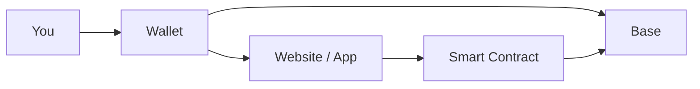

# 00 - Start here

So, you’re new to crypto? huh?


**Tough luck, kiddo.**


You picked one of the toughest places for a nutcase like you to grow.


It is like trying to grow an oak in a desert with no water, no shade, and apparently no nuts.


Crypto is unforgiving.


Send funds to the wrong address and there may be nobody to call.

Sign the wrong transaction and your wallet can be emptied.


Approve the wrong contract and you may give it permission to spend your tokens later.


Buy something without understanding liquidity and you may discover that getting in was considerably easier than getting out.


None of this means you should avoid crypto.

It means you should learn how it actually works.


This series teaches crypto and decentralized finance on **Base**, using BASED NUT interactions as the practical laboratory.


Coinbase is the recurring centralized-exchange example.

Rabby is the primary desktop EVM training wallet.

BaseScan is the independent inspection surface.

Uniswap, Balancer, and Aerodrome are recurring DEX examples.

Dune, DeFiLlama, CoinGecko, IQ.wiki, SEAL, Pocket Universe, Revoke.cash, L2BEAT, Safe, and advanced security resources enter when their specific function becomes useful.



**The objective is not to memorize buttons. It is to understand what you are authorizing, what state changes, what can fail, how to verify the result, and how to get out.**



**There is no separate security chapter.** Security is the invariant running through funding, sending, signing, swapping, LPing, wrapping, bridging, lending, research, and exit.


## 🧭 The operating model

Every operation must answer seven questions:

<table><thead><tr><th width="148">Check</th><th>Required answer</th></tr></thead><tbody><tr><td><strong>Origin</strong></td><td>Am I on the canonical site/app/docs rather than an ad, DM, clone, or lookalike?</td></tr><tr><td><strong>Network</strong></td><td>Which chain am I on, and is Base expected here?</td></tr><tr><td><strong>Identity</strong></td><td>What exact wallet, token, contract, pool, router, vault, spender, or recipient is involved?</td></tr><tr><td><strong>Authority</strong></td><td>Am I connecting, signing a message, approving spending, granting a permit/delegation, or sending a transaction?</td></tr><tr><td><strong>Economics</strong></td><td>What leaves, what arrives, what fee/slippage/price impact exists, and what can change before settlement?</td></tr><tr><td><strong>Blast radius</strong></td><td>What can this authorization expose if the frontend, contract, key, or assumption is wrong?</td></tr><tr><td><strong>Verification / exit</strong></td><td>How will I verify the result independently, and how do I revoke, withdraw, repay, unwrap, bridge back, or otherwise exit?</td></tr></tbody></table>


The loop is:

```
learn the operation
    ↓
verify origin + identity + network
    ↓
understand the authority
    ↓
bound the blast radius
    ↓
execute small
    ↓
verify independently onchain
    ↓
prove the exit
```


## 🧰 The actual tool stack

This curriculum will not say “use your wallet” when a concrete tool or workflow matters.

<table><thead><tr><th width="161">Tool</th><th>Role in this course</th><th>Trust boundary</th></tr></thead><tbody><tr><td><strong>Rabby Wallet</strong></td><td>Primary EVM training/active wallet; transaction previews; signing</td><td>Wallet software is an authorization interface, not a truth oracle</td></tr><tr><td><strong>Pocket Universe</strong></td><td>Optional pre-sign simulation/warnings</td><td>Secondary defense; simulation can miss risks</td></tr><tr><td><strong>Coinbase</strong></td><td>Fiat/CEX ingress and egress; account-security lessons</td><td>Custodial counterparty + account-security domain</td></tr><tr><td><strong>Base docs</strong></td><td>Canonical Base network/system information</td><td>Primary Base source</td></tr><tr><td><strong>BaseScan</strong></td><td>Transactions, addresses, contracts, events, verified source</td><td>Explorer evidence; verified source ≠ safe contract</td></tr><tr><td><strong>Revoke.cash</strong></td><td>Inspect/revoke token allowances</td><td>Useful authority-management interface; verify spender/token addresses</td></tr><tr><td><strong>Uniswap / Balancer / Aerodrome</strong></td><td>Swap and LP mechanics</td><td>Use canonical protocol docs/deployments for mechanics/addresses</td></tr><tr><td><strong>Dune + DuneSQL</strong></td><td>Reproducible onchain analytics</td><td>Indexed/curated data; validate important observations onchain</td></tr><tr><td><strong>DeFiLlama</strong></td><td>TVL/fees/volume/yield/protocol context</td><td>Analytics, not canonical token identity</td></tr><tr><td><strong>CoinGecko</strong></td><td>Market and contract-oriented discovery/corroboration</td><td>Secondary metadata; not deployment authority</td></tr><tr><td><strong>IQ.wiki</strong></td><td>Definitions, background, research leads</td><td>Tertiary context; promote claims to primary sources before acting</td></tr><tr><td><strong>L2BEAT</strong></td><td>Independent L2 architecture/risk analysis</td><td>Research assessment; current status is time-sensitive</td></tr><tr><td><strong>SEAL</strong></td><td>Vendor-neutral security frameworks</td><td>Security-policy reference</td></tr><tr><td><strong>Safe</strong></td><td>Multi-signer/high-value account architecture</td><td>Adds signer/configuration/module complexity as well as protection</td></tr><tr><td><strong>Immunefi / DVDeFi / Solodit</strong></td><td>Advanced adversarial security education</td><td>Use only in authorized/local/test environments</td></tr></tbody></table>

### Install/bookmark first



#### Create a dedicated browser profile for DeFi



#### Bookmark canonical domains from [SOURCES.md](/broken/pages/9fd5f75974d26a2f573376f31610d5ca678bdcc6)



#### Install Rabby

Install Rabby only by starting from `https://rabby.io/`.



#### Optionally install Pocket Universe

Install Pocket Universe only from `https://www.pocketuniverse.app/`.



#### Create a training wallet

Create a **training wallet** that contains only test/working capital.



#### Protect your vault seed

Never import a vault seed into a browser extension just to follow a tutorial.



## ⚠️ The assumptions you should kill early

<details>

<summary>“If the site looks real, it is safe.”</summary>

No. Interfaces can be cloned, compromised, or misleading. Verify the domain and the contracts behind it.

</details>

<details>

<summary>“Connecting my wallet gives the site my money.”</summary>

Usually no. Connection primarily exposes account information and permits the site to request actions. **Approvals, permits, signatures, and transactions are separate authorizations.**

</details>

<details>

<summary>“A signature is harmless because it has no gas fee.”</summary>

No. Some signatures authorize economically meaningful actions without an immediate onchain transaction.

</details>

<details>

<summary>“The wallet simulation says safe, so it is safe.”</summary>

No. Simulation is a defensive sensor, not proof of protocol integrity, oracle integrity, frontend integrity, or economic safety.

</details>

<details>

<summary>“If the transaction succeeds, I did the right thing.”</summary>

No. A blockchain can successfully execute a bad instruction.

</details>

<details>

<summary>“Same token symbol means same asset.”</summary>

No. **Network + contract address** define onchain identity.

</details>

<details>

<summary>“Audited means safe.”</summary>

No. An audit is evidence that a particular code scope was reviewed at a particular time. It is not a warranty against bugs, governance failure, malicious upgrades, oracle failure, economic attacks, or compromised frontends.

</details>


**Small transactions are debugging.** They expose wrong networks, addresses, contracts, approvals, and assumptions with a deliberately smaller blast radius.


***

### Exercise Caution At All Times

Crypto gives ordinary users direct access to settlement, markets, programmable assets, and financial protocols.

It also removes many of the guardrails people unconsciously rely on.


A bank may reverse fraud. A card network may dispute a payment. A centralized exchange may freeze an account after suspicious activity. A blockchain generally does something more primitive:

> **It executes valid instructions.**

The network does not know whether you were tricked. That distinction is the first thing to learn.



A technically valid transaction can still be economically disastrous. “Successful” only means the network accepted and executed the instruction.


***

## 🧠 Your first mental model

When you use DeFi, separate four layers:





The website helps you construct requests.

The wallet asks you to authorize them.

The contract defines what the request can do.

The blockchain executes the resulting transaction.

These are related systems. They are not the same system.

A compromised interface can ask your uncompromised wallet to authorize a malicious contract. A correct wallet will faithfully sign what you tell it to sign.


***

## 🔍 Trust has coordinates


“Looks official” is weak evidence.


Before meaningful interactions, identify:

* the **network**;
* the **asset contract**;
* the **protocol domain**;
* the **contract being called**;
* the **amount**;
* the **permission** being requested;
* the **expected state change**.

When swapping NUT on Uniswap, Balancer, or Aerodrome, the token symbol is not sufficient identification. Use the canonical contract address published by BASED NUT documentation and confirm the network.


A ticker, logo, token name, social-media account, or search result can be copied. A contract address can also be copied into a fake interface, so verify the address **and** the interaction target.



***

## 🧪 Make mistakes cheaply

Mistakes are possible. Design for that.

A beginner should avoid using the maximum balance for an unfamiliar workflow. Test with an amount small enough that a bad route, wrong network, misunderstood approval, or incorrect address becomes an inconvenience rather than a catastrophe.

This is not merely beginner advice. Production engineers test systems before sending full traffic. Treat money with at least the same discipline.


***

## ✍️ Every prompt is a request for authority

In this course, Rabby (or another EVM wallet) may ask you to:



Broadcast an onchain state-changing instruction. It can move assets, call contracts, approve spenders, add liquidity, withdraw, wrap, or perform many other operations.



Produce cryptographic authorization without necessarily broadcasting an onchain transaction immediately. Some signatures are login proofs. Others can authorize token movement or orders.



Give another address or contract permission to move a specific token up to an allowance.



Treat these as different classes of authority. “No gas” does **not** mean “no consequence.”


***

## 🚩 Stop conditions

Do not continue an interaction merely because you are halfway through it.


Stop when:

* the domain is different from the one you intended;
* the wallet shows an unexpected chain;
* the interacting contract is unfamiliar;
* the requested amount is wrong;
* the spender is not the protocol contract you expected;
* the transaction cannot be decoded and the amount is meaningful;
* the site creates urgency;
* somebody claiming to be support asks for keys, recovery words, or remote access;
* your expected result and simulated result disagree.

You are allowed to reject the transaction. Rejecting an unexpected request costs less than authorizing one you do not understand.


***

## 🧭 The verification loop



### Establish the intended action

Write it mentally in plain language.

> “Swap 0.001 NUT for WETH on Base.”

If you cannot describe the action, do not sign the machine version.



### Verify the origin

Use a known official domain or navigate from canonical documentation. Search results and advertisements are not authoritative identity systems.



### Verify the authorization

Check network, target, asset, amount, spender, and decoded effect.



### Execute

Confirm only after the wallet request matches your intention.



### Verify independently

Use BaseScan and balances. Do not rely only on a confetti animation or “Success!” screen.




***

## 🚫 What competence is not

It is not memorizing where the Swap button lives.

Interfaces change.

It is not becoming fearless.

Fear is not the relevant variable. Verification is.

It is not assuming audited contracts cannot fail.

Audits reduce uncertainty; they do not create invulnerability.

It is not avoiding all risk.


DeFi is risk allocation. Competence means identifying the risk you are accepting.



***

## 🧪 Operational lab: build a verified operating environment

Do this before the first meaningful transaction. The point is not to install every crypto tool. The point is to establish **known-good origins** that you can return to without searching under pressure.



### Create a dedicated browser profile

Use a separate browser profile for DeFi. Keep ordinary browsing, random extensions, work accounts, and experimental downloads out of it.



### Bookmark canonical origins manually

Type or independently verify these domains, then bookmark them:

* `rabby.io` — wallet software and official links.
* `basescan.org` — Base block explorer.
* `docs.base.org` — Base documentation.
* `coinbase.com` — centralized exchange/learning material.
* `app.uniswap.org` and `developers.uniswap.org` — Uniswap interface/developer documentation.
* `balancer.fi` / `docs.balancer.fi` — Balancer.
* `aerodrome.finance` — Aerodrome.
* `revoke.cash` — approval inspection/revocation.
* `defillama.com`, `dune.com`, `coingecko.com`, `iq.wiki` — research surfaces with different trust roles.

Do not use a sponsored search result as your canonical bookmark.



### Install only from a canonical publisher path

For the lab environment, use **Rabby Wallet** as the primary EVM wallet. Start from `https://rabby.io/` and follow its official extension link. If you add **Pocket Universe**, start from `https://www.pocketuniverse.app/`.

Never install a wallet because a search ad, Telegram message, Discord DM, or support account supplied a link.



### Write a pre-sign checklist you can actually follow

Before any signature or transaction, require yourself to answer:

`origin → network → identity → authority → economics → blast radius → verification/exit`

If one answer is unknown, stop and resolve it before signing.




**A simulation is not permission to stop thinking.** Rabby or Pocket Universe can add useful transaction previews and warnings, but a clean simulation is not proof that a contract, frontend, oracle, bridge, or economic assumption is safe.


## 🔗 Learn more

### Primary/security framework

* [Security Alliance (SEAL) — Introduction to Frameworks](https://frameworks.securityalliance.org/intro/introduction/)
* [Ethereum.org — Security](https://ethereum.org/security/)
* [XRPL Learn — DeFi Security 101](https://learn.xrpl.org/course/blockchain-for-business/lesson/defi-security-101-staying-safe-in-the-new-decentralized-world/)

### Broader introductory material

* [Coinbase Learn](https://www.coinbase.com/learn)
* [Bankless Academy — Lessons](https://app.banklessacademy.com/lessons)
* [Investopedia — Decentralized Finance (DeFi)](https://www.investopedia.com/decentralized-finance-defi-5113835)
* [Consensys — DeFi Knowledge Base](https://consensys.io/knowledge-base/defi)
* [Fireblocks Academy — Intro to DeFi](https://www.fireblocks.com/academy/intro-to-defi)
* [Coursera — DeFi Introduction](https://www.coursera.org/learn/defi)


These introductory resources are useful for orientation. They do **not** establish canonical contract addresses or prove that a protocol is safe.


## 📐 Final model

```
interface ≠ wallet
wallet ≠ contract
contract ≠ asset
asset symbol ≠ asset identity
transaction success ≠ good decision
```

Everything else in the series builds on this.

***

This file is the curriculum's **source registry**. It is intentionally more explicit than a normal bibliography because different crypto sources establish different kinds of facts.

## 🧭 Evidence hierarchy

<table><thead><tr><th width="155">Class</th><th>Meaning</th><th>Appropriate use</th></tr></thead><tbody><tr><td><strong>[C] Canonical</strong></td><td>Chain/protocol/project's own documentation, deployment registry, repository, help center</td><td>Mechanics, current supported networks, canonical domains, documented deployments</td></tr><tr><td><strong>[O] Onchain</strong></td><td>BaseScan/Etherscan-family explorers, verified bytecode/source, transactions, logs/events</td><td>What is deployed and what actually happened</td></tr><tr><td><strong>[S] Security</strong></td><td>SEAL, audits, incident reports, bug-bounty/security research, academic security literature</td><td>Threat models, vulnerability classes, review evidence</td></tr><tr><td><strong>[A] Analytics</strong></td><td>Dune, DeFiLlama, CoinGecko and derived/indexed datasets</td><td>Activity, volume, TVL, fees, price/market context; reproducible analysis</td></tr><tr><td><strong>[T] Tertiary</strong></td><td>Encyclopedias, media, courses, community discussions, commercial education</td><td>Orientation, vocabulary, leads, alternative explanations</td></tr></tbody></table>


**Discovery is not authentication.** A CoinGecko entry, IQ.wiki page, DeFiLlama listing, BaseScan label, DEX search result, tweet, or ticker can help you find something. The executable identity of a protocol/token must be established through canonical deployments and corroborated onchain.


## 🔵 Base and L2 architecture

* **\[C]** [Base Documentation](https://docs.base.org/)
* **\[C]** [Base RPC / network documentation](https://docs.base.org/base-chain/api-reference/rpc-overview)
* **\[C]** [Base Contract Addresses](https://docs.base.org/base-chain/network-information/base-contracts)
* **\[C]** [Base withdrawal specification](https://docs.base.org/base-chain/specs/protocol/bridging/withdrawals)
* **\[O]** [BaseScan](https://basescan.org/)
* **\[A/S]** [L2BEAT — Base](https://l2beat.com/scaling/projects/base)
* **\[T/A]** [ChainList](https://chainlist.org/) — convenient network discovery; verify Base parameters against Base docs

### Stable reference facts used by this edition

* Base mainnet chain ID: `8453`.
* Base Sepolia chain ID: `84532`.
* Native gas asset: ETH.


Current rollup stage, activity, fees, bridge metrics, and governance/risk posture are time-sensitive and should be rechecked before publication updates.


## 👛 Wallets, transaction simulation, custody, and permissions

* **\[C]** [Rabby](https://rabby.io/)
* **\[C]** [RabbyHub GitHub](https://github.com/RabbyHub)
* **\[C/S]** [Pocket Universe](https://www.pocketuniverse.app/)
* **\[C/S]** [Revoke.cash](https://revoke.cash/)
* **\[C/S]** [Revoke.cash Learn](https://revoke.cash/learn)
* **\[C/T]** [Ledger Academy](https://www.ledger.com/academy)
* **\[C/T]** [Trezor Learn](https://trezor.io/learn)
* **\[C]** [Safe Knowledge Base](https://help.safe.global/)


Wallet/simulation products are **defense in depth**, not safety oracles. A correct-looking simulation cannot prove that an upgradeable contract, oracle, bridge, frontend dependency, or economic design is safe.


## 🏦 Coinbase

* **\[C]** [Coinbase Learn](https://www.coinbase.com/learn)
* **\[C]** [Coinbase Wallet — Learn Web3](https://www.coinbase.com/wallet/learn-web3)
* **\[C/T]** [Coinbase Wallet Quests](https://www.coinbase.com/wallet/quests)
* **\[C]** [Assets on multiple networks](https://help.coinbase.com/en/coinbase/trading-and-funding/sending-or-receiving-cryptocurrency/assets-on-multiple-networks)
* **\[C]** [Crypto addresses](https://help.coinbase.com/en/coinbase/getting-started/crypto-education/where-is-my-crypto-address)
* **\[C]** [Make your Coinbase account more secure](https://help.coinbase.com/en/coinbase/privacy-and-security/data-privacy/how-can-i-make-my-account-more-secure)
* **\[C]** [2-step verification](https://help.coinbase.com/en/coinbase/getting-started/getting-started-with-coinbase/2-step-verification)
* **\[C]** [Withdrawal address whitelisting / address book](https://help.coinbase.com/en/exchange/managing-my-account/address-book-and-crypto-withdrawal-address-whitelisting)


Coinbase product names, UI, supported networks, and support articles change. The live receiving/withdrawal interface must confirm the exact asset and network at execution time.


## 🦄 DEX protocols

### Uniswap

* **\[C]** [Uniswap Developer Documentation](https://developers.uniswap.org/docs)
* **\[C]** [Uniswap Support — where to start](https://support.uniswap.org/hc/en-us/articles/48552618548493-Where-to-start-with-Uniswap)
* **\[C]** [Price Impact vs Price Slippage](https://support.uniswap.org/hc/en-us/articles/8643794102669-Price-Impact-vs-Price-Slippage)
* **\[C]** [Routing](https://support.uniswap.org/hc/en-us/articles/46932289118733-How-does-routing-work)
* **\[C]** [Permit2](https://docs.uniswap.org/contracts/permit2/overview)

### Balancer

* **\[C]** [Balancer Documentation](https://docs.balancer.fi/)

### Aerodrome

* **\[C]** [Aerodrome](https://aerodrome.finance/)
* **\[C]** [Aerodrome Documentation](https://aerodrome.finance/docs)


Protocol versions differ. Never copy router/vault/pool addresses from another chain or version without a current canonical deployment reference.


## 📊 Onchain analytics and market research

### Dune / DuneSQL

* **\[A]** [Dune](https://dune.com/)
* **\[A]** [Dune Docs](https://docs.dune.com/)
* **\[A]** [Dune query-engine functions/operators](https://docs.dune.com/query-engine/Functions-and-operators/)

#### Useful curriculum query families

```
DQ-WALLET      base.transactions by from/to address
DQ-TRANSFERS   Base token/native transfers by wallet and token
DQ-GAS         Base transaction gas/fee observations
DQ-APPROVAL    ERC-20 Approval events for a verified token
DQ-DEX         Base dex.trades where a verified token appears
DQ-ROUTE       dex.trades ordered by tx hash + event index
DQ-POOL        recent market activity grouped by pool/protocol
DQ-LP          protocol-specific add/remove-liquidity events
DQ-WRAP        verified wrapper mint/burn/transfer flows
DQ-CONTRACT    calls/events for a verified target contract
```


Dune tables are indexed/curated datasets. Preserve query SQL, parameters, and `as of` timestamp, and reconcile consequential findings with raw onchain evidence.


Dune supports reusable freeform parameters, including varbinary address parameters such as `{{wallet}}` or `{{token}}`. The exact examples used in this curriculum are embedded in `04-reading-blockchain-basescan.md` and `08-how-dexs-work.md` so the reader learns SQL while verifying real operations.

### DeFiLlama

* **\[A]** [DeFiLlama](https://defillama.com/)
* **\[A]** [DeFiLlama DEXs](https://defillama.com/dexs)
* **\[A]** [DeFiLlama Bridges](https://defillama.com/bridges)
* **\[A]** [DeFiLlama API](https://api-docs.defillama.com/)

Use for comparative TVL, fees, revenue, volume, yield, chain/protocol, and bridge context. Read data definitions. Do not use a listing to authenticate a token contract.

### CoinGecko

* **\[A]** [CoinGecko](https://www.coingecko.com/)
* **\[A]** [CoinGecko API Docs](https://docs.coingecko.com/)

Use contract-address-oriented lookups over symbol search. CoinGecko is useful corroboration/market context, not the canonical deployment registry for BASED NUT or any protocol.

### IQ.wiki

* **\[T]** [IQ.wiki](https://iq.wiki/)

Use for definitions, project context, and research leads. Promote any claim that affects an executable action to a primary/canonical source first.

## 🛡️ Security frameworks, courses, exploit research, and advanced training

### Primary / high-value security resources

* **\[S]** [Security Alliance (SEAL) — Introduction to Frameworks](https://frameworks.securityalliance.org/intro/introduction/)
* **\[S]** [SEAL — Wallet Security](https://frameworks.securityalliance.org/wallet-security/overview/)
* **\[S]** [SEAL — Signing & Verification](https://frameworks.securityalliance.org/wallet-security/signing-and-verification/signing-verification/)
* **\[S]** [SEAL — Verifying Standard Transactions](https://frameworks.securityalliance.org/wallet-security/signing-and-verification/verifying-standard-transactions/)
* **\[S/C]** [Ethereum.org — Security](https://ethereum.org/security/)
* **\[S/C]** [Ethereum.org — Smart-contract security](https://ethereum.org/developers/docs/smart-contracts/security/)
* **\[S]** [Ethereum.org — Damn Vulnerable DeFi](https://ethereum.org/developers/tools/damn-vulnerable-defi/)
* **\[S]** [Immunefi Learn](https://immunefi.com/learn/)
* **\[S]** [Immunefi — Web3 Security Library](https://github.com/immunefi-team/Web3-Security-Library)
* **\[S]** [Immunefi — Hacking the Blockchain](https://medium.com/immunefi/hacking-the-blockchain-an-ultimate-guide-4f34b33c6e8b)
* **\[S]** [Immunefi Hackers](https://immunefi.com/hackers/)
* **\[S]** [Immunefi Rules](https://immunefi.com/rules/)
* **\[S]** [Immunefi — Your First Day as a Bug Bounty Hunter](https://medium.com/immunefi/your-first-day-as-a-bug-bounty-hunter-on-immunefi-9b101768a40c)
* **\[S]** [Immunefi Research](https://immunefi.com/blog/research/)
* **\[S]** [Cyfrin Solodit](https://solodit.cyfrin.io/)
* **\[S/A]** [ScienceDirect — _Decentralized finance security: A survey of attacks, defenses, and open challenges_](https://www.sciencedirect.com/science/article/pii/S2667295226000024)

### Supplemental security education requested for this curriculum

* **\[T]** [XRPL Learn — DeFi Security 101](https://learn.xrpl.org/course/blockchain-for-business/lesson/defi-security-101-staying-safe-in-the-new-decentralized-world/)
* **\[T]** [Hedera — Is DeFi Safe?](https://hedera.com/learning/is-defi-safe/)
* **\[C/T]** [CoW — DeFi Security Explained](https://cow.fi/learn/de-fi-security-explained-from-transactional-threats-to-protocol-vulnerabilities-and-beyond)
* **\[T]** [Gate — Introduction to DeFi Security](https://www.gate.com/learn/course/introduction-to-defi-security)
* **\[T]** [Medium / 101 Blockchains author — DeFi Security Fundamentals](https://medium.com/@luke101blockchains/defi-security-fundamentals-d9f6f13432d5)
* **\[T]** [CertiK — Top 10 DeFi Security Best Practices](https://www.certik.com/blog/top-10-defi-security-best-practices)
* **\[T]** [CoinsBench — DeFi Security 101](https://coinsbench.com/defi-security-101-a-beginners-guide-96fb2033b6df)
* **\[T]** [CatchWisdom — DeFi Protocol Security Masterclass](https://catchwisdom.com/course/defi-protocol-security-masterclass)
* **\[T]** [101 Blockchains — DeFi Security Best Practices](https://101blockchains.com/top-defi-security-best-practices/)


These are included for breadth. Commercial/vendor/blog material can contain promotional framing, outdated claims, or oversimplification. Use it to generate questions—not to authenticate a contract or prove safety.


## 🎓 General DeFi learning and current context

* **\[T]** [Bankless Academy — Lessons](https://app.banklessacademy.com/lessons)
* **\[T]** [The Defiant — DeFi](https://thedefiant.io/news/defi)
* **\[T]** [Investopedia — DeFi](https://www.investopedia.com/decentralized-finance-defi-5113835)
* **\[T]** [Consensys — DeFi Knowledge Base](https://consensys.io/knowledge-base/defi)
* **\[T]** [Fireblocks Academy — Intro to DeFi](https://www.fireblocks.com/academy/intro-to-defi)
* **\[T]** [Coursera — DeFi Introduction](https://www.coursera.org/learn/defi)
* **\[T]** [Udemy — The DeFi Blueprint](https://www.udemy.com/course/thedefiblueprint/?couponCode=MT260902G1A)
* **\[T/community]** [Reddit r/defi — “How do I learn DeFi?”](https://www.reddit.com/r/defi/comments/zlkton/how_do_i_learn_defi/)


News, courses, Reddit, and encyclopedia content can improve intuition and expose disagreement. They are not substitutes for chain evidence or protocol documentation.


##

🌰 BASED NUT

* **\[C]** [BASED NUT](https://basednut.com/)
* **\[C]** [BASED NUT Docs](https://docs.basednut.com/)
* **\[C]** [BASED NUT GitHub](https://github.com/BASEDNUT)

### Executable-address policy


This curriculum **does not invent, infer, or copy BASED NUT addresses from aggregators**. NUT, wNUT, wrapper, pool, router, vault, lending, oracle, or bridge addresses are published in an executable walkthrough only when independently established from canonical BASED NUT sources and verified on Base.

Until that verification occurs, project-specific examples remain conceptually useful but executable fields are explicitly `UNSPECIFIED`.


***

## 🔍 Source-use rules



### Canonical docs

Canonical docs establish intended mechanics and official deployments.



### Onchain evidence

Onchain evidence establishes what is deployed and what happened.



### Security evidence

Security evidence identifies review scope and failure classes, never guarantees safety.



### Analytics

Analytics establishes observed context, never canonical identity.



### Tertiary material

Tertiary material teaches or suggests leads, never authorizes a transaction.



### Dynamic facts

Dynamic facts carry a date/time or are checked live before execution.



### Statement context

A reader should always know whether a statement is current behavior, general mechanism, historical example, or hypothetical exercise.


