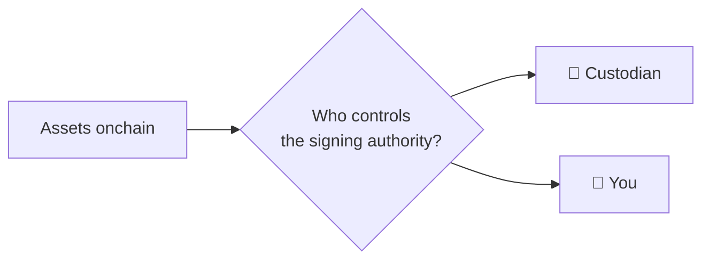

# 01 - Wallets

A crypto wallet does not literally hold ERC-20 tokens inside the application.

The blockchain records balances and ownership state. Your wallet manages the keys or authorization system that lets you act as an account.

> **The wallet is your authorization boundary.**

If that boundary fails, every DeFi lesson downstream becomes irrelevant.


***

## 🔑 Custody first

Before choosing a wallet, understand **custody**. **Custody is control over the authority that can move assets.**

On an EVM network such as Base, assets are controlled by addresses. Moving those assets requires valid signing authority over the address or control over a smart contract that holds them.


The important question is therefore not:

> Where are my tokens?

It is:

> **Who controls the authority required to move them?**


That is the custody question. Neither model erases risk. They relocate it.






### **A balance shown inside an app does not tell you who has custody.**

The interface may show "your" ETH, USDC, or other assets while the actual signing authority belongs to an exchange, a wallet you control, a multisig, or a smart contract.




A service such as **Coinbase** controls the operational keys or signing infrastructure for assets held within your exchange account.

You authenticate to Coinbase using your **account credentials and security controls**. Coinbase then controls the blockchain-level authority used to move custodial assets.

Conceptually:

```
You
↓
Coinbase account authentication
↓
Coinbase controls signing authority
↓
Blockchain
```

You depend on:

* the security of your Coinbase account;
* Coinbase's key-management infrastructure;
* its withdrawal controls;
* its availability;
* its policies;
* its continued ability and willingness to process withdrawals.

If you lose access to your Coinbase account, account-recovery mechanisms may exist.

If Coinbase's infrastructure or your account is compromised, you are exposed to a different class of risk than a self-custody wallet.


When assets are held custodially, **knowing your Coinbase password does not mean you possess the blockchain private key controlling those assets.**




With self-custody, **you control the signing authority**.

For a normal externally owned account, this ultimately derives from the wallet's private key.

Wallet software such as **Rabby** gives you an interface for using that authority.

Conceptually:

```
You
↓
Wallet
↓
Private key / signing device
↓
Blockchain
```

You can directly:

* send assets;
* sign messages;
* approve token spending;
* interact with smart contracts;
* swap through DEXs;
* provide liquidity;
* revoke permissions.

But there is no exchange standing between you and the blockchain deciding whether the transaction should be allowed.

If your signing authority is stolen, an attacker may be able to act as you.

If you permanently lose it, there may be nobody capable of restoring access.


### **Self-custody does not mean "the wallet app holds your money."**

Rabby or another wallet is primarily an interface for using signing authority. Your assets and protocol positions exist onchain.





***

### ⚖️ What Actually Changes?

Neither model erases risk.

**Custody relocates risk and responsibility.**

| Question                                       | Centralized custody         | Self-custody                            |
| ---------------------------------------------- | --------------------------- | --------------------------------------- |
| **Who controls blockchain signing authority?** | Custodian                   | You                                     |
| **What do you protect directly?**              | Exchange account            | Wallet signing authority                |
| **Can account recovery exist?**                | Usually                     | Not inherently                          |
| **Can you interact directly with DeFi?**       | Generally after withdrawing | Yes                                     |
| **Who can authorize an onchain transfer?**     | Custodian infrastructure    | Your wallet/signing device              |
| **Primary failure domain**                     | Account + custodian         | Keys + devices + signatures + contracts |

This distinction becomes critical the moment you withdraw from Coinbase.

Before withdrawal:

```
You trust Coinbase to exercise custody correctly.
```

After withdrawal to a self-custody wallet:

```
You become the custodian.
```


That means every later lesson in this series—sending, approving, swapping, LPing, wrapping, bridging, lending—depends on one fact:

> **Your wallet can authorize real state changes involving real assets.**


The wallet is therefore not merely where crypto is displayed.

It is the interface through which custody becomes action.

***

## 🌱 Seed phrases and private keys

Traditional self-custody wallets may use a recovery phrase to derive accounts and their keys.

The practical rule is brutal:


**Anyone who obtains your recovery phrase can usually recreate the wallet and act as you.**

Do not type it into websites. Do not send it to “support.” Do not photograph it for cloud storage. Do not paste it into chat.


A hardware wallet reduces key exposure by keeping signing keys isolated from the general-purpose computer. It does not protect you from deliberately approving a malicious transaction displayed on the hardware device.

That is why key security and transaction verification are separate problems.

***

## 🧩 Wallet ≠ address

An address is public.

Example form:

```
0x1234...abcd
```

You can share an address to receive compatible assets.

A private key or recovery phrase is secret.


Do not confuse “someone knows my address” with “someone controls my wallet.”

Public addresses are expected to be public. They are also permanent identifiers for onchain activity, so privacy is a separate consideration.


***

## 🧠 Hot, cold, and smart wallets

| Type                      | Useful mental model        | Primary tradeoff                             |
| ------------------------- | -------------------------- | -------------------------------------------- |
| **Browser/mobile wallet** | Fast interactive signer    | Larger online attack surface                 |
| **Hardware wallet**       | Isolated signing device    | More operational friction                    |
| **Smart wallet/account**  | Programmable account logic | Depends on implementation and recovery model |
| **Exchange account**      | Custodial account          | Exchange controls custody layer              |

Do not choose a wallet because a thread said it was “the safest.”

Choose a model you understand and can operate correctly.


***

## ⚙️ Create a DeFi wallet deliberately

If your Rabby lab wallet is new:



### Obtain wallet software from a canonical source

Avoid download links from advertisements, unsolicited messages, or cloned websites.



### Understand recovery before funding

Know exactly how the wallet can be recovered before depositing meaningful value.



### Record recovery material offline where applicable

Protect against both theft **and loss**. A recovery phrase that attackers cannot reach but you can no longer recover is not a successful security system.



### Confirm your Base address

For ordinary EVM accounts, the same `0x...` account format can appear across EVM networks. That does not make the networks interchangeable.



### Fund with a test amount first

Do not make the wallet's first real-world test your entire intended DeFi balance.



***

## 🧨 Wallet connection is not token approval

This distinction prevents endless confusion.


Connecting a wallet to a site normally allows the interface to see your public address and request actions.

An ERC-20 approval is an onchain permission allowing a spender to transfer a token up to an allowance.

Disconnecting a site does not automatically revoke existing token allowances.


You will learn approvals properly later. For now, remember:

```
connect ≠ approve ≠ transfer ≠ sign
```


***

## 🌰 BASED NUT exercise

Before swapping or wrapping anything:

1. Open the Rabby browser extension from the extension icon—not from a search result or ad.
2. Confirm you can identify the active network.
3. Copy your public address.
4. Open the same address on BaseScan.
5. Compare the onchain balances with the wallet display.
6. Locate any NUT balance by contract, not merely by ticker.


No funds need to move.

The point is to learn that the wallet UI is one view of onchain state—not the state itself.


***

## ⚠️ Failure modes

| Failure                       | Consequence                      | Control                                    |
| ----------------------------- | -------------------------------- | ------------------------------------------ |
| Recovery phrase exposed       | Account takeover                 | Keep recovery material secret and isolated |
| Fake wallet software          | Credential theft                 | Use canonical sources                      |
| Blind hardware signing        | Malicious instruction authorized | Verify device display                      |
| Single wallet used everywhere | Large blast radius               | Separate roles as value grows              |
| Recovery method never tested  | Self-lockout                     | Understand recovery before relying on it   |

***

## 🧪 Operational lab: create a Rabby DeFi wallet

This curriculum uses **Rabby** for desktop EVM exercises because it is designed around EVM/DeFi interactions and exposes transaction information before signing. The security model remains wallet-agnostic: the seed/private key controls the account, and the wallet UI is only one interface to that authority.



### Obtain Rabby from the canonical origin

Open `https://rabby.io/` from your saved bookmark. Follow the official extension-store link from that page. Confirm the publisher before installation.



### Create a fresh training wallet

Create a new software wallet specifically for this curriculum. Do **not** import the seed phrase of a high-value wallet into a browser extension merely to follow the exercises.



### Back up the recovery secret offline

Write the recovery material down physically or use another deliberate offline backup method. Never paste it into a website, cloud note, email, chat, AI assistant, form, or “verification” page.



### Record the public address separately

Copy the public `0x…` address from Rabby. This address is safe to use in BaseScan and analytics exercises. It is **not** the seed phrase or private key.



### Add a simulation layer only as defense in depth

Optionally install Pocket Universe from `https://www.pocketuniverse.app/`. It can preview expected asset movements before supported signatures/transactions. Keep Rabby’s own preview enabled as well.



### Keep the wallet empty until recovery is understood

Before funding it, be able to explain how you would recover the wallet on a clean device and why anybody obtaining the recovery secret could control it.



### Hardware-wallet boundary

A browser wallet is suitable for a bounded training/active wallet. Long-term or high-value custody should graduate to a hardware-backed signing architecture discussed in [Wallet Architecture](/broken/pages/1a63de9241dba1ecb30f27c0f7ad9e06aa0c496f). Do not turn the browser lab wallet into the vault by inertia.

## 🔗 Learn more

* [Rabby — canonical website](https://rabby.io/)
* [RabbyHub — official GitHub organization](https://github.com/RabbyHub)
* [Pocket Universe — transaction simulation/scam warnings](https://www.pocketuniverse.app/)
* [SEAL — Wallet Security](https://frameworks.securityalliance.org/wallet-security/overview/)
* [Ledger Academy](https://www.ledger.com/academy)
* [Trezor Learn](https://trezor.io/learn)
* [Coinbase Wallet — Learn Web3](https://www.coinbase.com/wallet/learn-web3)


Wallet vendors teach useful concepts but also sell products. For security policy, cross-check vendor guidance against vendor-neutral sources such as SEAL and the underlying chain/protocol documentation.


## 📐 Final model

```
blockchain state
      ↑
address/account
      ↑
authorization
      ↑
wallet
      ↑
you
```


Protect the keys.

Then protect the decisions made with them.
