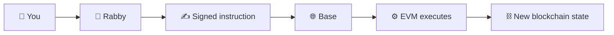

# 02 - Base Network

## 🌐 Base, Blockchains, the EVM, and Gas

Before using BASED NUT, learn what environment your wallet is actually controlling.

You already know what a wallet does.

Now go one layer deeper.


Your wallet is not where the blockchain lives.

Your wallet is a **tool for controlling an account and authorizing instructions** that a blockchain executes.


That distinction matters.

> **Your wallet signs. The network executes. The blockchain records the resulting state.**

***

## 🌍 What is crypto?

At the broadest level, crypto is the use of cryptography and distributed networks to create and control digital assets, accounts, and applications without requiring one central database operator.


In practical terms, crypto gives you:

* an account represented by an address;
* assets recorded on a blockchain;
* private keys that authorize actions;
* smart contracts that execute programmed rules;
* networks that agree on the resulting state.

When you hold ETH, USDC, NUT, or another token, the asset does not literally sit inside Rabby or another wallet application.


The blockchain records the state.

Your wallet holds or controls the **keys used to authorize changes to that state**.



### 👛 What this means for you

If Rabby disappeared tomorrow, your blockchain account would not disappear with it.


If you still control the private key or recovery mechanism, another compatible wallet can access the same account.


The wallet is an interface.

The keys are the authority.

The blockchain contains the state.


***

## ⛓️ What is a blockchain?

A blockchain is a shared system for agreeing on and recording state.


That state can include:

* account balances;
* token ownership;
* smart-contract storage;
* approvals;
* liquidity positions;
* loans;
* votes;
* transactions.

A blockchain takes valid instructions, processes them according to its rules, and produces a new agreed state.


A simplified model is:

```
current state
    +
valid transaction
    +
network rules
    ↓
new state
```

For example:

```
Alice has 1 ETH

Alice signs:
send 0.1 ETH to Bob

network executes transaction

new state:

Alice ≈ 0.9 ETH - gas
Bob   = Bob + 0.1 ETH
```

The important point is that the blockchain is not merely a historical list of transactions.

It is continuously maintaining the **current state of the system**.


***

## 🧠 Think in state changes

Most actions in DeFi are state changes.

```
Send
→ change balances

Approve
→ change allowance

Swap
→ change wallet balances + pool balances

Provide liquidity
→ change pool reserves + create/update an LP position

Borrow
→ change collateral + debt state

Wrap
→ move one asset state into another representation
```


This is a better mental model than thinking:

> “I clicked a button on a website.”

The website is only helping construct an instruction.


The meaningful event is:

> **What state change am I authorizing?**


***

## ⚙️ What is the EVM?

The **Ethereum Virtual Machine**, or **EVM**, is the execution environment used by Ethereum and many Ethereum-compatible networks.


It provides a common model for:

* accounts;
* addresses;
* smart contracts;
* transactions;
* contract storage;
* gas;
* execution.

Base is an EVM-compatible network. So are many other networks.


That is why the same wallet software can interact with multiple chains and why the same address format often appears across them.

```
Ethereum
Base
Arbitrum
Optimism
other EVM networks
        ↓
similar account + contract model
        ↓
same wallet can often interact with all of them
```

But these networks do **not** share one universal state.


### ⚠️ Same address ≠ same assets

Your address might be:

```
0xABC...
```

on Ethereum, Base, Arbitrum, and other EVM networks.


But each network maintains its own state.


You might have:

```
Ethereum:
0xABC... → 2 ETH

Base:
0xABC... → 0.03 ETH + NUT

Arbitrum:
0xABC... → 0 ETH
```


Same address.


Different chains.

Different balances.

Different contracts.

Different state.


***

## 👛 What your wallet is actually doing

When Rabby displays your assets, it is reading blockchain state.


When you send something, Rabby constructs a transaction.

When you approve something, Rabby asks you to authorize a contract call.

When you interact with a DEX, Rabby passes signed instructions to the selected network.


The rough flow is:





This is why wallet prompts matter so much.


The wallet is standing between:

```
your authority
```

and:

```
a permanent state change
```

***

## 🧩 Accounts and smart contracts

EVM networks contain two broad kinds of accounts.



Usually controlled by a private key.

Often called an **EOA** — Externally Owned Account.

Your Rabby address is typically this kind of account.


It can:

* hold assets;
* send transactions;
* call smart contracts;
* authorize signatures.



An account containing executable code.

A smart contract follows programmed rules when called.


Examples include:

* ERC-20 token contracts;
* DEX routers;
* liquidity pools;
* vaults;
* lending markets;
* wrappers.




A normal DeFi interaction is therefore usually:

```
your account
    ↓
signs transaction
    ↓
calls smart contract
    ↓
contract executes
    ↓
blockchain state changes
```

***

## 🌰 Tokens are usually contracts

ETH is the native asset of Base.


NUT, USDC, WETH, and most other tokens you encounter are smart-contract-based assets.


An ERC-20 token contract keeps records resembling:

```
address A → balance X
address B → balance Y
```

and exposes functions such as:

```
transfer()

approve()

transferFrom()
```

Your wallet reads those contracts and presents the results as token balances.


This leads to one of the most important lessons in crypto:

> **A token is identified by its contract address on a specific network—not merely by its name, ticker, or logo.**


Someone can deploy another token called `USDC`.

Someone can deploy another token called `NUT`.

The symbol alone proves nothing.


***

## 🗺️ The network is part of the asset identity

Before using BASED NUT, learn to distinguish an asset from the network carrying its state.


Base is an Ethereum Layer 2 network.

Its Base mainnet chain ID is:

```
8453
```

That identifier matters because wallets and applications can operate across many EVM networks that use similar address formats.

> **Same address format does not mean same chain state.**

And:

> **Same token symbol does not mean same token contract.**


A more complete identity is:

```
network
+
contract address
=
specific token
```

For example:

```
Base
+
0xTOKEN...
=
one particular token deployment
```

Change the chain and you are querying a different state system.


***

## 🧠 What is a Layer 2?

Ethereum is the underlying Layer 1.

Base is an Ethereum Layer 2.


```
Ethereum
    ↓
provides underlying settlement/security infrastructure

Base
    ↓
executes many user transactions in its own L2 environment

Base applications
    ↓
Uniswap
Aerodrome
Balancer
BASED NUT
etc.
```

For the user, the practical consequence is simple:

**Using Base means you are performing transactions on Base—not directly inside Ethereum mainnet state. But Base exist as a tool built using Ethereum as its dependency.**

Your Base balances therefore exist on Base.

Your Base transactions appear on BaseScan.

Your Base gas is paid on Base.


***

## 🗺️ The network is part of the transaction

A transaction is not simply:

```
send 1 token to 0xABC...
```

It is closer to:

```
on network X

from account A

to account/contract B

with value/data C

under fee conditions D
```

Change the network and you change the state machine receiving the instruction.


***

## ⛽ What is gas?

The EVM needs a way to measure computational work.

That measurement is **gas**.


Different operations require different amounts of execution.

For example:

```
simple ETH transfer
        ↓
relatively simple execution

ERC-20 transfer
        ↓
contract execution

DEX swap
        ↓
router + token + pool interactions

complex DeFi transaction
        ↓
potentially many contract calls
```

More computation generally means more gas.

Your wallet estimates the transaction's fee conditions before submission.


Gas is not a fee paid to BASED NUT, Uniswap, Balancer, or Aerodrome.

It is part of executing the transaction on the network.


***

## 🌰 Why you need ETH

On Base, ordinary transactions use **native ETH** for gas.


That creates a common beginner failure:

```
wallet:

USDC ✅
NUT  ✅
WETH ✅
ETH  0

result:

assets available
but no ordinary gas budget
```

You cannot normally pay Base gas directly using your NUT or USDC balance.

Keep some native ETH available.

Do not routinely swap the entire ETH balance.

The exact amount you should retain depends on activity and current fees.


***

## 🧩 Native ETH and ERC-20 tokens

This distinction matters.



Built directly into the network.

Used for transaction fees on Base.

Does not require an ERC-20 token contract.



Implemented through a smart contract.

Examples include:

* WETH
* USDC
* NUT

Balances and transfers are maintained by contract logic.



WETH represents wrapped ETH in ERC-20 form.

Its market value generally tracks ETH, but:

```
native ETH ≠ WETH
```

at the execution layer.


Do not assume that a WETH balance means you have native ETH available for ordinary gas.


***

## ⚠️ A failed transaction can still cost gas

A network can begin executing your transaction and later encounter a condition that causes it to revert.


Conceptually:

```
transaction begins
    ↓
computation occurs
    ↓
contract condition fails
    ↓
state changes revert
```

The desired state change does not complete.


But computational resources were already consumed.


Therefore:

```
failed transaction ≠ zero cost
```

This is why repeatedly clicking **Try Again** without understanding the failure is bad practice.


Capture context. Diagnose first. Retry after.

***

## 🧪 Testnet is not mainnet

Base Sepolia is a test network.

Its chain ID is:

```
84532
```

Base mainnet is:

```
8453
```

Do not confuse them.

```
Base Mainnet  → 8453

Base Sepolia  → 84532
```

Testnet assets have no automatic economic equivalence to mainnet assets.


A successful testnet transaction demonstrates that a workflow can operate in that test environment.

It does **not** prove identical:

* contracts;
* liquidity;
* pricing;
* economic conditions;
* mainnet behavior.


***

## 🔍 Verify Base before every meaningful action



### Check Rabby

Open **Rabby**.

Look at the currently selected network.

Confirm:

```
Base
```

before proceeding.



### Check the application

Uniswap, Balancer, and other DeFi interfaces may support multiple networks.

Confirm the application's selected network is also:

```
Base
```

Wallet and application should agree.



### Check the asset

Do not identify a token using only:

* name;
* ticker;
* logo.

Verify its **Base contract address** against a canonical source.



### Read the wallet request

Identify:

```
network
from
to
action
amount
gas
```

For contract interactions, also determine what function or permission is being requested.



### Execute

Only sign once those details make sense.

For unfamiliar actions, use a deliberately small amount first.



### Verify on BaseScan

Open the resulting transaction on **BaseScan**.

Check:

* status;
* sender;
* target;
* token transfers;
* gas;
* contract interaction.



***

## 🧪 Operational lab: prove the network before spending anything

Use:

```
Rabby
+
BaseScan
+
Base documentation
```



### Open Rabby

Select your normal DeFi account.

Do **not** expose your seed phrase or private key.

Only the public address is required for this exercise.



### Select Base

Switch Rabby to:

```
Base
```

Find the network information.

Confirm Base mainnet uses:

```
Chain ID: 8453
```



### Copy your public address

It will resemble:

```
0x...
```

This address is safe to inspect publicly.

Do not confuse:

```
public address → shareable

private key → secret

recovery phrase → secret
```



### Open BaseScan manually

Navigate to:

```
https://basescan.org/
```

Paste your public address into the search field.

You should now be viewing your account from the perspective of the Base blockchain rather than through Rabby's interface.

Compare:

```
Rabby balance
vs
BaseScan balance
```

The interfaces may present information differently, but they are ultimately reading the same underlying Base state.



### Look for native ETH

Find the account's native ETH balance.

Ask yourself:

> Do I have native ETH available to execute transactions?

Then inspect token holdings separately.

Notice that:

```
ETH balance
```

and:

```
ERC-20 token balances
```

are distinct categories.



### Compare another EVM network

Without sending anything, inspect the same public address on another EVM explorer such as Ethereum's Etherscan.

You may see entirely different balances and transaction history.

That demonstrates:

```
same address
+
different network
=
different state
```



### Cross-check Base independently

Use:

* Base documentation — canonical network information;
* BaseScan — Base state and transaction inspection;
* L2BEAT — independent research into Base's Layer 2 architecture and trust assumptions.

ChainList can help discover EVM network settings, but treat it as a convenience layer.

For Base configuration, prefer Base's own documentation as the authority.



***

## 🚫 Network misconceptions

<details>

<summary><strong>“My crypto is inside Rabby.”</strong></summary>

No. Rabby is an interface controlling keys and reading blockchain state.

</details>

<details>

<summary><strong>“My Ethereum address tells me which network I'm using.”</strong></summary>

No. The same address can exist across many EVM networks.

</details>

<details>

<summary><strong>“If the ticker says NUT, it must be NUT.”</strong></summary>

No. Verify the contract address and network.

</details>

<details>

<summary><strong>“WETH is basically ETH, so it can always pay gas.”</strong></summary>

No. Native ETH and WETH are different execution forms.

</details>

<details>

<summary><strong>“The transaction failed, so nothing happened and nothing was spent.”</strong></summary>

Not necessarily. A reverted transaction can still consume gas.

</details>

<details>

<summary><strong>“Testnet worked, so mainnet will behave identically.”</strong></summary>

No. Code, deployments, liquidity, prices, and economic conditions may differ.

</details>

***

## 🔗 Learn more

Use these after completing the exercise:

* **Base Documentation** — canonical Base network and developer information
* **BaseScan** — inspect Base accounts, transactions, contracts, and tokens
* **L2BEAT — Base** — independent Layer 2 architecture and risk analysis
* **Ethereum.org** — Ethereum, EVM, accounts, transactions, and smart-contract fundamentals
* **Rabby** — EVM wallet interface used throughout this series
* **ChainList** — convenient network discovery; verify important parameters against canonical documentation
* **Dune Docs** — later used to query Base blockchain data directly with SQL

***

## 📐 Final model

```
private key
    ↓
controls

account
    ↓
uses

wallet interface
    ↓
constructs

transaction
    ↓
sent to

network
    ↓
executed by

EVM
    ↓
changes

blockchain state
```

For DeFi:

```
you
+
wallet
+
network
+
account
+
contract
+
transaction
+
gas
=
onchain action
```

The practical question is no longer:

> **Which button do I press?**

It becomes:

> **Which network am I on, what account am I controlling, what contract am I calling, what authority am I granting, and what state will change if this executes?**

That is the level of understanding you want before touching a DEX.
