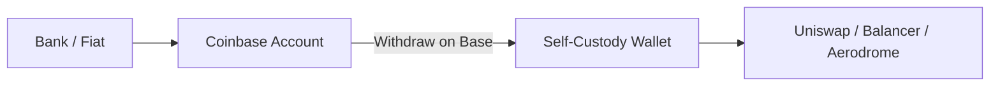

# 03 - Getting Crypto Coinbase

A centralized exchange and a self-custody wallet solve different problems.

Coinbase is useful here because it makes the distinction concrete.

On Coinbase, you interact with an account operated by a company. After you withdraw assets to a self-custody address on Base, you interact directly with onchain systems.



**Withdrawal is not merely “moving crypto.” It changes the custody boundary.**


***

## 🔄 Two environments





Coinbase can provide account recovery and centralized controls.

A DEX cannot reset your wallet because you forgot the key.

Do not carry centralized-exchange expectations into self-custody.

***

## 🌐 Asset + network + destination

A withdrawal has at least three independent coordinates:

```
asset
network
destination address
```

All three must be correct.


Coinbase supports some assets on multiple networks and explicitly warns users to match the sending and receiving network. An EVM address may look valid on several networks while the asset ends up on a network you did not intend.


Do not select Base merely because BASED NUT operates on Base. First confirm the asset you are withdrawing is supported on Base by both Coinbase and the receiving wallet.


***

## 🔐 Secure the exchange account before funding DeFi

When this guide says **Coinbase**, it means the centralized exchange/account environment—not a generic self-custody wallet and not the Base app.


Before using it as an on-ramp:

* use a unique password stored in a reputable password manager;
  * alternatively keep it in a paper somewhere and store it securely;
* protect the email account tied to Coinbase;
* enable strong 2-step verification;
* prefer a passkey or hardware security key where supported and appropriate;
* review active sessions and devices;
* use saved/allowlisted withdrawal addresses where the specific Coinbase product supports them.


Coinbase currently recommends passkeys or security keys for stronger 2-step verification and notes that the security of the associated email account matters because email is used for device confirmations and account communications.


### A fake “Coinbase support” message can be as dangerous as a fake DEX.

Do not hand over passwords, 2FA codes, private keys, or wallet recovery phrases to someone who contacts you.


A CEX reduces some self-custody burdens while introducing account-takeover and custodial risks. Treat the login as financial infrastructure.


***

## 🧪 A safer first withdrawal



## Prepare the receiving wallet

Open the wallet and confirm the intended receiving address.

Do not copy an address from transaction history if you can copy it from the wallet you control.



## Select the asset on Coinbase

Choose the asset you actually intend to move. ETH and USDC are common funding assets for Base, but availability and supported networks can change.



## Select Base as the network

Confirm the receiving wallet supports Base and that Coinbase shows Base for the selected asset.



## Verify the address

Compare multiple characters at the beginning and end. For meaningful withdrawals, use a test transfer before sending the remainder.



## Review the preview

Check asset, amount, destination, network, and fee. Do not treat the preview as decorative.



## Send a test amount

Wait for confirmation and verify the transaction on BaseScan.



## Send the intended amount

Only after the route has been proven with the same network and destination.




***

## ⛽ Do not strand yourself without ETH

ERC-20 transfers and DeFi contract interactions on Base require network fees.

For ordinary Base transactions, ETH is the native gas asset.

If you withdraw only a token such as USDC and no ETH, you may be able to see the token but not perform ordinary onchain transactions from that wallet until it has ETH for gas or uses a supported sponsored-transaction mechanism.

Keep operational gas in mind before turning every last bit of ETH into NUT or another token.


***

## 🧠 CEX price ≠ DEX execution

Buying an asset on Coinbase and swapping on a DEX are different market mechanisms.



Centralized exchange infrastructure manages orders and account balances. You rely on the exchange as an intermediary.



Rabby or another self-custody wallet interacts with smart contracts and onchain liquidity. Execution depends on pools, routes, fees, liquidity, and transaction conditions.



The existence of a price on one venue does not guarantee the same executable price on another.


***

## 🚩 Withdrawal failure modes

### Wrong network

The address may be syntactically valid while funds arrive somewhere you did not intend.

### Wrong asset

A familiar ticker does not substitute for checking the actual asset and network.

### Clipboard substitution

Malware can replace copied addresses. Recheck after pasting.

### No test transfer

The first transfer becomes the full-value experiment.

### No gas plan

Funds arrive, but the wallet cannot perform the next intended operation.


***

## 🌰 BASED NUT exercise

The goal is not to buy NUT on Coinbase. The goal is to use Coinbase as the centralized on-ramp example:

```
Coinbase
   ↓ Base withdrawal
Rabby / self-custody wallet
   ↓ verified on BaseScan
DEX interaction
   ↓
NUT ecosystem
```

Notice where control changes hands. That boundary matters more than the brand names.


***

## 🧪 Operational lab: Coinbase → Rabby on Base

This is the first real value-transfer workflow. The exact Coinbase UI can change, so the invariant is more important than the button label: **asset + network + destination must all be correct**.



## Harden Coinbase first

Open Coinbase from your bookmark. Enable the strongest account authentication available to you, review active sessions/devices, and enable withdrawal/address protections where supported. Do this before depositing funds intended for DeFi.



## Copy your Rabby receiving address

Open Rabby, select the training account, select Base, and copy the public `0x…` address. Do not copy from transaction history, an old chat, or a search result.



## Choose a Base-supported withdrawal asset

In Coinbase, choose the asset you intend to withdraw. Confirm Coinbase currently supports **Base** for that exact asset. Network support is asset-specific and can change.



## Select Base explicitly

Do not infer the network from the address format: many EVM chains use the same `0x…` address format. Select **Base** in Coinbase’s network selector.



## Paste and compare the destination

Compare the first and last several characters of the pasted address against Rabby. For a new route, send a deliberately small test amount.



## Verify independently

After Coinbase reports the withdrawal, search the destination address or transaction hash on BaseScan. Confirm the token, amount, network, status, and resulting balance independently of Coinbase and Rabby.



## Preserve gas

Ensure the wallet has enough native ETH for subsequent Base transactions. Do not strand all value in an ERC-20 if the next action requires gas.



## 🔗 Learn more

* [Coinbase Learn](https://www.coinbase.com/learn)
* [Coinbase — Make your account more secure](https://help.coinbase.com/en/coinbase/privacy-and-security/data-privacy/how-can-i-make-my-account-more-secure)
* [Coinbase — Assets on multiple networks](https://help.coinbase.com/en/coinbase/trading-and-funding/sending-or-receiving-cryptocurrency/assets-on-multiple-networks)
* [Coinbase Wallet — Learn Web3](https://www.coinbase.com/wallet/learn-web3)
* [Coinbase Wallet Quests](https://www.coinbase.com/wallet/quests) — optional guided practice; treat quest incentives as exercises, not endorsements or investment recommendations

## 📐 Final model

```
CEX account
   │
   │ withdrawal
   ▼
network + destination
   │
   ▼
self-custody wallet
   │
   │ direct authorization
   ▼
DeFi
```

Every withdrawal should answer one question before you press send:

> **Exactly where will this asset exist after the transaction settles?**
