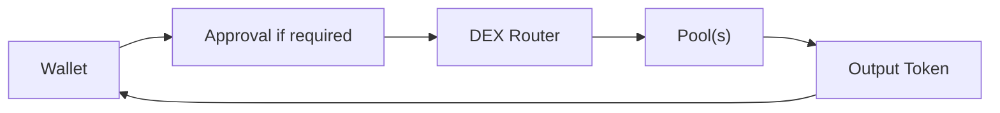

# 07 - First Swap

A swap is not “press button, token changes.”

A DEX swap is an execution path through smart contracts and liquidity.

Uniswap, Balancer, and Aerodrome provide useful examples because they expose different market designs while preserving the same core discipline:

> **Know the asset, route, authorization, execution conditions, and result.**


***

## 🧭 Before the swap

Use a small BASED NUT example such as NUT ↔ WETH.

Confirm:

* Base is active;
* the canonical NUT contract came from BASED NUT documentation;
* the WETH contract is correct;
* you opened the intended DEX;
* you have native ETH for gas;
* the amount is intentionally small for a first interaction.


***

## ⚙️ The swap flow





Actual routes can be more complex, including multiple pools or signature-based mechanisms.

The diagram is a mental model, not a promise that every DEX uses identical contracts.


***

## 🥜 Execute deliberately



## Select the input token

Search by canonical contract address if there is any ambiguity.



## Select the output token

Again, verify contract and network.



## Enter a small amount

Do not use Max on your first unfamiliar route.



## Read the quote

Inspect output amount, route if exposed, fees, price impact, slippage conditions, and gas estimate.



## Handle approvals consciously

If the DEX needs token permission, verify the spender and amount. Approval may be a separate transaction.



## Review the final authorization

Confirm that the wallet request matches the swap you intend.



## Verify settlement

Open BaseScan. Confirm the transaction status and token transfers.




***

## 💧 Quote is not guaranteed execution

Between quote and execution, market state can change.

That is why swaps use protection mechanisms such as slippage limits or minimum output amounts.


Uniswap distinguishes:

* **price impact** — movement caused by your own trade relative to available liquidity;
* **price slippage** — difference between expected and realized execution due to price movement.

You will study these in more depth later.


For now, never hide an alarming quote by increasing slippage until the transaction passes.

That solves the warning, not the economic problem.


***

## 🧠 Compare DEXs correctly

Suppose Uniswap, Balancer, and Aerodrome each offer a NUT-related route.

Do not compare only the displayed spot price.


Compare the executable outcome:

```
amount received
- protocol/trading effects already in quote
- network cost
- price impact
± execution uncertainty
```

Routing can also split or hop through intermediate pools.

The best visible pool is not necessarily the best full route.


***

## 🚨 Red flags during a swap


Stop if the wallet asks for an unexpected token, unexpected spender, unexpected chain, or authority far broader than the intended operation.


Also stop when:

* the price impact is far larger than expected;
* liquidity looks extremely thin;
* the token appeared through an unsolicited link;
* the DEX domain is misspelled;
* the quote changes wildly at tiny trade sizes;
* you do not understand why an additional signature appears.


***

## 🔎 Verify what happened

A successful swap should leave an observable state change.


On BaseScan, reconstruct:

```
input token left wallet
        ↓
router/pool interactions
        ↓
output token arrived
        ↓
gas charged in native ETH
```

Do not panic if the explorer shows more internal movements than the simple diagram. Routers and pools can generate several transfers.


Focus on net economic effect.


***

## 🚫 First-swap mistakes

* Trading a ticker without verifying its contract.
* Using maximum balance.
* Ignoring price impact.
* Increasing slippage blindly.
* Assuming “approve” completed the swap.
* Signing a second request without reading it.
* Repeating a transaction because the frontend is slow.
* Swapping away all native ETH needed for gas.


***

## 🧪 Operational lab: perform a small Base swap without trusting the frontend blindly

Use **Rabby**, one canonical DEX interface, and **BaseScan**. Keep Pocket Universe installed if you want an additional simulation layer.



## Open a DEX from a saved canonical origin

Use `https://app.uniswap.org/`, the canonical Balancer interface reached from `balancer.fi`, or `https://aerodrome.finance/`. Do not discover the interface through a sponsored search result immediately before signing.



## Connect only the training wallet

Connect Rabby’s active DeFi/training account—not a vault wallet. Select Base in both the DEX and wallet.



## Authenticate both token identities

Use contract addresses from canonical project documentation for BASED NUT assets. If a BASED NUT address is not established canonically, stop. Do not import by ticker alone.



## Enter a deliberately small trade

Record input amount, expected output, minimum output/slippage protection, price impact, route, network fee, and any approval required.



## Compare the wallet preview

The wallet/simulation should describe asset movements consistent with the quote. If the contract, token, amount, or direction differs unexpectedly, reject the request.



## Execute and audit

Submit. Open the transaction on BaseScan. Reconstruct the token movements and, if routed, identify multiple execution legs rather than treating the frontend summary as raw truth.




***

## 🔗 Learn more

* [Uniswap Developers](https://developers.uniswap.org/docs)
* [Balancer Documentation](https://docs.balancer.fi/)
* [Aerodrome](https://aerodrome.finance/)
* [Rabby](https://rabby.io/)
* [Pocket Universe](https://www.pocketuniverse.app/)
* [BaseScan](https://basescan.org/)


***

## 📐 Final model

```
correct asset
    +
correct DEX
    +
correct authorization
    +
acceptable execution
    +
onchain verification
    =
understood swap
```

The button is the least interesting part.
