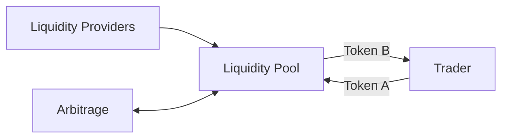

# 08 - How DEXs Work

A decentralized exchange can offer a swap because assets are already available through onchain liquidity.


There is no magical conversion engine.

> **A swap consumes a market structure somebody supplied.**


***

## 🧺 Pools instead of a central order book

Many DEX designs use automated market makers (AMMs).


At a high level:





Uniswap, Balancer, and Aerodrome all use onchain liquidity, but their pool designs and routing systems are not identical.

Do not generalize one AMM equation to every pool.


***

## 📐 Constant product as the first model

For a simple two-token constant-product pool:

$$
x \cdot y = k
$$

where:

* $$x$$ is one reserve;
* $$y$$ is the other reserve;
* $$k$$ is the invariant under the simplified model before accounting for implementation details.

When a trader adds one asset and removes the other, the reserve ratio changes.


That creates price impact.

The larger the trade relative to liquidity, the more the pool state moves.


***

## ⚖️ Pool price vs external price

A pool does not consult Coinbase and ask for permission to set a price.

Its state produces an exchange rate according to its mechanism.

If the pool becomes mispriced relative to other venues, arbitrageurs may trade against the difference.


Arbitrage can pressure prices toward one another, but it is not a contractual guarantee of parity or perfect synchronization.



***

## 🌈 Different DEX designs



Uniswap supports concentrated-liquidity and other protocol versions where liquidity can be allocated across price ranges and routed through pools.



Balancer supports programmable AMMs and pool designs that can include more than two assets and non-50/50 weights depending on pool type.



Aerodrome operates on Base with constant-product and concentrated-liquidity designs, including Slipstream.



The shared lesson is liquidity.

The implementation details determine the economics.


***

## 🌰 Observe NUT instead of merely trading it

Open a BASED NUT-related pool on a DEX and inspect:

* the pair or asset set;
* pool reserves or liquidity;
* fee tier or pool fee where visible;
* current price;
* your expected output at several trade sizes.


Try changing only trade size.

Watch price impact change.

You have now turned the AMM from an abstraction into an observable system.


***

## 🧠 What routing adds

A DEX interface may route:

```
NUT → WETH
```

directly.


Or it may find a path such as:

```
Token A → intermediate asset → Token B
```

It may even split trades depending on the routing system.


The interface is solving an execution problem across available liquidity.


That means:

> **The pool you know about may not be the route your trade actually uses.**

Always review route information when it materially affects understanding.


***

## ⚠️ Liquidity is not safety

Deep liquidity can reduce price impact.


It does not prove:

* the token contract is safe;
* the pool is canonical;
* the frontend is legitimate;
* the asset cannot collapse;
* the smart contracts cannot fail;
* the LP position is suitable for you.

Liquidity solves execution capacity.


Do not promote it into a universal trust signal.


***

## 🚫 AMM misconceptions

### “The DEX sets the price.”

Too vague. The pool mechanism, reserves, trades, arbitrage, routing, and broader market collectively matter.

### “More TVL means no risk.”

False. It can indicate larger liquidity, while introducing larger value at risk.

### “Arbitrage guarantees the right price.”

No. Arbitrage is an economic behavior under conditions where the opportunity is worth executing.

### “All pools use  $$x \cdot y = k$$”

No. It is a foundational model, not a universal AMM law.


***

## 🧪 Operational lab: inspect a market instead of merely swapping through it

Use **DEX UI + DeFiLlama + Dune + BaseScan** as four different views. They answer different questions.

| Surface               | Use it to answer                                 | Do not infer                                        |
| --------------------- | ------------------------------------------------ | --------------------------------------------------- |
| Canonical DEX docs/UI | Pool design, fee tier, route, position mechanics | That the pool is safe or deep enough for your trade |
| BaseScan              | Contract/transaction/event evidence              | That verified source implies safe economics         |
| DeFiLlama             | Comparative TVL/volume/fees context              | Canonical token identity                            |
| Dune                  | Reproducible historical onchain queries          | That an indexed dataset is complete or canonical    |


***

### Exercise



## Pick one Base DEX market you can identify canonically.



## Record pool details

Record pool type, token addresses, fee model, and current reserves/liquidity representation from the protocol surface.



## Check DeFiLlama context

Check the protocol on DeFiLlama for contextual TVL/volume/fees.



## Inspect recent trade legs

Use Dune’s `dex.trades` dataset to inspect recent Base trade legs for the market or protocol.



## Reconcile with chain evidence

Open one transaction on BaseScan and reconcile the indexed Dune row(s) with the underlying transaction/events.



That reconciliation—**interface → analytics → chain evidence**—is the beginning of professional DeFi analysis.


***

## 🔗 Learn more

* [Uniswap Developers](https://developers.uniswap.org/docs)
* [Balancer Documentation](https://docs.balancer.fi/)
* [Aerodrome Documentation](https://aerodrome.finance/docs)
* [DeFiLlama](https://defillama.com/)
* [Dune Docs](https://docs.dune.com/)
* [Consensys — DeFi Knowledge Base](https://consensys.io/knowledge-base/defi)
* [Fireblocks Academy — Intro to DeFi](https://www.fireblocks.com/academy/intro-to-defi)


***

## 📐 Final model

```
liquidity
   +
pricing mechanism
   +
trades
   +
arbitrage
   +
routing
   =
DEX execution surface
```

Once you understand the pool, the swap stops looking like magic.
