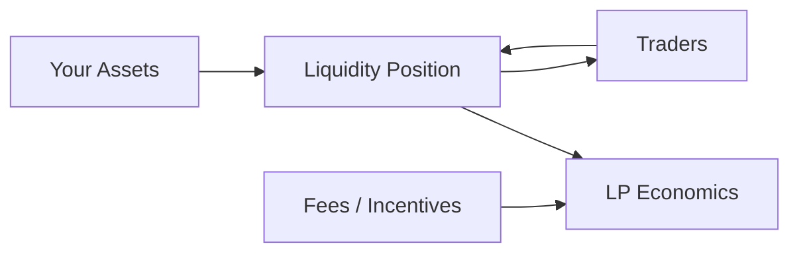

# 10 - Providing Liquidity

When you provide liquidity, you stop being only a trader.

Your assets become part of the inventory against which other people trade.

> **LPing is not “holding two tokens and earning free yield.” Your position changes as the market trades through it.**






The exact accounting varies across Uniswap, Balancer, and Aerodrome.

Some systems use fungible LP tokens. Concentrated-liquidity positions may be represented differently.


***

## 🔄 From holder to liquidity provider


## 🧠 Questions before depositing

Do not start with APY.

Start here:

1. Which assets am I depositing?
2. What pool design am I entering?
3. What price range applies, if any?
4. What happens if one asset appreciates sharply?
5. What fees can the position earn?
6. Are there external token incentives?
7. Can I withdraw at any time under normal operation?
8. What contracts custody or account for the assets?
9. Is the pool sufficiently liquid for my intended exit?
10. What approvals remain after deposit?


***

## ⚖️ Inventory changes

In a two-asset AMM, traders exchange against the pool.

As relative price changes, the composition of your position changes.

This is why LP performance must be compared against a relevant alternative, such as simply holding the assets.


The term **impermanent loss** describes a specific relative-performance effect in AMMs. It does not mean the loss disappears automatically if you wait.

Fees and incentives may offset it. They may also fail to offset it.


***

## 🎯 Concentrated liquidity

Concentrated-liquidity AMMs let LPs allocate liquidity to chosen price ranges.



The position can actively facilitate trades and may earn applicable fees.



The position may become concentrated predominantly or entirely in one asset and stop actively earning swap fees until price returns to the active range, depending on the design.



Tighter ranges can concentrate capital more efficiently near the current price.

They also require stronger understanding and potentially more active management.


***

## 🌰 BASED NUT exercise

Before adding NUT liquidity:



## Inspect the pool

Confirm DEX, network, token contracts, pool type, fee structure, and current liquidity.



## Model the assets

Decide whether you are willing to end up with more of either constituent asset.



## Use a small deposit

Treat the first position as an operational test.



## Read every approval

Liquidity provision often requires token permissions before deposit.



## Verify the position

Confirm the deposit and position state using the DEX interface and BaseScan.



## Practice removing part of it

Do not wait for an emergency to discover how withdrawal works.




***

## 🌱 Fees vs incentives

Keep these concepts separate.


### Trading fees

Generated by swap activity under the pool's fee rules.


### Token incentives

External rewards paid to encourage liquidity.

A high headline yield may be dominated by token emissions rather than organic trading fees.

Aerodrome, for example, has protocol-specific distinctions between fee earnings, emissions, staking/gauges, and pool types.

Understand the exact pool before extrapolating from another DEX.


***

## ⚠️ LP risk stack

```
token risk
  + smart-contract risk
  + market risk
  + price-range risk
  + execution/liquidity risk
  + approval risk
  + incentive-token risk
  + operational error
```

Providing liquidity combines risks.

It does not diversify them away by default.


***

## 🚫 Do not LP because

* the APY is large;
* the pool has a familiar ticker;
* somebody calls the position “passive”;
* the interface says “earn”;
* the assets are correlated today;
* you assume fees guarantee profit.

Understand the inventory dynamics first.


***

## 🧪 Operational lab: enter, inspect, and partially exit one LP position

Use a **small position** on a canonical Base DEX. The exercise is incomplete until you remove liquidity again.



## Choose the exact pool, not merely the pair

Identify DEX, pool address/ID, pool type, token contracts, fee tier, weighting/range rules, and whether incentives require a separate gauge/staking action.



## Model what inventory can become

For concentrated liquidity, identify the active range and what happens when price leaves it. For weighted or multi-asset pools, identify the actual weighting invariant. Do not apply constant-product intuition universally.



## Verify every spender before approval

In Rabby, inspect the approval target and compare it against the protocol’s canonical deployment documentation. Use bounded approvals for the lab where practical.



## Deposit a deliberately small amount

Record starting wallet balances and the exact position representation created—NFT position, BPT/pool token, or another receipt/state depending on protocol design.



## Verify onchain

Use BaseScan to inspect approvals and the add-liquidity transaction. Use DeFiLlama only for contextual protocol/pool metrics, not to authenticate the pool.



## Remove part of the position now

Do not postpone learning the exit. Withdraw part, record received token amounts, verify the transaction, and identify any approvals that remain after exit.



***

## 🔗 Learn more

* [Uniswap Developers — liquidity](https://developers.uniswap.org/docs)
* [Balancer Documentation](https://docs.balancer.fi/)
* [Aerodrome Documentation](https://aerodrome.finance/docs)
* [DeFiLlama](https://defillama.com/)
* [Dune Docs](https://docs.dune.com/)
* [Gate — Introduction to DeFi Security](https://www.gate.com/learn/course/introduction-to-defi-security) — supplemental course; do not use it to authenticate deployments

***

## 📐 Final model

```
LP position
    =
market inventory
  + fee exposure
  + changing asset composition
  + protocol mechanics
  + risk
```

When you provide liquidity, you are not watching the market.

You are inside it.
