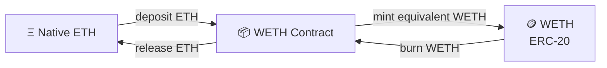

# 11 - Wrapping Assets

## 📦 Wrapped Assets: Why ETH Becomes WETH

Wrapped assets exist because **the same economic asset may need a different technical form to participate in another execution environment**.


The most important example is ETH and WETH.


ETH is the native asset of Ethereum-compatible networks such as Base. It existed before the ERC-20 token standard and does **not** itself implement the ERC-20 interface.


WETH is an ERC-20 representation of ETH.

That sounds like a minor distinction.

It is not.


It explains why wrapping exists, why DeFi contracts frequently work with WETH instead of ETH, why a wallet can contain WETH while being unable to pay gas, and why two assets representing the same economic root can behave differently inside smart contracts.

> **Wrapping changes the execution form of an asset. It does not automatically create additional economic value.**



**Do not learn “wrapped token = copy of token.”**

Ask instead:

> **What technical limitation or execution requirement is the wrapper solving?**

Different wrappers exist for very different reasons.



***

### 🧬 Start With the Missing Distinction: Native Asset vs Token

Before understanding WETH, understand that **ETH and ERC-20 tokens live at different layers of the system**.


#### ETH is native

ETH is built directly into the Ethereum execution environment.

On Base, native ETH is used to:

* pay transaction gas;
* transfer native value;
* attach value directly to a smart-contract call;
* settle execution fees.

There is no ordinary ERC-20 token contract that maintains your native ETH balance.

The protocol itself knows how much ETH your account owns.


#### ERC-20 tokens are contracts

An ERC-20 such as USDC, NUT, WETH, or another fungible token exists because a **smart contract maintains its accounting**.


ERC-20 defines a common interface including operations such as:

* `balanceOf`;
* `transfer`;
* `approve`;
* `allowance`;
* `transferFrom`.

That common interface allows wallets, exchanges, routers, vaults, lending markets, and other applications to integrate many different fungible assets in a predictable way.


The distinction is therefore:

```
Native ETH
    ↓
accounted for by the network itself

ERC-20 token
    ↓
accounted for by a token smart contract
```


***

### ⚖️ ETH vs wETH

| Property                              | ETH                     | wETH                    |
| ------------------------------------- | ----------------------- | ----------------------- |
| **Type**                              | Native network asset    | ERC-20 token            |
| **Accounting**                        | Protocol-level          | Smart-contract-level    |
| **ERC-20 interface**                  | No                      | Yes                     |
| **Can pay Base gas**                  | Yes                     | No                      |
| **Has a token contract**              | Not in the ERC-20 sense | Yes                     |
| **Supports `approve()`**              | No                      | Yes                     |
| **Supports `transferFrom()`**         | No                      | Yes                     |
| **Can be treated like other ERC-20s** | Not directly            | Yes                     |
| **Economic relationship**             | Underlying ETH          | Claim on deposited ETH  |
| **Conversion**                        | Deposit ETH → mint WETH | Burn WETH → release ETH |

Ethereum.org describes WETH as a 1:1 ERC-20 representation created by depositing ETH into the wrapper contract. Native ETH remains necessary for gas even when the wallet holds WETH.


***

### 🤨 Why Isn't ETH Already an ERC-20?

Because ETH came first. Ethereum launched with ETH as its native asset.


The ERC-20 standard was proposed afterward as a standardized interface for fungible tokens implemented using smart contracts.


This left Ethereum with two different forms of fungible value:

```
Native value
ETH

        versus

Contract-managed value
ERC-20 tokens
```

From a human perspective, both may look like tokens in a wallet.

From a smart contract's perspective, they are different things.


***

### 🧩 Why Does DeFi Care?

Imagine building a DEX that handles:

* NUT;
* USDC;
* AERO;
* cbBTC;
* another ERC-20;
* ETH.

If every token follows ERC-20 except ETH, ETH becomes the special case.


For an ERC-20, a protocol can generally reason in terms of:

```
token address
balanceOf()
transfer()
transferFrom()
approve()
allowance()
```

Native ETH does not expose that ERC-20 interface.


It instead moves through Ethereum's native value-transfer mechanics.


That means protocols would otherwise need separate logic:

```
ERC-20 path
    +
special native ETH path
```


Wrapping ETH gives applications another option:

```
ETH
 ↓ wrap
WETH
 ↓
standard ERC-20 path
```

Now WETH can participate using the same basic token interface as other ERC-20 assets.

This standardization is one reason WETH is deeply integrated across DeFi.


***

### 🔄 The ETH → WETH Model






For the ordinary WETH model:

```
1 ETH deposited
        ↓
1 WETH minted
```

and:

```
1 WETH redeemed
        ↓
1 ETH released
```

The wrapper does not need to invent another economic ETH.

It changes **how the claim is represented and how contracts can interact with it**.


***

### 🧮 Follow the Accounting

Suppose your wallet begins with:

```
Native ETH:  0.200 ETH
WETH:        0.000 WETH
```

You wrap:

```
0.100 ETH
```

Ignoring gas for a moment:

```
Wallet native ETH  → -0.100
WETH contract ETH  → +0.100
Wallet WETH        → +0.100
```

The new state is approximately:

```
Native ETH:  0.100 ETH
WETH:        0.100 WETH
```

The underlying economic quantity was transformed into another execution form.

But the transaction itself also costs gas.

So in practice:

```
Native ETH decrease
=
ETH wrapped
+
gas paid
```

That distinction matters when reconciling balances.


***

### ⛽ Why WETH Cannot Pay Your Gas

This catches beginners constantly.


You can have:

```
WETH balance: 10 WETH
```

and:

```
Native ETH balance: 0 ETH
```

and still be unable to send an ordinary Base transaction.

Why?

Because transaction fees are paid by the protocol using the **native gas asset**.

WETH is an ERC-20 balance maintained inside the WETH contract.

The Base execution environment does not automatically unwrap your WETH because you need gas.

So:

```
WETH ≠ gas balance
```

On Base:

```
Gas → native ETH
```


**Do not wrap every last bit of ETH.**

A wallet holding only WETH may still need native ETH before it can perform the transaction required to unwrap that WETH.



***

### 🧠 The Difference at the Smart-Contract Level

Native ETH can accompany a smart-contract call as native value.

Conceptually:

```solidity
someFunction{value: x}()
```

A contract can inspect that native value through mechanisms such as:

```solidity
msg.value
```

ERC-20 assets work differently.

The contract interacts with another token contract:

```
token.transfer(...)
token.transferFrom(...)
token.balanceOf(...)
```

That distinction is why approvals exist for ERC-20s but not for native ETH in the same form.

#### Sending ETH

```
Wallet
  ↓ native value
Contract
```

#### Spending an ERC-20

Frequently:

```
Wallet
  ↓ approve spender
Token Contract
  ↓ permission recorded

Protocol
  ↓ transferFrom()
Token Contract
  ↓
Tokens move
```

Wrapping ETH therefore changes more than its ticker. It changes the **interaction model**.


***

### 💧 Why DEXs Use WETH

Consider a pool containing:

```
NUT / WETH
```

Both sides can be represented using ERC-20 token contracts.

That creates a clean common interface for:

* pool accounting;
* balances;
* transfers;
* approvals;
* routers;
* liquidity positions;
* indexing;
* other smart contracts.

A protocol can still create a user experience that accepts native ETH.

The application or router may wrap ETH internally as part of the transaction.


So the user may see:

```
ETH → NUT
```

while part of the underlying execution resembles:

```
ETH
 ↓
WETH
 ↓
pool interaction
 ↓
NUT
```


### **You do not always need to manually wrap ETH.**

Modern DeFi applications may handle wrapping and unwrapping inside a larger transaction.


The important skill is understanding that the transformation may still occur underneath the interface.



***

### 🔍 Watch for ETH and WETH When Reading BaseScan

This distinction becomes particularly useful when inspecting transactions.

A frontend may tell you:

> Swapped ETH for Token X.

BaseScan may reveal several internal steps.

Look for:

* native ETH value entering a router;
* interaction with WETH;
* WETH `Deposit` or transfer activity;
* pool transfers;
* the output ERC-20;
* native ETH returned as change where applicable.

The frontend gives you the summary.

The transaction trace gives you the mechanism.


***

### 🌐 WETH on Base

Base uses ETH as its native gas asset.

Base also has a canonical WETH9 deployment.

```
Base WETH9

0x4200000000000000000000000000000000000006
```

Base publishes this address in its official L2 contract registry.

Do not generalize this lesson into:

> WETH always has this address.

It does not.

Contract identities are chain-specific unless independently established otherwise.

Always verify the deployment for the network you are actually using.


***

## 🌰 Then Why Wrap NUT?

This is where the idea becomes more interesting.

ETH → WETH and NUT → wNUT should **not** be mentally collapsed into the same reason for wrapping.


NUT is already an ERC-20 token.

It does not need wNUT merely to become ERC-20-compatible.


The useful distinction is:

```
ETH → WETH
solves an interface mismatch

NUT → wNUT
creates another interoperable execution state
```


For NUT/wNUT, the important conceptual model is:

> **wNUT preserves a one-to-one claim on NUT while allowing the same underlying asset to exist through another execution state.**


It does not create additional economic NUT.

It expands the **execution surface** of the same asset.


***

### 🧬 Simple State vs Dual State

Without another execution state:

```
NUT
```

The system has one representation.


With an interoperable wrapped state:

```
NUT
 ↕
wNUT
```

The amount of underlying NUT does not need to increase.


But the possible relationships do. Conceptually:

```
Single state

NUT
```

becomes:

```
Dual state

NUT ←→ wNUT
```

And if protocols can interact with both:

```
NUT
 ├── protocol A
 ├── pool A
 └── application A

wNUT
 ├── protocol B
 ├── pool B
 └── application B
```


The important expansion is not:

```
more NUT
```

It is:

```
more execution paths
```


#### 🌰 Root conservation

A wrapped state can expand what the asset can interact with without requiring the root asset itself to multiply.

**The root is preserved. The execution surface expands.**



***

## ⚖️ ETH/WETH vs NUT/wNUT



#### Problem

ETH is native currency.

Most fungible tokens use ERC-20.


#### Wrapper function

Give ETH an ERC-20-compatible representation.


#### Main effect

```
native asset
    ↓
standardized token interface
```


#### Why useful

Contracts can treat WETH similarly to other ERC-20 assets.



#### Starting point

NUT is already tokenized.


#### Wrapper function

Create another interoperable execution state while retaining the NUT claim.


#### Main effect

```
one execution state
    ↓
multiple interoperable states
```


#### Why useful

The same underlying asset can gain additional interaction paths.



This illustrates a broader principle:

> **A wrapper is a mechanism. “Why wrap?” is an architectural question.**


***

## 🧩 Not All "Wrapped" Assets Mean the Same Thing

Crypto uses the word **wrapped** far too casually.

Do not assume that everything beginning with `w` follows the WETH model.


Several different structures can appear similar from the outside.


### 1. Simple 1:1 Wrapper

Example mental model:

```
Asset A
 ↓ deposit
Wrapper
 ↓
wAsset A
```

with:

```
1 underlying
=
1 redeemable wrapped unit
```

WETH is the classic example.


### 2. Wrapped Non-Rebasing Representation

Some wrappers transform another token's accounting behavior.

A wrapped version may represent a **claim whose redemption rate changes over time** rather than maintaining a perpetual one-token-for-one-token quantity relationship.

So:

```
1 wrapped token
```

does not necessarily mean:

```
1 underlying token
```

forever.

Never infer exchange-rate mechanics from the word `wrapped`.


### 3. Custodial Wrapped Asset

A token may represent an asset held by a custodian.

Conceptually:

```
Underlying Asset
       ↓
External Custodian
       ↓
Tokenized Claim
```

Now the trust model includes:

* custodian solvency;
* reserves;
* redemption;
* legal structure;
* operational controls.

That is substantially different from a simple immutable onchain wrapper.


### 4. Bridged Representation

A bridged asset can look like a wrapper but solves another problem.

Its purpose is generally:

```
asset on Chain A
        ↓
bridge system
        ↓
representation on Chain B
```

That introduces:

* another chain;
* bridge contracts;
* message verification;
* possibly validators or multisigs;
* cross-chain finality;
* additional failure surfaces.

**Wrapped and bridged are not synonyms.**


### 5. Vault Share

Suppose you deposit USDC into a vault and receive a token representing your share.

That token may represent:

```
claim on vault assets
```

rather than:

```
simple 1:1 wrapper
```

Its redemption value may increase, decrease, or otherwise change according to vault accounting.

ERC-4626 exists specifically to standardize tokenized vault interfaces.

A vault share is not automatically equivalent to WETH-style wrapping.


***

### 🧠 A Better Classification

When encountering any derivative-looking token, ask:

| Question                             | Why it matters                                       |
| ------------------------------------ | ---------------------------------------------------- |
| **What is the underlying asset?**    | Establishes the economic root                        |
| **Where is the underlying held?**    | Identifies custody                                   |
| **Who controls that custody?**       | Identifies trust                                     |
| **What creates the representation?** | Defines minting                                      |
| **What destroys it?**                | Defines redemption                                   |
| **What is the conversion rate?**     | Determines accounting                                |
| **Can that rate change?**            | Distinguishes fixed wrappers from shares/derivatives |
| **Is it on the same chain?**         | Distinguishes wrapping from bridging                 |
| **Can redemption be paused?**        | Reveals operational dependency                       |
| **Can the implementation change?**   | Reveals upgradeability risk                          |
| **Does it generate yield? Why?**     | Separates representation from economics              |

***

## ⚙️ Operational Lab A: Inspect ETH and WETH on Base

The first exercise does not require risking funds.

Use:

* **Rabby** to inspect your wallet balances;
* **BaseScan** to inspect the WETH contract;
* **Base official documentation** to authenticate the contract address.



### Confirm Base

In Rabby, select or inspect the **Base** network.

Do not continue because the interface merely shows "ETH."

Confirm the chain.



### Record native ETH

Record your native ETH balance.

Example:

```
Native ETH: 0.0124
```

This is the balance available for Base gas.



### Authenticate WETH

Obtain the Base WETH9 address from Base's official contract documentation.

Canonical Base WETH9:

```
0x4200000000000000000000000000000000000006
```



### Open the contract on BaseScan

Inspect:

* contract name;
* verified source;
* token tracker;
* transactions;
* holders;
* contract read functions.

Do not interpret "verified source" as "risk free."

Source verification means the published code corresponds to deployed bytecode—not that the economic system cannot fail.



### Compare the two balances

Observe that BaseScan treats:

```
native ETH balance
```

and:

```
WETH ERC-20 balance
```

as separate state.



If that distinction makes intuitive sense, you understand the foundation of wrapping.


***

## 🧪 Operational Lab B: Wrap a Tiny Amount

Only perform this after understanding the previous sections.

Do not use meaningful funds for your first experiment.



### Establish the canonical route

Use a known interface or the verified wrapper contract.

Do not Google:

> wrap WETH

and connect to the first result.

Authenticate the application or contract independently.



### Record pre-state

Record:

```
native ETH
WETH
network
wrapper address
```

If using Rabby, also inspect the expected transaction simulation.



### Wrap a deliberately small amount

For example, use an amount small enough that failure would be educational rather than consequential.

Do **not** use your remaining gas balance.



### Read the wallet request

Confirm:

* network = Base;
* destination = expected wrapper/router;
* native ETH value = expected amount;
* simulation = expected outcome;
* gas = reasonable.

Simulation is an additional defense.

It is not permission to stop thinking.



### Submit

Broadcast the transaction.



### Verify independently

Open the transaction on BaseScan.

Reconstruct:

```
ETH left wallet
        ↓
wrapper received ETH
        ↓
WETH appeared
```

Also account for gas.



### Unwrap part of it

Reverse a small amount.

Verify:

```
WETH decreases
ETH increases
```

minus the native ETH spent executing the transaction.



***

## 🌰 Operational Lab C: NUT → wNUT

Now apply the same analytical method without assuming the mechanics are identical.


For BASED NUT, authenticate separately:

```
NUT contract
wNUT contract
wrapper / execution contract
```

Do not infer any address from:

* ticker;
* token name;
* CoinGecko;
* DEX search results;
* a wallet token list;
* an old screenshot.

Use canonical BASED NUT sources and independently inspect the resulting contracts on BaseScan.


### Before Wrapping

Record:

```
NUT balance
wNUT balance
native ETH for gas
NUT allowance to wrapper
```


Then determine from the verified contract:

```
Does wrapping require approve()?
What function performs wrapping?
What amount does it accept?
What event/state change proves completion?
What function reverses it?
```

Do not simply assume a WETH-style `deposit()` implementation.


### During Wrapping

Verify:

```
Origin
Network
Contract
Function
Amount
Approval / authority
Expected balance change
Gas
```

Use a tiny first transaction.


### After Wrapping

Verify independently:

```
NUT before
NUT after

wNUT before
wNUT after

wrapper state
transaction events
allowance
gas
```

Then unwrap a test amount.

Until you can reconstruct both directions, you do not yet understand the wrapper operationally.


***

## 🔒 Wrapper Risk Is Real

Wrapping adds another dependency.

Even when the underlying economic exposure is intended to remain equivalent, the execution path changes.


Ask:

#### Custody

* Where does the underlying asset go?

#### Redemption

* Can anyone redeem?
* Can redemption be paused?

#### Accounting

* Is backing exactly 1:1?
* Is there an exchange rate?
* Is there a fee?

#### Supply

* What controls minting?
* Can wrapped supply exceed backing?

#### Administration

* Is the contract:
  * upgradeable;
  * pausable;
  * owner-controlled;
  * multisig-controlled;
  * immutable?

#### External dependencies

* Does redemption depend on:
  * an oracle;
  * a bridge;
  * a custodian;
    * another protocol;
* governance?

#### Failure

* What happens if the wrapper itself fails?


**Same economic exposure does not mean same risk surface.**

The wrapper can preserve a claim on an asset while introducing another contract, administrator, bridge, custodian, oracle, or accounting dependency.


***

## 🚫 What Wrapping Does Not Automatically Mean

Wrapping does **not** automatically mean:

* additional underlying supply;
* additional wealth;
* yield;
* staking;
* borrowing;
* leverage;
* permanent market-price equality;
* trustlessness;
* identical contracts;
* identical execution behavior;
* cross-chain portability;
* bridge security;
* guaranteed redemption;
* guaranteed protocol support.

The word tells you almost nothing by itself.


Inspect the mechanism.


***

## 🔎 What to Verify Onchain

After any wrap or unwrap, inspect:

#### Transaction

* sender;
* target contract;
* function;
* native value;
* gas;
* status.

#### Underlying asset

* balance before;
* balance after;
* transfers into or out of custody.

#### Wrapped state

* mint;
* burn;
* transfer;
* final balance.

#### Authority

* allowance before;
* allowance after;
* spender.

#### Conversion

Calculate:

```
wrapped received
÷
underlying deposited
```

Then determine whether that ratio is:

* contractually fixed;
* variable;
* merely expected;
* market-dependent.

\--

## 🔗 Learn More

#### Core concepts

* **Ethereum.org — Wrapped Ether (WETH)**\
  Best introductory explanation of why ETH and WETH differ.
* **Ethereum.org — ERC-20 Token Standard**\
  Understand the common interface WETH gains by becoming an ERC-20.
* **EIP-20 — Token Standard**\
  Read the actual standard once you are comfortable with the concepts.

#### Base

* **Base Documentation — Contract Addresses**\
  Canonical source for Base's WETH9 deployment.
* **BaseScan**\
  Inspect actual contracts, transactions, transfers, events, and balances.

#### Analysis

* **Dune**\
  Reconstruct wrap/unwrap activity programmatically once the relevant addresses and events are known.

#### BASED NUT

* **BASED NUT canonical documentation and repositories**\
  Authority for NUT-, wNUT-, and wrapper-specific mechanics.


***

## 📐 Final Model

Do not memorize:

```
wrapped token
=
copy
```

Use this model:

```
Economic root
      ↓
execution constraint
      ↓
transformation
      ↓
new representation / state
      ↓
additional interaction surface
```

For ETH:

```
ETH
native asset
    ↓
wrap
    ↓
WETH
ERC-20 execution form
```

For NUT:

```
NUT
existing execution state
    ↓
wrap
    ↓
wNUT
interoperable wrapped execution state
```

The important question is never merely:

> **What does the wrapper represent?**

Ask:

> **Why does this second state exist, what new execution path does it enable, what invariant connects it to the root, and what new dependency did we accept to get there?**

That is wrapping.
