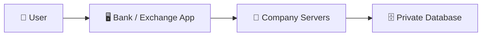
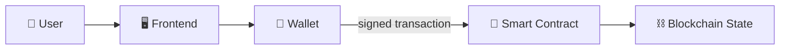
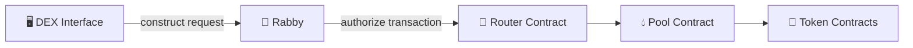
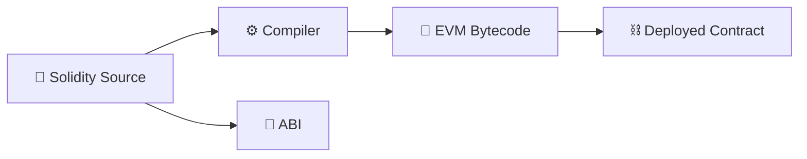
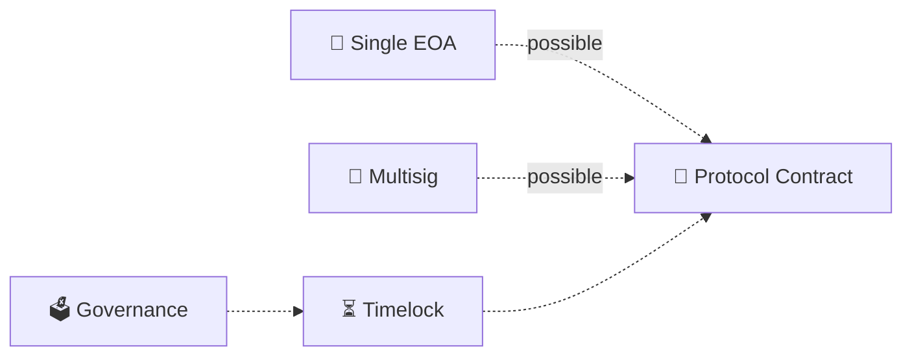
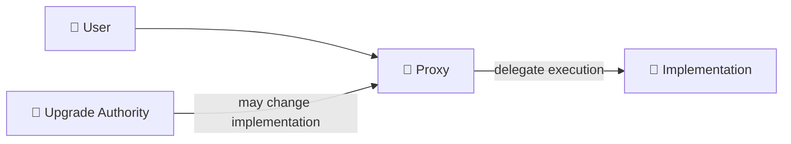
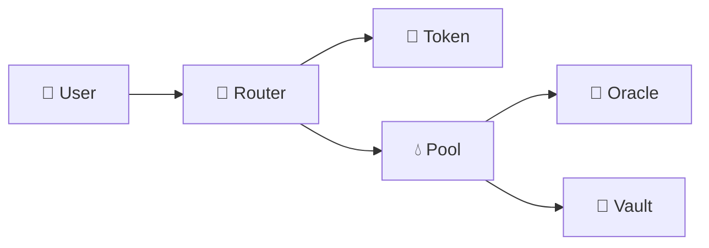
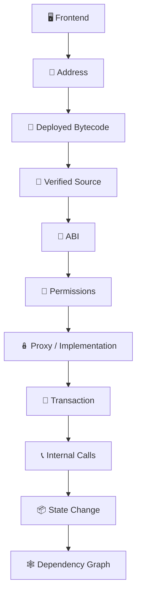

```mermaid
flowchart LR
    INTENT["1️⃣ User Intent"]
    UI["2️⃣ Frontend Constructs Call"]
    WALLET["3️⃣ Wallet Displays Request"]
    SIGN["4️⃣ User Authorizes"]
    NETWORK["5️⃣ Transaction Reaches Base"]
    EVM["6️⃣ EVM Executes Contract"]
    CALLS["7️⃣ Contracts May Call Contracts"]
    STATE["8️⃣ State Changes"]
    EVENTS["9️⃣ Events / Transfers Recorded"]
    EXPLORER["🔟 BaseScan Observes Result"]

    INTENT --> UI --> WALLET --> SIGN --> NETWORK --> EVM --> CALLS --> STATE --> EVENTS --> EXPLORER
```

# 13 - Smart Contracts

## 🧱 Smart Contracts: The Machines Behind DeFi

A swap looks like a button.

A loan looks like a form.

A liquidity position looks like a dashboard.

Underneath all of them are **smart contracts**.


Smart contracts are the bedrock of DeFi and onchain finance. They create tokens, hold assets, maintain balances, operate markets, issue loans, enforce collateral requirements, distribute rewards, govern protocols, wrap assets, route swaps, and connect one financial system to another.

The website is usually not the financial system.

**The contracts are.**

> **A DeFi interface is a control panel for financial machines living onchain. Learn to see the machines.**


A polished website can construct a dangerous transaction.

A terrible website can interact with a perfectly legitimate contract.

**Frontend appearance and contract identity are different security questions.**


***

## 🧠 What Is a Smart Contract?

A smart contract is a **program deployed to a blockchain address**.


On Base, Ethereum, and other EVM networks, a contract can contain:

* **code** — the rules it can execute;
* **state** — information it stores;
* **functions** — operations that can be called;
* **permissions** — rules governing who may perform privileged operations;
* **events** — records it can emit when things happen;
* **assets or accounting** — ETH, tokens, positions, balances, shares, debt, or other financial state.

Once deployed, users and other contracts can call its functions. Conceptually:

```
address
   +
executable code
   +
persistent state
   =
smart contract
```

A contract is not merely a document stored onchain.

> **It is an executable state machine.**

Give it an allowed input, and it applies its rules to the current state.

```
current state
     +
input
     +
contract rules
     ↓
new state
```

That simple idea eventually becomes almost all of DeFi.


***

### 🏦 Why Smart Contracts Matter

Traditional financial applications usually look approximately like this:





The institution operates the system and maintains the authoritative database.


Onchain finance changes the architecture:





The interface helps construct the request.

The wallet authorizes it.

The network executes it.


The smart contract defines what the request is allowed to do.

The blockchain records the resulting state.


#### The important shift

In traditional finance, you often ask an institution to update its ledger.


In DeFi, you authorize a transaction that causes shared onchain programs to update shared onchain state.



***

## ⚙️ What Can Smart Contracts Actually Do?

A smart contract can implement surprisingly sophisticated systems.



Contracts can:

* create fungible tokens;
* create NFTs;
* mint and burn assets;
* wrap one asset into another representation;
* enforce transfer rules;
* maintain balances;
* issue shares representing claims on assets.


An ERC-20 token is itself a smart contract.

NUT is therefore not merely a balance displayed inside your wallet.

Its token behavior originates from a deployed contract.



Contracts can:

* hold liquidity;
* calculate swap outputs;
* charge trading fees;
* issue LP positions;
* route trades;
* rebalance accounting;
* execute multi-asset exchanges.


Uniswap, Balancer, and Aerodrome are not merely websites where trades happen.

Their interfaces ultimately lead to contract systems that perform the execution.



Contracts can implement:

* lending;
* borrowing;
* collateral;
* liquidation;
* vaults;
* escrow;
* staking;
* rewards;
* auctions;
* derivatives;
* governance;
* treasury controls.


A lending market can therefore exist primarily as relationships between contracts rather than as a conventional company ledger.



One contract can call another contract.


That enables:

```
token
  ↓
DEX
  ↓
vault
  ↓
lending market
  ↓
oracle
```

This property is called **composability**.


It is one of DeFi's greatest capabilities and one of its largest sources of complexity and risk.



***

## 🌰 BASED NUT Is Already Teaching You Contracts

Almost every operation you perform with BASED NUT can be understood as a different kind of contract interaction.

<table><thead><tr><th width="195">Operation</th><th>Contract role you may encounter</th></tr></thead><tbody><tr><td>Hold NUT</td><td>ERC-20 token contract</td></tr><tr><td>Transfer NUT</td><td>Token contract</td></tr><tr><td>Approve NUT</td><td>Token contract granting a spender allowance</td></tr><tr><td>Swap NUT</td><td>Router and/or pool contracts</td></tr><tr><td>Provide liquidity</td><td>Pool, vault, router, or position-management contracts</td></tr><tr><td>Wrap NUT</td><td>Wrapper contract</td></tr><tr><td>Unwrap wNUT</td><td>Wrapper contract</td></tr><tr><td>Use LP positions</td><td>Pool / position contracts</td></tr><tr><td>Claim rewards</td><td>Reward or gauge contract, where applicable</td></tr></tbody></table>

You do not need to memorize every architecture immediately.

Start learning to ask:

> **Which machine am I talking to?**


***

## 🖥️ The Frontend Is Not the Contract

Suppose you visit a DEX.


You see:

```
Swap
100 USDC
↓
NUT
```

That screen is not itself performing the swap.


A simplified flow may look like:





The frontend may determine which contracts to call and how to encode the transaction.

Your wallet then shows you a request to authorize.


Once signed and submitted, the blockchain executes the contract logic.

This is why understanding contracts changes how you use DeFi.


Instead of thinking:

> “Uniswap wants me to approve this.”


You begin thinking:

> “My NUT token contract is being asked to grant this specific spender permission to move this amount.”

That is a much stronger mental model.


***

## 🪪 Contract Addresses

Every deployed contract has an address.


It looks like an ordinary EVM address:

```
0x123...
```


But two fundamentally different things can exist behind addresses.

| Address type                       | Controlled by |
| ---------------------------------- | ------------- |
| **Externally Owned Account — EOA** | Private key   |
| **Contract account**               | Deployed code |

A contract address is therefore its basic onchain identity.


If two contracts have different addresses, they are different deployed contracts even if they:

* have the same name;
* use the same logo;
* contain similar code;
* advertise the same ticker.



#### Names are not identities

`NUT`

`USDC`

`WETH`

`Uniswap`

are human-readable labels.

For executable operations, the **network + contract address** establishes which deployed object you are actually interacting with.



***

## 🧬 Source Code, Bytecode, and ABI Are Different Things

These three terms are frequently thrown at beginners without explanation.


They describe different layers of the same machine.






### 📝 Source code

Humans commonly write EVM contracts using languages such as Solidity.

Example:

```solidity
function balanceOf(address account)
    external
    view
    returns (uint256)
```

This is designed for humans to read.


### 🤖 Bytecode

The blockchain does not execute Solidity source files.

The source is compiled into **EVM bytecode**.

Bytecode is the machine-level program executed by the Ethereum Virtual Machine. Conceptually:

```
Solidity
   ↓ compile
EVM bytecode
   ↓ deploy
contract address
```

The deployed bytecode is ultimately what the network executes.


### 📖 ABI

The **Application Binary Interface — ABI** describes how outside applications communicate with a contract.


It tells software things such as:

* which functions exist;
* which parameters they accept;
* what they return;
* which events exist;
* how values should be encoded and decoded.


Think of it as the contract's **interaction vocabulary**.


If a contract contains:

```
approve(address spender, uint256 amount)
```

the ABI tells Rabby, BaseScan, ethers.js, a DEX frontend, or another program how to construct that call.


A useful simplification is:

```
Source code → understand the program

Bytecode → what the EVM executes

ABI → how outsiders communicate with it
```

***

## 🔎 What “Verified Contract” Actually Means

When BaseScan says a contract's source is verified, it means published source code has been matched against the deployed bytecode through the verification process.

That is valuable.

It allows humans and tools to inspect the program more easily.


It does **not** mean:

```
verified = audited
```

or:

```
verified = safe
```

or:

```
verified = trustworthy
```


**Source verification establishes code correspondence, not code correctness.**

Malicious contracts can have beautifully verified source code.


***

## 📦 State: What the Contract Remembers

Contracts can maintain persistent information.

That information is their **state**.


Examples include:

```
balance[address]

allowance[owner][spender]

totalSupply

owner

feeRate

collateral[address]

debt[address]

pool reserves

vault shares

governance roles
```

When a transaction changes one of these values, blockchain state changes.


Consider an ERC-20 approval:

```
Before:

allowance[Alice][Router] = 0

Alice calls:

approve(Router, 100)

After:

allowance[Alice][Router] = 100
```


The important thing that happened was not:

> “The wallet showed Approved.”


The important thing was:

> **Onchain state changed.**


***

## 📖 Reads vs ✍️ Writes

Not every contract interaction changes the blockchain.

This distinction is fundamental.




Read operations inspect existing state.


Examples:

```
balanceOf(address)

allowance(owner, spender)

owner()

totalSupply()
```

They generally do not create an onchain transaction.


You are asking:

> What is the current state?



Write operations attempt to change state.


Examples:

```
transfer(...)

approve(...)

deposit(...)

withdraw(...)

swap(...)

mint(...)

repay(...)
```

They require an onchain transaction and gas.


You are asking:

> Execute this function and attempt to modify blockchain state.



This is why BaseScan separates **Read Contract** and **Write Contract** interfaces.


***

## ⚡ Contracts Do Not Wake Up by Themselves

The word “smart” creates a misleading impression.


A contract does not sit around thinking. It does not wake up at midnight because:

```
if time == midnight:
    doSomething()
```

Someone or something still has to submit a transaction that causes execution.


That caller might be:

* a user;
* another contract;
* a keeper;
* an automation network;
* a relayer;
* a bot;
* a protocol operator.


The contract then evaluates its programmed rules.

So:

```
condition becomes true
```

does **not necessarily mean**

```
contract automatically executes
```

Execution still needs to be triggered.


***

## 🔄 What Happens When You Call a Contract?

A useful simplified lifecycle is:





This is the chain you should eventually learn to inspect.


***

## 📞 Functions: The Things Contracts Can Be Asked to Do

A contract exposes functions.


A token might contain:

```
transfer()
approve()
balanceOf()
allowance()
totalSupply()
```


A vault might contain:

```
deposit()
withdraw()
redeem()
convertToShares()
```


A protocol might expose:

```
swap()
borrow()
repay()
liquidate()
claim()
```


The function name matters.

The parameters matter just as much.


For example:

```
approve(
    spender = 0xABC...,
    amount   = 1000000000000000000
)
```


The question is not merely:

> Am I calling `approve()`?

It is:

> **Who receives spending authority, over which token, and how much?**


***

## 🚫 Reverts: Contracts Can Say No

A transaction does not automatically succeed just because you signed it.

The contract can reject execution.


This is called a **revert**.

Examples:

```
insufficient balance

insufficient allowance

unauthorized caller

slippage exceeded

position unhealthy

deadline expired

contract paused

invalid parameter
```


When execution reverts:

```
requested state change → rejected
```

The intended state changes are rolled back.


Gas may still have been consumed because the network performed computation before encountering the failure.


This is why failed transactions are still worth studying.

They tell you which machine rejected you and sometimes why.


***

## 📡 Events and Logs

Contracts can emit events during execution.


Examples include:

```
Transfer

Approval

Deposit

Withdraw

Swap

Borrow

Repay
```


Explorers and analytics systems use these logs heavily.


A token transfer may therefore appear as:

```
Transaction
   ↓
Contract execution
   ↓
Transfer event
   ↓
BaseScan token-transfer display
```

Dune, wallets, dashboards, indexers, and protocol analytics frequently reconstruct higher-level activity from these onchain records.


***

## 🔐 Permissions: Who Can Change the Machine?

A contract may expose functionality to everyone while reserving other functions for privileged accounts.


This is **access control**. Possible authorities include:

* owner;
* admin;
* guardian;
* pauser;
* minter;
* upgrader;
* fee manager;
* governance;
* multisig;
* timelock;
* another contract.


Privileges may permit actions such as:

```
mint tokens

pause transfers

change fees

replace an implementation

change an oracle

withdraw treasury assets

add markets

modify parameters

grant additional roles
```


So one of the most important questions in DeFi is:

> **Who can do what?**

Not simply:

> Who owns the contract?

A system may have many distinct privileged roles.


***

## 🏛️ Single Owner, Multisig, Governance, and Timelocks

Administrative authority can itself have architecture.





These arrangements have different trust assumptions.


A single owner may be operationally simple but creates concentrated authority.

A multisig distributes signing authority.

Governance can distribute decision-making more widely.

A timelock can create a delay between authorization and execution.


None is automatically safe merely because it sounds decentralized.

You inspect the actual authority graph.


***

## 🪆 Proxies and Implementations

Individual deployed contract bytecode is normally immutable.


But developers can build systems where the address users interact with delegates execution to another contract containing the current logic.


That first contract is commonly called a **proxy**.






The user continues interacting with:

```
Proxy Address A
```

while the implementation can potentially change:

```
Implementation V1
        ↓
Implementation V2
        ↓
Implementation V3
```

This is how an apparently stable address can represent changing executable logic.


***

## ⚖️ Immutable vs Upgradeable


This distinction needs precision.



Advantages can include:

* no administrator replacing the deployed logic;
* smaller upgrade governance surface;
* stronger predictability about that bytecode.


But:

* bugs may be impossible to patch;
* migrations may require new contracts;
* mistakes can become permanent.


**Immutable does not mean correct.**



Advantages can include:

* patching vulnerabilities;
* changing functionality;
* evolving protocol logic.


But upgradeability adds questions:

* Who can upgrade?
* Through what mechanism?
* Is there a timelock?
* Is the authority a single key or multisig?
* Can users exit before an upgrade?
* Can storage changes break assumptions?
* Can the implementation become malicious?


**Upgradeable does not mean untrustworthy.**

It means there is an additional authority surface to inspect.




A proxy system may contain immutable deployed contracts while still producing **upgradeable effective behavior**.

That distinction matters.



***

## 🧩 Contracts Calling Contracts

Now we reach one of the defining properties of DeFi.


Contracts can call other contracts.

Ethereum contracts are therefore often described as composable building blocks or open APIs.

A transaction that appears to be one operation may cross many contracts.


Example:





One button can therefore hide a substantial dependency graph.


This is why:

```
frontend → contract
```

is still too simplistic.


Real DeFi often looks more like:

```
frontend
   ↓
wallet
   ↓
router
   ↓
token
   ↓
pool
   ↓
oracle
   ↓
vault
   ↓
another protocol
```


***

## 🌐 Contracts Cannot Know Everything

A smart contract can directly inspect onchain information available to its execution environment.

It cannot inherently know:

* the temperature in San Juan;
* Apple's stock price;
* whether a shipment arrived;
* the current price of an offchain asset;
* whether a real-world borrower defaulted.


External information must be introduced somehow.


That may involve:

* oracles;
* attestations;
* trusted signers;
* bridges;
* relayers;
* administrators.


Every such connection introduces another trust or failure boundary.

This matters enormously in financial contracts.


***

## 💰 A Contract Can Hold Assets

Contracts can own ETH and tokens.


That is why they can implement:

* liquidity pools;
* vaults;
* escrow;
* bridges;
* lending systems;
* treasury systems.


But “the contract holds the money” is not enough analysis.


You need to ask:

```
Who can cause it to move?

Under what conditions?

Through which function?

Can an admin bypass normal rules?

Can another contract move it?

Can the logic change?
```

This is the beginning of actual protocol analysis.


***

## 💧 Example: What a Swap Really Means

A beginner sees:

```
NUT → ETH
```


A more experienced user sees:

```
NUT token
   ↓
allowance / authorization
   ↓
router
   ↓
pool
   ↓
pricing function
   ↓
token transfer
   ↓
output asset
```


An expert starts asking:

```
Which router?

Which pool?

Which pool implementation?

What spender received authority?

What route?

Which tokens actually moved?

What minimum output was enforced?

Was another protocol called?

What events were emitted?

What state changed?
```

Same swap.

Different level of understanding.


***

## 📋 Contract Roles You Will Encounter in DeFi

Learn to classify contracts by function.

<table><thead><tr><th width="180">Contract type</th><th>Primary job</th></tr></thead><tbody><tr><td><strong>Token</strong></td><td>Tracks balances and transfers</td></tr><tr><td><strong>Wrapper</strong></td><td>Converts between execution representations</td></tr><tr><td><strong>Pool</strong></td><td>Holds/accounts for liquidity and executes market logic</td></tr><tr><td><strong>Router</strong></td><td>Coordinates calls across pools/contracts</td></tr><tr><td><strong>Vault</strong></td><td>Holds/accounts for assets under defined rules</td></tr><tr><td><strong>Position manager</strong></td><td>Creates/manages positions</td></tr><tr><td><strong>Lending market</strong></td><td>Tracks collateral, loans, interest, liquidation</td></tr><tr><td><strong>Oracle adapter</strong></td><td>Supplies/interprets external pricing information</td></tr><tr><td><strong>Gauge / rewards</strong></td><td>Accounts for incentives</td></tr><tr><td><strong>Factory</strong></td><td>Deploys new contracts or pools</td></tr><tr><td><strong>Governance</strong></td><td>Coordinates protocol decisions</td></tr><tr><td><strong>Timelock</strong></td><td>Delays privileged operations</td></tr><tr><td><strong>Proxy</strong></td><td>Provides stable address/delegates execution</td></tr><tr><td><strong>Implementation</strong></td><td>Contains logic used by a proxy</td></tr></tbody></table>

A large protocol is normally a **contract system**, not one contract.

***

## 🔍 BaseScan: Start Interrogating the Machine

BaseScan gives you an inspection surface for Base contracts.


Do not just look at the token logo.

Open the contract itself.


A useful progression is:

```
Address
   ↓
Code identity
   ↓
ABI
   ↓
Permissions
   ↓
Proxy / implementation
   ↓
Stored state
   ↓
Transactions
   ↓
Events / transfers
   ↓
Internal calls
   ↓
Dependencies
```



### Establish the Address

Do not begin at BaseScan search.

Begin with a **canonical protocol source**.

Obtain the address there.

Then open that exact address on BaseScan.

Compare:

```
network
address
contract type
source
```

A block explorer helps inspect an address.

It should not be the only reason you believe an address is canonical.



### Determine Whether It Is a Contract

Inspect the address.

Ask:

* Is code deployed here?
* Is it an EOA?
* Is it a token contract?
* Is it a proxy?
* Is it a router?
* Is it a pool?

Classification comes before interpretation.



### Inspect the Code Tab

Check:

* source verification;
* compiler;
* optimization settings;
* contract name;
* implementation information where applicable;
* constructor or initialization context;
* files and imported libraries.

Do not attempt to read every line yet.

First establish what you are looking at.



### Inspect the ABI

Before becoming a Solidity expert, become **function literate**.

Look for recognizable functions:

```
balanceOf
allowance
approve
transfer

deposit
withdraw
redeem

swap
quote

owner
pause
unpause

grantRole
revokeRole

upgradeToAndCall
```

The ABI gives you a map of the machine's exposed controls.



### Find Permissions

Search for:

```
owner

admin

roles

DEFAULT_ADMIN_ROLE

pauser

guardian

upgrade

fee setter

operator
```

Then identify which addresses hold those powers.

Do not stop at:

> There is an owner.

Ask:

> **What can the owner actually do?**



### Determine Whether It Is a Proxy

If BaseScan identifies a proxy, inspect:

```
proxy address
     ↓
implementation address
     ↓
upgrade authority
```

Then inspect the implementation too.

Reading only the proxy shell can tell you very little about the actual business logic.



### Read State

Use **Read Contract** or **Read as Proxy** where appropriate.

Try harmless reads such as:

```
totalSupply()

balanceOf(...)

allowance(...)

owner()

paused()
```

Now you are querying the machine directly.

No DEX interface required.



***

## ⚠️ Write Contract Means Real Execution

BaseScan may expose **Write Contract** functionality.

That is not a sandbox.


Connecting a wallet and calling:

```
approve()

transfer()

deposit()

withdraw()
```

can create real Base transactions involving real assets.



Direct explorer interaction removes a protocol's normal frontend from the path.

It does **not** remove:

* contract risk;
* parameter risk;
* wallet risk;
* network risk;
* approval risk;
* your ability to make a catastrophic mistake.

It also means you are relying on the explorer interface to encode the call unless you independently construct it.


For learning, begin with **read operations**.


***

## 🧾 Read a Transaction Like an Execution Record

Pick a transaction you already performed.


Do not merely check:

```
Status: Success
```

Interrogate it.


Ask:

#### Entry

```
From?
To?
Which contract?
Which function?
```

#### Parameters

```
Which token?
Which recipient?
Which amount?
Which spender?
Which minimum output?
Which deadline?
```

#### Execution

```
Which other contracts were called?
Which tokens moved?
Which events were emitted?
```

#### Result

```
What state changed?
What balances changed?
What permissions changed?
```

That is how a transaction turns from a mysterious hash into an execution trace.


***

## 🔬 From Interface to Reality

You should eventually be able to trace:





This hierarchy now has meaning because you understand each layer.

It is not a checklist of unexplained nouns.


***

## 🕸️ Dependency Graphs

Once you understand individual contracts, stop looking at them individually.

Map the system.


For example:

```
NUT
│
├── Wrapper
│   └── wNUT
│
├── Uniswap Router
│   └── Pool
│
├── Balancer Router
│   └── Vault
│       └── Pool
│
└── Aerodrome Router
    └── Pool
```

Then add authority:

```
Contract
├── owner → Safe
├── upgrader → Timelock
├── oracle → External Contract
└── dependency → Token Contract
```

Now you are no longer merely reading contracts.

You are studying **protocol architecture**.


***

## ⚠️ Contract Risk Is More Than “Could the Code Be Hacked?”

A useful model is:

```
Contract risk
=
code
+ deployment
+ initialization
+ permissions
+ upgradeability
+ external calls
+ dependencies
+ economic assumptions
+ user authorization
```

A contract can contain correct code and still participate in an unsafe system.


Examples:

* bad oracle;
* compromised admin;
* incorrect initialization;
* malicious dependency;
* unsafe upgrade;
* broken economic assumption;
* unexpected token behavior;
* dangerous user approval.

This is why professional protocol analysis operates at the **system level**.


***

## 🧱 Immutable Does Not Mean Safe

Immutability removes one class of change.

It does not remove:

* logic bugs;
* economic exploits;
* oracle manipulation;
* reentrancy;
* accounting failures;
* integration failures;
* incorrect assumptions.

A perfectly immutable vulnerability is still a vulnerability.


***

## 🔄 Upgradeable Does Not Mean Scam

Upgradeability adds authority.

That authority must be analyzed.

Ask:

```
Who can upgrade?

Is it one key?

A Safe?

A DAO?

A timelock?

How quickly?

Can users exit first?

Can the upgrade authority itself change?

What implementation is active right now?
```

A careful evaluation describes the actual control system instead of substituting ideological labels.


***

## 🧪 Audits Are Evidence, Not Guarantees

Audits matter.


But:

```
audit ≠ proof
```


When reading an audit, identify:

* auditor;
* date;
* repository;
* commit hash;
* contracts included;
* contracts excluded;
* severity classifications;
* unresolved findings;
* acknowledged risks;
* changes made after the audit.


Then ask the uncomfortable question:

> **Is the code running today actually the code that was audited?**


That requires connecting:

```
audit
   ↓
source repository
   ↓
commit
   ↓
compiled contract
   ↓
deployed bytecode
```


***

## 🚫 Smart-Contract Myths



False.

Verification makes inspection easier.

It does not establish security.



False.

An audit is evidence of review.

It is not proof that every vulnerability was found.



False.

Immutable bugs remain bugs.



False.

Upgradeability is an architectural capability with an associated authority surface.

Analyze the authority.




Also false:

* open source = safe;
* famous protocol = safe;
* high TVL = safe;
* contract has existed for years = safe;
* frontend simulation = guaranteed outcome;
* successful transaction = economically good transaction.

***

## 🧪 Operational Lab: Learn to See Through the Frontend

The objective is not to become a Solidity auditor today.

The objective is to stop being blind.



### Choose a known Base contract

Use either:

* a canonical BASED NUT contract from BASED NUT documentation; or
* a well-documented Base protocol contract.

Obtain the address from the project's canonical documentation.

Do **not** begin by searching the ticker on BaseScan.



### Open the exact address on BaseScan

Confirm:

```
Base
+
expected address
+
contract account
```

Bookmark neither the token nor contract simply because BaseScan displays a familiar label.



### Establish code identity

Open **Contract → Code**.

Record:

* verification status;
* contract name;
* compiler;
* proxy status;
* implementation address if applicable.



### Read the ABI

Open the ABI or Read Contract interface.

Identify at least five functions.

Classify each as:

```
read
write
privileged write
```



### Find the authority surface

Look for:

```
owner
roles
admin
pause
upgrade
mint
fee controls
```

Determine what privileged actors can actually change.



### Resolve the proxy

If the contract is a proxy:

```
proxy
→ implementation
→ upgrade authority
```

Inspect all three where applicable.



### Query state

Perform read-only queries.

Examples:

```
totalSupply()

balanceOf(yourAddress)

allowance(yourAddress, spender)

owner()
```

Compare the result with what your wallet or frontend displays.



### Find one transaction you personally executed

Use a swap, approval, transfer, wrap, or liquidity transaction.

Open the transaction hash on BaseScan.



### Decode the action

Identify:

```
caller
target contract
function
parameters
token transfers
events
internal calls
```

Write down what you believe happened.



### Verify the resulting state

Return to contract reads or wallet balances.

Confirm that the expected state actually changed.

Do not infer success solely from the frontend animation.



### Draw the dependency graph

For that one operation, draw:

```
wallet
→ contract
→ contract
→ asset
→ resulting state
```

Add every external dependency you can identify.



### Repeat without the frontend explanation

Take another transaction.

Attempt to explain it from BaseScan alone.

When you can reconstruct the operation without depending on the application's narrative, your contract literacy is improving.



***

## 🎓 Going From User to Contract-Literate Operator

You do not need every layer immediately.

Progress deliberately.

| Level                        | You should be able to do                                                      |
| ---------------------------- | ----------------------------------------------------------------------------- |
| **1 — User**                 | Recognize that the frontend is not the protocol                               |
| **2 — Verifier**             | Confirm network and canonical contract address                                |
| **3 — Explorer**             | Read BaseScan transactions and token movements                                |
| **4 — ABI reader**           | Understand common contract functions                                          |
| **5 — Authority reader**     | Identify owners, roles, proxies, and upgrade powers                           |
| **6 — Transaction analyst**  | Decode calls, parameters, events, and internal execution                      |
| **7 — Architecture analyst** | Map dependencies between contracts                                            |
| **8 — Code reader**          | Read Solidity and reason about implementation                                 |
| **9 — Security researcher**  | Analyze vulnerability classes and economic attacks                            |
| **10 — Protocol expert**     | Reason across code, state, permissions, markets, governance, and dependencies |

Do not rush levels eight through ten.

The first seven already make you dramatically harder to fool.

***

## 🧑‍💻 Becoming a Code Reader

When you are ready, learn:

1. Solidity syntax
2. EVM accounts
3. storage and memory
4. calldata
5. function selectors
6. `msg.sender`
7. `msg.value`
8. external calls
9. `delegatecall`
10. events and logs
11. access control
12. proxy patterns

Then begin studying vulnerability classes:

* reentrancy;
* access-control failures;
* oracle manipulation;
* price manipulation;
* flash-loan-assisted attacks;
* integer/accounting errors;
* signature validation;
* initialization errors;
* storage collisions;
* unsafe upgrades;
* denial of service;
* external-call assumptions;
* economic design failures.

At that point, contract analysis becomes its own technical discipline.

***

## 🧨 Learn From Broken Machines

The fastest way to understand smart-contract security is eventually to study systems that fail.

Use controlled environments.

Good progression:

```
Read contract
   ↓
Read real transactions
   ↓
Read Solidity
   ↓
Run local examples
   ↓
Solve vulnerable test contracts
   ↓
Read audit findings
   ↓
Read exploit postmortems
   ↓
Participate only in authorized security programs
```


Security training belongs in:

* local environments;
* CTFs;
* forks;
* testnets;
* deliberately vulnerable exercises;
* explicitly authorized bug-bounty scopes.

Do not “test” somebody else's live protocol without authorization.


***

## 🔗 Learn More

Use these in roughly this order:

#### Foundations

* **Ethereum.org — Introduction to Smart Contracts**
* **Ethereum.org — Anatomy of Smart Contracts**
* **Ethereum.org — Ethereum Stack**
* **Solidity Documentation**

#### Contract architecture

* **OpenZeppelin Contracts**
* **OpenZeppelin Access Control**
* **OpenZeppelin Proxy Documentation**

#### Onchain inspection

* **BaseScan**
* **Etherscan — Contract Code and Verification documentation**

#### Security

* **Security Alliance frameworks**
* **Immunefi Learn**
* **Immunefi Web3 Security Library**
* **Solodit**
* **Damn Vulnerable DeFi**

Do not try to consume all of this simultaneously.

Use each resource when the layer it explains becomes relevant.

***

## 📐 The Final Mental Model

A beginner sees:

```
website
→ button
→ wallet popup
```

A competent DeFi user sees:

```
frontend
→ wallet
→ contract
→ state change
```

A contract-literate operator sees:

```
frontend
→ network
→ address
→ calldata
→ proxy
→ implementation
→ function
→ permissions
→ internal calls
→ token movement
→ state transition
→ dependencies
```

And an expert asks:

```
What machine is this?

What code is executing?

What state does it control?

What authority am I granting?

Who else has authority?

Can the logic change?

What other contracts does it trust?

What economic assumptions does it make?

What happens if one assumption fails?

Can I independently verify the result?

How do I exit?
```


#### 🧱 The contract-literacy invariant

**Do not stop at the interface.**

Follow the action until you understand the machine that actually executes it.


A wallet authorizes machines.

Smart contracts are those machines.

Learning DeFi means learning what they can do before giving them control of your money.
