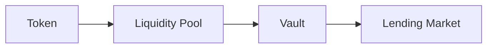
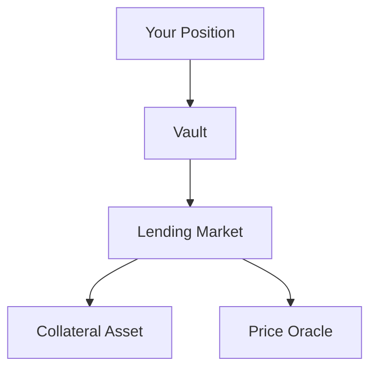

# 14 - Composability

## 🧩 Composability: DeFi Builds With DeFi

DeFi protocols do not exist alone.


A token can be deposited into a pool.

That pool can be used by a vault.

The vault can interact with a lending market.

The lending market can depend on an oracle.


One financial system can become a building block inside another.

That is **composability**.



**DeFi is powerful because protocols can build on each other. The same connections also allow failures to travel.**


***

### 🧱 Think LEGO, but With Money

Traditional financial products are usually built inside separate institutional systems.


DeFi contracts can directly interact with other contracts.






Each component can specialize.

* Tokens handle ownership and transfers.
* DEXs handle exchange.
* Vaults handle allocation.
* Lending protocols handle credit.
* Oracles provide reference prices.
* Bridges connect environments.
* Wrappers create new execution forms.

Instead of one enormous contract doing everything, systems can combine smaller financial primitives.


***

### 🌰 You Already Use Composability

A BASED NUT swap already combines several pieces.

```
wallet
  ↓
NUT token
  ↓
DEX router
  ↓
liquidity pool
  ↓
other asset
```

On Uniswap, Balancer, or Aerodrome, the interface may make this look like one action.


Underneath it, multiple contracts participate.


Add wNUT:

```
NUT
 ↓
wrapper
 ↓
wNUT
 ↓
pool
```


Add an LP position:

```
NUT + asset
     ↓
 liquidity pool
     ↓
 LP position
```

The system becomes more capable because the pieces can interact.


***

## 🌐 The Dependency Graph

Once protocols compose, your position may depend on things you cannot immediately see.


Suppose you deposit into a vault.





You see:

> Vault position.


But your actual exposure may include:

* the vault;
* the lending market;
* the collateral;
* the oracle;
* administrators controlling those systems.



**Your visible position may be one token. Your actual risk may be an entire system underneath it.**


***

## 🔥 Failure Can Travel


Suppose:

```
Protocol A
   ↓ deposits into
Protocol B
```


If Protocol B suffers a loss, Protocol A can inherit that loss even if Protocol A's own contracts work exactly as designed.


This is different from:

```
Protocol A has a bug
```


But the user can lose money in either case.


That is **dependency risk**.

The important question becomes:

> What must keep working for my position to keep working?


***

## 🔍 What to Look For

When a DeFi position becomes more complex, identify its dependencies.

<table><thead><tr><th width="138">Dependency</th><th>Ask</th></tr></thead><tbody><tr><td><strong>Token</strong></td><td>Can it pause, blacklist, rebase, depeg, or change?</td></tr><tr><td><strong>Pool</strong></td><td>Where is liquidity actually held?</td></tr><tr><td><strong>Oracle</strong></td><td>Where does the price come from?</td></tr><tr><td><strong>Vault</strong></td><td>Where can deposited assets go?</td></tr><tr><td><strong>Bridge</strong></td><td>Does the asset depend on another chain?</td></tr><tr><td><strong>Admin</strong></td><td>Who can pause, upgrade, or reconfigure?</td></tr><tr><td><strong>Protocol</strong></td><td>What happens if another protocol fails?</td></tr></tbody></table>

You do not need to map every contract immediately.

Start by identifying the major economic dependencies.


***

## 🧯 Correlated Risk

Using several protocols does not automatically mean you are diversified.

Imagine three positions:

```
Position A → USDC → Oracle X

Position B → USDC → Oracle X

Position C → USDC → Oracle X
```

They look different.

But they share important dependencies.

If USDC or Oracle X fails, all three may be affected.

Other shared dependencies can include:

* the same bridge;
* the same collateral;
* the same stablecoin;
* the same implementation contract;
* the same admin multisig;
* the same chain.

> **Count shared dependencies, not logos.**


***

## 🏗️ Complexity Is Not Automatically Bad

Composability is not a defect.

It allows protocols to specialize instead of rebuilding everything themselves.


For example:

```
wrapper → representation

DEX → exchange

oracle → pricing

vault → allocation

lending market → credit
```

This can produce cleaner systems.


But each connection introduces an assumption:

```
Component A assumes Component B behaves correctly.
```

More composition means more capability.


It can also mean more things that must continue working.


***

## 🧪 Operational Lab: Map One Position

Pick one real DeFi position.


It can be:

* a NUT swap;
* a NUT liquidity position;
* a wrapped asset;
* a vault;
* a lending position.


Draw only the major components.



### Start with what you own

Example:

```
LP position
```



### Ask what gives it value

```
LP position
   ↓
liquidity pool
```



### Add the underlying assets

```
LP position
   ↓
pool
 ↙   ↘
NUT   WETH
```



### Add important external dependencies

Examples:

* wrapper;
* oracle;
* bridge;
* reward contract;
* vault;
* admin authority.



### Ask one question

For every node:

> **What happens to my position if this fails?**



If you cannot answer yet, that is useful.

You found something you need to understand before increasing exposure.


***

## 🚫 Composability Myths

* **More protocols = more diversification** — not necessarily.
* **More layers = more yield** — not necessarily.
* **Safe underlying = safe wrapper** — false.
* **Secure wrapper = safe underlying** — false.
* **One audited contract = safe system** — false.
* **Complexity = bad** — also false.


The point is not to avoid composition.

The point is to see it to **understand the risks involved for you.**


***


## 🔗 Learn More

* Immunefi Research
* Immunefi Web3 Security Library
* CoW — DeFi Security Explained
* ScienceDirect — DeFi security research
* Hedera — DeFi safety overview

Use security and academic material to learn failure patterns, but use canonical protocol documentation when determining how a specific system actually works.


***

## 📐 Final Model

```
Composability
=
protocols using protocols
```

This creates:

```
more capability
+
more dependencies
```

The correct unit of analysis is therefore not just:

```
the token
```

It is:

```
the system the token depends on
```

**Learn what your position is connected to before assuming you know what you own.**
