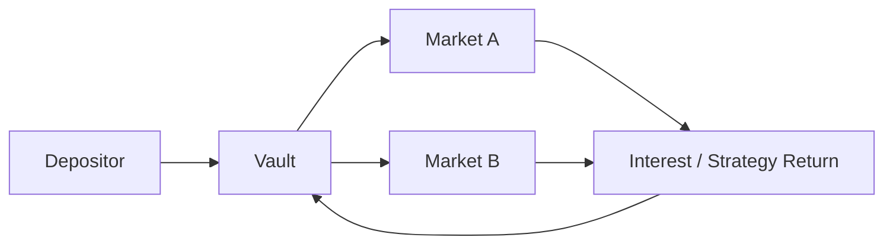

# 15 - Yield

## 💸 Yield: Where Does the Money Come From?

“Earn 40% APY” is not an explanation.

It is an output.


Before putting money into any yield-bearing position, you should be able to answer:

> **Who pays me, what am I being paid for, how is the rate calculated, and what can make it disappear?**


Yield is not created by displaying a percentage.

Something somewhere is generating or distributing value.


***

### 🌱 What Is Yield?

**Yield is the return generated by putting an asset or position to work.**


That work can be very different depending on the protocol.

<table><thead><tr><th width="220">You provide</th><th>Possible source of return</th></tr></thead><tbody><tr><td>Liquidity</td><td>Trading fees</td></tr><tr><td>Capital to borrowers</td><td>Interest on repayments</td></tr><tr><td>Staked capital</td><td>Protocol/network rewards</td></tr><tr><td>LP capital</td><td>Fees + incentives</td></tr><tr><td>Vault deposit</td><td>Underlying strategy returns</td></tr><tr><td>Incentivized participation</td><td>Token emissions</td></tr><tr><td>Real-world capital</td><td>External revenue</td></tr></tbody></table>

The word **yield** hides these differences.

Do not let it.


***

## 💰 Follow the Money

Most DeFi yield comes from a few broad sources.


#### Trading fees

Traders pay to use liquidity.

```
traders
   ↓ fees
liquidity pool
   ↓
LPs
```

More trading can generate more fees.

But your share depends on how much liquidity you provide and, in concentrated-liquidity systems, whether your liquidity is actually active.


#### Borrower interest

Borrowers pay lenders for access to capital.

```
lender
   ↓ supplies capital
market
   ↓
borrower

borrower
   ↓ interest
market
   ↓
lender
```

This is one of the cleanest examples of economically generated DeFi yield.

But the rate is usually variable.


#### Token incentives

A protocol may distribute tokens to attract capital or particular behavior.

```
protocol emissions
      ↓
participants
```

This can produce substantial displayed yield even if little external revenue exists.

That does not automatically make the incentive bad.

It means:

> **The source is subsidy rather than operating cash flow.**


#### Other sources

Yield can also come from:

* staking/security rewards;
* protocol fees;
* transfer fees;
* liquidation income;
* real-world assets;
* arbitrage strategies;
* basis trades;
* options/derivatives;
* leveraged positions;
* points or token campaigns;
* combinations of several sources.

The first job is always **decomposition**.


***

## 🧠 Native Yield vs Incentive Yield

This is one of the most useful distinctions in DeFi.


Suppose a position shows:

```
Total APY: 24%
```


That might actually mean:

```
6% native yield
+
18% token incentives
=
24% displayed yield
```


Those components behave differently.



Generated by the underlying economic activity.


Examples:

* swap fees;
* borrower interest;
* staking rewards;
* real-world asset income.


It usually changes as economic activity changes.



Created by distributing additional rewards.


Examples:

* AERO emissions;
* governance-token rewards;
* liquidity-mining campaigns;
* temporary partner incentives.


It usually depends on an emissions or incentive budget.



A position can legitimately contain both. Just do not confuse them.


***

## 📐 APR and APY Are Not the Same Thing

This distinction matters whenever a website annualizes returns.


#### APR

**Annual Percentage Rate** generally describes the annualized rate without assuming compounding.

```
10% APR
```

means approximately 10% over a year if the rate remained constant and returns were not compounded.


#### APY

**Annual Percentage Yield** includes an assumption about compounding.

If returns are periodically reinvested:

```
principal
   ↓ earns yield
principal + yield
   ↓ earns more yield
```

then APY can exceed APR.


A simplified formula is:

```
APY = (1 + APR / n)^n - 1
```

where `n` is the number of compounding periods.



### A displayed APY usually annualizes current or recent conditions.

It does **not** mean the protocol has promised that return for the next year.



***

## ⏱️ Annualization Can Make Small Numbers Look Huge

Suppose a new pool earns unusually high fees for one day.


A dashboard can annualize that short period:

```
one unusually profitable day
        ↓
× 365
        ↓
very large annualized rate
```

Nothing guarantees another 364 identical days.


Always ask:

* What time window produced this number?
* Is it trailing or current?
* Is it based on seven days? Thirty days?
* Is the rate projected?
* Does it assume constant token prices?
* Does it assume reinvestment?

An APY without methodology is barely a metric.


***

## 💧 LP Yield: Fees Need Volume

For a liquidity pool, fee yield is roughly driven by:

```
trading volume
×
fee rate
÷
liquidity competing for those fees
```


Conceptually:

```
LP fee yield
≈
fees generated
÷
capital providing liquidity
```

So two pools with identical assets may produce very different fee yield.


#### High volume + low liquidity

Can generate high fee yield.


#### Low volume + huge liquidity

Can generate very little yield per dollar supplied.


This introduces an important concept:

> **Yield has a denominator.**

More capital entering a strategy can dilute the yield available to each unit of capital.


***

## 🎯 Concentrated Liquidity Changes the Denominator

On concentrated-liquidity DEXs, your capital may only earn swap fees while it is active within the chosen price range.


So:

```
total pool TVL
```

is not always the same thing as:

```
liquidity actively competing for this trade
```


Your realized fee return depends on:

* trading volume;
* fee tier;
* selected range;
* time spent in range;
* competing liquidity;
* price movement.

This is why two LPs in the same market can earn different returns.


***

## 🌀 Aerodrome: Same Pool, Different Yield Modes

Do not assume all DEXs distribute value identically.

Aerodrome is a useful example.


Depending on the pool and position state, LP economics can involve:

* swap fees;
* AERO emissions;
* gauges;
* voting incentives.


Under Aerodrome's current design, liquidity staked in an emissions-eligible gauge receives AERO emissions, while unstaked liquidity earns swap fees; the same deposit does not simultaneously earn both.


That means:

```
“yield from Aerodrome”
```

is still not specific enough.


Ask:

```
fees?
emissions?
incentives?
which position state?
```

Never transfer Uniswap assumptions into Aerodrome, or Aerodrome assumptions into Balancer.


***

## 🏦 Lending Yield: Utilization Matters

Lending provides a particularly clean example of dynamic yield.


Imagine:

```
$1,000,000 supplied
$100,000 borrowed
```

Only part of the supplied capital is actually being borrowed.


Now imagine:

```
$1,000,000 supplied
$900,000 borrowed
```

Demand for capital is much greater.


This relationship is called **utilization**:

```
utilization
=
borrowed assets
÷
supplied assets
```

Interest-rate models commonly change rates as utilization changes.


Morpho, for example, documents supplier yield as depending on borrower APY, utilization, and applicable market fees:

```
Supply APY
=
Borrow APY
× Utilization
× (1 - Fee)
```

So:

```
higher demand for borrowing
→ potentially higher rates
```

and:

```
more supply without more borrowing
→ potentially lower supplier yield
```

Yield responds to the market.


***

## 🎁 Emissions Yield Has Its Own Denominator

Suppose a protocol distributes:

```
10,000 reward tokens per week
```

among participants.


If $100,000 competes for them, rewards per dollar can be high.


If $10,000,000 arrives:

```
same emissions
÷
100× more capital
=
much lower reward rate
```

This is why attractive incentives often attract enough capital to reduce their own APY.

Yield can be **self-diluting**.


***

## 🪙 Reward-Token Price Matters

Suppose you earn:

```
1,000 tokens
```

The number of tokens earned may be predictable.


Their value is not.

```
Reward APR
≈
reward tokens distributed
× reward-token price
÷ capital receiving rewards
```

If the token price falls 80%, the dollar value of the incentive can collapse even if token emissions remain unchanged.

This is especially important when dashboards quote reward APY in USD.


***

## 📈 Revenue, Fees, Incentives, and Yield Are Different Metrics

These terms are routinely mixed together. They should not be.

<table><thead><tr><th width="142">Metric</th><th>Meaning</th></tr></thead><tbody><tr><td><strong>TVL</strong></td><td>Value deposited/locked</td></tr><tr><td><strong>Volume</strong></td><td>Value traded or processed</td></tr><tr><td><strong>Fees</strong></td><td>Amount users pay</td></tr><tr><td><strong>Revenue</strong></td><td>Portion captured by the protocol or another specified party</td></tr><tr><td><strong>Incentives</strong></td><td>Rewards distributed to encourage activity</td></tr><tr><td><strong>Yield</strong></td><td>Return accruing to a particular position</td></tr><tr><td><strong>APY/APR</strong></td><td>Annualized representation of that return</td></tr></tbody></table>


A protocol generating $10 million in fees does not imply LPs received $10 million.

A protocol with $1 billion TVL does not imply that capital generates high yield.


DeFiLlama is useful precisely because it separates many of these categories rather than treating everything as “revenue.”


***

## 🏦 Vault Yield Adds Another Layer

A vault can earn yield by deploying deposited capital elsewhere.





Now you need to ask:

* Where is the capital actually allocated?
* Who controls allocation?
* What strategies generate the return?
* Are there performance or management fees?
* Are rewards included?
* Does the share price increase automatically?
* Must rewards be claimed separately?

Morpho Vaults, for example, can collect borrower-paid interest from underlying markets while additional incentive programs may exist separately.

The vault APY is therefore the result of **underlying positions**, not magic occurring at the vault level.


***

## 🔄 Auto-Compounding vs Claimable Rewards

Two positions advertising identical yield can behave differently.


#### Auto-compounding

Yield increases the value of the position itself.

```
100
↓
105
↓
110
```


#### Claimable rewards

Rewards accumulate separately.

```
principal
+
claimable tokens
```

You may need to:

1. claim;
2. swap;
3. reinvest;
4. pay transaction costs.

So an advertised “compounded APY” may assume actions that do not happen automatically.

Check the mechanics.


***

## ⚖️ Yield Is Not Total Return

This is probably the most important distinction on the page.


Suppose an LP earns:

```
+15% fees
```

but the position experiences:

```
-25% change in asset value / composition
```

The investor did not make 15%.


A better mental model is:

```
Total outcome
=
native yield
+ incentives
+ asset price changes
+ position rebalancing effects
- protocol fees
- transaction costs
- realized losses
```

For LPs, this includes the effects of providing liquidity instead of simply holding the assets.

For lending, it includes asset and credit/liquidation risks.

For reward farming, it includes the value of the reward token.

**Yield measures one dimension of a position.**


***

## 📉 Advertised Yield vs Realized Yield

There are at least three different numbers you may encounter.

```
Advertised yield
     ↓
Current estimate shown by interface

Realized yield
     ↓
What the position actually earned

Total return
     ↓
What happened to your wealth overall
```

Those are not interchangeable.


A useful habit is to record:

```
entry value
rewards received
fees received
withdrawal value
transaction costs
```

Then calculate what actually happened.


***

## 🚨 What Can Make Yield Collapse?

A yield rate can fall because:

* volume declines;
* utilization falls;
* more capital enters;
* emissions are reduced;
* reward-token price falls;
* incentives expire;
* your liquidity leaves its active range;
* protocol parameters change;
* borrower demand disappears;
* strategies are reallocated;
* fees increase;
* market conditions change.

The percentage is **state-dependent**.


***

## 🧪 Yield Interrogation

Before entering a yield-bearing position:



### Decompose the headline number

Write:

```
native yield
+
reward yield
+
other
=
displayed yield
```

If a component is unknown, write **unknown**.



### Find the payer

Ask:

```
traders?
borrowers?
protocol treasury?
token emissions?
external business?
other participants?
```



### Find the service

What are you actually providing?

* liquidity;
* credit;
* security;
* inventory;
* collateral;
* strategy capital.



### Find the denominator

What capital is competing for the same return?

More capital can dilute yield.



### Inspect the annualization

Determine:

* APR or APY;
* measurement window;
* compounding assumption;
* token-price assumption.



### Inspect the reward asset

If rewards are paid in another token:

```
How much token?
×
What token price?
=
What actual value?
```



### Model the exit

Ask what the position is worth if:

* yield falls;
* reward token falls;
* liquidity disappears;
* you need to exit immediately.



***

## 🔬 Operational Lab: Explain One Real Yield

Use:

**DeFiLlama → canonical protocol documentation → Dune → CoinGecko**

Choose one real Base pool, lending market, or vault.

Record the displayed APR/APY and timestamp.


Then produce this table:

| Question                        | Answer |
| ------------------------------- | ------ |
| Headline yield                  |        |
| Native yield                    |        |
| Incentive yield                 |        |
| Who pays?                       |        |
| Why do they pay?                |        |
| Reward asset                    |        |
| What changes the rate?          |        |
| How is it annualized?           |        |
| Is compounding automatic?       |        |
| What dilutes the yield?         |        |
| What could reduce total return? |        |
| How do I exit?                  |        |

Use DeFiLlama to understand broad metrics.

Use protocol documentation to understand the actual mechanism.

Use Dune to verify activity onchain where practical.

Use CoinGecko for market-price context, not as proof of contract identity.

If you cannot fill the table, you do not understand the yield yet.


***

## 🚫 Yield Myths

* **APY is a promised return** — false.
* **Yield means profit** — false.
* **High yield means scam** — not necessarily.
* **High yield means opportunity** — also not necessarily.
* **Fees and emissions are economically equivalent** — false.
* **More TVL means more yield** — often the opposite.
* **Reward tokens equal cash** — false.
* **Auto-compounding is universal** — false.
* **Passive income means passive risk** — definitely false.


***

## 🔗 Learn More

* DeFiLlama — yield, TVL, fees, revenue, and protocol metrics
* Dune — reproduce onchain activity
* Uniswap Docs — liquidity and LP fee mechanics
* Aerodrome Docs — fees, gauges, emissions, and voting economics
* Balancer Docs — pool and liquidity mechanics
* Morpho Docs — utilization, lending rates, vault yield, and incentives
* CoinGecko — reward-token and market-price context
* The Defiant — current DeFi developments; verify important claims through primary sources


***

## 📐 Final Model

```
Yield
=
source of value
÷
capital entitled to receive it
```

Then ask:

```
How durable is the source?

How large is the denominator?

What assumptions create the APY?

What risk am I taking?

What is my total return after everything else moves?
```

> **Follow the money backward before you follow the APY forward.**
