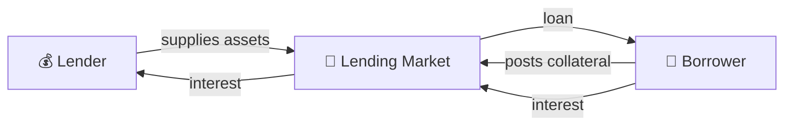
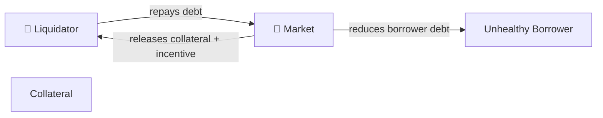

# 16 - Lending and Borrowing

## 🏦 Lending & Borrowing: Money Has a Price

DeFi lending lets one user supply assets and another borrow them under rules enforced by smart contracts.


The lender wants yield.

The borrower wants capital without selling their collateral.

The protocol connects them.






**Borrowed money is not free capital. It is debt secured by something the protocol can take.**


***

### 🧠 Why Borrow at All?

Suppose you own $10,000 of cbETH.

You need USDC but do not want to sell your cbETH.


A lending market may let you:

```
cbETH
  ↓ collateral
lending market
  ↓
USDC loan
```

You still have economic exposure to cbETH.


But now you also have:

```
USDC debt
+
interest
+
liquidation risk
```

Borrowing adds a liability without removing the original market exposure.


***

## 💰 Where Lender Yield Comes From

The connection to the previous lesson on yield is direct.

Borrowers pay interest. Part of that interest accrues to suppliers according to the protocol's design.

```
borrow demand
      ↓
borrow rate
      ↓
interest paid
      ↓
supplier yield
```

Rates usually change with market conditions.


One of the most important variables is **utilization**:

```
utilization
=
assets borrowed
÷
assets supplied
```

If almost nobody wants to borrow, lenders generally should not expect enormous organic lending yield.

If available liquidity becomes scarce, interest-rate models can increase borrowing rates to attract supply and encourage repayment.


***

## 🧱 The Core Pieces

A lending position usually contains more than “deposit and borrow.”

<table><thead><tr><th width="262">Component</th><th>Function</th></tr></thead><tbody><tr><td><strong>Loan asset</strong></td><td>Asset lenders supply and borrowers receive</td></tr><tr><td><strong>Collateral</strong></td><td>Asset securing the debt</td></tr><tr><td><strong>Oracle</strong></td><td>Determines collateral value for protocol accounting</td></tr><tr><td><strong>Interest-rate model</strong></td><td>Determines how borrowing costs evolve</td></tr><tr><td><strong>LTV / borrow limit</strong></td><td>Determines borrowing capacity</td></tr><tr><td><strong>Liquidation threshold / LLTV</strong></td><td>Determines when liquidation becomes possible</td></tr><tr><td><strong>Liquidator</strong></td><td>Repays unhealthy debt and receives collateral</td></tr><tr><td><strong>Liquidity</strong></td><td>Assets actually available to borrow or withdraw</td></tr></tbody></table>

Different protocols arrange these components differently.


***

## ⚖️ Collateral and Borrowing Power

If you deposit:

```
$10,000 collateral
```

the protocol normally does **not** let you borrow $10,000.


Suppose a market allows 70% borrowing capacity:

```
$10,000 collateral
× 70%
=
$7,000 maximum borrowing capacity
```

But maximum is not the same thing as sensible operating distance.


Borrowing $6,999 against a $7,000 boundary leaves almost no room for:

* collateral price movement;
* debt interest;
* oracle movement;
* market volatility.


**A protocol limit tells you when the machine permits something. It does not tell you where prudent risk begins.**


***

## 📐 LTV

**Loan-to-Value** measures debt relative to collateral value.

```
LTV
=
debt value
÷
collateral value
```


Example:

```
Collateral = $10,000
Debt       = $5,000

LTV = 50%
```


Now suppose the collateral falls to $7,000:

```
Debt       = $5,000
Collateral = $7,000

LTV ≈ 71.4%
```

You borrowed nothing else.

Yet the position became much riskier.


***

## ⏳ Debt Can Move Too

Collateral does not have to fall for your position to deteriorate.


Borrowed assets accrue interest.

```
initial debt
+
accrued interest
=
current debt
```


So this can happen:

```
collateral → unchanged

debt → increases

LTV → increases
```


A position can therefore move toward liquidation because:

1. collateral falls;
2. debt grows;
3. the borrowed asset rises relative to collateral;
4. several happen together.


***

## 🚧 Borrow Limit Is Not Liquidation Threshold

Protocols use different terminology, but conceptually there are often two important boundaries:

```
SAFE
│
├──── borrowing capacity
│
│     increasingly leveraged
│
├──── liquidation boundary
│
└──── LIQUIDATABLE
```

Aave expresses borrower safety through **Health Factor** and asset-specific liquidation thresholds.

Morpho markets use a defined **LLTV — Liquidation Loan-to-Value**.

Do not assume terminology from one protocol maps perfectly onto another.


***

## ❤️ Health Factor

Many interfaces compress collateral safety into a health metric.


A simplified idea is:

```
Health Factor
=
liquidation-adjusted collateral value
÷
debt
```


Generally:

```
HF > 1    → not liquidatable

HF ≈ 1    → near the boundary

HF < 1    → liquidation possible
```

Aave uses this model directly.

Morpho can also express market health this way, although its underlying market parameter is LLTV.


The dashboard number is useful.

Understand the equation underneath it.


***

## 💥 What Liquidation Actually Is

Liquidation is not the protocol confiscating collateral for fun.


It is the mechanism designed to protect lenders before insufficient collateral leaves unrecoverable debt.





The liquidator usually:

1. finds an unhealthy position;
2. repays some or all of its debt;
3. receives collateral;
4. receives an economic incentive for doing the job.

These actors are commonly automated bots.

Do not expect a polite warning call before they act.


***

## 🎯 Why Liquidators Receive a Bonus

Liquidation has costs and risks.


A liquidator may need to:

* obtain the debt asset;
* pay gas;
* compete with other liquidators;
* receive collateral;
* sell or hedge that collateral;
* absorb slippage.


So protocols generally give liquidators collateral worth somewhat more than the debt they repay.


That incentive helps make liquidation economically attractive.

The borrower's loss is part of the system protecting lenders.


***

## 🧯 Bad Debt

Liquidation is designed to happen **before** collateral becomes insufficient.

But markets can move quickly.

Suppose:

```
Debt        = $8,000
Collateral  = $7,000
```

There is now less collateral than debt.

The missing amount is **bad debt**.


Someone ultimately absorbs that loss according to the protocol's design.

This is why lending risk is not merely a borrower problem.


Lenders care deeply about:

* collateral quality;
* liquidation efficiency;
* oracle reliability;
* market liquidity;
* risk parameters.


***

## 📡 Oracles Are Critical

The protocol needs some way to answer:

> What is the collateral worth?


That often comes from an oracle.

```
market price information
        ↓
oracle
        ↓
lending protocol
        ↓
LTV / health calculation
```

If the oracle price moves, the protocol's view of your health moves.

This can differ from the price you happen to see on CoinGecko or a DEX interface.

For liquidation purposes, **the protocol's configured oracle is what matters**.


***

## 🏊 Liquidity Matters Too

A lending protocol can be solvent while available withdrawal liquidity is temporarily limited.

Suppose:

```
1,000,000 USDC supplied
900,000 USDC borrowed
```

Only part of the supplied capital remains immediately idle.

Borrowers do not normally borrow imaginary money.

They borrow assets that suppliers made available.


This is another reason utilization matters:

```
high utilization
→ less idle liquidity
→ potentially higher rates
→ potentially harder immediate withdrawals
```

Exact behavior depends on protocol design.


***

## 🧩 Not All Lending Markets Are Built the Same

This is worth understanding early.



Protocols such as Aave and Moonwell generally organize multiple supported assets inside broader lending systems.


Users may:

* supply assets;
* designate eligible assets as collateral;
* borrow other supported assets;
* manage an account-level health position.


This is convenient.

But several assets and risk parameters participate in the same broader system.



Morpho Blue markets are much more explicit.


A market is defined around parameters such as:

```
collateral asset
+
loan asset
+
oracle
+
LLTV
+
interest-rate model
```

For example:

```
cbBTC collateral
→ USDC loan
```

is its own market configuration.


Risk is easier to inspect market by market.

But you must actually inspect those parameters.



Neither model is automatically superior.

They organize risk differently.


***

## 🌰 Think Like a BASED NUT User

Do not assume that because an asset exists on Base it can or should be used as lending collateral.


Before considering **any** NUT-related lending integration, establish that the market actually exists and inspect its parameters canonically.

The useful BASED NUT lesson is broader.


You already understand:

```
token identity
+
liquidity
+
wrappers
+
oracles
+
smart contracts
+
composability
```

Lending combines all of them.

A collateral asset with poor exit liquidity can be difficult to liquidate.

A wrapped collateral asset inherits wrapper risk.

A bridged asset inherits bridge risk.

A lending market inherits all of those dependencies.


***

## 🧪 Operational Lab: Inspect a Real Base Lending Market

Use an established Base lending protocol such as **Aave, Morpho, or Moonwell**.

Do not borrow yet.



### Pick one market

Example:

```
cbBTC collateral
+
USDC borrowing
```

Use the protocol's canonical interface and documentation.



### Identify the two assets

Write down:

```
collateral:
loan asset:
```

Verify contract identities rather than relying only on symbols.



### Find the borrowing boundary

Record whichever metrics that protocol uses:

```
LTV
liquidation threshold / LLTV
health factor
```

Do not translate terminology from another protocol by assumption.



### Find the oracle

Determine how the protocol prices the collateral against the loan asset.



### Inspect rates

Record:

```
supply APR/APY
borrow APR/APY
utilization
```

Then ask why the lender rate and borrower rate differ.



### Simulate a position

Pretend:

```
Collateral = $1,000
Borrow     = $300
```

Calculate LTV.

Then reduce collateral value by:

```
10%
25%
50%
```

Recalculate.



### Add interest

Increase the debt without changing collateral.

Observe that leverage rises even without a price crash.



### Find the liquidation mechanics

Determine:

* when liquidation becomes legal;
* how much debt can be repaid;
* what collateral the liquidator receives;
* what incentive exists.



### Find the exit

Before borrowing anything, know how to:

```
repay debt
→ remove collateral
→ withdraw supplied assets
```



Only after you can explain the hypothetical position should real borrowing even become an option.


***

## 🚫 Lending Myths

* **Collateral is a payment** — false.
* **Borrowed assets are yield** — false.
* **Overcollateralized means safe** — false.
* **Stablecoin debt means stable risk** — false.
* **Maximum LTV is a target** — terrible assumption.
* **Only falling collateral causes liquidation** — false; interest can increase debt.
* **Lenders have no risk because loans are collateralized** — false.
* **A high supply APY is free money** — see the previous lesson.
* **The protocol will save you before liquidation** — do not rely on it.


***

## 🔗 Learn More

Use the documentation for the protocol you are actually examining:

* Aave — borrowing, health factor, liquidations
* Morpho — markets, LLTV, interest rates, liquidations
* Moonwell — lending and borrowing on Base
* DeFiLlama — market/protocol context
* BaseScan — contract and transaction verification
* Dune — lending activity and historical analysis

For consequential parameters, the protocol's current canonical documentation and onchain configuration outrank aggregator summaries.


***

## 📐 Final Model

```
Borrowing
=
collateral exposure
+
debt
+
interest
+
oracle dependence
+
liquidation risk
```


For the lender:

```
Lending
=
interest income
+
borrower system risk
+
collateral risk
+
liquidation risk
+
liquidity risk
```


**A loan turns an asset position into a balance sheet. Learn both sides before adding leverage.**

