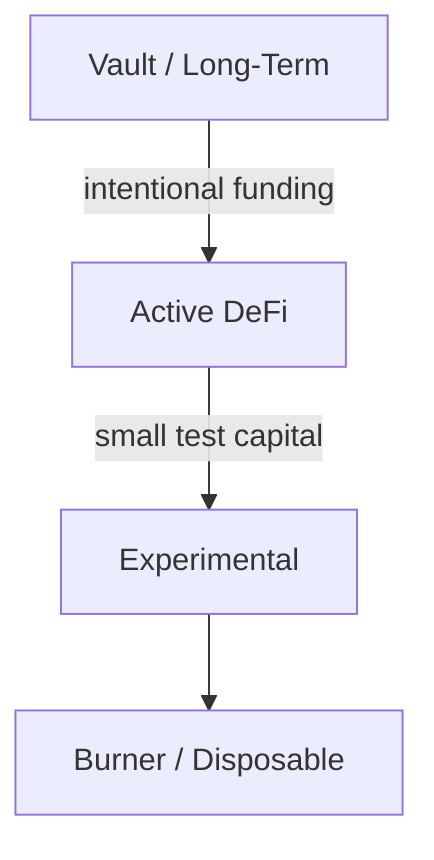

# 18 - Personal Wallet Architecture

One wallet can technically do almost everything.

That does not mean it should.

As your holdings, protocols, and experiments grow, separate accounts by role.



**Wallet architecture is failure containment.**



***

## 🌳 A simple model



Do not mechanically copy this exact structure.

The principle is to prevent one compromised authorization from reaching everything you own.


***

## 🔒 Vault wallet

**Purpose:**

* Long-term storage
* Minimal contract interaction
* Minimal approvals
* Deliberate transfers

A hardware wallet can be appropriate for this role depending on value and operational needs.

The vault should not be the wallet you connect to every new mint, DEX fork, or experimental interface.


***

## 💧 Active DeFi wallet

**Purpose:**

* Uniswap
* Balancer
* Aerodrome
* BASED NUT interactions
* Liquidity positions
* Known DeFi contracts

Keep only the capital appropriate for active use.

Review allowances periodically.


***

## 🧪 Experimental wallet

**Purpose:**

* Unfamiliar contracts
* New interfaces
* Testing
* Low-value experiments

A test wallet is not permission to sign blindly.

It is a damage-containment layer **after** ordinary verification.


***

## 🔥 Burner wallet

A burner can be useful for disposable or low-trust interactions where losing the wallet's contents would be acceptable.

Do not fund it with assets you are unwilling to lose.

Do not reuse it until it quietly becomes your main wallet.


***

## 🔄 Funding boundaries

Avoid casual cross-contamination.

If you move assets from a vault to an active DeFi wallet:



## Verify destination

Use a saved, independently verified address.



## Send a test if the route is new

Especially when meaningful value is involved.



## Fund only the intended operation

Do not move the entire vault “for convenience.”



## Return excess capital intentionally

After the operation, decide what needs to remain exposed.



***

## 🧠 Privacy vs security

Multiple wallets can reduce blast radius.

They do not automatically provide privacy.

Onchain transfers can create obvious links between accounts.

Do not claim anonymity simply because you created another address.


***

## 👥 High-value operations

As value grows, consider architectures beyond one human and one private key, such as multisig or more sophisticated smart-account controls.

But complexity has a cost.

A poorly operated multisig can be less safe than a well-operated simpler wallet.

SEAL's guidance emphasizes that even strong custody hardware and multisig controls fail if signers approve attacker-controlled calldata blindly.


***

## 🌰 BASED NUT workflow example

```
vault
  │
  │ deliberate NUT/WETH funding
  ▼
active DeFi wallet
  │
  ├── Uniswap
  ├── Balancer
  ├── Aerodrome
  └── known BASED NUT contracts

experimental wallet
  └── new/unknown integrations
```

The point is not brand-specific segregation.

The point is exposure-specific segregation.


***

## 🚨 If something goes wrong

First identify the failure class.



If the wallet key is still under your exclusive control but you granted an unwanted token allowance, revoke or reduce the allowance through a trusted method and verify the onchain change.



If the private key or recovery material may be compromised, removing one approval is insufficient. Treat the account itself as exposed and move remaining assets using a clean environment and new wallet architecture where feasible.



If Coinbase credentials or sessions appear compromised, use Coinbase's current account-security procedures, secure the associated email account, revoke unknown sessions/devices, and contact official support through canonical channels.



Preserve transaction hashes, addresses, and suspicious domains. They may matter for investigation and reporting.


***

## 🚫 Architecture mistakes

* Using the vault for experiments.
* Storing recovery material for all wallets in one insecure location.
* Assuming hardware prevents malicious authorization.
* Funding test wallets with large balances.
* Forgetting old allowances.
* Creating so many wallets that recovery becomes chaotic.

Risk reduction must remain operable.


***

## 🧪 Operational lab: implement four separate trust zones

Do not merely understand wallet segmentation. Build it.

<table><thead><tr><th width="140">Zone</th><th>Concrete implementation</th><th>Rule</th></tr></thead><tbody><tr><td><strong>Vault</strong></td><td>Hardware-backed signer; optionally a Safe for appropriate multi-signer/high-value operations</td><td>No experimental dapps; minimal approvals</td></tr><tr><td><strong>Active DeFi</strong></td><td>Rabby account connected to known protocols</td><td>Only working capital</td></tr><tr><td><strong>Experimental</strong></td><td>Separate Rabby account/seed or deliberately isolated signer</td><td>New contracts and tests only</td></tr><tr><td><strong>Burner</strong></td><td>Disposable low-value account</td><td>Nothing you care about retaining</td></tr></tbody></table>



## Separate the accounts now

Create labels in Rabby such as `ACTIVE-DEFI`, `EXPERIMENTAL`, and `BURNER`. The vault should be separately hardware-backed rather than another hot account in the same browser profile.



## Define transfer ceilings

Write a policy for how much capital may sit in each hot zone. The exact number is personal; the principle is that compromise of one interaction wallet must not imply compromise of total holdings.



## Use Safe only when its control model solves a real problem

For shared, organizational, or high-value operations, study Safe multisig/account architecture. Multisig adds coordination and signer separation; it also adds configuration, signer, module, transaction, and operational complexity.



## Test the vault path with tiny value

Practice vault → active transfer and active → vault return with minimal value. Verify each transfer independently before relying on the architecture under pressure.



## Inventory approvals on hot wallets

Use Revoke.cash on Active and Experimental wallets. Do not routinely connect the vault wallet to approval-checking or random dapps merely for convenience.



***

## 🔗 Learn more

* [SEAL — Wallet Security](https://frameworks.securityalliance.org/wallet-security/overview/)
* [Safe Knowledge Base](https://help.safe.global/)
* [Ledger Academy](https://www.ledger.com/academy)
* [Trezor Learn](https://trezor.io/learn)
* [Rabby](https://rabby.io/)
* [Pocket Universe](https://www.pocketuniverse.app/)
* [Revoke.cash](https://revoke.cash/)

***

## 📐 Final model

```
one mistake
should not
equal
total loss
```

Design your wallet structure accordingly.
