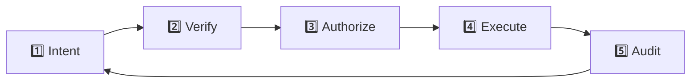

# 20 - Operational Competence

You now know how wallets, tokens, approvals, swaps, liquidity, wrappers, contracts, lending, yield, and composability work.

That does **not** mean you know every protocol.


You should not need to.

> **The goal is transferable judgment. Interfaces change. Mechanisms repeat.**

A new protocol may have different branding, buttons, and terminology.

The questions underneath are usually familiar.


***

## 🌳 The Operating Rules

These are the habits worth carrying everywhere.


### 1. Verify identity before economics

Before asking whether something is profitable, establish that you are looking at the correct:

* network;
* website;
* token;
* contract;
* pool;
* protocol.

**Never let a good APY convince you to skip authentication.**



### 2. Small transactions are debugging

When possible:

```
unknown workflow
→ tiny amount
→ verify result
→ increase only after understanding
```

You do not receive extra intelligence for discovering a mistake with your entire wallet.



### 3. Connection ≠ signature ≠ approval ≠ transaction

Know which one you are authorizing.

A wallet connection does not automatically move tokens.

An approval can create future spending authority.

A signature may authorize behavior without immediately creating an onchain transaction.

A transaction can change blockchain state.

Treat them differently.



### 4. Never operate at the boundary

Do not deliberately live at:

* maximum borrowing capacity;
* minimum gas balance;
* maximum slippage;
* liquidation threshold;
* maximum wallet exposure;
* maximum approval;
* minimum pool liquidity.

**Margin for error is part of the position.**



### 5. Know the exit before the entry

Before depositing, wrapping, bridging, borrowing, LPing, or staking:

> How do I get back out?

If the exit is unclear, you are not finished researching.


***

## 🔎 The Pre-Transaction Check

Before a meaningful transaction, answer five groups of questions.

### Identity

* Which network?
* Which asset contract?
* Which protocol?
* Which contract will my wallet call?
* Did I obtain the address or domain from a canonical source?


### Authority

* Am I signing a message or sending a transaction?
* Is there an approval?
* Which spender receives authority?
* How much?
* Does that authority remain afterward?


### Economics

* What leaves my wallet?
* What should arrive?
* What fees apply?
* What is the price impact?
* What is the minimum output?
* If there is yield, where does it come from?


### Failure

* What can fail?
* What dependencies exist?
* Can this position be liquidated or rebalanced?
* What happens if the frontend disappears?
* How much capital is exposed if I am wrong?


### Exit

* How do I reverse or unwind this?
* Is the exit liquid?
* What debt must be repaid first?
* What approvals remain afterward?


If one important answer is:

> “I have no idea.”

that is not permission to guess.

That is the next thing to investigate.


***

## 🧠 The Five-Stage Operating Loop







### Intent

Describe what should happen in plain language.

> “I am exchanging 20 USDC for NUT on Base.”

If you cannot explain the intended state change simply, do not submit it yet.



### Verify

Confirm:

```
network
+ domain
+ token
+ contract
+ amount
```



### Authorize

Read the Rabby or other wallet request.

Check what authority is actually being granted.

Use simulation tools such as Rabby or Pocket Universe as **additional evidence**, not permission to stop thinking.



### Execute

Use a deliberately appropriate amount.

For unfamiliar workflows, start small.



### Audit

Open BaseScan.

Confirm:

* status;
* called contract;
* token movements;
* final balances;
* approvals where relevant.

Then remove permissions you no longer need.



***

## 🧰 Your DeFi Toolbox

You should know what tool to reach for.

<table><thead><tr><th width="241">Need</th><th>Useful tool</th></tr></thead><tbody><tr><td><strong>Wallet / signing</strong></td><td>Rabby</td></tr><tr><td><strong>Transaction simulation</strong></td><td>Rabby, Pocket Universe</td></tr><tr><td><strong>Blockchain truth</strong></td><td>BaseScan</td></tr><tr><td><strong>Revoke permissions</strong></td><td>Revoke.cash</td></tr><tr><td><strong>Buy / cash in / cash out</strong></td><td>Coinbase</td></tr><tr><td><strong>Swap / LP</strong></td><td>Uniswap, Balancer, Aerodrome</td></tr><tr><td><strong>Protocol discovery</strong></td><td>DeFiLlama</td></tr><tr><td><strong>Token market context</strong></td><td>CoinGecko</td></tr><tr><td><strong>Onchain analytics</strong></td><td>Dune</td></tr><tr><td><strong>Crypto reference</strong></td><td>IQ.wiki</td></tr><tr><td><strong>L2 research</strong></td><td>L2BEAT</td></tr><tr><td><strong>Security practice</strong></td><td>SEAL, Immunefi, Damn Vulnerable DeFi</td></tr></tbody></table>

Do not confuse tool roles.

```
CoinGecko → discovery / market information

BaseScan → onchain inspection

canonical docs → protocol mechanics and deployments

Dune → indexed analysis

wallet simulation → transaction preview
```

No single tool is your source of truth for everything.


***

## 🚨 When You Should Not Transact

Stop if:

* somebody is rushing you;
* a countdown is creating urgency;
* “support” contacted you first;
* you reached the site through a suspicious ad or DM;
* the wallet simulation does not match your intent;
* the contract cannot be independently verified;
* you do not understand the approval;
* the requested authority is much larger than expected;
* the position is too complicated to explain;
* liquidity is too thin for the trade;
* your wallet has insufficient gas to safely exit later;
* you are tired, distracted, intoxicated, or angry.

There will be another block.

There will be another trade.

There will be another APY.


**FOMO is not a transaction parameter.**

Opportunity cost is generally cheaper than catastrophic authorization.



***

## 🔐 Reduce the Blast Radius

Do not carry your entire crypto life through every website.

A practical architecture:

```
Vault wallet
    ↓ long-term assets

Active DeFi wallet
    ↓ normal known protocols

Experimental wallet
    ↓ new contracts / learning

Burner
    ↓ disposable interactions
```

Your experimental wallet should not contain everything you own.

Your vault should not be connecting to random farms.

Your active wallet should not accumulate years of forgotten permissions.


Compartmentalization turns:

```
one mistake = everything
```

into:

```
one mistake = bounded damage
```

***

## 🧹 Maintenance Is Part of DeFi

Security is not finished when the transaction confirms.

### Review approvals

Use your wallet and Revoke.cash.

Remove permissions you no longer need.


### Review positions

Ask:

* Is the thesis still valid?
* Is liquidity still healthy?
* Has the protocol changed?
* Has the yield source changed?
* Have incentives expired?
* Has an admin or implementation changed?


### Review wallets

Move idle value out of highly exposed experimental wallets.


### Review bookmarks

Use canonical bookmarks for important services instead of repeatedly searching for them.


### Review gas

Keep enough native ETH on Base to make necessary transactions.

A perfectly healthy position you cannot operate is still an operational problem.


***

## 🔬 Learn New Protocols by Mechanism

When something new appears, ignore the marketing for a moment.

Classify it. Is it a:

```
token?
wrapper?
pool?
router?
vault?
lending market?
bridge?
oracle-dependent position?
derivative?
signature-based order?
smart account?
```

Then apply the questions you already know.


### New vault

Ask:

```
What do I deposit?
What do I receive?
Where can the vault allocate?
Who controls allocation?
Where does yield originate?
How do I redeem?
```


### New DEX

Ask:

```
What pool architecture?
What router?
What fees?
What approval system?
What liquidity?
What happens to LP positions?
```


### New lending market

Ask:

```
What collateral?
What debt asset?
What oracle?
What LTV?
What liquidation boundary?
What interest-rate model?
```

**Start from mechanism, not branding.**


***

## 🌰 BASED NUT as the Laboratory

If you can safely:

```
fund a wallet
      ↓
operate on Base
      ↓
verify contracts
      ↓
send tokens
      ↓
approve intentionally
      ↓
swap NUT
      ↓
compare DEX execution
      ↓
provide and remove liquidity
      ↓
wrap and unwrap
      ↓
inspect permissions
      ↓
audit transactions
      ↓
exit cleanly
```

then you have learned substantially more than how to use BASED NUT.

You have learned the basic operating grammar of EVM DeFi.


***

## 🧪 Final Practical Test

You do not need a giant certification exam.


Prove that you can do these seven things with an experimental wallet and insignificant value:



### Authenticate

Authenticate a token and protocol from canonical sources.



### Send

Send a small Base transaction and explain it on BaseScan.



### Approve and revoke

Approve and revoke an ERC-20 permission intentionally.



### Swap

Swap while explaining route, slippage, price impact, and final transfers.



### Enter and exit

Enter and exit a small liquidity position.



### Inspect

Inspect the contracts and dependencies behind one action.



### Research

Research an unfamiliar protocol without relying on its own marketing page.



If you can do those without blindly following instructions, the series worked.


***

## 🌳 The Rules Worth Remembering

```
Verify before trusting.

Read before signing.

Test before scaling.

Separate wallets by risk.

Keep gas.

Do not live at liquidation boundaries.

Understand the source of yield.

Use canonical addresses.

Treat simulations as evidence, not guarantees.

Revoke stale authority.

Know your dependencies.

Know the exit.
```


And one final rule:

> **Do not trust the button. Understand what the button does.**

Every forest starts with one nut.

Keep yours.
