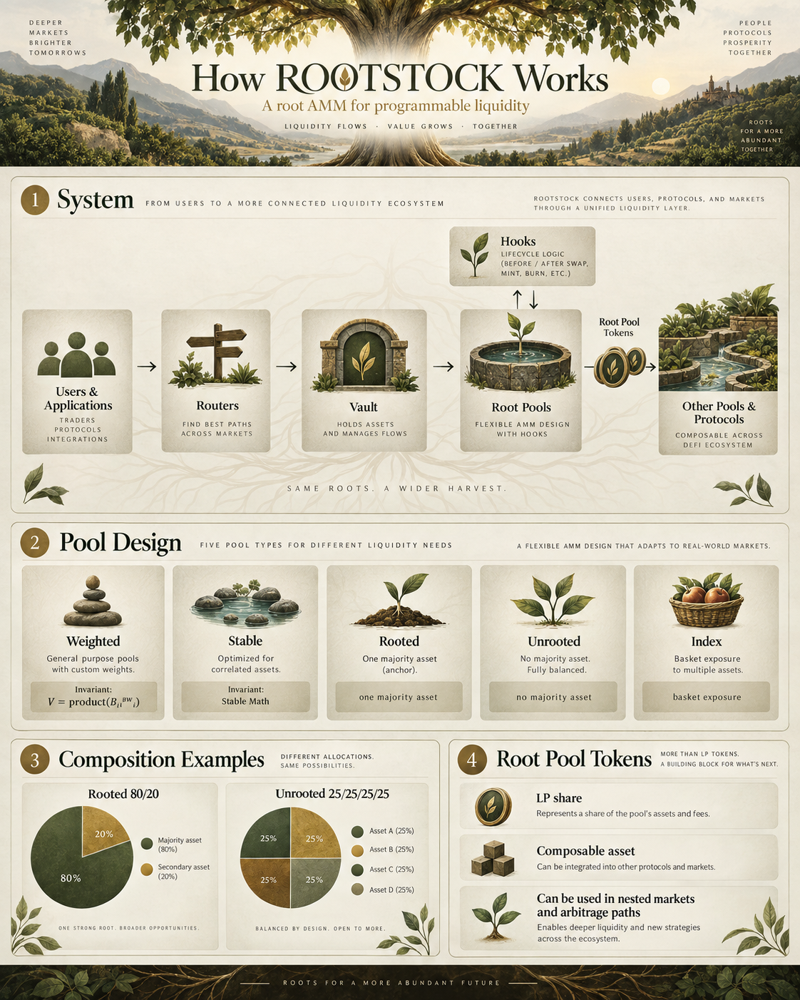
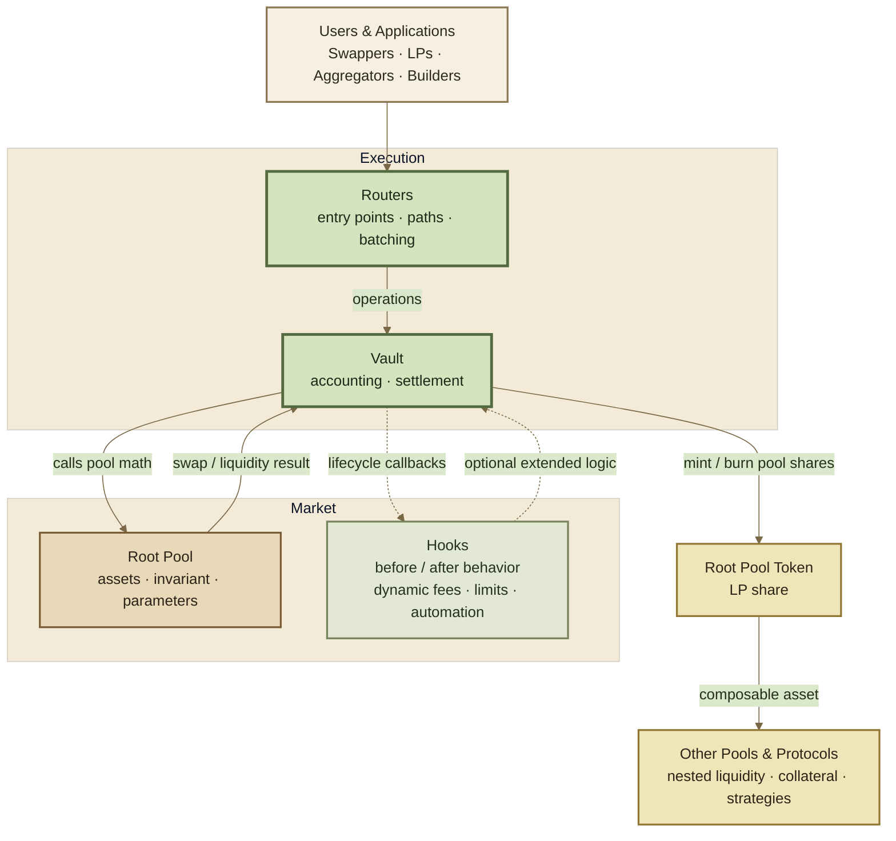
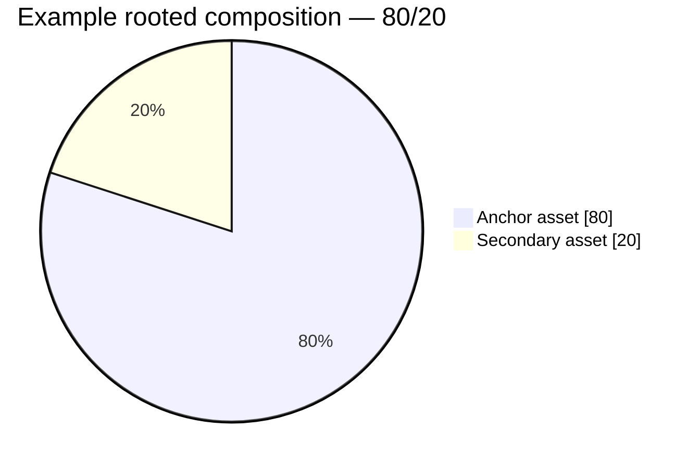
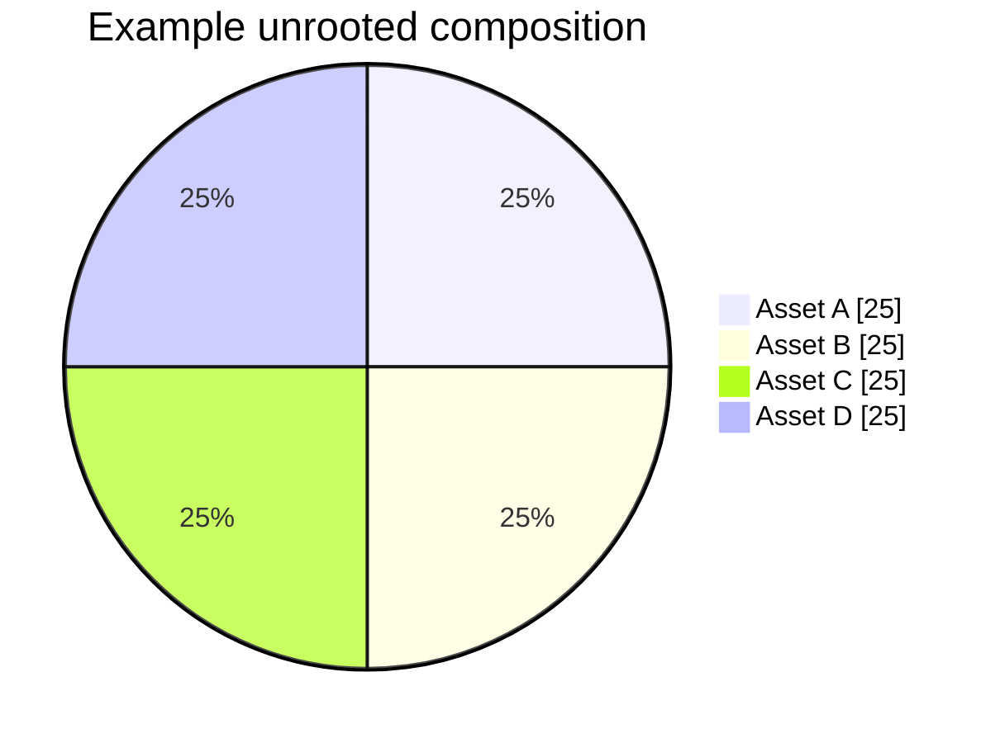

# 🌳 What is Rootstock?

## What is ROOTSTOCK?

> ROOTSTOCK is a **root AMM for programmable liquidity** on Base.

<figure><figcaption></figcaption></figure>

At the execution level, it is a regular automated market maker: liquidity providers deposit assets, traders swap against pooled liquidity, pool invariants determine prices, fees accrue to liquidity, and arbitrage connects pool prices to the wider market.

ROOTSTOCK makes that model modular. Pool mathematics, asset composition, routing, settlement, hooks, and pool-share tokens are separated into layers that can be combined without rebuilding the entire exchange.

***


### How the system fits together

<figure><figcaption></figcaption></figure>

**Routers** are the normal entry point.&#x20;

The **Vault** handles shared accounting and settlement.&#x20;

**Root Pools** define market mathematics.&#x20;

**Hooks** extend specific operations.&#x20;

**Root Pool Tokens** represent liquidity-provider shares and can move into other markets or protocols.


A ROOTSTOCK deployment can also specialize the Vault layer when a different accounting or settlement environment is required.







**The short model:** the invariant defines the market; the pool defines its assets; hooks extend its behavior; Routers and Vaults execute it; Root Pool Tokens make the liquidity composable.


***


### Pool design is multidimensional

A pool is not defined by one label. Several independent choices combine to describe how a market works.

<table data-full-width="true"><thead><tr><th width="144.66666666666666">Design axis</th><th>Question</th><th>Examples</th></tr></thead><tbody><tr><td><strong>Invariant</strong></td><td>What mathematical relationship does the pool preserve?</td><td>Weighted · Stable · Custom</td></tr><tr><td><strong>Composition</strong></td><td>How are the assets distributed?</td><td>50/50 · 80/20 · Rooted · Unrooted</td></tr><tr><td><strong>Portfolio</strong></td><td>What economic exposure does the pool represent?</td><td>Pair · Multi-asset · Index</td></tr><tr><td><strong>Behavior</strong></td><td>What can change around pool operations?</td><td>Static · Dynamic · Hook-extended</td></tr><tr><td><strong>Composability</strong></td><td>Can the liquidity position become an asset elsewhere?</td><td>Root Pool Tokens · Nested pools · External protocols</td></tr></tbody></table>

These dimensions overlap. An index pool, for example, may also be weighted, unrooted, composable, and hook-extended.

***


#### Different pools, different markets

Each Root Pool has its own rules for how assets are priced and exchanged. That underlying rule is called an **invariant**.

You do not need to understand the mathematics to use ROOTSTOCK. The important part is that different invariants are suited to different kinds of markets.

ROOTSTOCK provides the common infrastructure around these markets, while each pool defines how its own liquidity behaves.

#### 1. Weighted Pools

Weighted Pools use a **constant weighted product invariant** and allow assets to carry different normalized weights.

A 50/50 pool is the familiar two-asset form. An 80/20 pool uses the same invariant family but gives one asset four times the normalized weight of the other.

Weighting also gives us a useful way to describe **rooted** and **unrooted** compositions.



A **rooted pool** is a weighted pool in which one asset has a majority weight, generally **51%–99%**.

The root describes the pool's composition: one asset anchors most of the pool while the remaining weight is distributed among other assets.





An **unrooted pool** has no majority asset. No single token represents more than half of the pool's normalized weight.

Examples include **50/50**, **25/25/25/25**, **20/20/20/20/20**, and other distributed weightings.






**Root Pool** and **rooted pool** describe different things.

A **Root Pool** is a market created through ROOTSTOCK. **Rooted** is only one possible weighting pattern inside a Weighted Pool. A Root Pool can be rooted or unrooted.


#### 2. Stable Pools

Stable Pools use a **Stable Math invariant** for assets expected to remain closely related in price. The invariant behaves differently from weighted math so liquidity can be concentrated more efficiently around the expected trading range.

#### 3. Custom invariants

ROOTSTOCK can support pools with their own invariant and pricing logic. The Vault does not need every market to use the same equation; the pool supplies the market-specific mathematics while the shared execution layer handles the surrounding accounting and settlement.

***


### First-class pool patterns

ROOTSTOCK treats multiple market structures as first-class building blocks. They are not mutually exclusive.

<table data-full-width="true"><thead><tr><th width="143.66666666666666">Pattern</th><th>Role</th><th>Typical use</th></tr></thead><tbody><tr><td><strong>Weighted</strong></td><td>Custom asset weights under a weighted-product invariant.</td><td>General-purpose markets and portfolio exposure.</td></tr><tr><td><strong>Stable</strong></td><td>Stable invariant for closely related assets.</td><td>Stablecoins, wrappers, and correlated assets.</td></tr><tr><td><strong>Rooted</strong></td><td>A weighted composition with one majority asset.</td><td>Markets intentionally organized around a primary asset.</td></tr><tr><td><strong>Unrooted</strong></td><td>A composition with no majority asset.</td><td>Balanced pairs and diversified multi-asset pools.</td></tr><tr><td><strong>Index</strong></td><td>A multi-asset basket represented by one pool share.</td><td>Portfolio and basket exposure.</td></tr><tr><td><strong>Composable</strong></td><td>The Root Pool Token becomes an asset in another market or protocol.</td><td>Nested liquidity and interconnected markets.</td></tr><tr><td><strong>Hook-extended</strong></td><td>Pool operations gain additional programmable behavior.</td><td>Dynamic fees, limits, automation, and custom execution rules.</td></tr><tr><td><strong>Custom</strong></td><td>New invariant or specialized pool logic.</td><td>Markets that do not fit the standard pool families.</td></tr></tbody></table>

A single pool can occupy several of these categories at once.

> **Weighted + unrooted + index + composable + hook-extended** is one valid market description, not five separate protocols.

***


### Root Pool Tokens

Liquidity providers receive **Root Pool Tokens (RPTs)** representing their proportional share of a pool.



An RPT represents ownership of pooled liquidity. When liquidity is added or removed, the pool-share supply changes with the position.



An RPT can itself become an asset in another pool, application, or protocol.

```
assets
  ↓
Root Pool
  ↓
Root Pool Token
  ↓
another pool / protocol
```

This allows liquidity positions to become building blocks for additional markets.



A Root Pool Token can also develop a market price of its own.

When that price diverges from the value implied by the underlying pool, the RPT can become part of an arbitrage path between the pool share, its underlying assets, and external markets.



***


### What ROOTSTOCK adds

The basic AMM transaction is familiar. ROOTSTOCK's contribution is the separation of the system around it.

<table data-full-width="true"><thead><tr><th width="218.5">Capability</th><th>What it provides</th></tr></thead><tbody><tr><td><strong>Shared execution</strong></td><td>Routers and Vaults provide common paths for swaps and liquidity operations.</td></tr><tr><td><strong>Modular market math</strong></td><td>Different invariants and pool designs can share the same surrounding infrastructure.</td></tr><tr><td><strong>Programmable behavior</strong></td><td>Hooks extend pool operations without requiring a new exchange stack.</td></tr><tr><td><strong>Composable liquidity</strong></td><td>Root Pool Tokens can connect one liquidity position to additional markets and protocols.</td></tr><tr><td><strong>Extensible settlement</strong></td><td>Custom Vault deployments can specialize the accounting and settlement layer when needed.</td></tr></tbody></table>

The result is a regular AMM at the center and a modular liquidity system around it.

***


### Who uses ROOTSTOCK?



**Swappers** exchange assets against Root Pool liquidity.

**Arbitrageurs** trade price differences between pools, Root Pool Tokens, and external venues.

**Aggregators and routing systems** discover and compose execution paths across available liquidity.



**Liquidity providers** choose the market structure that fits the exposure they want: Weighted, Stable, rooted, unrooted, index, composable, or another supported design.

In return for supplying liquidity, LPs receive Root Pool Tokens representing their pool share.



**Builders** can develop custom pools, invariants, hooks, Routers, Vault deployments, and integrations.

**Protocols** can use Root Pools and Root Pool Tokens as liquidity infrastructure inside larger systems.



***


### Continue

<table data-full-width="true"><thead><tr><th width="216.5">Page</th><th>What it explains</th></tr></thead><tbody><tr><td><strong>AMM Basics</strong></td><td>How pool balances, invariants, swaps, fees, and arbitrage form an AMM.</td></tr><tr><td><strong>Protocol Components</strong></td><td>The roles of Pools, Routers, Vaults, Hooks, and Root Pool Tokens.</td></tr><tr><td><strong>Architecture</strong></td><td>How the components interact during swaps and liquidity operations.</td></tr></tbody></table>

***

