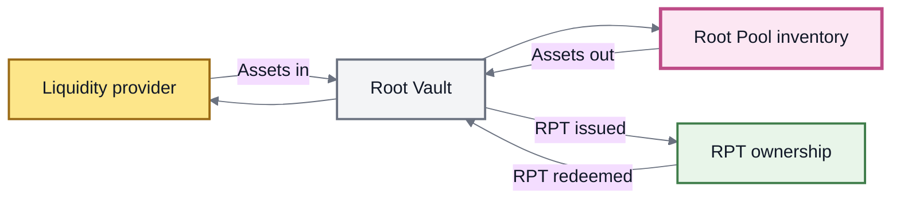
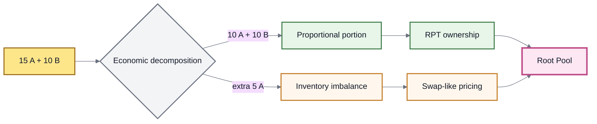

# 🔀 Adding & Removing Liquidity

## Adding & Removing Liquidity

Adding or removing liquidity changes two connected parts of a Root Pool:

* the **assets held by the pool**; and
* the **Root Pool Token (RPT) ownership** representing that liquidity.

The most important distinction is whether the operation **preserves the pool's current proportions** or asks the pool to absorb a change in composition.


**The liquidity-operation mental model:** proportional liquidity scales the pool. Non-proportional liquidity changes both the pool's size **and** its composition.

That second effect introduces swap-like economics.


### Liquidity changes inventory and ownership together

A normal add-liquidity operation moves assets into a Root Pool and issues the corresponding RPT ownership.

A removal does the reverse.





These are not independent state changes. Pool inventory and RPT ownership must remain coherent before and after settlement.

See Root Pool Tokens for the ownership model.

### Scaling vs changing composition



The assets entering or leaving follow the pool's current proportions.

For example, if a pool holds:

```
60 A
40 B
```

a proportional addition could be:

```
+6 A
+4 B
```

leaving:

```
66 A
44 B
```

The pool becomes larger, but its relative inventory is unchanged.

A proportional removal works in the opposite direction: RPT is redeemed for the corresponding slice of every pool asset.

**Economic effect:** changes pool size without rebalancing the pool.



The assets entering or leaving do **not** follow the pool's current proportions.

If the same `60 A / 40 B` pool receives:

```
+10 A
+1 B
```

the pool becomes larger **and** more concentrated in A.

That inventory shift must be priced.

**Economic effect:** combines a liquidity change with an implicit inventory transformation.



A proportional removal therefore has **zero AMM price impact from changing the pool ratio** and, in the inherited v3 model, avoids the swap fee charged on non-proportional exits.

### Why non-proportional liquidity behaves like a swap

An unbalanced liquidity operation can be understood as two economic components:

1. a proportional liquidity change; and
2. an excess or deficit that changes the pool's relative inventory.

Suppose a pool can proportionally absorb:

```
10 A + 10 B
```

but an LP supplies:

```
15 A + 10 B
```

Conceptually:



The extra `5 A` changes the same relative inventory that a trade would change.

The protocol therefore cannot treat the entire deposit as economically neutral liquidity.

#### The v3 fair-settlement rule

Balancer v3 generalizes non-proportional liquidity through its **liquidity invariant approximation**.

The purpose is not merely convenience. It enforces economic consistency between two paths that can produce the same inventory transformation:

```
unbalanced liquidity operation

        versus

proportional liquidity operation + swap
```


For fair settlement, the inherited v3 model is designed so that:

* an indirect swap through liquidity operations does not receive a cheaper swap fee than the equivalent direct path;
* the correct amount of pool ownership is minted or burned; and
* economically equivalent paths produce consistent net token outcomes.

The approximation is therefore part of the protocol's accounting and safety model, not just a UX feature.


This generalization is also what lets a custom AMM inherit standard proportional, unbalanced, and single-token liquidity behavior once it provides the invariant and balance-computation functions required by the Vault.

The detailed numerical method belongs in Rounding & Invariant Approximation.

### Swap fees apply to the imbalance

The inherited v3 architecture charges swap fees on the **non-proportional component** of a liquidity operation.

The proportional component is liquidity provision. The imbalance is the part that acts economically like a trade.

This prevents a user from expressing a trade as an add or removal merely to bypass the pool's normal swap economics.

> **Same inventory transformation → economically consistent treatment.**

The exact calculation depends on the pool's invariant, fee configuration, rounding rules, and any applicable Hooks.

See Fees & LP Returns.

### Add-liquidity modes

The inherited v3 Vault defines five add-liquidity kinds.

| Mode                       | User fixes                                        | Protocol calculates                                        | Economic shape                                   |
| -------------------------- | ------------------------------------------------- | ---------------------------------------------------------- | ------------------------------------------------ |
| **Proportional**           | Exact RPT to receive                              | Proportional token amounts required                        | Scales the pool                                  |
| **Unbalanced**             | Exact amounts of one or more pool tokens supplied | RPT received                                               | Liquidity + implicit rebalance                   |
| **Single-token exact out** | Exact RPT to receive                              | Amount of one pool token required, within the user's limit | One-sided, non-proportional                      |
| **Donation**               | Assets contributed                                | No RPT is issued                                           | Increases pool assets without creating ownership |
| **Custom**                 | Defined by the pool                               | Defined by the pool                                        | Pool-specific                                    |

#### Proportional add

A proportional add preserves the pool's current relative balances.

The user chooses the amount of RPT they want to receive, and the required pool-token amounts are calculated proportionally.

This is the cleanest share-issuing liquidity operation because it does not create an implicit rebalance.

#### Unbalanced add

The user supplies exact amounts of one or more pool tokens.

The protocol calculates how much RPT that contribution should receive after accounting for the induced imbalance.

This is useful when a user does not want to leave unnecessary token dust in a wallet, but the convenience comes with non-proportional economics.

#### Single-token exact out

The user chooses an exact RPT amount to receive and supplies only one pool asset.

The required token input is calculated subject to the user's maximum.

Because the entry is one-sided, the operation necessarily changes relative inventory.

#### Donation is not ordinary liquidity provision

A donation sends assets into the pool **without issuing RPT**.

```
pool assets ↑
RPT supply  unchanged
```

Existing RPT therefore represents more pool assets after a donation.


Donation is a specialized mode, not a normal way to become an LP.

In the inherited v3 design it must be explicitly enabled at pool registration and is intended for narrow use cases such as LVR reduction. Donation also makes the pool-token rate trivially manipulable, which prevents safe nesting and makes that rate unsuitable for external reliance.

Do not assume a ROOTSTOCK pool supports donation merely because the inherited architecture can express it.


#### Custom add

A custom pool can define an additional add-liquidity operation when the built-in modes are insufficient.

Its meaning, exact inputs, outputs, and risks are defined by that pool.


**Initialization is separate.** The first liquidity operation that initializes a new pool is not another `AddLiquidityKind`. It establishes the initial funded state and initial RPT ownership supply. See Pool Lifecycle.


### Remove-liquidity modes

Removal begins from the opposite side of the ownership relationship: the user already holds RPT and wants to convert some of that ownership back into assets.

The inherited v3 Vault defines four removal kinds.

| Mode                       | User fixes                                    | Protocol calculates                     | Economic shape        |
| -------------------------- | --------------------------------------------- | --------------------------------------- | --------------------- |
| **Proportional**           | Exact RPT to redeem                           | Amount of every pool token returned     | Scales the pool down  |
| **Single-token exact in**  | Exact RPT to redeem                           | Amount of one selected token returned   | Non-proportional exit |
| **Single-token exact out** | Exact amount of one selected token to receive | RPT required, within the user's maximum | Non-proportional exit |
| **Custom**                 | Defined by the pool                           | Defined by the pool                     | Pool-specific         |

#### Proportional removal

The user burns an exact amount of RPT and receives the corresponding proportion of every pool token.

Because the operation removes a slice of the existing pool without changing its relative inventory, the inherited v3 model gives it:

* **zero price impact from rebalancing**; and
* **no swap fee for an implicit rebalance**, because there is none.

#### Single-token exact in

The user spends an exact amount of RPT and chooses one pool token to receive.

The protocol calculates the output of that token.

```
known:      RPT spent
calculated: token received
```

#### Single-token exact out

The user chooses exactly how much of one pool token they want to receive.

The protocol calculates the RPT required, subject to the user's maximum.

```
known:      token received
calculated: RPT spent
```

#### Custom removal

A custom pool can define a specialized removal operation.

Its semantics are not implied by the generic ROOTSTOCK architecture and must be documented by the pool.


There is no standard generic **unbalanced remove** kind corresponding directly to `UNBALANCED` add liquidity.

Standard non-proportional exits are expressed through the single-token removal modes.


### Exact input vs exact output

Liquidity operations often fix one side and calculate the other.



The user fixes what they are willing to spend.

The protocol calculates the result.

Examples:

* unbalanced add: exact token amounts in → RPT out calculated;
* single-token remove exact in: exact RPT in → token out calculated.



The user fixes what they want to receive.

The protocol calculates the required input, subject to a maximum.

Examples:

* proportional add: exact RPT out → proportional token inputs calculated;
* single-token add exact out: exact RPT out → one token input calculated;
* single-token remove exact out: exact token out → RPT input calculated.



This same distinction appears in swaps because both systems need a clear boundary between a known amount and a calculated amount.

### What changes in each operation

| Operation               | Pool assets   | RPT supply    | Relative inventory     | Swap-like component |
| ----------------------- | ------------- | ------------- | ---------------------- | ------------------- |
| **Proportional add**    | Increase      | Increase      | Preserved              | No                  |
| **Unbalanced add**      | Increase      | Increase      | Changes                | Yes, on imbalance   |
| **Single-token add**    | Increase      | Increase      | Changes                | Yes                 |
| **Donation**            | Increase      | Unchanged     | Depends on donated mix | Specialized         |
| **Proportional remove** | Decrease      | Decrease      | Preserved              | No                  |
| **Single-token remove** | Decrease      | Decrease      | Changes                | Yes                 |
| **Custom add/remove**   | Pool-specific | Pool-specific | Pool-specific          | Pool-specific       |

This table describes the **economic shape** of each operation. Exact calculation and settlement remain pool- and implementation-specific.

### How an add settles



#### 1. Express the liquidity intent

The LP chooses a Root Pool and a supported add mode.



#### 2. Calculate the ownership change

The protocol evaluates the proposed inventory change and determines the RPT result or required token input.

For non-proportional operations, this includes the economics of the induced imbalance.



#### 3. Apply execution bounds

The user constrains the calculated side of the operation with a minimum acceptable output or maximum acceptable input.



#### 4. Settle assets and RPT

Assets enter the pool and the corresponding RPT accounting changes within the same coordinated Vault settlement.



### How a removal settles



#### 1. Choose the exit shape

The holder chooses proportional, single-token, or another explicitly supported removal mode.



#### 2. Calculate the asset result

The protocol evaluates the ownership being surrendered and the token output or RPT input required by that mode.



#### 3. Apply execution bounds

The user sets minimum token outputs or a maximum RPT input where the calculated side can move.



#### 4. Burn ownership and release assets

RPT is redeemed or burned and the resulting assets leave the pool within the same settled operation.



### Quotes and execution limits

A liquidity quote describes one pool state.

A transaction may execute against a later state.

Between quote and execution:

* swaps can change balances;
* arbitrage can move inventory;
* another LP can add or remove liquidity;
* rates can update;
* dynamic fees can change;
* configured Hooks can affect the result.

A quote is therefore **not a guarantee**.

The calculated side of the transaction should be constrained with an appropriate minimum output or maximum input.

The inherited Router architecture provides query equivalents for the standard add and removal paths so applications can simulate results before submitting the state-changing transaction.

The exact Router functions, approvals, token ordering, raw decimals, Permit2 handling, calldata, and SDK objects belong in the Integration Guides and Queries & Simulation.

### Pool configuration determines what is available

Protocol capability is not the same as pool capability.

A particular Root Pool may:

* disable or restrict unbalanced liquidity;
* define custom liquidity operations;
* enable or reject donation;
* attach Hooks that participate in liquidity operations;
* contain wrapped assets with additional routing requirements.

Applications should reason about the **specific pool configuration**, not only the protocol's global feature set.

### Hooks can participate in liquidity operations

The inherited v3 Hooks surface includes callbacks:

* before and after initialization;
* before and after add liquidity;
* before and after remove liquidity.

Hooks can therefore add pool-specific behavior around a liquidity operation.

They can also be configured to adjust calculated amounts in supported paths.


In the inherited v3 implementation, hook-adjusted amounts are deliberately constrained.

When `enableHookAdjustedAmounts` is enabled, adjusted results are supported for proportional liquidity paths where the calculated side can be changed safely. Unbalanced, single-token, and custom liquidity paths are not supported for hook-adjusted amounts under that mechanism.

See Hooks.


Hooks extend the operation; they do not replace the underlying relationship between pool inventory and RPT ownership.

### Underlying assets change the route, not the liquidity kind

Some Root Pools can contain ERC-4626 wrapped assets.

Where the required buffers and routing infrastructure exist, the inherited Composite Liquidity Router can allow a user to enter or exit using the wrapper's underlying asset.

```
underlying asset
      ↓
wrap / buffer / route
      ↓
registered pool asset
      ↓
Root Pool
      ↓
RPT
```

The distinction is:

> **proportional vs non-proportional describes the pool-state change; wrapped vs underlying describes how assets reach or leave that state.**

Balancer v3's composite routing supports proportional and unbalanced entry into ERC-4626 pools and proportional removal to wrapped or underlying assets. Associated buffers must be initialized before they are relied on for the parent pool, and transaction limits still matter.

See ERC-4626 Buffers.

#### Nested routes are a separate routing layer

The preserved Balancer v3 developer-reference snapshot also describes composite operations for traversing pools that hold other pool-share tokens.

Those functions were explicitly marked **not yet released as of January 2026** in that source snapshot.

They should therefore be treated as a routing design available in the upstream research corpus, **not as a current ROOTSTOCK capability unless verified against ROOTSTOCK deployments**.

### Recovery removal is a safety path

The inherited v3 architecture provides a dedicated `removeLiquidityRecovery` path when a pool is in **Recovery Mode**.

It is a proportional emergency exit that burns an exact amount of pool ownership and returns the corresponding pool assets.

This is not another normal LP strategy or liquidity kind. It belongs to the protocol's safety model.

Balancer v3 moved this protection into the Vault so pools share a common recovery-withdrawal path rather than requiring each pool type to implement its own emergency exit behavior.

See Emergency Controls.

### v2 terminology: joins and exits

Older Balancer v2 documentation and inherited code may use:

```
join  ≈ add liquidity
exit  ≈ remove liquidity
BPT   ≈ pool-share token
```

The concepts remain useful when reading upstream history, but v3 moved to more explicit add/remove liquidity operations and Router interfaces.

ROOTSTOCK documentation uses **add liquidity**, **remove liquidity**, and **RPT** as the public terminology.

### What liquidity operations are not

Adding and removing liquidity are not:

* deposits and withdrawals from a fixed-balance account;
* guaranteed to preserve the exact token quantities originally supplied;
* economically identical across proportional and one-sided operations;
* a free path around swap fees;
* guaranteed to expose every inherited mode on every Root Pool;
* the same thing as wrapping or unwrapping an underlying asset;
* the same thing as pool initialization or emergency recovery.

They are **coordinated changes to pool inventory and pool ownership**.

### The model to remember

```
Proportional liquidity
    → changes pool size

Non-proportional liquidity
    → changes pool size
    + changes relative inventory
    + requires swap-like pricing

RPT mint / burn
    → records the ownership change

Vault settlement
    → keeps inventory and ownership coherent
```

The invariant and fee logic price the inventory transformation. RPT records the ownership transformation.

### Continue

<table><thead><tr><th width="300">Page</th><th>What it explains</th></tr></thead><tbody><tr><td>Liquidity Providers</td><td>Why LPs supply assets and what their position represents</td></tr><tr><td>Root Pool Tokens</td><td>How liquidity ownership is represented</td></tr><tr><td>Fees &#x26; LP Returns</td><td>How fees and other economics affect LP positions</td></tr><tr><td>LP Risk &#x26; Impermanent Loss</td><td>How changing inventory and prices affect LPs</td></tr><tr><td>Vault</td><td>The accounting layer coordinating liquidity state</td></tr><tr><td>Rounding &#x26; Invariant Approximation</td><td>How generalized liquidity operations are calculated safely</td></tr><tr><td>Add Liquidity</td><td>Transaction construction and execution</td></tr><tr><td>Remove Liquidity</td><td>Redeeming a liquidity position</td></tr></tbody></table>
