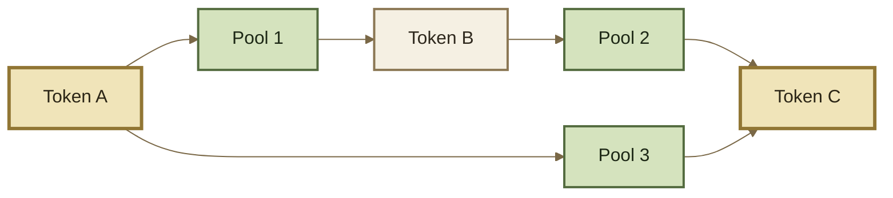

# Batch & Multihop Swaps

## Batch & Multihop Swaps

A swap does not need a direct pool between its starting and destination assets.

A **multihop swap** reaches the destination through a sequence of intermediate steps. A **batch** can execute one or more of those paths inside the same transaction.


**Hop → Path → Batch**

A **hop** is one step.\
A **path** is an ordered sequence of steps.\
A **batch** can execute several independent paths together.


***

### From one hop to many

A direct swap contains one market step:

```
Token A
   ↓
Pool 1
   ↓
Token B
```

A multihop swap chains several steps:

```
Token A
   ↓
Pool 1
   ↓
Token B
   ↓
Pool 2
   ↓
Token C
```

From the user's perspective, the economic trade is still:

```
Token A → Token C
```

Token B exists because it connects the two available markets.

The route determines how the trade gets from the starting asset to the destination asset.

***

### Intermediate assets can remain internal

Without shared accounting, a two-hop route could require the first pool to transfer Token B out before Token B is transferred into the second pool.

```
A → Pool 1 → transfer B → Pool 2 → C
```

ROOTSTOCK's Vault accounting allows the intermediate obligations to be composed inside one execution context instead.

```
A debt
  ↓
Pool 1
  ↓
B credit
  ↓
Pool 2 consumes B
  ↓
C credit
  ↓
settle net result
```

If the Token B credit from one step offsets the Token B debt from the next, no separate user-facing transfer of Token B is required between them.

This is one of the main benefits of separating **accounting** from **physical token settlement**.

See Accounting & Settlement.

***

### Paths and batches are different

A **path** describes one route from a starting token to a destination.

```
Path 1

A → Pool 1 → B → Pool 2 → C
```

A **batch** can carry several paths in the same transaction.





Here the batch contains two independent paths:

```
Path 1: A → B → C
Path 2: A → C
```

Each path can contain one step or several.

***

### Split routes

Multiple paths can also represent different portions of the same logical trade.

For example:

```
                 → Pool 1 ─────────┐
100 Token A ─────                   ├→ Token C
                 → Pool 2 → Pool 3 ┘
```

A routing system might decide that sending all `100 A` through one market is less attractive than dividing the trade:

```
60 A → Path 1
40 A → Path 2
```

The Batch Router can execute those supplied paths together.


**The Batch Router is an execution engine, not a route optimizer.**

A router, solver, aggregator, or other routing system decides which paths and amounts to use. ROOTSTOCK provides the liquidity and execution primitives needed to carry them out.


Route selection may consider available liquidity, fees, price impact, pool state, Hooks, gas costs, and other execution constraints.

***

### Why use multiple pools?

Different Root Pools can expose different markets.

A route may cross pools because:

* no direct pool exists between the desired assets;
* another intermediate asset connects deeper liquidity;
* several pools expose different prices or depths;
* different invariants produce different execution characteristics;
* fees differ between markets;
* Hooks alter supported pool behavior;
* wrapped and underlying assets require conversion steps;
* dividing a trade across paths may improve aggregate execution.

The route is therefore a **composition of markets**, not a new market itself.

Each Root Pool still calculates only the step executed against it.

***

### Paths can contain more than AMM swaps

In the inherited architecture, a path step can represent more than a conventional pool-to-pool swap.

Supported routes can incorporate additional liquidity primitives.

#### ERC-4626 buffer steps

A route can move between an ERC-4626 asset and its wrapped form through a Vault liquidity buffer.

Conceptually:

```
DAI
 ↓
ERC-4626 buffer
 ↓
wrapped DAI
 ↓
Root Pool
 ↓
wrapped USDC
 ↓
ERC-4626 buffer
 ↓
USDC
```

The path identifies whether a particular step represents a normal pool operation or a buffer conversion.

See ERC-4626 Buffers.

#### Pool-share steps

Where supported, a path can also cross between a pool's underlying assets and its Root Pool Token.

```
Token A
   ↓
swap
   ↓
Token B
   ↓
add liquidity
   ↓
Root Pool Token
```

The reverse direction can use a liquidity-removal step.

This allows routing to compose **swaps, conversions, and liquidity positions** without treating every transition as the same kind of operation.

***

### Exact In across a path

With Exact In, each path starts from a known input amount.

```
100 A fixed
   ↓
Pool 1
   ↓
B calculated
   ↓
Pool 2
   ↓
C calculated
```

Each calculated output becomes the amount available to the following step until the path reaches its final output.

An Exact-In path therefore carries:

```
exact input
+
ordered steps
+
minimum final output
```

If the path's final output falls below its minimum, the transaction cannot successfully execute that path.

***

### Exact Out across a path

Exact Out starts from the opposite requirement.

```
100 C required
    ↑
Pool 2
    ↑
required B
    ↑
Pool 1
    ↑
required A
```

The required amounts are solved from the destination back toward the starting asset.

An Exact-Out path therefore carries:

```
desired exact output
+
ordered steps
+
maximum initial input
```

The token movement still executes from input toward output. The backward direction above describes the **calculation dependency**.

See Exact In & Exact Out.

***

### Limits apply per path

A batch may contain several independent paths, and each path carries its own execution constraint.



Each path defines:

```
exactAmountIn
minAmountOut
```

The final output of that path must meet its own minimum.



Each path defines:

```
exactAmountOut
maxAmountIn
```

The initial input required by that path must remain within its own maximum.



A routing application can also present an aggregate quote or aggregate economic result to the user, but that should not obscure the protocol-level distinction: **the Batch Router executes an array of independently constrained paths.**

Pool-specific limits, invariant restrictions, Hooks, and other execution rules still apply inside each path.

***

### One batch, one atomic result

All paths execute inside the same transaction.

Consider a route with three steps:

```
A → B
B → C
C → D
```

If the first two succeed mathematically but the final step cannot execute within its constraints, the transaction does not leave the earlier swaps permanently completed.

The transaction reverts as a whole.

The same applies to multiple paths:

```
Path 1 ─ succeeds ─┐
                   ├→ batch succeeds only if everything settles
Path 2 ─ fails ────┘
```

Vault transient accounting reinforces this atomicity: temporary credits and debts can accumulate while the batch executes, but all outstanding token deltas must be settled before the execution context closes.


**Intermediate success is not final success.**

A composed route succeeds only when the entire transaction satisfies its constraints and settles completely.


***

### Routing and execution are separate problems

It is useful to distinguish two layers.

<table data-full-width="true"><thead><tr><th width="138.5">Layer</th><th>Responsibility</th></tr></thead><tbody><tr><td><strong>Routing</strong></td><td>Discover pools, compare candidate paths, divide amounts, estimate outcomes, and choose a route.</td></tr><tr><td><strong>Execution</strong></td><td>Execute the supplied paths through Root Pools, buffers, and supported liquidity operations while enforcing their constraints.</td></tr></tbody></table>

ROOTSTOCK does not require every routing system to use the same optimization strategy.

Different aggregators, solvers, applications, or custom Routers can construct different paths over the same underlying liquidity.

***

### Continue

<table data-full-width="true"><thead><tr><th width="252.5">Page</th><th>What it explains</th></tr></thead><tbody><tr><td><strong>Exact In &#x26; Exact Out</strong></td><td>How amounts and limits propagate through a swap path.</td></tr><tr><td><strong>Routers</strong></td><td>The execution layer that packages user actions into protocol operations.</td></tr><tr><td><strong>Router Types</strong></td><td>The different Router surfaces available for different workflows.</td></tr><tr><td><strong>Queries &#x26; Simulation</strong></td><td>How candidate paths can be evaluated before execution.</td></tr><tr><td><strong>Accounting &#x26; Settlement</strong></td><td>Why intermediate assets can remain internal and settle as net token deltas.</td></tr><tr><td><strong>ERC-4626 Buffers</strong></td><td>How wrapped and underlying token conversions participate in routes.</td></tr><tr><td><strong>Aggregator Integration</strong></td><td>How external routing systems integrate with ROOTSTOCK liquidity.</td></tr></tbody></table>
