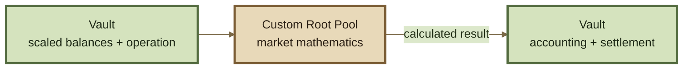

# Build a Custom Pool

## Build a Custom Pool

Build a **Custom Root Pool** when the market requires new pricing or invariant logic that cannot be expressed by an existing pool family plus Hooks.

A Custom Pool should remain narrowly responsible for **market-specific mathematics**. The Vault continues to provide the shared accounting, token scaling, fee accounting, liquidity machinery, and settlement around that math.


**Use a Custom Pool when the market itself is different.**

If the underlying AMM mathematics can remain the same and you only need additional behavior around operations, build a Hook instead.


***

### 1. Specify the market mathematically

Start with the market model, not Solidity.

Define:

* supported token count;
* invariant or pricing function;
* parameter ranges;
* valid balance domain;
* exact-in behavior;
* exact-out behavior;
* behavior as balances approach their limits;
* invariant behavior during liquidity changes;
* any time-dependent or state-dependent parameters;
* mathematical assumptions that must always hold.

For an invariant-based pool, write the invariant as a function of its live balances:

$$
I = f(b_1,b_2,\ldots,b_n)
$$

Then define what properties that function must preserve.

#### Invariant properties

The inherited v3 liquidity model places particularly strong requirements on the invariant.

A swap should not reduce the economic state represented by the invariant through mathematical error. Fees may increase pool value, but rounding or approximation must not create a path that systematically drains it.

The invariant used for generic liquidity accounting should also scale consistently when every balance scales by the same factor:

$$
f(\lambda b_1,\lambda b_2,\ldots,\lambda b_n)
=
\lambda f(b_1,b_2,\ldots,b_n)
$$

This degree-one scaling property is important because RPT ownership must remain proportional as the entire pool grows or shrinks.


If the mathematical model does not satisfy the assumptions required by generic ROOTSTOCK liquidity accounting, do not force it into the standard path.

Use explicit custom liquidity behavior or restrict the unsupported operation.


***

### 2. Map the math to the Pool surface

The Vault supplies the accounting state. The Pool supplies the market calculation.



In the inherited Balancer v3 interface, the central mathematical surface includes:

| Primitive              | Responsibility                                                          |
| ---------------------- | ----------------------------------------------------------------------- |
| `onSwap`               | Calculate the market result for an exact-in or exact-out swap           |
| `computeInvariant`     | Calculate the invariant for a set of live balances                      |
| `computeBalance`       | Calculate a token balance implied by a change in the invariant          |
| Swap-fee bounds        | Define the fee range that is mathematically valid for the Pool          |
| Invariant-ratio bounds | Define the safe range for invariant changes during liquidity operations |

ROOTSTOCK should use the exact interfaces and function signatures exposed by its canonical contract package. The inherited names above describe the v3 baseline and should not substitute for the ROOTSTOCK contract reference.


The Pool receives accounting state because it needs that state to perform mathematics.

That does **not** make the Pool the custody or settlement layer.


Do not move token custody, settlement, or general Vault accounting into the Pool merely because the Pool needs balances to calculate a result.

***

### 3. Treat scaled balances as mathematical inputs

The inherited architecture does not necessarily pass raw token balances directly into Pool mathematics.

The Vault can first account for:

* token decimals;
* scaling;
* rate-provider conversions;
* applicable yield accounting.

The Pool therefore operates on the protocol's normalized mathematical representation of the assets rather than independently reproducing those transformations.

This distinction matters when designing:

* balance bounds;
* minimum meaningful amounts;
* approximation tolerances;
* invariant domains;
* rate-dependent mathematics.

See Token Scaling and Rate Providers.

***

### 4. Implement fixed-point math deliberately

The EVM performs integer arithmetic. A continuous equation therefore needs a finite-precision implementation.

For every mathematical operation, define:

* fixed-point precision;
* rounding behavior;
* acceptable approximation error;
* overflow and underflow bounds;
* minimum and maximum balances;
* valid parameter ranges;
* safe invariant-ratio bounds;
* behavior near singularities or asymptotes;
* error bounds for logarithms, exponentiation, roots, or iterative methods.

#### There is no universal rounding direction

Do not reduce the rounding model to “always round up” or “always round down.”

Different protocol operations need different conservative directions.

For example:

```
exact in
→ amount out must not be overstated

exact out
→ required amount in must not be understated
```

Likewise, invariant calculations may explicitly request an upward or downward approximation depending on how the result is being used.

The requirement is therefore:

> **Precision loss must not transfer unintended value out of the Pool.**

See Rounding & Invariant Approximation.

***

### 5. Implement swaps consistently

A Custom Pool must handle both swap directions supported by the protocol:



The input amount is fixed.

The Pool calculates how much of the output token the market permits.

The implementation must not overstate the amount out.



The output amount is fixed.

The Pool calculates how much input the market requires.

The implementation must not understate the required amount in.



`onSwap` should implement the market equation efficiently and consistently with the invariant.


In the inherited v3 architecture, **swap-fee charging is handled by the Vault**.

The Pool defines compatible fee bounds and calculates the market result from the values supplied to it. Do not independently deduct the same swap fee again inside the Pool's swap calculation.


The swap implementation and the invariant implementation must describe the **same market**.

If `onSwap` and `computeInvariant` disagree economically, the protocol can produce incorrect pricing or liquidity accounting even when each function appears correct in isolation.

***

### 6. Decide how liquidity should work

A Custom Pool does not automatically need custom add/remove-liquidity code.

In the inherited v3 model, `computeInvariant` and `computeBalance` allow the Vault's generic liquidity machinery to support multiple liquidity paths using the Pool's own mathematics.

#### Proportional liquidity

A proportional liquidity change preserves the relative balance state of the market.

For example:

```
before
100 A / 200 B

+50%

after
150 A / 300 B
```

This is generally the simplest liquidity case and can often be handled by shared protocol math without invoking specialized Pool calculations.

#### Unbalanced liquidity

Unbalanced liquidity changes the Pool's relative balances.

This introduces an implicit trading effect and therefore requires the invariant calculations, fee treatment, and RPT issuance or redemption to remain mutually consistent.

If the Pool supports generic unbalanced liquidity, test that its `computeInvariant` and `computeBalance` behavior correctly reproduces the economics of the market across the full allowed invariant-ratio range.

#### Custom liquidity

Some AMMs require liquidity operations that cannot be represented by the generic invariant approximation.

For those cases, the inherited architecture provides explicit custom add/remove-liquidity paths.

Use custom liquidity behavior when the market genuinely needs a different operation—not merely because the Pool itself is custom.


Support only the liquidity operations whose mathematics you can justify and test.

A deployment can restrict unsupported generic liquidity behavior rather than exposing a mathematically invalid path.


***

### 7. Define the deployment and trust configuration

Separate **Pool mathematics** from **deployment configuration**.

For each deployment, determine:

* which tokens can be registered;
* initial and permitted fee configuration;
* whether a Hook is attached;
* which Hook callbacks are enabled;
* liquidity-management settings;
* role accounts;
* mutable parameters;
* external rate providers or oracles;
* pause and recovery controls;
* initialization requirements.

These choices become part of the market's trust model even when they are not implemented directly inside the Pool contract.

#### Hooks

A Custom Pool can be combined with a Hook.

The distinction remains:

```
Custom Pool
    = market mathematics

Hook
    = configured behavior around operations
```

A Hook should not be used to hide essential invariant logic that the Pool itself needs in order to describe the market correctly.

See Build a Hook.

***

### 8. Test properties, not just examples

Example-based tests establish that known cases work.

Custom AMM math also needs **property testing**.

Important properties can include:

<table><thead><tr><th width="222">Property</th><th>What to test</th></tr></thead><tbody><tr><td><strong>Exact-in safety</strong></td><td>Output is never greater than the mathematically permitted amount</td></tr><tr><td><strong>Exact-out safety</strong></td><td>Required input is never understated</td></tr><tr><td><strong>Invariant consistency</strong></td><td>Swaps and liquidity calculations describe the same market</td></tr><tr><td><strong>Scaling consistency</strong></td><td>Proportional balance scaling produces proportional invariant scaling where required</td></tr><tr><td><strong>Round-trip safety</strong></td><td>Rounding cannot be composed into a profitable value-extraction loop</td></tr><tr><td><strong>RPT fairness</strong></td><td>Joining or exiting does not unfairly dilute existing or entering LPs</td></tr><tr><td><strong>Domain safety</strong></td><td>Valid operations cannot push the Pool outside its mathematical domain</td></tr><tr><td><strong>Fee consistency</strong></td><td>Liquidity paths cannot be used to bypass equivalent trading costs</td></tr><tr><td><strong>Bound safety</strong></td><td>Extreme but valid parameters remain numerically safe</td></tr></tbody></table>

Fuzz **sequences**, not only individual calls.

For example:

```
initialize
→ swap
→ unbalanced add
→ swap
→ remove
→ swap back
→ proportional exit
```

Stateful fuzzing can expose failures that no isolated function test reaches.

Also test:

* minimum balances;
* maximum balances;
* minimum meaningful trades;
* nearly depleted assets;
* invariant-ratio boundaries;
* parameter boundaries;
* repeated rounding;
* rapidly changing state where applicable;
* external dependency failure where applicable.

***

### 9. Deploy through a known factory pattern

For public and repeatable deployments, a factory provides a standard path for creating a Pool family.

A factory can establish:

* implementation lineage;
* constructor format;
* configuration validation;
* deterministic or reproducible deployment behavior;
* pool-family discovery;
* coordinated deployment and Vault registration.

The inherited v3 architecture recommends factory-based deployment, particularly because a known factory improves provenance and can make deployment and registration atomic.


A Factory is the recommended deployment pattern, not the mathematical definition of a Pool.

In the inherited v3 architecture, direct Vault registration is technically separate from factory deployment. The canonical ROOTSTOCK deployment system determines which paths ROOTSTOCK publicly supports.


After deployment, the Pool still needs to be correctly:

1. registered with the Vault;
2. configured;
3. initialized with its first liquidity;
4. recorded in the canonical ROOTSTOCK deployment artifacts.

See Factories & Deployment.

***

### 10. Make the Pool integrable

Correct onchain mathematics is necessary but not sufficient.

External systems need enough information to understand and quote the market safely.

Document:

* pool family and version;
* factory or deployment provenance;
* supported token count;
* token restrictions;
* parameter meanings;
* parameter bounds;
* invariant definition;
* swap behavior;
* supported liquidity kinds;
* fee behavior;
* Hook behavior;
* rate or oracle dependencies;
* relevant mutable state;
* mathematical reference implementation;
* events required for indexing.

Where practical, provide an offchain reference implementation of the Pool mathematics so routers, aggregators, simulations, and analytics systems do not need to reverse-engineer the Solidity implementation.


A market that cannot be quoted or simulated reliably by external systems may have limited routing reach even when its onchain implementation is correct.


***

### Security gate

A shared Vault removes the need for every Pool to rebuild the same accounting and settlement machinery.

It does **not** prove that a custom market is economically or mathematically safe.

A flaw in any of the following can still create loss:

* pricing;
* invariant design;
* approximation;
* rounding;
* parameter bounds;
* liquidity accounting;
* external dependencies;
* privileged state changes.

Novel invariants should receive independent review, adversarial testing, and economic analysis before substantial value depends on them.


**Treat custom AMM mathematics as security-critical code.**

A Pool can satisfy the protocol interface perfectly and still define an unsafe market.

