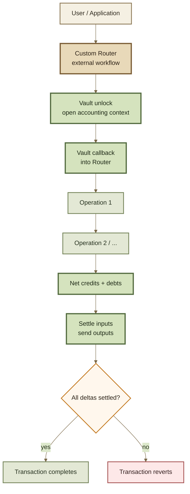

# Build a Custom Router

## Build a Custom Router

A **Router** translates application intent into one or more Vault operations and settles the resulting token deltas.

Build a Custom Router when the protocol already supports the required market behavior, but the **interaction workflow** needs to change.


**Router = workflow. Pool = market mathematics. Hook = behavior around a Pool operation.**

Do not build a Custom Router merely to change pricing. If the market equation itself changes, that logic belongs in a Custom Pool.


***

### When to build a Router

A Custom Router can:

* compose multiple swaps;
* combine swaps and liquidity operations;
* migrate liquidity between Pools;
* combine Pool and ERC-4626 buffer operations;
* expose a specialized application interface;
* integrate authorization and permit flows;
* support prepaid aggregator or solver execution;
* enforce workflow-level constraints;
* package several protocol actions into one atomic transaction.

The Router should determine **how operations are composed**, not silently change what an individual Pool considers a valid market result.

| Need                                         | Extension surface |
| -------------------------------------------- | ----------------- |
| New pricing equation                         | Custom Pool       |
| Behavior around an existing Pool operation   | Hook              |
| New combination of existing Vault operations | Custom Router     |

***

### The execution model

ROOTSTOCK inherits the Vault's transient-accounting model.

A Router can open an execution context, perform multiple Vault operations, allow their temporary credits and debts to offset one another, and settle only the remaining net token movements.



The essential invariant is:

```
temporary Vault deltas may exist
        ↓
only while the execution context is open

context closes
        ↓
every delta must be settled
```

A Router does not need every intermediate operation to transfer tokens immediately.

That is what makes atomic workflow composition possible.

***

### 1. Define the workflow before the interface

Start with the economic sequence.

For example:

```
remove liquidity from Pool A
        ↓
use resulting assets in Pool B
        ↓
swap residual asset
        ↓
send final position to user
```

Only after that sequence is clear should you design calldata and external functions.

For every step, identify:

* Vault operation;
* token entering;
* token leaving;
* Pool or buffer involved;
* exact-in or exact-out semantics;
* user limit;
* recipient;
* temporary credit or debt created;
* final settlement path.


A good Router interface hides unnecessary protocol choreography without hiding the economic action the user is authorizing.


***

### 2. Authenticate the Vault callback

`Vault.unlock(...)` calls back into the Router so the Router can perform the operations inside the unlocked accounting context.

That callback is a privileged execution surface.

It should not be callable as though it were an ordinary public workflow function.

Conceptually:

```
user
  ↓
Router entrypoint
  ↓
Vault.unlock(...)
  ↓
Vault
  ↓
Router callback
```

The inherited production Router architecture restricts Vault callback functions to the Vault.


**Do not leave an unlock callback usable by arbitrary callers.**

A callback that assumes the Vault has already opened an accounting context must authenticate that assumption.


Exact modifiers and base contracts belong in Router APIs.

***

### 3. Preserve the real initiator

Inside the Vault callback:

```
msg.sender = Vault
```

That is not necessarily the user or application that initiated the workflow.

This distinction becomes especially important when:

* Hooks reenter a Router;
* Routers compose other Routers;
* smart contracts initiate operations;
* authorization depends on the original caller;
* recipients differ from callers.

The inherited production Router pattern preserves the **outermost initiating sender** across the callback sequence.

```
external caller
      ↓
 saved sender
      ↓
Vault callback
      ↓
nested operations
      ↓
still identify original initiator
```

Do not accept a freely supplied `sender` parameter and treat it as authenticated identity merely because it appears in calldata.

If a caller can act for another account, that authority must be established separately.

***

### 4. Choose the funding model

A Router that can move user tokens is an important approval surface.

Choose the funding model deliberately.

#### Retail flow

The inherited standard retail Routers use **Permit2** for tokens entering the Vault.

Permit-based flows can also establish approvals without requiring a separate approval transaction where the relevant token supports them.

For signature-based authorization, define:

* spender;
* token;
* maximum amount;
* nonce;
* deadline;
* chain/domain separation;
* replay protection.

Use narrowly scoped and expiring approvals where practical.

#### Prepaid flow

Contract callers such as:

* aggregators;
* solvers;
* smart accounts;
* other protocols

may instead use a **prepaid** pattern.

```
caller
   ↓
transfers input to Vault
   ↓
Router executes
   ↓
Vault recognizes payment during settlement
```

This avoids having the Router pull assets from an EOA through Permit2.


The inherited Router base distinguishes retail and prepaid behavior at deployment.

A custom authorization model is possible, but it should be treated as an explicit architecture change rather than assumed to be part of the standard Router model.


Avoid creating an additional implicit authorization system unless the workflow genuinely requires one.

***

### 5. Settle every token delta

Vault operations create credits and debts.

Conceptually:

```
debt
= value still owed to the Vault

credit
= value the execution context may take from the Vault
```

A Custom Router must account for every token touched by every branch.

For a composed workflow:

```
operation A
    creates +100 X credit

operation B
    consumes 80 X
    creates 40 Y credit

net
    20 X credit
    40 Y credit
```

Only the net amounts need to cross the final user/Vault boundary.

#### Paying the Vault

Where the Router owes tokens, the settlement flow must ensure the assets actually reach the Vault and are recognized by Vault accounting.

#### Taking value from the Vault

Where the execution has credit, the Router can direct the corresponding output to the intended recipient.

#### No unresolved branch

Every code path must end in one of two states:

```
all deltas settled
        ↓
success
```

or:

```
any delta remains
        ↓
revert
```

Do not design a path that relies on residual Router balances to repair accounting after the transaction.

***

### 6. Preserve user limits through composition

Atomic composition does not remove the need for economic limits.

A Router should preserve user intent through:

* minimum amount out;
* maximum amount in;
* minimum RPT received;
* maximum RPT spent;
* deadlines;
* recipient checks;
* path constraints;
* application-specific bounds.

For multistep workflows, distinguish:

```
intermediate limits
```

from:

```
final user guarantee
```

An internal step may have a broad intermediate range while the overall workflow still enforces a strict final result.


A technically settled transaction can still be economically unacceptable.

Settlement correctness and slippage protection are separate invariants.


***

### 7. Model reentrancy across the whole workflow

A Router may interact in one transaction with:

* the Vault;
* Pools;
* Hooks;
* tokens;
* ERC-4626 wrappers;
* Permit2;
* other Routers;
* arbitrary external protocols.

Hooks may themselves invoke additional Vault or Router operations.

A single `nonReentrant` modifier therefore does not replace architectural reasoning.

Model:

```
external caller
   ↓
Router
   ↓
Vault
   ↓
Pool
   ↓
Hook
   ↓
Router / Vault again
```

For each possible callback edge, ask:

* what state has already changed?
* which sender is currently visible?
* which transient state remains active?
* can the same workflow be entered again?
* can external code observe an intermediate state?
* what assumptions must still hold after control returns?

Use guards where they protect an actual invariant, but do not assume one guard makes the entire call graph non-reentrant.

***

### 8. Account for Hooks

A Custom Router can interact with Pools that have Hooks.

That introduces two distinct concerns.

#### Hooks can change execution behavior

A Hook may:

* reject an operation;
* compute a dynamic fee;
* modify a supported calculated amount;
* execute additional logic;
* reenter Vault operations.

The Router should not assume:

```
Pool family
=
complete execution behavior
```

#### Hooks can care which Router initiated the operation

Hook callbacks receive information about the Router involved in liquidity and swap operations.

A Hook can therefore implement its own Router trust policy.


Permissionless access to the Vault's general unlock surface does **not** guarantee that every Pool + Hook configuration will accept every custom Router.


Test the Router against the actual Hook configurations it is expected to support.

***

### 9. Keep query and execution logic aligned

If the Custom Router exposes quotes or simulations, query and execution paths should share the same underlying operation logic wherever possible.

A useful structure is:

```
              shared workflow logic
               /               \
              /                 \
      execution path         query path
      + settlement           + simulation
```

The inherited Router architecture uses the Vault's quote mechanism to execute operation logic in a query context without performing normal settlement.

This makes it possible for query and execution paths to reuse substantial portions of the same calculations.

#### Queries are not transactions

A query normally does **not** prove that the future transaction will succeed.

Between quote and execution:

* Pool balances can change;
* rates can change;
* Hook state can change;
* fees can change;
* permissions can change;
* the transaction can be reordered.

Queries should therefore produce the expected result from a particular state, while execution still enforces explicit limits.


Router queries are primarily an **offchain simulation surface**.

Do not treat a quote as authorization, settlement, or guaranteed execution.


See Queries & Simulation.

***

### 10. Treat non-standard tokens explicitly

The inherited Vault assumes compatible token-transfer behavior.

Historically problematic categories include:

* rebasing tokens;
* fee-on-transfer tokens;
* tokens whose balances change outside normal transfers;
* double-entry-point tokens;
* callback-heavy token implementations.

Standard Router logic should not silently pretend these behave like ordinary ERC-20s.


If a Custom Router intentionally compensates for unusual token-transfer behavior, document that behavior as a specialized compatibility feature and test it against the Vault's actual accounting assumptions.


Otherwise, reject unsupported token behavior.

See Token Compatibility.

***

### 11. Design the error surface for integrators

Custom errors should make materially different failure classes distinguishable.

Useful categories include:

* authorization failure;
* expired deadline;
* invalid recipient;
* malformed path;
* unsupported operation;
* slippage or limit failure;
* incompatible token;
* Vault callback authentication failure;
* settlement failure;
* external dependency failure.

Do not unnecessarily catch and replace useful downstream errors.

A Pool or Hook revert can contain information an integration needs for diagnosis.

Exact selectors and contract-specific errors belong in Errors.

***

### 12. Test workflows, not only functions

A Router should be tested as an execution graph.

Test:

#### Settlement

* every debt branch;
* every credit branch;
* netting across several operations;
* zero residual deltas;
* partial workflow failure;
* failure immediately before settlement.

#### Authorization

* insufficient allowance;
* Permit2 expiry;
* invalid signature;
* replay attempt;
* incorrect signer;
* unauthorized delegated caller;
* wrong spender.

#### Caller integrity

* direct callback call from a non-Vault address;
* nested Router call;
* Hook → Router reentry;
* contract caller;
* recipient different from sender.

#### Path behavior

* exact in;
* exact out;
* malformed paths;
* repeated tokens;
* repeated Pools;
* zero or minimal amounts;
* maximum supported path length;
* invalid recipients;
* deadline expiry.

#### External behavior

* Hook revert;
* dynamic-fee state change;
* adjusted Hook amounts;
* wrapper failure;
* incompatible token behavior;
* external protocol revert.

#### Query parity

For the same starting state:

```
query result
    ≈
execution result before state changes
```

Any intentional difference between simulation and execution should be documented and tested.

#### Gas

Profile:

* common workflow;
* longest supported path;
* worst-case settlement set;
* workflows with Hooks;
* wrapper/buffer paths;
* multicall-style composition where supported.

***

### 13. Deploy and publish the Router

A Router is different from a Pool.

A Pool is registered with the Vault.

A Router generally **does not become canonical through Vault registration**.

The inherited Vault's normal unlock mechanism is open to callers, and third-party Routers can be built against it.

Canonical status is therefore a matter of deployment identity and protocol support.

Publish:

* network;
* Router address;
* implementation/version;
* source commit;
* bytecode verification;
* Vault address;
* funding model;
* Permit2 address where applicable;
* WETH/native-token configuration where applicable;
* supported operations;
* query support;
* known Hook compatibility;
* audit status.


Applications should never select a Router from a human-readable name alone.

Use the canonical ROOTSTOCK deployment registry and verify the network, address, and version.


Because Routers do not hold the pooled liquidity owned by the Vault, new Router versions can generally be deployed without migrating the Pools themselves.

That flexibility makes provenance especially important: multiple Router versions may coexist while only some are recommended for new integrations.

***

### Security gate

A Custom Router may be peripheral to Pool mathematics, but it sits directly on the **authorization and settlement path**.

Review it as security-critical when it can:

* move user assets;
* consume approvals;
* interpret signatures;
* choose recipients;
* compose several Vault operations;
* interact with external protocols;
* handle native-token wrapping;
* preserve user identity across callbacks;
* settle credits and debts.


**The Vault guarantees that its accounting context cannot close with unsettled deltas.**

It does not guarantee that a Custom Router expressed the user's intent correctly, authenticated the right account, chose safe external calls, or enforced appropriate economic limits.

