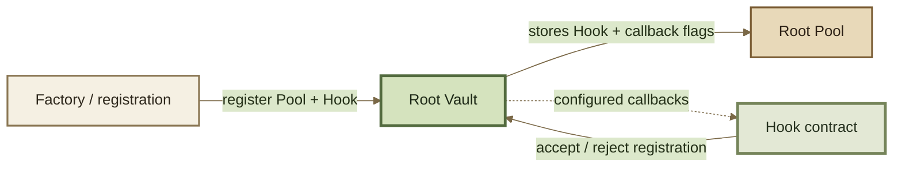

# Build a Hook

## Build a Hook

A **Hook** extends Root Pool behavior at configured lifecycle points without replacing the Pool's core invariant.

Use a Hook when the market mathematics are already correct but additional logic should run **around** initialization, swaps, liquidity operations, or fee calculation.


**Pool = market mathematics. Hook = behavior around that market.**

If the pricing equation itself must change, build a Custom Pool instead.


***

### Hook or Custom Pool?

Use a Hook for behavior such as:

* dynamic swap fees;
* allow/deny rules;
* operation validation;
* external state checks;
* logic before or after liquidity changes;
* automation around Pool operations;
* specialized limits;
* protocol or market policy.

Use a Custom Pool when the actual:

* invariant;
* pricing equation;
* swap mathematics; or
* balance relationship

must change.

```
same market math + new behavior
        ↓
       Hook

new market math
        ↓
   Custom Pool
```

A complex Hook should not become a hidden replacement for the Pool's invariant.

***

### How a Hook becomes part of a Pool

A Hook is a standalone contract.

It becomes part of a particular Root Pool when the Pool is **registered with the Vault** using that Hook address.

Conceptually:



In the inherited v3 architecture:

* the Hook contract can accept or reject a Pool during registration;
* the Vault reads the Hook's supported callback flags;
* the Hook address is associated with that Pool;
* the enabled callback configuration is stored by the Vault.

That relationship is persistent.


For a registered Pool, the **Hook address and stored callback configuration are not ordinary mutable settings**.

The Hook contract itself may still contain mutable state, privileged roles, or external dependencies. A fixed Hook address therefore does **not** imply fixed behavior.


One Hook contract can also serve multiple Pools if its design permits it.

***

### 1. Choose callbacks narrowly

Enable only the lifecycle points the Hook actually needs.

The inherited v3 callback surface includes:

| Lifecycle point         | Hook opportunity                                                         |
| ----------------------- | ------------------------------------------------------------------------ |
| Registration            | Accept or reject the Pool                                                |
| Before initialization   | Validate or react before first liquidity                                 |
| After initialization    | React to the initialized state                                           |
| Dynamic fee calculation | Compute a swap fee                                                       |
| Before swap             | Validate or execute logic before Pool math                               |
| After swap              | React to the swap result and, when enabled, adjust the calculated amount |
| Before add liquidity    | Validate or execute logic before an add                                  |
| After add liquidity     | React to the result and, when enabled, adjust supported amounts          |
| Before remove liquidity | Validate or execute logic before a removal                               |
| After remove liquidity  | React to the result and, when enabled, adjust supported amounts          |

Conceptually:

```
operation requested
        ↓
configured before-Hook
        ↓
Vault + Pool operation
        ↓
configured after-Hook
        ↓
settlement
```

Every additional callback introduces:

* another external call;
* more gas;
* more state interactions;
* more failure modes;
* more code that integrators must understand.


**Do not enable callbacks for future convenience.**

Enable the smallest surface required by the Hook's actual behavior.


Exact callback signatures, arguments, and return values belong in Hooks API.

***

### 2. Secure registration and callback authority

A Hook should know **who is allowed to invoke it** and **which Pools are allowed to attach to it**.

These are separate checks.

#### Validate registration

The inherited Hook interface includes a registration callback specifically so the Hook can decide whether a Pool should be allowed to use it.

A robust Hook may validate:

* factory address;
* whether the Pool actually came from that factory;
* token configuration;
* liquidity-management configuration;
* expected Pool family;
* other Hook-specific requirements.

Do not assume that a caller supplying the Hook address during registration is automatically trusted.

#### Authenticate runtime callbacks

Operational Hook callbacks are intended to be invoked by the Vault.

A Hook should therefore enforce the canonical Vault-caller restriction rather than exposing sensitive callback logic as an unrestricted public entry point.

```
registration check
    → may this Pool use me?

runtime caller check
    → is the Vault invoking me?
```

These protect different boundaries.

***

### 3. Define authority and mutable state

A Hook can have its own internal state and permissions.

For every mutable value, answer:

1. **Who can change it?**
2. **What bounds constrain it?**
3. **How quickly can it change?**
4. **Can users observe the new state before executing?**
5. **Can the change block an operation?**
6. **Can it change economic outcomes?**
7. **Can it redirect or withhold value?**
8. **What happens if the controlling authority disappears or is compromised?**

Examples of security-sensitive Hook state include:

* fee parameters;
* allowlists;
* oracle addresses;
* thresholds;
* limits;
* operator addresses;
* strategy parameters;
* pause-like controls.


A Hook does not need to custody tokens to be economically powerful.

If it can block execution, alter fees, change calculated amounts, or depend on privileged state, it is part of the Pool's trust model.


***

### 4. Bound dynamic fees explicitly

Dynamic swap fees are one of the most direct Hook extensions.

Conceptually:

```
swap state
    ↓
dynamic-fee Hook
    ↓
fee percentage
    ↓
Vault applies fee
    ↓
Pool calculates trade
```

Define:

* inputs to the fee calculation;
* units and fixed-point representation;
* minimum fee;
* maximum fee;
* rounding behavior;
* update rules;
* fallback behavior;
* treatment of unavailable external state.

#### Do not assume the Pool's minimum fee protects you

In the inherited v3 design, the Vault constrains a Hook-computed dynamic fee against the protocol-wide maximum supported percentage.

However, a dynamic Hook can return a value **below the normal minimum fee defined by a standard Pool implementation**.

That distinction matters because minimum swap fees can be part of the numerical and economic safety margin around rounding and approximation.


If the Hook can reduce fees below the Pool family's normal minimum, that decision requires explicit security justification.

Do not accidentally remove a mathematical safety guardrail while implementing a fee strategy.


The Hook should enforce its own intended bounds rather than rely solely on an operator to choose sensible values.

***

### 5. Treat adjusted amounts as a separate capability

An after-Hook can do more than observe an operation.

When **Hook-adjusted amounts** are explicitly enabled, supported after-Hooks can modify the **calculated side** of an operation.

This is a much stronger capability.

For swaps:



The user fixes the amount entering the swap.

An adjusted after-Hook can affect the calculated output side.

The user's minimum-output limit still applies.



The user fixes the desired output.

An adjusted after-Hook can affect the calculated input side.

The user's maximum-input limit still applies.



The Vault does not simply trust an arbitrary Hook return value. It validates the adjusted result against the limits supplied by the user.

#### Liquidity compatibility

Hook-adjusted amounts also interact with the Pool's liquidity configuration.

In the inherited v3 design, enabling adjusted amounts requires **unbalanced liquidity to be disabled**.

The generic adjusted-amount mechanism therefore works with compatible proportional liquidity paths rather than allowing arbitrary rewriting of every liquidity operation.

```
Hook-adjusted amounts
        ×
liquidity configuration
        =
actual supported operation surface
```


Do not treat `enableHookAdjustedAmounts` as a generic permission to mutate any amount in any operation.

Its semantics are deliberately constrained by operation type and user limits.


If the Hook only needs to validate, observe, update state, or compute a dynamic fee, do **not** enable adjusted amounts.

***

### 6. Treat external calls as adversarial boundaries

Hooks can interact with other contracts and protocol state.

Every external dependency introduces another failure and manipulation surface.

Consider:

* reentrancy;
* stale state;
* same-block manipulation;
* revert propagation;
* malformed return values;
* gas griefing;
* upgradeable dependencies;
* unavailable dependencies;
* compromised privileged contracts;
* unexpected token behavior.

Prefer dependencies that are:

* bounded;
* observable;
* auditable;
* minimally privileged;
* explicit about failure.

#### Reentrancy requires architecture-level reasoning

Do not assume Hook execution follows a simple non-reentrant callback model.

The inherited v3 architecture intentionally permits Vault reentry from several Hook contexts so Hooks can compose additional Vault operations.

That enables powerful patterns, but it also means Hook security must be reasoned about across the **whole execution sequence**, not only one callback frame.

Initialization Hooks have different reentrancy semantics from normal swap and liquidity Hooks.


A blanket `nonReentrant` mental model is not sufficient.

Test the exact callback context supported by the Vault and the operations your Hook can trigger from it.


***

### 7. Design failure behavior

For each Hook dependency, decide whether failure should:

* revert the entire operation;
* fall back to a bounded default;
* retain the previous known value;
* disable only the optional behavior.

Do not leave this implicit.

For example:

```
oracle unavailable
        ↓
?

revert swap
use last known value
use static fee
disable feature
```

Each choice has different safety and liveness consequences.

The correct behavior depends on what the external dependency controls.

A stale fee input and a stale authorization input, for example, should not automatically share the same fallback policy.

***

### 8. Test interaction sequences

Callback unit tests are necessary but insufficient.

The important failures often appear when several operations interact with Hook state.

Fuzz sequences such as:

```
swap
→ add liquidity
→ swap
```

```
add
→ remove
→ add
```

```
exact in
→ exact out
→ exact in
```

```
state update
→ swap
→ state update
→ swap
```

Also test:

* registration from an unauthorized factory;
* direct callback calls from an unauthorized address;
* dynamic-fee minimum and maximum boundaries;
* Hook-adjusted amount limits;
* dependency revert;
* stale dependency state;
* same-block state changes;
* callback-triggered Vault reentry;
* multiple Pools using the same Hook;
* privileged state changes immediately before operations;
* behavior at Pool pause/recovery boundaries where relevant.

Test against the actual Vault execution environment, not only a mocked Hook interface.

Callback order, Vault state, balance updates, and settlement can all affect the result.

***

### 9. Make the Hook legible to integrators

A Hook changes the effective behavior of the Pool.

Routers, indexers, interfaces, and risk systems therefore need to know more than the Pool family.

Publish or expose:

* Hook address;
* implementation/version;
* associated factory or provenance where relevant;
* supported callbacks;
* whether Hook-adjusted amounts are enabled;
* dynamic-fee behavior;
* permission model;
* mutable configuration;
* external dependencies;
* quote-critical state;
* events required to reconstruct that state.


**Unknown Hook ≠ no Hook.**

Two Weighted Pools with identical tokens and weights can expose materially different execution and trust assumptions because one has a Hook.


Integrations should treat:

```
Pool family
    +
Pool configuration
    +
Hook capabilities
    +
Hook state
```

as part of the market they are interacting with.

***

### Security gate

A Hook is executable code inside the Pool's operating path.

Review it with the same seriousness as market mathematics when it can:

* reject operations;
* compute dynamic fees;
* alter calculated amounts;
* trigger additional Vault operations;
* rely on privileged state;
* consume external data;
* change behavior after deployment through mutable state.

The shared Vault still enforces its own accounting and settlement invariants, but those guarantees do not prove that Hook policy is economically safe.


**A fixed Hook address does not mean fixed Hook behavior.**

Audit both the code attached to the Pool **and the authorities, dependencies, and mutable state that can change what that code does.**

