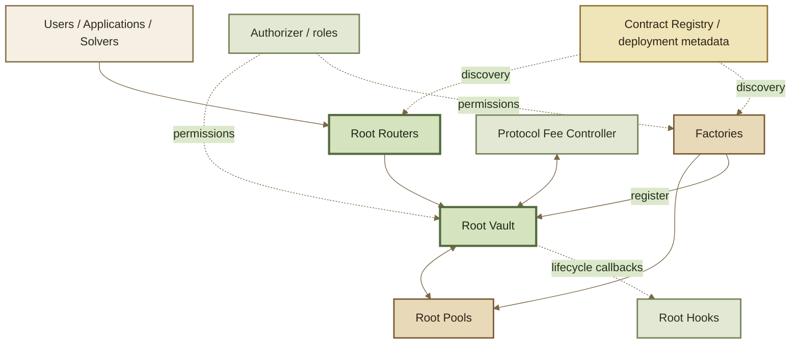

# Contract Architecture

ROOTSTOCK separates **interaction**, **accounting**, **market math**, and **extensions** across contracts with narrow responsibilities.

The central boundary is the **Root Vault**: Routers translate user intent into operations, the Vault performs shared accounting and settlement, Root Pools provide market-specific calculations, and Hooks can extend selected lifecycle points.


**Trace responsibility, not just calls.** A Router organizes a workflow. The Vault owns settlement. A Pool owns its market math. A Hook owns only the behavior it is configured to extend.


***

### Contract map





The Registry node represents the inherited discovery model. ROOTSTOCK's published Base Sepolia address map does not currently include a Contract Registry address, so registry discovery should not be treated as a required live path for that deployment.

***

### Root Vault

The Vault is the shared accounting and settlement substrate. It coordinates pool token balances, normalization, fees, transient credits and debts, pool registration, recovery state, and optional ERC-4626 buffer accounting.

A Router can compose several internal operations while the Vault is unlocked. The transaction may temporarily create token deltas, but the execution context cannot complete with unresolved non-zero deltas.

The Vault therefore owns **how value is accounted for and settled**, not the market equation that decides a swap price.

#### Vault extension and admin surfaces

The inherited v3 design splits implementation responsibilities across the Vault, a Vault Extension, and a Vault Admin surface while exposing them as one protocol system. This reduces implementation-size pressure and separates operational/admin capabilities from the smallest execution core.

The exact deployed addresses for these components are version-specific. See Deployments.

***

### Root Pools

A Pool supplies market-specific calculations: swap behavior, invariant calculations, and any pool-specific parameters required by that market design.

Pools share the Vault's accounting infrastructure. A custom Pool therefore does **not** need to recreate custody, settlement, token scaling, or Router plumbing simply to introduce a different invariant.

This boundary is what makes different pool families coexist under one execution layer.

***

### Root Routers

Routers are workflow adapters for users, applications, aggregators, and solvers. They package high-level actions such as:

* initialize a pool;
* add or remove liquidity;
* execute exact-in or exact-out swaps;
* traverse multihop paths;
* wrap or unwrap ERC-4626 assets;
* combine several protocol operations atomically.

Routers normally handle sender/recipient context, limits, deadlines, approvals, Permit2, and native-token wrapping so applications do not need to reproduce low-level Vault settlement.

Multiple Router contracts can coexist around the same Vault. Adding a specialized Router does not imply a new Pool ABI or a new Vault.

***

### Root Hooks

Hooks are standalone contracts registered with a Pool. A Hook advertises which callbacks it implements, then receives only those configured lifecycle calls.

Hooks are a separate trust and economic boundary. Two Pools with the same invariant and token configuration can still behave differently if one enables dynamic fees or hook-adjusted amounts.

See Hooks API for the exact callback model.

***

### Factories

Factories create standardized Pool instances and encode deployment provenance for a pool family. A factory normally determines which implementation/version is instantiated and supplies the configuration required to register it with the Vault.

For indexers and integrators, factory provenance is stronger evidence than bytecode similarity alone: two contracts can expose similar functions while representing different supported pool classes or versions.

***

### Protocol Fee Controller

The Protocol Fee Controller keeps protocol- and pool-creator fee accounting separate from a Pool's base swap-fee decision. The Vault interacts with it to compute, record, collect, and distribute aggregate fee shares.

See Protocol Fee Controller.

***

### Authorization

Privileged operations are gated by the deployed authorization model. Permission checks matter for actions such as pausing, configuring fees, changing administrative dependencies, or registering/configuring protocol components.

Never infer a caller's authority from the existence of a setter in an ABI. Permission is a property of the deployed authorization state.

***

### Debugging responsibility

When a transaction fails, locate the failing layer before interpreting the revert:

```
external caller
      ↓
Router
      ↓
Vault accounting
      ↓
Pool math / Hook callback
      ↓
Vault settlement
```

A Router approval failure is not a Pool-math failure. A Hook callback revert is not automatically a Vault accounting bug. Trace first; classify second.
