# Contract Registry

A Contract Registry gives applications a typed, version-aware way to discover protocol contracts without scattering hard-coded addresses throughout every client.

The inherited Balancer v3 registry model tracks contract type, canonical name, aliases, active/deprecated status, and trusted-Router state. It is the reference model for this page.


No Contract Registry address appears in ROOTSTOCK's published Base Sepolia application/SDK map. The interface below is therefore **inherited reference behavior**, not a claim that this exact registry is currently deployed as a canonical ROOTSTOCK component.


***

### What the registry answers

A registry can answer questions such as:

* Is this address a recognized protocol contract?
* What type of contract is it?
* What address currently owns a canonical alias?
* Is a previously known contract still active?
* Is a Router trusted by the protocol registry?
* What address does a canonical alias resolve to now, and is an older known address still active?

That is more expressive than a flat `addresses.json` file because it captures recognized identity, aliases, and active/deprecated state as well as location. It does not, by itself, encode a complete chronological deployment history or an explicit `supersededBy` relationship.

***

### Contract types

The inherited `IBalancerContractRegistry` defines these contract classes:

| Type           | Meaning                                             |
| -------------- | --------------------------------------------------- |
| `OTHER`        | registered contract outside the specialized classes |
| `POOL_FACTORY` | Pool factory                                        |
| `ROUTER`       | Router / execution surface                          |
| `HOOK`         | Hook contract                                       |
| `ERC4626`      | registered ERC-4626 contract                        |

A ROOTSTOCK fork may extend or rename its public taxonomy only if the deployed registry interface actually does so. Documentation should not invent extra onchain enum values.

***

### Interface index

| Method                             | Role                                                    |
| ---------------------------------- | ------------------------------------------------------- |
| `registerBalancerContract`         | register a typed canonical name/address                 |
| `deregisterBalancerContract`       | remove a primary registration by name                   |
| `deprecateBalancerContract`        | mark a registered address inactive                      |
| `addOrUpdateBalancerContractAlias` | point an alias at an existing registered address        |
| `isActiveBalancerContract`         | test active membership for a type/address pair          |
| `getBalancerContract`              | resolve a type + name/alias to address and active state |
| `getBalancerContractInfo`          | read type/registered/active state by address            |
| `isTrustedRouter`                  | test whether an address is an active registered Router  |

The inherited Solidity names retain `Balancer` because they are interface identifiers. A ROOTSTOCK deployment should only document these exact names if its deployed registry ABI retains them.

***

### Registration lifecycle

The upstream registry distinguishes several operations:

* register a contract under a type and canonical name;
* deregister a contract/name;
* deprecate a contract;
* add or update an alias;
* query whether a contract is active;
* resolve a contract by type and alias;
* inspect `ContractInfo` for an address;
* check whether an address is a trusted Router.

This means **registered**, **active**, and **current alias target** are separate facts.


Do not delete old deployment history just because an alias moves. Historical decoders and transaction explorers still need to know what an old address represented.


***

### Discovery model

```mermaid
%%{init: {"theme":"base","themeVariables":{
  "primaryColor":"#E7E0C3",
  "primaryTextColor":"#243018",
  "primaryBorderColor":"#6F7B48",
  "lineColor":"#7A6847",
  "secondaryColor":"#DCE8CB",
  "tertiaryColor":"#F3EBD8",
  "fontFamily":"Inter, ui-sans-serif, system-ui, sans-serif"
}}}%%
flowchart LR
    A["Application"] --> K["chain + type + alias"]
    K --> G["Contract Registry"]
    G --> D["recognized address"]
    D --> V["ABI / bytecode / version checks"]
    V --> U["usable integration surface"]

    classDef user fill:#F5F0E3,stroke:#8B7754,stroke-width:2px,color:#2E281D;
    classDef execution fill:#D5E3BE,stroke:#536B3F,stroke-width:3px,color:#1D2816;
    classDef metadata fill:#F0E4B9,stroke:#917634,stroke-width:2px,color:#2B2516;

    class A user;
    class G execution;
    class K,D,V,U metadata;
```

Registry membership establishes what the protocol recognizes. It does **not** prove that every Pool or Hook behind that address has the economic properties an application wants.

***

### Frontend use

A frontend should resolve canonical contracts from a versioned ROOTSTOCK deployment source and cache them by chain ID.

If discovery fails, fail closed. Never silently substitute a Balancer address because it has the same contract type or interface.

***

### Smart-contract use

Onchain consumers may validate counterparties against registry state when their gas/trust model justifies it.

Before depending on registry results onchain, determine:

* who can register, deprecate, or retarget aliases;
* whether the caller requires “registered” or “active” state;
* whether alias movement is acceptable;
* whether the result is cached and for how long.

A mutable governance-controlled registry has different trust semantics from an immutable address constant.

***

### Aggregator use

Aggregators should combine registry discovery with:

1. chain-ID scoping;
2. active/deprecated status;
3. interface/ABI compatibility;
4. version metadata;
5. Pool and Hook capability analysis.

A trusted Router check can help classify execution contracts, but it does not replace route-level validation or user limits.

***

### ROOTSTOCK deployment state

The published Base Sepolia application/SDK map includes Router, Vault, Hook, and Factory addresses, but no Contract Registry address is included in that map.

Until a ROOTSTOCK registry address and its governance/provenance are published, use Deployments as the address authority for the contracts the current integration supports.
