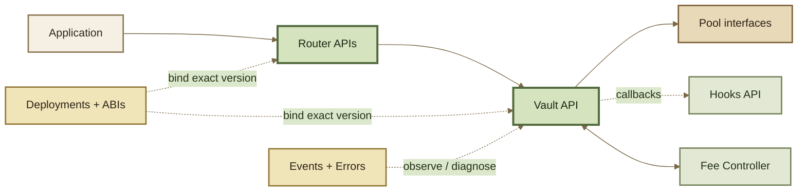

# Developer Reference

The Developer Reference is the **exact-surface layer** of ROOTSTOCK documentation. It maps the protocol's conceptual architecture to the contracts, interfaces, callbacks, events, errors, addresses, and client libraries that software actually integrates with.

Concept pages explain **what** a mechanism means. Integration Guides explain **how** to complete a workflow. This section answers the lower-level question: **which protocol surface implements it, and what must an integration preserve?**


ROOTSTOCK is derived from Balancer v3, but lineage is not deployment identity. Addresses, bytecode, ABIs, permissions, constants, enabled Routers, and deployed Hooks must always be resolved from the ROOTSTOCK deployment and build artifacts for the chain you are using.


***

### Reference map

<table data-full-width="true"><thead><tr><th width="211.5">Page</th><th>Use it for</th></tr></thead><tbody><tr><td><strong>Contract Architecture</strong></td><td>Contract boundaries and responsibility flow.</td></tr><tr><td><strong>Protocol Interfaces</strong></td><td>Which interface family owns each capability and who calls whom.</td></tr><tr><td><strong>Vault API</strong></td><td>Low-level accounting, settlement, swap, liquidity, pool, buffer, and query primitives.</td></tr><tr><td><strong>Router APIs</strong></td><td>User-facing execution and query methods across the Router family.</td></tr><tr><td><strong>Hooks API</strong></td><td>Lifecycle callbacks, flags, adjusted amounts, and dynamic fees.</td></tr><tr><td><strong>Protocol Fee Controller</strong></td><td>Protocol and pool-creator fee accounting, synchronization, and withdrawal surfaces.</td></tr><tr><td><strong>Contract Registry</strong></td><td>Contract discovery, aliases, active/deprecated state, and trusted-Router checks.</td></tr><tr><td><strong>Events</strong></td><td>Incremental state and accounting data for indexers.</td></tr><tr><td><strong>Errors</strong></td><td>Custom-error decoding and debugging by selector.</td></tr><tr><td><strong>ABIs</strong></td><td>Machine-readable interface artifacts and versioning rules.</td></tr><tr><td><strong>Deployments</strong></td><td>Chain-specific ROOTSTOCK addresses and deployment status.</td></tr><tr><td><strong>SDK</strong></td><td>Typed client construction, quoting, limits, and calldata generation.</td></tr><tr><td><strong>Repositories</strong></td><td>Code provenance and the source-of-truth hierarchy.</td></tr></tbody></table>

***

### Read the surface in layers



Most integrations should begin at a Router. Direct Vault integration is for infrastructure that deliberately assumes responsibility for transient accounting and settlement.

***

### ROOTSTOCK names vs inherited Solidity names

ROOTSTOCK documentation calls pool-share tokens **Root Pool Tokens (RPTs)**. The inherited Solidity surface still contains Balancer-era identifiers such as `bptAmountOut`, `getBptRate`, and related BPT field names.

Developer Reference pages preserve those exact identifiers when they are part of an inherited interface. Renaming them in prose would make code harder to verify against the ABI.


**RPT is the ROOTSTOCK concept. BPT may still appear inside inherited Solidity identifiers.** Treat the ABI name as syntax, not as a competing product term.


***

### What is stable?

Different parts of the reference layer change at different rates.

| Surface                       | Expected stability       | Integration rule                                 |
| ----------------------------- | ------------------------ | ------------------------------------------------ |
| Component responsibilities    | high                     | depend on the architectural boundary             |
| Interface families            | medium-high              | pin the protocol version                         |
| Function signatures / structs | versioned                | generate types from the matching ABI             |
| Router availability           | deployment-specific      | resolve from Deployments                         |
| Permissions / role holders    | deployment-specific      | inspect onchain authorization state              |
| Contract addresses            | chain + version specific | never hard-code an upstream address as ROOTSTOCK |
| Events / custom errors        | build-specific           | decode with the exact deployed ABI               |

***

### Source-of-truth rule

For an exact implementation claim, use the strongest available evidence:

```
deployed ROOTSTOCK bytecode + deployment provenance
        ↓
pinned ROOTSTOCK source/build
        ↓
generated ROOTSTOCK ABI / error / deployment artifacts
        ↓
inherited Balancer v3 interface source
        ↓
explanatory documentation
```

ROOTSTOCK repository and Base Sepolia integration provenance are documented in Repositories and Deployments. Where a ROOTSTOCK-specific generated artifact is not published, these pages describe the inherited v3 contract surface without relabeling upstream artifacts as ROOTSTOCK deployment artifacts.
