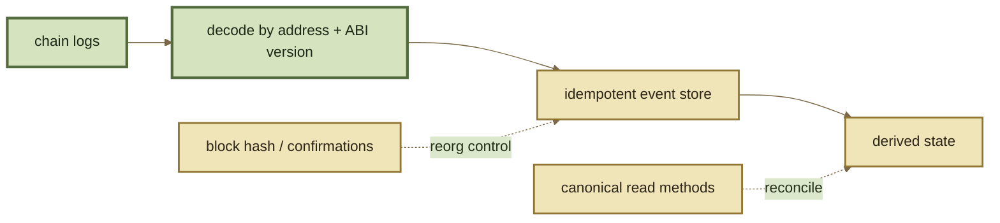

# Events

## Events

Events are ROOTSTOCK's primary **incremental data surface**. Indexers, analytics pipelines, accounting systems, and route-state caches consume logs to update local state without rereading every contract after every block.

The exact event ABI is deployment-version specific. The names below describe the inherited Balancer v3 Vault event surface used as ROOTSTOCK's technical lineage.

***

### Core market events

#### `Swap`

Records an executed swap, including Pool, input/output tokens, raw amounts, effective swap-fee percentage, and fee amount.

Use it for trade history, volume, and fee accounting. One user transaction can emit multiple `Swap` events when a path crosses multiple Pools.

#### `LiquidityAdded`

Records Pool, liquidity provider, liquidity kind, resulting pool-share supply, raw token amounts added, and liquidity-operation fee amounts.

Initialization has its own event in the inherited Vault surface; do not rely on “first liquidity add” heuristics to reconstruct initialization state.

#### `LiquidityRemoved`

Records Pool, liquidity provider, removal kind, resulting pool-share supply, raw token amounts removed, and associated fee amounts.

***

### Pool lifecycle events

The inherited Vault event interface includes:

| Event                                | Meaning                                                  |
| ------------------------------------ | -------------------------------------------------------- |
| `PoolRegistered`                     | a Pool has been registered with the Vault                |
| `PoolInitialized`                    | initial liquidity / initialization state was established |
| `PoolPausedStateChanged`             | Pool pause state changed                                 |
| `PoolRecoveryModeStateChanged`       | Pool recovery mode changed                               |
| `SwapFeePercentageChanged`           | Pool static swap fee changed                             |
| `AggregateSwapFeePercentageChanged`  | aggregate protocol/creator swap-fee percentage changed   |
| `AggregateYieldFeePercentageChanged` | aggregate yield-fee percentage changed                   |

Indexers should store configuration events alongside market activity because later interpretation of swaps/liquidity can depend on which configuration was active at that block.

***

### Vault and authorization events

Important inherited events also include:

* `VaultPausedStateChanged`;
* `VaultBuffersPausedStateChanged`;
* `VaultQueriesDisabled`;
* `VaultQueriesEnabled`;
* `AuthorizerChanged`;
* `ProtocolFeeControllerChanged`.

These are protocol-state transitions, not market volume. They belong in operational/risk indexes even when a consumer does not show them in a trading UI.

***

### ERC-4626 buffer events

The inherited event surface includes:

* `Wrap`;
* `Unwrap`;
* `LiquidityAddedToBuffer`;
* `LiquidityRemovedFromBuffer`;
* `BufferSharesMinted`;
* `BufferSharesBurned`.

Buffer events should be decoded with the same version discipline as Pool events; wrapper accounting can otherwise be misclassified as ordinary Pool liquidity.

***

### Fee-controller events

The inherited Protocol Fee Controller has its own event surface in addition to Vault aggregate-fee events. Important families include:

* global protocol fee changes: `GlobalProtocolSwapFeePercentageChanged`, `GlobalProtocolYieldFeePercentageChanged`;
* Pool protocol overrides: `ProtocolSwapFeePercentageChanged`, `ProtocolYieldFeePercentageChanged`;
* Pool creator fee changes: `PoolCreatorSwapFeePercentageChanged`, `PoolCreatorYieldFeePercentageChanged`;
* fee collection: `ProtocolSwapFeeCollected`, `ProtocolYieldFeeCollected`;
* withdrawals: `ProtocolFeesWithdrawn`, `PoolCreatorFeesWithdrawn`;
* registration/initialization: `InitialPoolAggregateSwapFeePercentage`, `InitialPoolAggregateYieldFeePercentage`, `PoolRegisteredWithFeeController`.

Index these from the Fee Controller address/version, not from the Vault address.

***

### Contract-registry events

Where the inherited registry is deployed, its lifecycle is observable through `BalancerContractRegistered`, `BalancerContractDeregistered`, `BalancerContractDeprecated`, and `ContractAliasUpdated`.

These events describe registry state transitions. They do not replace a deployment manifest because an alias update does not encode a complete migration history.

***

### RPT ERC-20 events

RPT transfers and approvals belong to the Pool token's ERC-20 event surface, not to `IVaultEvents`. In the inherited design, accounting is centralized in the Vault, but `Transfer` and `Approval` are emitted from the Pool token contract so wallets, indexers, and ERC-20 tooling observe the expected token address.

Indexers tracking RPT ownership should therefore ingest the Pool token's standard ERC-20 logs in addition to Vault liquidity events. `LiquidityAdded` / `LiquidityRemoved` describe liquidity operations; `Transfer` describes token ownership movement after issuance. They are related but not interchangeable data.

***

### Auxiliary events

`VaultAuxiliary` provides a generic Vault-level event channel for Pool-associated encoded event data:

```
pool + eventKey + eventData
```

An indexer cannot safely interpret arbitrary auxiliary payloads from the event name alone. It needs the producer's schema/version associated with the `eventKey`.

***

### Event identity

Use the log's chain-local identity rather than Pool/address heuristics:

```
chainId + transactionHash + logIndex
```

Store contract address, Pool address, block number/hash, and interface/deployment version separately. This gives the indexer enough context to decode historical logs after a deployment is superseded.

***

### Reorg-safe ingestion

Production indexers must expect:

* chain reorganizations;
* duplicate delivery;
* missed ranges;
* RPC/provider disagreement;
* new contract versions;
* configuration-dependent interpretation.

A useful pipeline is:



Events should drive incremental state, but periodic reconciliation against canonical read methods catches missed logs and interpretation drift.

***

### Event sourcing is not state truth by itself

A log proves that an event was emitted in a transaction that remains canonical. It does not automatically prove your derived database still matches the contract today.

Use events to move state forward; use contract reads to validate important aggregates and current configuration.

See Events & Indexing for data-pipeline guidance.
