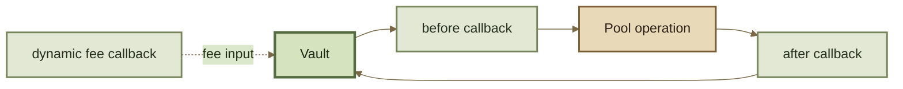

# Hooks API

Hooks are lifecycle extensions attached to a Pool. They let a Pool opt into additional behavior without moving that behavior into the Pool's invariant or the Vault's general accounting logic.

A Hook first declares which callback capabilities it uses. The Vault then calls only the enabled lifecycle points for that Pool.

***

### Registration

#### `onRegister`

Called when a Pool is registered with the Vault. The inherited interface receives the factory, Pool, token configuration, and liquidity-management configuration and returns a success flag.

Use registration to validate that the Hook is compatible with the Pool being attached to it.

#### `getHookFlags`

Returns the Hook's callback capability flags.

A Hook should enable only the callbacks it actually implements. Every enabled callback increases the Pool's execution surface and should have a clear purpose.

***

### Hook flags

The inherited `HookFlags` model includes flags for:

* before initialize;
* after initialize;
* before add liquidity;
* after add liquidity;
* before remove liquidity;
* after remove liquidity;
* before swap;
* after swap;
* dynamic swap-fee computation;
* Hook-adjusted amounts.

The Vault stores the enabled set in the Pool's Hooks configuration together with the Hook contract address.

***

### Lifecycle callbacks

| Lifecycle        | Before                    | After                    |
| ---------------- | ------------------------- | ------------------------ |
| initialization   | `onBeforeInitialize`      | `onAfterInitialize`      |
| add liquidity    | `onBeforeAddLiquidity`    | `onAfterAddLiquidity`    |
| remove liquidity | `onBeforeRemoveLiquidity` | `onAfterRemoveLiquidity` |
| swap             | `onBeforeSwap`            | `onAfterSwap`            |

Before-callbacks are primarily gates/inspection points. After-callbacks can also participate in adjusted-amount behavior when that capability is enabled.

***

### Dynamic swap fees

`onComputeDynamicSwapFeePercentage` lets a configured Hook provide the swap-fee percentage for an operation instead of using only the Pool's static fee.

The callback receives the swap context and the static fee as an input to the decision. Returned values remain bounded by the protocol's fee validation rules.

A dynamic-fee Hook changes execution economics even though the Pool's invariant and ABI can remain unchanged.

***

### Hook-adjusted amounts

The inherited interface can permit an enabled Hook to return adjusted raw amounts after supported operations.

Important cases include:

* `onAfterAddLiquidity` → adjusted raw token amounts in;
* `onAfterRemoveLiquidity` → adjusted raw token amounts out;
* `onAfterSwap` → adjusted calculated raw amount.

This capability is explicit. A Hook does **not** gain arbitrary authority to mutate any Vault state simply because it is called during an operation.


For aggregators and risk systems, an unknown Hook is not equivalent to “no Hook.” Check the Pool's Hook address and flags before assuming standard execution semantics.


***

### Callback context

Exact callback signatures are ABI-version facts, but integrations and Hook builders should expect the lifecycle context to carry data such as:

* Pool address;
* Router/sender context;
* token configuration;
* raw and/or scaled balances;
* exact-in / exact-out swap data;
* liquidity kind;
* RPT amounts;
* Hook user data;
* static fee inputs;
* success / adjusted-amount returns.

Do not mix raw token units with scaled18 or live balances. The callback signature determines which representation is being passed.

***

### Control-flow boundary

A callback is an external control-flow boundary. Hook code can introduce reentrancy assumptions, griefing, stale-oracle behavior, privilege risk, or economic manipulation even when the underlying Pool math is unchanged.

See Build a Hook and Trust Boundaries.
