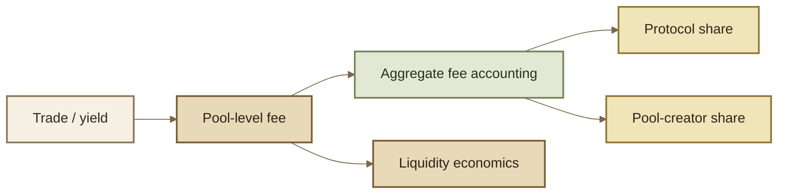

# Protocol Fee Controller

The Protocol Fee Controller separates **market fees** from **fee distribution**.

A Pool's swap-fee mechanism determines the fee charged by the market. The Protocol Fee Controller determines how configured protocol and pool-creator shares of accumulated fees are accounted for and withdrawn.

***

### Fee layers

These layers should not be collapsed into one “fee percentage.” A frontend quoting a trade mainly needs the effective Pool swap fee. Accounting and treasury systems also need the protocol/creator distribution.

***

### Read surface

The inherited controller exposes reads for:

* global protocol swap-fee percentage;
* global protocol yield-fee percentage;
* Pool-specific protocol swap/yield fee information;
* whether a Pool uses a specific override;
* pool-creator fee percentage;
* protocol fee balances;
* pool-creator fee balances;
* aggregate fee-percentage calculation.

Exact function names and return structs should come from the deployed ROOTSTOCK ABI.

***

### Interface index

The inherited controller groups its callable surface as follows:

| Area                    | Methods                                                                     |
| ----------------------- | --------------------------------------------------------------------------- |
| identity / collection   | `vault`, `collectAggregateFees`, `isPoolRegistered`                         |
| global reads            | `getGlobalProtocolSwapFeePercentage`, `getGlobalProtocolYieldFeePercentage` |
| Pool protocol-fee reads | `getPoolProtocolSwapFeeInfo`, `getPoolProtocolYieldFeeInfo`                 |
| creator-fee reads       | `getPoolCreatorSwapFeePercentage`, `getPoolCreatorYieldFeePercentage`       |
| accrued balances        | `getProtocolFeeAmounts`, `getPoolCreatorFeeAmounts`                         |
| composition             | `computeAggregateFeePercentage`                                             |
| global synchronization  | `updateProtocolSwapFeePercentage`, `updateProtocolYieldFeePercentage`       |
| Pool registration       | `registerPool`                                                              |
| global configuration    | `setGlobalProtocolSwapFeePercentage`, `setGlobalProtocolYieldFeePercentage` |
| Pool protocol overrides | `setProtocolSwapFeePercentage`, `setProtocolYieldFeePercentage`             |
| creator configuration   | `setPoolCreatorSwapFeePercentage`, `setPoolCreatorYieldFeePercentage`       |
| protocol withdrawal     | `withdrawProtocolFees`, `withdrawProtocolFeesForToken`                      |
| creator withdrawal      | overloaded `withdrawPoolCreatorFees` methods                                |

Exact authorization belongs to the deployed implementation/Authorizer; the grouping above only describes interface ownership.

***

### Global defaults and Pool overrides

The upstream v3 model distinguishes a global protocol fee from an optional Pool-specific override.

That distinction matters operationally:

* a Pool following the global value can synchronize to the current global fee;
* a Pool with a governance-set override does not simply inherit the new global value;
* the creator share is a separate configuration surface.

***

### Update vs set

The inherited interface contains **two different permission models** that should not be confused.



`updateProtocolSwapFeePercentage(pool)` and `updateProtocolYieldFeePercentage(pool)` synchronize a Pool that is following the global value.

In the upstream interface these update operations are permissionless when the Pool is not under a governance override.



Global setters, Pool-specific override setters, and creator-fee setters are permissioned configuration operations.

Who can call them is a property of the deployed Authorizer/role configuration.



The existence of a setter never implies public mutability.

***

### Collection and withdrawal

The controller participates in collecting aggregate fees from the Vault and exposes separate balances/withdrawal paths for protocol and Pool-creator amounts.

This separation lets accounting systems answer distinct questions:

* how much gross fee did the market produce?
* how much was assigned to the protocol?
* how much was assigned to the Pool creator?
* how much remains economically attributable to liquidity?

***

### Composition order matters

Protocol and creator percentages are not safely combined by simply adding two displayed percentages unless the implementation explicitly defines that formula.

In the inherited v3 controller, creator fee composition is calculated in the controller's aggregate-fee logic. Integrations should use the deployed contract's read/calculation surface rather than re-creating the formula from UI labels.

***

### ROOTSTOCK deployment note

A Protocol Fee Controller address is not included in the currently published 17-address Base Sepolia application/SDK map used by this documentation build. That does **not** mean the deployed Vault has no controller; the Vault interface itself exposes controller discovery.

Use Deployments once the controller address and deployment provenance are published as a canonical ROOTSTOCK artifact.

***

### Integration rule

* **Swap UI:** consume the effective Pool swap fee relevant to the quote.
* **Pool analytics:** record gross swap/yield fee data plus aggregate protocol/creator shares.
* **Treasury tooling:** query controller balances and withdrawal events/state.
* **Governance/admin tooling:** inspect authorization before exposing configuration actions.

Never substitute an upstream Balancer controller address for an unpublished ROOTSTOCK address.
