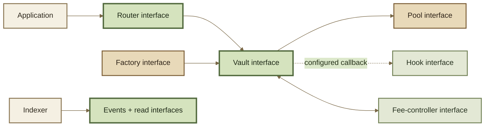

# Protocol Interfaces

Protocol interfaces are the formal boundaries between ROOTSTOCK components. They define **who may call what shape of function**, which data crosses the boundary, and which responsibilities remain on each side.

The inherited Balancer v3 interface families provide the current technical model. Exact ROOTSTOCK interface artifacts should be generated from the build that produced the deployed bytecode.

***

### Interface families

| Family                      | Primary responsibility                                        | Typical caller                        |
| --------------------------- | ------------------------------------------------------------- | ------------------------------------- |
| Vault                       | accounting, settlement, swaps, liquidity, pool state, queries | Routers / infrastructure              |
| Vault Admin                 | pausing, fee/config administration, recovery, buffer controls | authorized accounts/contracts         |
| Pool                        | invariant and swap/liquidity math                             | Vault                                 |
| Router                      | public workflows and query equivalents                        | users / apps / solvers                |
| Hook                        | lifecycle callbacks and dynamic fees                          | Vault                                 |
| Factory                     | instance creation and version provenance                      | deployers / builders                  |
| Protocol Fee Controller     | protocol + creator fee accounting and collection              | Vault / authorized fee administration |
| Authorizer / authentication | permission checks and role administration                     | protocol contracts / administrators   |
| Token / rate                | RPT ERC-20 behavior, rate providers, ERC-4626 assets          | Vault / apps                          |
| Contract Registry           | typed discovery, aliases, active/deprecated state             | apps / Routers / governance tooling   |

***

### Caller direction





Applications should normally integrate through a Router rather than internal math interfaces. The Router gives the application a stable workflow boundary while the Vault and Pool retain their lower-level responsibilities.

***

### The Vault interface is composed

The inherited v3 Vault surface is not one small interface. It is composed from execution, extension/read, admin, event, and error surfaces.

A useful mental split is:



Unlocking, settlement, swaps, liquidity operations, token movement, and buffer wrap/unwrap primitives.



Pool registration/state, balances, rates, configuration, RPT accounting, fee reads, recovery reads, quote machinery, and authorization discovery.



Pause state, fee/config setters, recovery controls, query controls, buffer administration, and authorizer replacement.



See Vault API for the callable groups.

***

### Shared data types

Several types are part of the inherited cross-contract language. Important examples include:

| Type                  | Meaning                                                                       |
| --------------------- | ----------------------------------------------------------------------------- |
| `SwapKind`            | `EXACT_IN` or `EXACT_OUT`                                                     |
| `AddLiquidityKind`    | proportional, unbalanced, single-token exact-out, donation, custom            |
| `RemoveLiquidityKind` | proportional, single-token exact-in/out, custom                               |
| `TokenConfig`         | token, token type, rate provider, yield-fee flag                              |
| `PoolConfig`          | liquidity management, fee percentages, pause/registration/init/recovery state |
| `PoolRoleAccounts`    | pause manager, swap-fee manager, pool creator                                 |
| `HookFlags`           | callback capabilities a Hook requests                                         |
| `HooksConfig`         | enabled callback flags plus Hook contract address                             |
| `PoolSwapParams`      | normalized swap inputs passed to pool/hook logic                              |

Exact struct members and ordering are ABI facts. Use the generated interface/ABI for the deployment version you target.

***

### Interface compatibility is not economic compatibility

Two contracts can satisfy the same Solidity interface and still behave differently economically.

A custom Pool may implement the expected Vault callback while using a different invariant. A Hook can alter dynamic fees or adjusted amounts without changing the Pool ABI. Interface compatibility therefore answers **can these contracts communicate?** It does not answer **do these markets behave the same?**

Integrators that accept arbitrary Pools or Hooks need capability and trust checks in addition to ABI compatibility.

***

### Version binding

For every exact interface used by an integration, record:

* interface source path and commit/build identifier;
* compiler/build provenance where available;
* deployed chain and contract address;
* corresponding ABI artifact;
* version metadata exposed by the contract/factory, when available;
* whether the surface is intended for external callers or internal composition.

See ABIs, Deployments, and Repositories.
