# SDK

An SDK should make ROOTSTOCK easier to integrate without hiding the economic choices an application must make.

The SDK layer is responsible for typed inputs, queries, calldata construction, address resolution, and common validation. It should not silently choose risk, slippage, trust, or routing policy on behalf of the caller.

***

### Current ROOTSTOCK client stack

The current ROOTSTOCK application repository uses:

* a private workspace library, `@repo/lib`, for application/domain logic;
* `@balancer/sdk` **6.2.0** for inherited v3 builders, address helpers, Permit2 utilities, and protocol types;
* `@balancer-labs/balancer-maths` for upstream math utilities;
* `viem` / `wagmi` for EVM transport and wallet interaction.

ROOTSTOCK does **not** currently publish a separate public npm package such as `@rootstock/sdk` in its public repository.

***

### Base Sepolia adaptation

`@balancer/sdk@6.2.0` does not natively contain ROOTSTOCK's Base Sepolia (`84532`) deployment map.

The active ROOTSTOCK branch therefore carries a pnpm patch that adds the Base Sepolia addresses used by SDK `AddressProvider` lookups for 17 v3 contract roles.


That patch is part of the current application integration. It is not a substitute for a standalone canonical deployment manifest or a ROOTSTOCK-specific released SDK.


See Deployments.

***

### SDK responsibilities

A ROOTSTOCK SDK surface should cover at least:

| Area               | Responsibility                                                   |
| ------------------ | ---------------------------------------------------------------- |
| chains/deployments | resolve supported networks and exact contract addresses          |
| pools/tokens       | typed Pool, token, amount, rate, and RPT representations         |
| swaps              | exact-in/exact-out query and transaction construction            |
| liquidity          | initialize/add/remove builders and queries                       |
| routers            | choose an explicitly supported Router capability                 |
| limits             | slippage, min-out, max-in, deadlines                             |
| approvals          | ERC-20 / Permit2 policy and calldata                             |
| native assets      | ETH/WETH value/wrap handling                                     |
| paths              | multihop/batch route representation                              |
| decoding           | ABIs, events, custom errors, transaction receipts                |
| Hooks              | surface Hook identity/capabilities relevant to trust and quoting |

***

### What an SDK should not hide

The caller should deliberately choose or accept:

* slippage tolerance;
* recipient;
* deadline where exposed;
* approval/Permit2 policy;
* route-selection policy;
* acceptable Pool and Hook types;
* chain/deployment version;
* whether an operation may use a specialized Router.

A convenient API is not permission to erase economically meaningful choices.

***

### Query → limit → build

A robust builder flow is:

```mermaid
%%{init: {"theme":"base","themeVariables":{
  "primaryColor":"#E7E0C3",
  "primaryTextColor":"#243018",
  "primaryBorderColor":"#6F7B48",
  "lineColor":"#7A6847",
  "secondaryColor":"#DCE8CB",
  "tertiaryColor":"#F3EBD8",
  "fontFamily":"Inter, ui-sans-serif, system-ui, sans-serif"
}}}%%
flowchart LR
    I["typed user intent"] --> Q["matching Router query"]
    Q --> L["apply user limits"]
    L --> B["build calldata + value"]
    B --> S["simulate"]
    S --> X["submit"]

    classDef user fill:#F5F0E3,stroke:#8B7754,stroke-width:2px,color:#2E281D;
    classDef execution fill:#D5E3BE,stroke:#536B3F,stroke-width:3px,color:#1D2816;
    classDef metadata fill:#F0E4B9,stroke:#917634,stroke-width:2px,color:#2B2516;
    class I user;
    class Q,B,S,X execution;
    class L metadata;
```

The query and execution builder should target the same operation and Router family.

***

### Version binding

Pin SDK behavior to the deployment/interface version it understands.

A package update can change:

* Router selection;
* default address maps;
* path encoding;
* ABI assumptions;
* Permit2 behavior;
* supported Pool types;
* calculation helpers.

Therefore record both the application SDK version and the protocol deployment version in reproducible builds.

***

### Validation

For every transaction builder, test parity against:

1. the matching onchain Router query;
2. transaction simulation;
3. known transaction fixtures;
4. decoded calldata;
5. expected contract address for the target chain.

Decode generated calldata during tests and assert the Pool, tokens, amounts, recipient, limits, path, and Router. This catches address-map and encoding regressions before a wallet signs them.

***

### Future ROOTSTOCK SDK release

If ROOTSTOCK publishes its own SDK package, it should remove the need for local patching and ship the deployment map, supported Router capability model, ABI/version bindings, and ROOTSTOCK terminology as a coherent release.

Until then, treat the current client stack as **ROOTSTOCK application code built on upstream SDK primitives**, not as a separately versioned public ROOTSTOCK SDK product.
