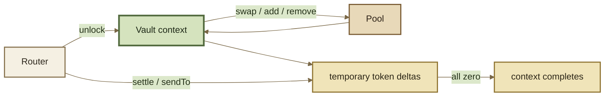

# Vault API

The Root Vault is ROOTSTOCK's low-level accounting and settlement surface. It is the contract boundary beneath Routers and above Pool math.

Most applications should **not** call Vault execution primitives directly. This page exists for Router builders, protocol integrations, auditors, and infrastructure that deliberately needs the lower-level surface.


Function names below describe the inherited Balancer v3 interface family. Exact signatures, structs, constants, permissions, and deployed addresses must be bound to the ROOTSTOCK ABI and deployment version you are targeting.


***

### Execution model

The inherited execution surface centers on transient accounting:

The critical invariant is simple: **an unlocked execution context cannot finish with unsettled non-zero token deltas.**

***

### Interface composition

The inherited `IVault` interface composes `IVaultMain`, `IVaultExtension`, `IVaultAdmin`, `IVaultEvents`, `IVaultErrors`, and authentication. The deployed implementation may delegate parts of that surface internally, but callers should bind to the ABI exposed at the target deployment.

Two low-level discovery methods are easy to miss:

* `getVaultExtension()` returns the extension implementation address used by the main Vault;
* `getVaultAdmin()` returns the admin implementation address exposed through the extension surface.

The main execution interface also includes `erc4626BufferWrapOrUnwrap`, the primitive used for buffer-backed wrapper conversions inside an unlocked Vault workflow.

***

### Transient accounting primitives

| Function               | Purpose                                                                       |
| ---------------------- | ----------------------------------------------------------------------------- |
| `unlock`               | Opens a Vault execution context and invokes caller-supplied callback data.    |
| `settle`               | Reconciles value transferred into the Vault against the caller's token delta. |
| `sendTo`               | Transfers tokens out of the Vault and updates the caller's delta.             |
| `isUnlocked`           | Reports whether the Vault is currently inside an unlocked context.            |
| `getNonzeroDeltaCount` | Returns the number of token deltas that remain non-zero.                      |
| `getTokenDelta`        | Returns a caller's credit or debt for a token.                                |
| `getReservesOf`        | Reads the Vault's recorded reserves for a token.                              |

A positive/negative delta is not an ERC-20 transfer by itself. It is transient accounting that must be reconciled before the context completes.

***

### Swaps

`swap` is the low-level Vault swap primitive.

The Vault normalizes balances and parameters, calls the Pool's swap logic, applies configured fee/accounting rules, invokes enabled Hook callbacks, and records the resulting token deltas. Final token settlement remains the responsibility of the caller's unlocked workflow.

Use Router APIs unless you are building infrastructure that needs to compose Vault primitives directly.

***

### Add liquidity

`addLiquidity` implements the protocol's liquidity-kind model. Inherited kinds include:

* proportional adds;
* unbalanced adds;
* single-token exact-out adds;
* donations;
* custom liquidity.

The Vault coordinates balances, fees, Hook callbacks, and RPT supply effects while the Pool supplies the market-specific calculation where required.

Exact kind support depends on Pool configuration and liquidity-management flags.

***

### Remove liquidity

`removeLiquidity` covers normal remove-liquidity kinds. `removeLiquidityRecovery` provides the dedicated recovery-mode exit path.

Inherited removal modes include proportional, single-token exact-in, single-token exact-out, and custom behavior where the Pool supports it.

Recovery removal is intentionally a separate path because recovery mode changes which assumptions are safe during an emergency.

***

### Pool registration and initialization

Key inherited methods include:

* `registerPool`;
* `isPoolRegistered`;
* `initialize`;
* `isPoolInitialized`.

Deployment, registration, and initialization are distinct lifecycle steps. A deployed Pool contract is not automatically an initialized market.

***

### Pool state and configuration reads

The inherited Vault Extension exposes reads such as:

| Function                           | Returns / purpose                                           |
| ---------------------------------- | ----------------------------------------------------------- |
| `getPoolTokenCountAndIndexOfToken` | token count and index lookup                                |
| `getPoolTokens`                    | registered token list                                       |
| `getPoolTokenRates`                | decimal/rate scaling data                                   |
| `getPoolData`                      | consolidated pool data                                      |
| `getPoolTokenInfo`                 | per-token accounting/config data                            |
| `getCurrentLiveBalances`           | current live/scaled balances                                |
| `getPoolConfig`                    | registration, liquidity, fee, pause, recovery configuration |
| `getHooksConfig`                   | Hook address and enabled callback flags                     |
| `getBptRate`                       | inherited pool-share rate read                              |
| `getPoolRoleAccounts`              | pool-specific role accounts                                 |


ROOTSTOCK calls pool shares **RPTs**. The inherited method name `getBptRate` is retained here because interface identifiers must match the ABI exactly.


***

### Read / extension interface index

The inherited extension/read surface exposes the following exact method families:

| Area             | Methods                                                                                                                                                                   |
| ---------------- | ------------------------------------------------------------------------------------------------------------------------------------------------------------------------- |
| execution state  | `isUnlocked`, `getNonzeroDeltaCount`, `getTokenDelta`, `getReservesOf`, `getAddLiquidityCalledFlag`                                                                       |
| Pool lifecycle   | `registerPool`, `isPoolRegistered`, `initialize`, `isPoolInitialized`                                                                                                     |
| Pool data        | `getPoolTokens`, `getPoolTokenRates`, `getPoolData`, `getPoolTokenInfo`, `getCurrentLiveBalances`, `getPoolConfig`, `getHooksConfig`, `getBptRate`, `getPoolRoleAccounts` |
| Pool state       | `isPoolPaused`, `getPoolPausedState`, `isPoolInRecoveryMode`                                                                                                              |
| buffer discovery | `isERC4626BufferInitialized`, `getERC4626BufferAsset`                                                                                                                     |
| fee reads        | `getAggregateSwapFeeAmount`, `getAggregateYieldFeeAmount`, `getStaticSwapFeePercentage`, `computeDynamicSwapFeePercentage`, `getProtocolFeeController`                    |
| queries          | `quote`, `quoteAndRevert`, `isQueryDisabled`, `isQueryDisabledPermanently`                                                                                                |
| auxiliary / auth | `emitAuxiliaryEvent`, `getAuthorizer`, `getVaultAdmin`                                                                                                                    |

The table is an index. Return tuples, units, and mutability still come from the exact ABI/source pin.

***

### RPT / ERC-20 surface

RPT accounting is centralized in the Vault, while the Pool token contract presents the normal ERC-20 surface to users.

At the Vault boundary, the inherited multi-token functions include:

* `totalSupply(token)`;
* `balanceOf(token, account)`;
* `allowance(token, owner, spender)`;
* `approve(owner, spender, amount)`;
* `transfer(from, to, amount)`;
* `transferFrom(spender, from, to, amount)`.

The Pool token contract forwards its standard ERC-20 calls into that shared accounting layer. For example, a user calls `pool.transfer(to, amount)`, while the Pool token forwards the accounting operation to the Vault.


**User-facing ERC-20 ABI and Vault accounting ABI are different surfaces.** Integrations treating an RPT as an ERC-20 should normally call the Pool token contract, not reproduce the Vault's multi-token method signatures. See Events for where `Transfer` and `Approval` are emitted.


***

### Fees

The Vault exposes reads and control points for:

* static swap-fee percentages;
* dynamic-fee computation through Hooks;
* aggregate protocol/creator swap and yield fee percentages;
* aggregate fee amounts;
* collection of aggregate fees;
* discovery of the Protocol Fee Controller.

Setters are authorization-sensitive. A function existing in an ABI does not make it permissionless.

See Protocol Fee Controller for fee-distribution semantics.

***

### ERC-4626 buffers

Where configured, the inherited Vault surface supports ERC-4626 buffer accounting. Relevant operations include initialization, wrap/unwrap, adding/removing buffer liquidity, share/balance reads, underlying-asset discovery, and pause state.

Buffers are protocol accounting primitives, not generic permission to treat every ERC-4626 token identically. Integrators must verify buffer initialization and token compatibility.

***

### Pausing and recovery

The inherited system distinguishes:

* Vault-level pause state;
* Pool-level pause state;
* Vault-buffer pause state;
* Pool recovery mode.

Admin surfaces also expose pause-window and buffer-period configuration. Exact authorization and timing are deployment facts; read them from the deployed system rather than hard-coding upstream assumptions.

***

### Queries

The low-level Vault query machinery includes `quote` and `quoteAndRevert`, plus controls that can disable queries temporarily or permanently.

Applications should normally use the corresponding Router query function. Router queries preserve the same workflow shape that the application later executes and reduce the chance of quoting one path while submitting another.

***

### Constants and deployment configuration

The inherited admin/read surface exposes values such as minimum trade/wrap amounts, minimum and maximum token counts, minimum pool supply, pause-window endpoints, and buffer-period configuration.

These are **deployment-version facts**. Resolve them from the target ROOTSTOCK deployment.

***

### Admin interface index

The inherited Vault Admin surface groups the exact methods below. Presence in the ABI does not imply permissionlessness.

| Area                 | Methods                                                                                                                                                                                                                                   |
| -------------------- | ----------------------------------------------------------------------------------------------------------------------------------------------------------------------------------------------------------------------------------------- |
| deployment constants | `getPauseWindowEndTime`, `getBufferPeriodDuration`, `getBufferPeriodEndTime`, `getMinimumPoolTokens`, `getMaximumPoolTokens`, `getPoolMinimumTotalSupply`, `getBufferMinimumTotalSupply`, `getMinimumTradeAmount`, `getMinimumWrapAmount` |
| Vault / Pool pause   | `isVaultPaused`, `getVaultPausedState`, `pauseVault`, `unpauseVault`, `pausePool`, `unpausePool`                                                                                                                                          |
| fees                 | `setStaticSwapFeePercentage`, `collectAggregateFees`, `updateAggregateSwapFeePercentage`, `updateAggregateYieldFeePercentage`, `setProtocolFeeController`                                                                                 |
| recovery             | `enableRecoveryMode`, `disableRecoveryMode`                                                                                                                                                                                               |
| query controls       | `disableQuery`, `disableQueryPermanently`, `enableQuery`                                                                                                                                                                                  |
| buffer controls      | `areBuffersPaused`, `pauseVaultBuffers`, `unpauseVaultBuffers`, `initializeBuffer`, `addLiquidityToBuffer`, `removeLiquidityFromBuffer`, `getBufferAsset`, `getBufferOwnerShares`, `getBufferTotalShares`, `getBufferBalance`             |
| authorization        | `setAuthorizer`                                                                                                                                                                                                                           |

This table is an interface index, not a permissions table. Resolve roles from the deployed Authorizer and contract state.

***

### Direct-Vault integration checklist

Before calling the Vault directly, your integration must deliberately handle:

* unlock/callback control flow;
* token deltas and settlement;
* sender and recipient semantics;
* authorization and approvals;
* exact-in/exact-out limits;
* native-token wrapping where applicable;
* Hook-adjusted behavior;
* pool initialization / pause / recovery state;
* query parity;
* exact ABI and deployment version.

If you do not need that control, use a Router.
