# Dynamic Fees

A **dynamic swap fee** is a swap fee calculated for the current trade instead of always using the pool's configured static fee.

In ROOTSTOCK's inherited v3 architecture, dynamic fees are implemented through **Hooks**.

The simplest mental model is:

```
Static fee
swap → configured fee → execution

Dynamic fee
swap → Hook calculates fee → execution
```

This allows two pools using the same underlying AMM mathematics to apply different fee policies.


**Dynamic fees change the cost of using a market without changing its underlying invariant.**

The pool still defines how the trade is priced. The Hook determines which swap-fee percentage the Vault should apply to that trade.


### Static vs dynamic fees

Every Root Pool has a **static swap fee** stored as part of its pool configuration.

For an ordinary static-fee pool:

```
executed fee = static fee
```

A pool configured for dynamic fees takes a different path:

```
executed fee = Hook(swap context, pool, static fee)
```

The static fee does not disappear.

In the inherited architecture, the Vault loads it first and passes it to the dynamic-fee Hook as a reference value. The Hook then returns the fee that should actually be used for the swap.

| Static fee                                             | Dynamic fee                                                                               |
| ------------------------------------------------------ | ----------------------------------------------------------------------------------------- |
| Stored in pool configuration                           | Calculated for the current swap                                                           |
| Changed through the pool's fee-management authority    | Determined by Hook logic                                                                  |
| Subject to the pool implementation's static-fee bounds | Subject to the dynamic-fee validation enforced by the Vault and any additional Hook rules |
| Same until configuration changes                       | Can vary between otherwise similar swaps                                                  |
| No dynamic-fee callback required                       | Requires the dynamic-fee Hook capability                                                  |


**Static and dynamic fee bounds are not the same mechanism.**

Static fees are constrained by the minimum and maximum fee bounds defined by the pool implementation.

In the inherited v3 implementation, a Hook-computed dynamic fee is instead checked against the Vault's global maximum supported fee. It does **not automatically inherit the pool's static-fee minimum and maximum**.

A particular Hook may impose tighter bounds of its own.


### Where the dynamic fee enters a swap

Dynamic fee calculation occurs inside the swap lifecycle.

Conceptually:



```mermaid
%%{init: {"theme":"base","themeVariables":{"fontFamily":"Inter, ui-sans-serif, system-ui","primaryTextColor":"#111827","lineColor":"#6B7280","clusterBkg":"#F9FAFB","clusterBorder":"#D1D5DB"}}}%%
flowchart LR
    R["Swap request"]
    B["Before-swap Hook"]
    F["Dynamic-fee Hook"]
    S["Core swap"]
    A["After-swap Hook"]
    X["Settlement result"]

    R --> B
    B --> F
    F --> S
    S --> A
    A --> X

    classDef action fill:#F3F4F6,stroke:#6B7280,stroke-width:2px,color:#111827;
    classDef hook fill:#FDE68A,stroke:#9A6A16,stroke-width:3px,color:#111827;
    classDef pool fill:#FCE7F3,stroke:#BE4B87,stroke-width:3px,color:#111827;
    classDef result fill:#E8F5E9,stroke:#3F7D4A,stroke-width:2px,color:#111827;

    class R action;
    class B,F,A hook;
    class S pool;
    class X result;
```

Only the configured callbacks are actually executed.

The important ordering in the inherited implementation is:

1. load the current pool and swap state;
2. run the before-swap Hook when enabled;
3. refresh relevant balances and rates if the before Hook ran;
4. compute the dynamic swap fee when enabled;
5. execute the core swap using that fee;
6. run the after-swap Hook when enabled;
7. return the final result.

This means the dynamic-fee calculation is based on the swap context used by the actual operation rather than an unrelated cached fee estimate.

### What can a dynamic fee react to?

The formula is defined by the Hook.

Depending on its implementation, a dynamic-fee strategy could use information such as:

* swap direction;
* trade size;
* current pool balances;
* inventory imbalance;
* token rates;
* Hook-owned configuration;
* time or market regime;
* caller or routing context;
* external onchain state;
* oracle or risk inputs available to the Hook.

For example:

```
low-risk state
    ↓
lower fee

high-risk state
    ↓
higher fee
```

Or:

```
balanced inventory
    ↓
base fee

trade pushes inventory farther from target
    ↓
higher fee
```

These are **possible strategies**, not one universal ROOTSTOCK fee formula.

The actual behavior is determined by the Hook attached to the pool.

### Why vary a fee?

A fixed fee assumes that one price for liquidity provision is appropriate across different market conditions.

That may not always be true.

Market-making conditions can change because of:

* volatility;
* inventory imbalance;
* toxic or adverse flow;
* changing arbitrage conditions;
* trade size;
* external market conditions;
* changing liquidity depth;
* application-specific risk.

A dynamic fee gives a market designer another control surface for responding to those conditions.

The general objective is:

> **change the price charged for liquidity when the conditions under which that liquidity is used change.**

That does not guarantee better market performance.

The result depends on the fee strategy, pool mathematics, competing liquidity, routing, market conditions, and user behavior.

### Dynamic fees and pool mathematics

Dynamic fees do **not** replace the pool invariant.

Consider a Weighted Pool.

```
Weighted invariant
        +
Dynamic-fee Hook
        ↓
Weighted market with adaptive swap fees
```

The Hook determines the fee.

The Weighted Pool still determines the mathematical relationship used to calculate the trade.

The same architectural separation can apply to other pool types:

```
Stable Pool + dynamic-fee Hook

Weighted Pool + dynamic-fee Hook

Custom Pool + dynamic-fee Hook
```

This is why dynamic fees belong to the **Hook extension layer**, not to a new category of invariant.

See Hooks.

### Dynamic fees apply to the swap path

The term **dynamic swap fee** is specific.

In the inherited v3 implementation, the dynamic-fee callback participates in the **swap execution path**.

Standard fee calculations associated with non-proportional liquidity operations use the pool's **static swap fee** instead.

Conceptually:

```
direct swap
    ↓
dynamic fee when configured

unbalanced / single-token liquidity calculation
    ↓
static fee used by the standard liquidity math
```

This distinction matters for applications attempting to reproduce pool economics.

A pool being configured for dynamic swap fees does not mean every operation that can generate swap-fee economics receives a dynamically calculated fee.

### Effects on LPs

A higher fee means more **gross fee per unit of executed volume**, all else equal.

But:

```
higher fee ≠ automatically higher LP return
```

A higher fee can also:

* make the pool less competitive for routing;
* reduce trading volume;
* change arbitrage behavior;
* alter how quickly prices are brought back toward external markets.

Likewise, a lower fee may attract more flow while collecting less fee on each unit traded.

The economic result depends on both:

```
fee per trade
        ×
executed trading activity
```

and on how gross fee economics are subsequently allocated.

Protocol and optional pool-creator allocations can reduce the portion ultimately retained by LP liquidity.

See Fees & LP Returns.

### Effects on traders and routers

For a trader, the important value is not the pool's stored static fee.

It is the fee that would apply to the **specific swap being executed**.

With dynamic fees, two trades against the same pool can receive different results even when the pool contract and static fee configuration have not changed.

For example:

```
Swap A
current state → Hook → 0.10%

Swap B
later state → Hook → 0.40%
```

A router therefore needs the result of the executable swap path rather than assuming that one cached percentage describes the pool indefinitely.

This also affects route selection.

A pool with attractive raw liquidity may become less attractive for a particular trade if its dynamic fee increases for that trade.

### Queries must include Hook behavior

Dynamic fees are one reason ROOTSTOCK integrations should prefer **protocol queries and simulation** over reconstructing swap results from incomplete offchain state.

A proper swap query can evaluate the same relevant path:

```
current state
      +
swap parameters
      +
configured Hook behavior
      ↓
simulated result
```

A locally cached value such as:

```
pool fee = 0.10%
```

may be insufficient if `0.10%` is only the static reference fee and the executed swap would invoke a dynamic-fee Hook.


A query is still a **simulation of a particular state**, not a guarantee of future execution.

Before the transaction executes:

* balances can change;
* token rates can change;
* Hook inputs can change;
* external state can change;
* another transaction can alter market conditions.

Execution limits remain necessary.


See Queries & Simulation.

### Fee bounds

Dynamic does not mean unlimited.

The Root Vault still validates the percentage returned by the Hook.

In the current inherited v3 implementation, the Vault rejects a dynamic swap fee above its global maximum supported fee, which is deliberately slightly below `100%`.

The Hook can impose stricter constraints.

For example, a Hook might define:

```
minimum strategy fee
        ≤
calculated fee
        ≤
maximum strategy fee
```

or use the static fee as a baseline:

```
dynamic fee = static fee + risk adjustment
```

Those policies belong to the Hook implementation.


Do not confuse three separate controls:

1. **pool-specific static-fee bounds**;
2. **Vault-level validity checks for dynamic fees**;
3. **additional limits implemented by a particular Hook**.

They are distinct layers.


Exact constants and callback behavior belong in the Hooks API and current deployed contracts.

### Failure behavior matters

The dynamic fee is part of swap execution, not optional metadata.

If a pool is configured to use the dynamic-fee callback and that callback fails, the inherited Vault does not silently fall back to an arbitrary cached dynamic value.

The swap fails.

Conceptually:

```
dynamic fee required
        ↓
Hook calculation succeeds?
      /       \
    yes        no
     ↓          ↓
 execute      revert
```

This makes the Hook an economic and availability dependency for the pool's swaps.

### Security considerations

A dynamic-fee Hook participates directly in the economics of every swap for which it is enabled.

Reviewing the pool therefore requires reviewing the fee logic as well.

Important questions include:

| Question                                                     | Why it matters                                                              |
| ------------------------------------------------------------ | --------------------------------------------------------------------------- |
| **Who can change Hook parameters?**                          | Fee behavior may be mutable even when the pool-to-Hook association is fixed |
| **What state does the Hook read?**                           | Manipulable inputs can produce manipulable fees                             |
| **Can inputs move within the same transaction?**             | Flash liquidity or earlier calls may affect the calculated fee              |
| **Does it use external contracts or oracles?**               | Additional dependencies become part of swap execution                       |
| **What are its effective fee bounds?**                       | Extreme fees can materially change execution economics                      |
| **Does behavior depend on direction, router, or user data?** | Different users or routes may receive different fee behavior                |
| **What happens on dependency failure?**                      | A failed fee calculation can prevent swaps                                  |
| **Can parameters change abruptly?**                          | Previously observed fees may cease to describe current behavior             |

In the inherited interface, the dynamic-fee callback itself is a **view** operation: it calculates and returns a fee rather than mutating Hook state through that callback.

It can still read mutable pool, Hook, and external state.

That distinction is important.

### Dynamic fee vs adjusted amount

Dynamic fees and Hook-adjusted amounts are separate capabilities.

A dynamic-fee Hook changes:

```
the fee used by the swap
```

An enabled after-swap Hook with adjusted amounts can potentially change:

```
the calculated side of the swap result
```

A Hook may support one, both, or neither capability.

Applications should not treat “this pool uses a Hook” as enough information to know which behavior is active.

See Hooks.

### What dynamic fees are not

A dynamic fee is **not** a new AMM invariant.

It is **not** necessarily the pool's stored static fee changing every block.

It is **not** automatically used by every fee-bearing liquidity operation.

It is **not** unconstrained merely because a Hook computes it.

And it is **not safely represented by one indefinitely cached offchain percentage**.

A useful final model is:

```
Pool
→ determines market mathematics

Hook
→ determines dynamic fee policy

Vault
→ validates the fee and executes the swap

Router / query
→ evaluates the path for the user
```


This page describes the **inherited v3 dynamic-fee architecture** used as the ROOTSTOCK design model.

The specific dynamic-fee Hooks available in a ROOTSTOCK release, their parameters, permissions, and deployed addresses should be verified against that release's contracts and deployment registry.


### Related pages

* Hooks
* Fees & LP Returns
* Pool Configuration & Roles
* Queries & Simulation
* Hooks API
