```mermaid
%%{init: {"theme":"base","themeVariables":{"fontFamily":"Inter, ui-sans-serif, system-ui","primaryTextColor":"#111827","lineColor":"#6B7280","clusterBkg":"#F9FAFB","clusterBorder":"#D1D5DB"}}}%%
flowchart LR
    U["Unlock Vault"]
    S["sendTo"]
    D["Temporary debt"]
    X["Atomic strategy"]
    R["Return assets"]
    T["settle"]
    Z["Token delta = 0"]

    U --> S
    S --> D
    D --> X
    X --> R
    R --> T
    T --> Z

    classDef root fill:#FDE68A,stroke:#9A6A16,stroke-width:3px,color:#111827;
    classDef action fill:#F3F4F6,stroke:#6B7280,stroke-width:2px,color:#111827;
    classDef debt fill:#FFF7ED,stroke:#C47A22,stroke-width:2px,color:#111827;
    classDef settled fill:#E8F5E9,stroke:#3F7D4A,stroke-width:3px,color:#111827;

    class U root;
    class S,X,R,T action;
    class D debt;
    class Z settled;
```

# Flash Loans

A **flash loan** gives a caller temporary access to assets held by the Root Vault without requiring collateral, provided the resulting debt is fully settled before the atomic Vault interaction completes.

If the obligation is not settled, the entire transaction reverts.


**In the inherited v3 architecture, a flash loan is not a separate lending subsystem.**

It is a use of the Root Vault's **transient accounting** system.


The basic idea is:

```
take assets from the Vault
        ↓
create temporary debt
        ↓
perform atomic operations
        ↓
return the assets
        ↓
settle the debt
        ↓
all token deltas = 0
```

If the final condition is not satisfied, none of the intermediate state changes persist.

### Why flash loans are possible

Blockchain transactions are **atomic**.

Either the complete transaction succeeds, or its state changes are reverted.

ROOTSTOCK's inherited Vault architecture builds on that property by allowing temporary credits and debts while the Vault is unlocked.

During an unlocked interaction:

```
temporary debt is allowed
        ↓
temporary credit is allowed
        ↓
operations can be composed
        ↓
final outstanding delta must be zero
```

The Vault therefore does not need collateral to protect a flash loan in the conventional lending sense.

Its protection is the transaction boundary itself.

The borrower cannot successfully finish the interaction while still owing the Vault.

### Flash loans are transient accounting

The most important mental model is:

```
Flash loan
    =
temporary Vault debt
    +
atomic settlement
```

A flash loan therefore uses the same accounting machinery that supports swaps, liquidity operations, and other composed Vault interactions.





This is why flash loans belong conceptually next to Accounting & Settlement.

### How the flow works



#### 1. Unlock the Vault

The caller opens a transient accounting context.

The Vault returns execution to the caller through the unlock callback.



#### 2. Take assets

While the Vault is unlocked, `sendTo` can transfer available Vault assets to a recipient.

That transfer creates a corresponding **debt** in transient accounting.

```
Vault → borrower

borrower now owes Vault
```



#### 3. Execute the strategy

The borrowed assets can participate in other operations during the same atomic interaction.

Examples include swaps, liquidations, collateral migrations, refinancing, or interactions with external protocols.



#### 4. Return the assets

The required assets are transferred back to the Vault.

Returning tokens physically to the Vault is not by itself the complete accounting step.



#### 5. Settle

The caller uses `settle` so the Vault recognizes the returned assets as credit against the outstanding debt.

Conceptually:

```
temporary debt
    +
repayment credit
    =
0
```



#### 6. Close the interaction

Before the outer unlock completes, the Vault checks whether any tracked token delta remains non-zero.

If:

```
all deltas = 0
```

the interaction can succeed.

If:

```
any delta ≠ 0
```

the interaction reverts.



### There is no dedicated v3 `flashLoan` operation

Older Balancer v2 architecture exposed a dedicated operation conceptually shaped like:

```
flashLoan(...)
    ↓
receiveFlashLoan(...)
    ↓
repay principal + configured fee
```

The inherited v3 architecture is different.

It composes flash credit from general Vault primitives:

```
unlock(...)
    ↓
sendTo(...)
    ↓
custom execution
    ↓
transfer repayment
    ↓
settle(...)
```

This difference matters for developers reading older Balancer material.


**v2 and v3 flash loans should not be treated as the same API.**

Historical v2 documentation may refer to `flashLoan`, `IFlashLoanRecipient`, and `feeAmounts`.

Those are not the inherited v3 execution model described on this page.


Exact signatures belong in the Vault API.

### Flash-loan fees

The inherited v3 primitive does not add a separate flash-loan fee to the debt created by `sendTo`.

Conceptually:

```
Vault sends X
     ↓
transient debt = X
```

The caller must restore the Vault's accounting before the interaction closes.

This is different from the older v2 flash-loan API, which explicitly supported a flash-loan fee amount.


**Fee-free flash credit does not mean fee-free execution.**

Operations performed with the borrowed capital can still incur their ordinary costs, including:

* swap fees;
* non-proportional liquidity fees;
* fees charged by external protocols;
* gas costs;
* other operation-specific economics.


ROOTSTOCK deployment behavior should still be verified against the active Vault contracts rather than inferred from historical Balancer configuration.

### Available liquidity

Flash credit is ultimately constrained by assets the Vault can actually transfer.

If the Vault cannot provide the requested token amount, the transfer cannot succeed.

This means flash-loan capacity is related to Vault-held reserves rather than to a separate lending market with its own deposited capital.

Conceptually:

```
Root Pools / Vault-held assets
             ↓
        Root Vault
             ↓
      flash-accessible capital
```

A flash borrower does not gain ownership of that liquidity.

It receives temporary control under an atomic repayment constraint.

### Common uses

Flash liquidity can be useful whenever a strategy requires capital only for the duration of one transaction.

Examples include:

* **arbitrage** — acquiring temporary capital to execute price-difference trades;
* **collateral migration** — repaying one position before establishing another;
* **debt refinancing** — replacing one debt source with another atomically;
* **liquidations** — sourcing repayment capital before receiving liquidation collateral;
* **portfolio rebalancing** — moving between positions without maintaining idle capital;
* **multi-protocol composition** — chaining several operations that must either all succeed or all fail.

The common property is not the strategy itself.

It is:

> **temporary capital is required during execution, but no outstanding debt may remain when execution finishes.**

### Flash loans vs ordinary loans

A flash loan is fundamentally different from an ordinary collateralized loan.

|                            | Flash loan                               | Ordinary loan                                            |
| -------------------------- | ---------------------------------------- | -------------------------------------------------------- |
| **Duration**               | One atomic transaction                   | Extends across transactions                              |
| **Collateral**             | Not required by the flash-loan mechanism | Usually required                                         |
| **Repayment enforcement**  | Transaction reverts if settlement fails  | Position remains open and can become undercollateralized |
| **Interest over time**     | No time duration exists                  | Usually accrues with time                                |
| **Capital risk to lender** | Protected by atomic settlement           | Managed through collateral and liquidation               |
| **Typical purpose**        | Atomic composition                       | Ongoing borrowing                                        |

The absence of collateral is therefore not the same as the Vault accepting unsecured credit risk.

No persistent unpaid loan can emerge from a successful flash-loan transaction.

### Flash credit and net settlement

Flash loans are an especially clear example of why transient accounting is more general than simple token transfer sequencing.

Consider:

```
sendTo 1,000 USDC
        ↓
USDC delta: -1,000

strategy returns 1,000 USDC
        ↓
settle
        ↓
USDC delta: 0
```

More complicated interactions can contain many intermediate credits and debts.

For example:

```
borrow Token A
      ↓
swap A → B
      ↓
use B elsewhere
      ↓
receive Token C
      ↓
swap C → A
      ↓
repay A
```

The Vault ultimately cares that its tracked obligations are settled correctly when the interaction closes.

This is the same broader accounting model used throughout ROOTSTOCK. The existing architecture defines the Vault as the shared accounting and settlement layer rather than making pools individually manage these token obligations.

See Accounting & Settlement.

### Failure means full reversion

Suppose a borrower receives:

```
1,000 Token A
```

but reaches the end of execution able to return only:

```
990 Token A
```

The Vault does not create a persistent debt for the missing `10 Token A`.

Instead:

```
remaining debt ≠ 0
        ↓
Vault cannot close cleanly
        ↓
transaction reverts
```

The original transfer, external calls, swaps, and other state changes made by that transaction are reverted with it, subject to normal EVM transaction semantics.

The borrower can still lose the gas spent on the failed transaction.

### Security model

Flash loans do not eliminate economic constraints from DeFi.

They change an important assumption:

> **An attacker may be able to obtain substantial capital for the duration of one transaction.**

Protocols integrating with ROOTSTOCK should therefore avoid relying on assumptions such as:

```
"Nobody can afford enough tokens to manipulate this state."
```

Temporary capital can invalidate that assumption.

Relevant security questions include:

| Assumption                                     | What to examine                                                    |
| ---------------------------------------------- | ------------------------------------------------------------------ |
| **Price cannot move far in one transaction**   | Can concentrated capital manipulate the observed market?           |
| **A large balance proves committed capital**   | Could that balance exist only temporarily?                         |
| **An oracle reads current pool state**         | Can the measured state be manipulated immediately before the read? |
| **Collateral value is trustworthy**            | Does valuation depend on a manipulable spot price?                 |
| **One operation is considered in isolation**   | Can several protocol actions be composed atomically?               |
| **An exploit requires large starting capital** | Can that capital be borrowed transiently?                          |


Flash liquidity should be part of the assumed attacker model for any system that depends on same-transaction balances, spot prices, liquidity conditions, or other manipulable state.

The correct defense is generally to secure the underlying economic assumption—not to assume that large temporary capital is unavailable.


See Security Model.

### Flash loans are not free money

Atomic repayment removes the requirement for upfront capital, but it does not remove the requirement for a viable strategy.

A successful transaction must still produce enough value to:

* restore every Vault obligation;
* satisfy any external protocol obligations;
* pay operation-specific fees;
* cover gas;
* leave any intended surplus.

Conceptually:

```
final strategy value
    ≥
all required settlements
    +
external costs
```

Otherwise the transaction either reverts or completes without the intended economic benefit.

### What flash loans are not

A flash loan is **not a persistent debt position**.

It is **not an uncollateralized loan that can remain unpaid after the transaction**.

It is **not a separate pool type**.

It is **not a dedicated v3 lending market**.

And in the inherited v3 architecture, it is **not primarily a standalone `flashLoan(...)` API**.

The most accurate model is:

```
Vault transient accounting
        ↓
temporary debt
        ↓
atomic strategy
        ↓
settlement
        ↓
zero remaining delta
```


This page describes the **inherited v3 flash-credit architecture** used as the ROOTSTOCK design model.

Before building against ROOTSTOCK, verify the deployed Vault interface, supported tokens, contract addresses, and current implementation from the relevant ROOTSTOCK release.


### Related pages

* Accounting & Settlement
* Vault
* Vault API
* Security Model
* Trust Boundaries
