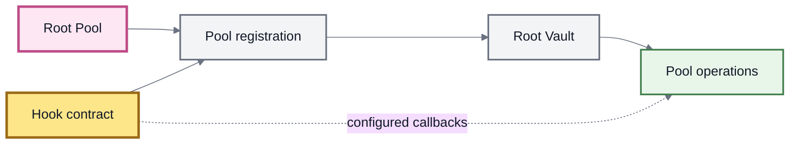

# Hooks

A **Hook** is a standalone contract that extends a Root Pool at specific points in its lifecycle.

Hooks let builders add behavior around an existing market without requiring the pool to reimplement the Root Vault, settlement system, routing infrastructure, or — in many cases — the underlying AMM mathematics.

The simplest mental model is:

```
Pool → defines the market
Hook → extends behavior around the market
Vault → coordinates the operation
```


**Hooks extend a market without automatically creating a new market model.**

A Weighted Pool with a dynamic-fee Hook is still using Weighted Pool mathematics. The Hook changes behavior around those mathematics.


This separation makes Hooks useful for creating specialized markets from reusable pool types.

### Pool logic vs Hook logic

A Root Pool and a Hook solve different problems.

| Component      | Primary responsibility                                                          |
| -------------- | ------------------------------------------------------------------------------- |
| **Root Pool**  | Pricing, invariant, balance mathematics, and other market-specific calculations |
| **Hook**       | Optional behavior executed at supported lifecycle points                        |
| **Root Vault** | Shared accounting, settlement, configuration, and operation coordination        |

For example:

```
Weighted Pool
      +
dynamic-fee Hook
      =
Weighted market with dynamic fee behavior
```

The Hook has not replaced the Weighted invariant.

It has extended how the market behaves while that invariant is being used.

This distinction becomes important when deciding between a **Hook** and a **Custom Pool**.

### How a Hook is connected to a pool

In the inherited v3 architecture, a Hook is connected to a pool during **pool registration**.

The registration process associates the Root Pool with a Hook contract and records which supported Hook callbacks should be used for that pool.



A pool can also be registered without a Hook.

In the inherited design, the **Hook association and callback configuration are established at registration and cannot later be replaced for that pool**.

A Hook contract itself can be reusable. The same contract can support multiple pools, including pools using different underlying pool types, if the Hook is designed to do so.


The pool-to-Hook connection being fixed does **not** necessarily mean every aspect of the Hook's behavior is permanently static.

A Hook is its own contract and may contain state, permissions, external dependencies, or other behavior defined by its implementation.

Users therefore need to reason about both the **Hook address** and the **Hook itself**.


### Lifecycle extension points

Hooks do not run everywhere.

The Vault invokes them only at lifecycle points supported by the Hook interface and enabled for the pool.

The inherited v3 Hook model exposes extension points around:

| Operation             | Hook opportunity                                              |
| --------------------- | ------------------------------------------------------------- |
| **Pool registration** | Validate or reject the pool–Hook association                  |
| **Initialization**    | Run logic before or after the pool receives its initial state |
| **Swap**              | Run logic before or after a swap                              |
| **Dynamic swap fee**  | Calculate the fee used for a particular swap                  |
| **Add liquidity**     | Run logic before or after liquidity enters the pool           |
| **Remove liquidity**  | Run logic before or after liquidity leaves the pool           |

The exact callback names, arguments, return values, and flags belong in the Hooks API.

### Before and after Hooks

Many lifecycle operations expose both a **before** and an **after** extension point.

Conceptually:

```
request
   ↓
before Hook
   ↓
core pool operation
   ↓
after Hook
   ↓
result
```

A **before Hook** runs before the core operation and can perform logic using the context available at that point.

An **after Hook** runs after the core pool operation has calculated or applied its result and can react to the resulting state.

The distinction matters because the information available before an operation is different from the information available after it.

For example, a swap Hook may need to observe the requested trade before execution, while another Hook may need the calculated result after pool math has run.

### Hooks can influence operation results

Hooks are more powerful than simple event listeners.

In the inherited v3 design, supported **after Hooks** can be configured to return **Hook-adjusted amounts**.

This allows a Hook to modify the calculated side of certain swap or liquidity operations.

Conceptually:

```
Pool calculation
      ↓
calculated amount
      ↓
After Hook
      ↓
adjusted calculated amount
```

This capability must be explicitly enabled in the pool's Hook configuration.

It is also deliberately constrained: Hook-adjusted amounts are not supported for every liquidity path or every possible value in an operation.


A Hook should not be described as arbitrary code that can rewrite any part of a pool operation.

Its authority is bounded by:

* the Hook interface;
* the callbacks enabled for the pool;
* the values each callback is allowed to return;
* Root Vault accounting and settlement rules;
* the Hook contract's implementation.

See Hooks API for the exact interface behavior.


### Dynamic fees are a Hook capability

One of the most important Hook patterns is **dynamic swap fees**.

Instead of using only a fixed fee value, a configured Hook can calculate the fee for an individual swap.

That calculation can use information available to the Hook to implement a market-specific fee policy.

For example, a strategy could vary fees according to market conditions, trade direction, or other explicitly supported inputs.

Dynamic fees are therefore an example of the broader Hook model:

```
same pool math
+
different Hook behavior
=
different market behavior
```

Dynamic fees are covered separately in Dynamic Fees.

### What Hooks can be used for

Hooks provide a general extension surface rather than one single feature.

Potential patterns include:

* **dynamic fee logic** that changes swap fees according to defined conditions;
* **policy or access logic** that accepts or rejects supported operations;
* **fee or discount mechanisms** using supported adjusted amounts;
* **observations and measurements** performed around market operations;
* **additional state or accounting logic** maintained by the Hook;
* **external integrations or automation** triggered through lifecycle behavior;
* **market-specific rules** that do not require replacing the underlying invariant.

These are architectural possibilities, not a statement that every pattern is deployed by ROOTSTOCK.

The actual Hook contracts available in a ROOTSTOCK release should be verified against the protocol's deployments and contract registry.

### Hook vs Custom Pool

The key question is **where the desired behavior belongs**.

|                                   | Hook                                         | Custom Pool                                  |
| --------------------------------- | -------------------------------------------- | -------------------------------------------- |
| **Changes the base invariant?**   | Usually no                                   | Yes, when required                           |
| **Extends lifecycle behavior?**   | Yes                                          | Can, but that is not its main purpose        |
| **Can reuse standard pool math?** | Yes                                          | Not necessarily                              |
| **Runs around operations?**       | Yes                                          | Pool math runs as part of the core operation |
| **Best fit**                      | New behavior around an existing market model | New pricing or invariant mathematics         |

Use a **Hook** when the underlying pool mathematics remain appropriate and the new behavior belongs around operations.

Use a **Custom Pool** when the market mathematics themselves need to change.

The two mechanisms are not mutually exclusive.

A Custom Pool can also use a Hook when it needs both custom mathematics and lifecycle extensions.

```
Standard Pool + Hook
Custom Pool
Custom Pool + Hook
```

These represent different layers of customization.

### Hooks are part of the pool's trust surface

A Hook can materially affect how a pool behaves.

That means identifying the pool type alone is not enough to fully understand the market.

Two pools can use the same underlying mathematics while having different Hook behavior.

For users and integrators, relevant properties can include:

| Property                           | Why it matters                                          |
| ---------------------------------- | ------------------------------------------------------- |
| **Hook contract**                  | Identifies the extension logic attached to the pool     |
| **Enabled callbacks**              | Determines where the Hook participates                  |
| **Dynamic fee capability**         | Can affect the fee applied to swaps                     |
| **Adjusted amounts**               | Can affect supported operation results                  |
| **Permissions**                    | May determine who can modify Hook-specific state        |
| **External calls or dependencies** | Can introduce additional assumptions                    |
| **Contract mutability**            | Determines whether behavior can change after deployment |

A pool created by a known factory should therefore not be evaluated solely from its invariant or factory provenance.

Its complete configuration matters.


Hooks execute inside economically sensitive workflows.

Builders must treat reentrancy, external calls, callback ordering, state assumptions, permissions, returned values, and failure behavior as part of the Hook's security model.

Exact execution and reentrancy semantics should be verified against the current Hooks API and deployed contracts rather than assumed from the word “Hook.”


See Trust Boundaries.

### What a Hook is not

A Hook is **not automatically a new AMM invariant**.

It is **not globally active across every Root Pool**.

It is **not synonymous with dynamic fees**; dynamic fees are only one Hook capability.

It is also **not an unrestricted override layer**. The Root Vault controls when Hooks are invoked and which returned values participate in protocol execution.

A useful final distinction is:

```
Pool      → What is the market?
Hook      → What happens around the market?
Vault     → How is the operation coordinated and settled?
Router    → How does the user enter the operation?
```

Keeping those layers separate makes the rest of the ROOTSTOCK architecture easier to reason about.


This page describes the **inherited v3 Hook architecture** used as the ROOTSTOCK design model.

Which Hook contracts, factories, and configurations are actually available in a specific ROOTSTOCK release should be determined from Deployments.


### Related pages

* Dynamic Fees
* Pool Configuration & Roles
* Build a Hook
* Hooks API
* Trust Boundaries
