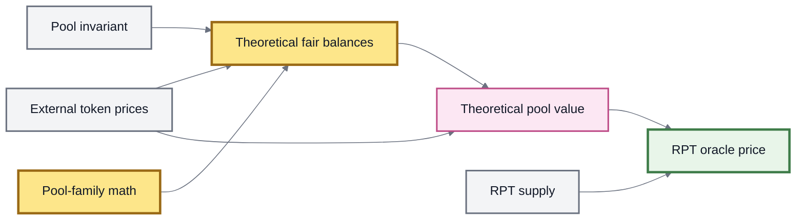

# RPT Valuation & Oracles

A **Root Pool Token (RPT)** represents proportional ownership in a Root Pool.

That tells us what the token **represents**.

It does not automatically tell us what the RPT is **worth**, nor how that value can be measured safely onchain.

The central distinction is:

```
ownership accounting
        ≠
safe market valuation
```

An RPT can represent valuable assets while still being unsafe to price using a naive balance calculation.


**RPT ownership is deterministic. RPT valuation is an oracle problem.**

The pool tells you what fraction of the market an RPT represents.

A valuation system must determine what that economic claim is worth.


### Several meanings of “RPT value”

The word **value** can refer to several different quantities.

<table><thead><tr><th width="248">Value</th><th>Meaning</th></tr></thead><tbody><tr><td><strong>Ownership share</strong></td><td>The fraction of the Root Pool represented by an RPT balance</td></tr><tr><td><strong>Accounting rate</strong></td><td>A pool-defined relationship such as invariant per unit of RPT</td></tr><tr><td><strong>Underlying-value estimate</strong></td><td>Estimated value of the assets economically represented by one RPT</td></tr><tr><td><strong>Oracle price</strong></td><td>A manipulation-resistant price intended for another onchain protocol</td></tr><tr><td><strong>Market price</strong></td><td>The price at which RPT trades externally</td></tr></tbody></table>

These values can be related.

They should not be treated as interchangeable.

### Informational underlying value

For dashboards and offchain analysis, the intuitive starting point is **net asset value**.

If:

```
Bᵢ = current balance of token i
Pᵢ = external price of token i
S  = relevant RPT supply
```

then:

```
informational pool value
    = Σ(Bᵢ × Pᵢ)

informational RPT value
    = Σ(Bᵢ × Pᵢ) / S
```

For example:

```
Pool holds:

100 Token A × $2   = $200
300 Token B × $1   = $300

Total value        = $500

RPT supply         = 100

Informational value per RPT
                   = $5
```

This is a useful way to display a pool.

It is not automatically a safe collateral oracle.


**Do not use naive pool-balance NAV as a manipulation-resistant onchain oracle merely because the calculation is easy.**

Balances can change within the transaction in which the price is consumed.


### Why onchain valuation is harder

Suppose a lending protocol accepts RPT as collateral.

If it computes:

```
RPT price =
current pool balances
×
current pool prices
÷
RPT supply
```

an attacker may try to manipulate one or more of those inputs before the lending protocol reads them.

Possible attack surfaces include:

* pool balance manipulation;
* spot-price manipulation;
* flash liquidity;
* temporary pool-state changes;
* transient RPT balances;
* manipulated or stale external feeds;
* incorrect rate-provider assumptions;
* unusual pool or Hook behavior.

The problem is therefore not simply:

> “What assets are in this pool?”

The harder question is:

> **“What value can another protocol safely attribute to this RPT under adversarial execution?”**

### The inherited v3 oracle model

Balancer v3's LP-token oracle design does not directly trust the pool's instantaneous token composition as the source of value.

Instead, it combines:

1. **external prices** for the pool assets;
2. the pool's **invariant**;
3. the pool family's mathematical properties;
4. the current RPT supply.

Conceptually:





The key idea is to derive a **theoretical pool state** consistent with both:

```
the actual invariant
        +
externally anchored market prices
```

rather than directly valuing whatever instantaneous balance ratio happens to exist.

### Two constraints

The inherited oracle model can be summarized using two constraints.

Let:

```
x̃ = theoretical token balances
D  = actual pool invariant
p  = vector of external token prices
```

#### Pool constraint

The theoretical balances must represent the same invariant:

```
F(x̃) = D
```

In other words, the theoretical state must remain consistent with the economic scale of the actual pool.

#### Price constraint

The marginal prices implied by those theoretical balances must align with externally supplied market prices.

Conceptually:

```
internal theoretical prices
        ∝
external oracle prices
```

Once a theoretical fair state has been found:

```
theoretical pool value
    = Σ(x̃ᵢ × Pᵢ)

RPT price
    = theoretical pool value / RPT supply
```

This is fundamentally different from simply multiplying the pool's current balances by current prices.

### Why use the invariant?

A pool's current token composition can be pushed away from its equilibrium state.

The invariant captures a deeper property of the AMM's mathematical state.

Using the invariant together with external prices allows the oracle to ask:

> **“What pool composition would be consistent with this invariant if the pool were priced according to the external market?”**

That theoretical composition can then be valued.

The exact calculation depends on the pool family.

### Oracle math depends on the pool family

There is no single universal RPT oracle formula for every possible AMM.

Different invariant families require different valuation mathematics.

The inherited v3 oracle package currently includes dedicated implementations for:

* **Weighted Pools** — `WeightedLPOracle`;
* **Stable Pools** — `StableLPOracle`;
* **Gyro E-CLP Pools** — `EclpLPOracle`.

The common structure is similar:

```
external prices
      +
pool-family invariant
      ↓
pool-family valuation math
      ↓
TVL
      ↓
TVL / RPT supply
      ↓
RPT price
```

But the method used to derive that TVL differs.

#### Weighted Pools

Weighted Pools use the weighted-product invariant.

Their oracle can use pool weights, the invariant, and externally anchored asset prices to determine a theoretical value without directly treating the current balance ratio as the market price.

#### Stable Pools

Stable Pools require different mathematics because their invariant includes the amplification parameter and is designed for assets expected to trade near a known relationship.

The inherited Stable oracle solves for the theoretical state compatible with:

* the Stable invariant; and
* the external token prices.

#### Other pool families

Concentrated or custom invariants may require their own valuation model.

A safe oracle for one pool family should not simply be assumed valid for another.


**Oracle compatibility is part of pool compatibility.**

A Custom Pool with new mathematics may also require a new RPT valuation model.


### RPT supply matters

Once pool value has been determined, it must be divided by the relevant RPT supply.

In the standard inherited v3 pool-token architecture:

```
RPT totalSupply()
        ↓
Vault pool-token accounting
```

The standard pool token delegates its supply accounting to the Vault.

This differs from some historical Balancer v2 designs.

#### Historical v2 supply mechanics

Some v2 pools used mechanisms such as:

* preminted BPT;
* virtual supply;
* actual supply calculations;
* BPT held by the pool itself.

Those mechanics affected which supply value was appropriate for valuation.

They should not be automatically transplanted into a v3-derived ROOTSTOCK model.


For ordinary v3-derived RPT, use the current pool implementation and Vault accounting as the source of truth.

Historical `getVirtualSupply()` or `getActualSupply()` assumptions belong to specific older pool architectures.


Custom ROOTSTOCK pool implementations can still introduce additional constraints, so an integration should always verify the actual implementation it accepts.

### Transient RPT is a separate risk

The v3 transient-accounting model creates another issue that did not exist in the same form in older architectures.

During an unlocked Vault interaction, extremely large **temporary RPT balances** can exist before settlement completes.

Those balances are valid intermediate accounting state.

They should not automatically be treated by an external lending system as permanently funded collateral.

Conceptually:

```
Vault locked
    ↓
ordinary RPT state

Vault unlocked
    ↓
transient accounting
    ↓
temporary RPT balance can exist
    ↓
Vault settles
    ↓
final RPT state
```

If an external protocol accepts the intermediate balance without protection:

```
temporary RPT
      ↓
deposit as collateral
      ↓
borrow real assets
```

the integration can become vulnerable even if its underlying RPT price formula is otherwise sound.

The retained v3 documentation explicitly treats this as a collateral-integration boundary.

### Locked-state protections

The inherited v3 architecture provides several ways for integrations to address transient RPT risk.

#### Oracle locked-state check

The upstream LP oracle base can be deployed with a setting that causes TVL-dependent oracle operations to revert while the Vault is unlocked.

Conceptually:

```
Vault locked?
   │
   ├─ yes → valuation allowed
   │
   └─ no  → revert
```

This prevents the oracle from being consumed during the transient Vault context when that protection is required.

#### Wrapped pool token

Upstream v3 also includes a wrapped pool-token form.

The wrapper exchanges pool tokens 1:1, but minting and burning are permitted only while the Vault is locked.

That creates a collateral representation that cannot be minted from transient RPT during an unlocked Vault operation.

#### Integration limits

A lending system can also impose explicit collateral or deposit limits.

This caps the amount of RPT the protocol will accept regardless of what temporary balance a caller can construct.


These protections solve related but different problems.

A locked-state oracle does not prevent RPT flash-borrowing from another external source.

A wrapper does not make bad constituent price feeds safe.

A deposit cap does not fix incorrect valuation mathematics.

Robust integrations generally require several independent assumptions to hold.


Whether equivalent safeguards are deployed by ROOTSTOCK must be verified against the current release rather than assumed from upstream availability.

### External price feeds are critical inputs

Invariant-based valuation does not remove the need for trustworthy asset prices.

It deliberately moves a major part of the pricing problem **outside the pool itself**.

A safe oracle therefore needs suitable price sources for the constituent assets.

Those sources should be evaluated for properties such as:

* manipulation resistance;
* freshness;
* market coverage;
* decimal handling;
* failure behavior;
* chain availability;
* sequencer assumptions where applicable;
* consistency of denomination.

All feeds also need to describe prices in compatible units.

For example:

```
Token A → USD
Token B → USD
Token C → USD
```

can be combined.

But mixing unrelated numeraires without conversion would produce an invalid pool valuation.

### Rate Providers complicate price feeds

Rate-bearing assets introduce an additional layer.

Suppose a registered pool asset is a wrapped token:

```
wrapped token
     ↓ Rate Provider
underlying-equivalent value
```

If the Vault's live accounting already incorporates that rate, the external price feed used by the RPT oracle must correspond to the **unit produced by the rate conversion**.

For example:

```
wrapped asset
    ↓
Rate Provider converts to ETH-equivalent units
    ↓
oracle feed should price ETH-equivalent units
```

Using another wrapped-asset conversion on top can double-count the rate.

Conversely, if the Rate Provider only converts one wrapper layer and leaves another economic layer intact, the price feed must match that remaining unit.

The rule is:

> **The external price feed and the Rate Provider must agree on what one unit represents.**

This relationship is explicitly called out in the inherited oracle design.

See Rate Providers.

### `getRate()` is not the same as an oracle price

Some v3-derived pools can expose a pool-token accounting rate conceptually based on:

```
pool-token rate
    =
invariant / RPT supply
```

That can be useful for accounting relationships.

It is not automatically the same thing as:

```
RPT / USD price
```

or another externally denominated market price.

A rate can tell you how the pool's invariant relates to one unit of RPT without telling you what that invariant is worth in an external market.

The distinction is especially important for Weighted Pools.

The current inherited Weighted Pool implementation deliberately rejects its generic `getRate()` valuation surface rather than presenting that rate as universally safe.


**Accounting rate ≠ collateral oracle.**

Never promote an RPT-related rate into a lending price merely because the function is available onchain.


### External RPT market price

An RPT can also trade in an external market.

For example:

```
RPT / USDC market
```

might imply an observed RPT price.

That is a different measurement from invariant-based underlying valuation.

```
oracle / underlying value
        ↕ arbitrage
external RPT market price
```

Arbitrage can connect the two when:

* RPT creation and redemption are available;
* the underlying assets are liquid;
* transaction costs are manageable;
* the external RPT market has sufficient liquidity;
* pool restrictions do not block the required strategy.

But divergence can still occur.

An external RPT market can itself be:

* thin;
* volatile;
* manipulable;
* temporarily disconnected from redemption value.

Therefore:

```
RPT trades at $X
```

does not alone establish that `$X` is a safe collateral oracle.

### Oracle freshness matters

RPT valuation inherits the freshness of its underlying price inputs.

If a pool contains three assets:

```
Token A feed updated now
Token B feed updated 30 seconds ago
Token C feed updated 20 minutes ago
```

the effective valuation is only as current as the assumptions around the stale component allow.

The inherited v3 oracle base can propagate the oldest constituent feed timestamp through its Chainlink-compatible interface.

That gives integrations information they can use to apply their own freshness requirements.

A safe consumer should define what happens when:

* a feed is stale;
* a feed returns an invalid value;
* a network sequencer is unavailable;
* a required oracle is missing;
* constituent feeds disagree with expected denominations.

### Hooks and custom pools expand the valuation surface

ROOTSTOCK's extensibility means two pools sharing a familiar invariant can still have different behavior around operations.

Hooks may affect:

* fees;
* operation results;
* pool state;
* external dependencies;
* access rules.

A Custom Pool can go further and change the market mathematics themselves.

That means oracle compatibility should be evaluated for the **complete pool design**, not inferred solely from a familiar factory name.

```
known invariant
    +
unknown extension behavior
    ≠
automatically known collateral risk
```

An inherited oracle implementation should only be used where its mathematical and operational assumptions still hold.

### Paused, recovery, and abnormal states

A mathematically valid price does not automatically imply that RPT should remain acceptable collateral under every protocol state.

An integration may also need policies for:

* paused pools;
* Recovery Mode;
* unavailable constituent feeds;
* broken or stale Rate Providers;
* abnormal invariant behavior;
* disabled liquidity paths;
* emergency controls;
* compromised external dependencies.

These are risk-policy decisions layered on top of valuation mathematics.

An oracle can answer:

> **“What price does this model currently calculate?”**

A lending protocol must separately decide:

> **“Under these conditions, should this asset still be accepted, and with what risk limits?”**

### A useful oracle checklist

A robust RPT valuation design should answer all of the following:

| Question                                          | Why it matters                                         |
| ------------------------------------------------- | ------------------------------------------------------ |
| **Which pool family is this?**                    | Determines the applicable valuation mathematics        |
| **What invariant is being used?**                 | Anchors the theoretical pool state                     |
| **What RPT supply is valid?**                     | Determines value per ownership unit                    |
| **Where do constituent prices come from?**        | Supplies the external market anchor                    |
| **Are all feeds denominated consistently?**       | Prevents invalid value aggregation                     |
| **Are feeds fresh?**                              | Avoids pricing from obsolete market state              |
| **Are Rate Providers involved?**                  | Changes what each balance unit economically represents |
| **Can RPT be transient right now?**               | Critical for collateral integrations                   |
| **Can a Hook alter relevant behavior?**           | Expands the pool's economic assumptions                |
| **Is the oracle designed for this pool family?**  | Prevents applying the wrong mathematics                |
| **What happens during abnormal protocol states?** | Defines integration failure behavior                   |

No single answer to these questions is sufficient by itself.

Safe RPT pricing is a system of assumptions.

### What RPT valuation is not

A safe RPT oracle is **not** simply:

```
current balances × current pool spot price
```

It is **not** automatically the pool's `getRate()`.

It is **not** automatically an external RPT trading price.

It is **not** made safe merely because the underlying assets themselves have good price feeds.

And it is **not** universal across arbitrary Custom Pools.

The inherited v3 model is better summarized as:

```
external market prices
        +
pool-family mathematics
        +
invariant
        +
valid RPT supply
        +
transient-state protections
        ↓
manipulation-resistant RPT valuation
```


#### Never treat an AMM's manipulable instantaneous state as a trustworthy collateral oracle merely because it is easy to query.

Collateral valuation must remain safe under adversarial transactions, flash liquidity, transient accounting, and abnormal market states.



This page describes the **inherited v3 valuation architecture** used as the ROOTSTOCK design model.

Upstream v3 currently includes dedicated Weighted, Stable, and E-CLP oracle implementations and additional defenses for transient pool-token state.

Which oracle contracts, factories, wrappers, feeds, and safeguards are actually deployed by a ROOTSTOCK release must be verified against that release's contracts and deployment registry.


### Related pages

* Root Pool Tokens
* Rate Providers
* Accounting & Settlement
* Hooks
* Security Model
* Trust Boundaries
